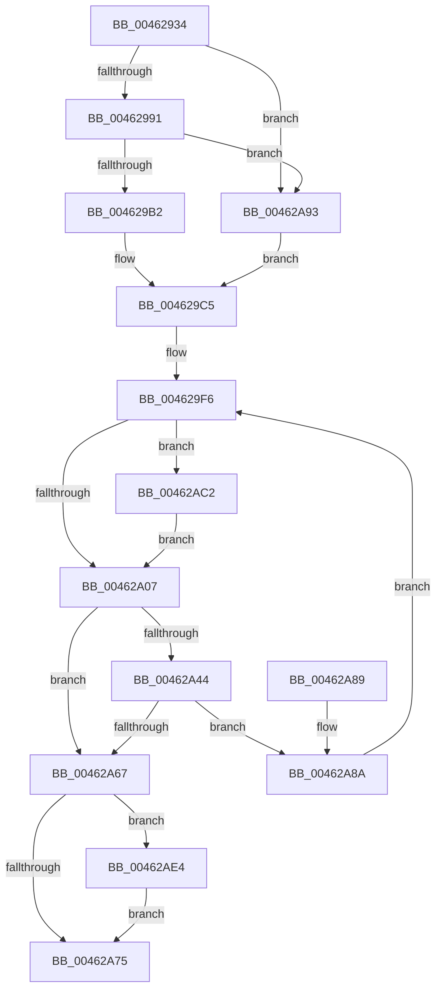

# HvlMapGpaPages

- RVA: `0x00462934`–`0x00462AF1` (길이 `445` bytes)
- VA: `0x0000000140462934`
- 실행 섹션: `.text`
- PDB 이름 있음: `예`; PDB Function 태그: `아니요`
- unwind 정보 RVA: `0x000AA3A8`
- 디코드: `119`개 명령, `445/445` bytes 표시
- 미해석 바이트: `0` (있으면 어셈블리에 `.byte`로 보존)

> 이 문서는 커널 이미지의 기계어와 PDB 기호를 분석해 생성했습니다. 4번과 5번은 함수 원형과 자료형을 바이너리 사용 방식에서 추정한 C 해석이며 원본 소스 복구 결과는 아닙니다.

## 1. Dependencies

- 직접 호출 지점: **6**; 고유 호출 대상: **6**
- 직접 호출자로 확인된 함수: **2**
- RIP 상대 이미지 참조: **1**

### Outgoing calls
- `0x004629A1` → [ExpInterlockedPopEntrySList](../6B/ExpInterlockedPopEntrySList_function_006BA570.md) (function, `0x006BA570`)
- `0x00462A37` → [HvcallInitiateHypercall](../31/HvcallInitiateHypercall_function_00313630.md) (function, `0x00313630`)
- `0x00462A6B` → [HvlpReleaseHypercallPage](../31/HvlpReleaseHypercallPage_function_00313480.md) (function, `0x00313480`)
- `0x00462A9A` → [KeDisableInterrupts](../21/KeDisableInterrupts_function_00217BE0.md) (function, `0x00217BE0`)
- `0x00462ADA` → [memcpy](../6C/memcpy_function_006C6840.md) (function, `0x006C6840`)
- `0x00462AE7` → [HvlpHvToNtStatus](../30/HvlpHvToNtStatus_function_00307BD8.md) (function, `0x00307BD8`)

### Direct callers
- [VmpInvalidateSingleGpaRange](VmpInvalidateSingleGpaRange_function_004628D8.md) at `0x00462913`
- [sub_006EE22C](../6E/Unknown_function_006EE22C.md) at `0x006EE255`

### Static image references
- `0x0046297F` → RVA `0x00FC6A90` (`ALMOSTRO`; read)

## 2. Other-region calls and transfers

- 다른 실행 섹션으로 향하는 call: **0**
- 별도 외부 분기/꼬리 이동을 확인하지 못했습니다.

## 3. Assembly (complete function range)

```asm
00462934  4C 89 4C 24 20                  mov qword ptr [rsp + 0x20], r9
00462939  48 89 54 24 10                  mov qword ptr [rsp + 0x10], rdx
0046293E  48 89 4C 24 08                  mov qword ptr [rsp + 8], rcx
00462943  55                              push rbp
00462944  53                              push rbx
00462945  56                              push rsi
00462946  57                              push rdi
00462947  41 54                           push r12
00462949  41 55                           push r13
0046294B  41 56                           push r14
0046294D  41 57                           push r15
0046294F  48 8B EC                        mov rbp, rsp
00462952  48 83 EC 58                     sub rsp, 0x58
00462956  4C 8B 6D 70                     mov r13, qword ptr [rbp + 0x70]
0046295A  33 C0                           xor eax, eax
0046295C  48 89 45 E0                     mov qword ptr [rbp - 0x20], rax
00462960  45 33 F6                        xor r14d, r14d
00462963  89 45 E8                        mov dword ptr [rbp - 0x18], eax
00462966  0F 57 C0                        xorps xmm0, xmm0
00462969  41 8B C0                        mov eax, r8d
0046296C  4D 8B F9                        mov r15, r9
0046296F  C1 F8 1F                        sar eax, 0x1f
00462972  41 8B D8                        mov ebx, r8d
00462975  83 E0 09                        and eax, 9
00462978  4D 89 75 00                     mov qword ptr [r13], r14
0046297C  89 45 70                        mov dword ptr [rbp + 0x70], eax
0046297F  8B 05 0B 41 B6 00               mov eax, dword ptr [rip + 0xb6410b]
00462985  0F 11 45 D0                     movups xmmword ptr [rbp - 0x30], xmm0
00462989  A8 08                           test al, 8
0046298B  0F 84 02 01 00 00               je 0x140462a93
00462991  65 48 8B 3C 25 20 00 00 00      mov rdi, qword ptr gs:[0x20]
0046299A  48 8D 8F C0 8B 00 00            lea rcx, [rdi + 0x8bc0]
004629A1  E8 CA 7B 25 00                  call 0x1406ba570
004629A6  48 8B F0                        mov rsi, rax
004629A9  48 85 C0                        test rax, rax
004629AC  0F 84 E1 00 00 00               je 0x140462a93
004629B2  4C 8B 60 10                     mov r12, qword ptr [rax + 0x10]
004629B6  C7 45 D0 01 00 00 00            mov dword ptr [rbp - 0x30], 1
004629BD  48 89 7D D8                     mov qword ptr [rbp - 0x28], rdi
004629C1  48 89 45 E0                     mov qword ptr [rbp - 0x20], rax
004629C5  4C 89 65 E8                     mov qword ptr [rbp - 0x18], r12
004629C9  BF 4B 00 00 00                  mov edi, 0x4b
004629CE  4C 89 76 08                     mov qword ptr [rsi + 8], r14
004629D2  44 89 76 14                     mov dword ptr [rsi + 0x14], r14d
004629D6  48 8B 45 48                     mov rax, qword ptr [rbp + 0x48]
004629DA  89 5E 10                        mov dword ptr [rsi + 0x10], ebx
004629DD  81 E3 00 00 03 00               and ebx, 0x30000
004629E3  89 5D 58                        mov dword ptr [rbp + 0x58], ebx
004629E6  49 8B 5D 00                     mov rbx, qword ptr [r13]
004629EA  48 89 06                        mov qword ptr [rsi], rax
004629ED  B8 FD 01 00 00                  mov eax, 0x1fd
004629F2  48 89 7D 48                     mov qword ptr [rbp + 0x48], rdi
004629F6  4C 3B F8                        cmp r15, rax
004629F9  4C 0F 43 F8                     cmovae r15, rax
004629FD  44 39 75 58                     cmp dword ptr [rbp + 0x58], r14d
00462A01  0F 84 BB 00 00 00               je 0x140462ac2
00462A07  8B 4D 70                        mov ecx, dword ptr [rbp + 0x70]
00462A0A  45 33 C0                        xor r8d, r8d
00462A0D  48 C1 EF 20                     shr rdi, 0x20
00462A11  49 8B D4                        mov rdx, r12
00462A14  44 33 FF                        xor r15d, edi
00462A17  48 D3 E3                        shl rbx, cl
00462A1A  48 03 5D 50                     add rbx, qword ptr [rbp + 0x50]
00462A1E  41 81 E7 FF 0F 00 00            and r15d, 0xfff
00462A25  44 33 FF                        xor r15d, edi
00462A28  48 89 5E 08                     mov qword ptr [rsi + 8], rbx
00462A2C  44 89 7D 4C                     mov dword ptr [rbp + 0x4c], r15d
00462A30  48 8B 7D 48                     mov rdi, qword ptr [rbp + 0x48]
00462A34  48 8B CF                        mov rcx, rdi
00462A37  E8 F4 0B EB FF                  call 0x140313630
00462A3C  48 8B D8                        mov rbx, rax
00462A3F  66 85 C0                        test ax, ax
00462A42  75 23                           jne 0x140462a67
00462A44  4C 8B 7D 60                     mov r15, qword ptr [rbp + 0x60]
00462A48  48 C1 E8 20                     shr rax, 0x20
00462A4C  25 FF 0F 00 00                  and eax, 0xfff
00462A51  49 01 45 00                     add qword ptr [r13], rax
00462A55  49 8B 45 00                     mov rax, qword ptr [r13]
00462A59  48 89 45 C8                     mov qword ptr [rbp - 0x38], rax
00462A5D  4C 2B F8                        sub r15, rax
00462A60  B8 FD 01 00 00                  mov eax, 0x1fd
00462A65  75 23                           jne 0x140462a8a
00462A67  48 8D 4D D0                     lea rcx, [rbp - 0x30]
00462A6B  E8 10 0A EB FF                  call 0x140313480
00462A70  66 85 DB                        test bx, bx
00462A73  75 6F                           jne 0x140462ae4
00462A75  41 8B C6                        mov eax, r14d
00462A78  48 83 C4 58                     add rsp, 0x58
00462A7C  41 5F                           pop r15
00462A7E  41 5E                           pop r14
00462A80  41 5D                           pop r13
00462A82  41 5C                           pop r12
00462A84  5F                              pop rdi
00462A85  5E                              pop rsi
00462A86  5B                              pop rbx
00462A87  5D                              pop rbp
00462A88  C3                              ret
00462A89  CC                              int3
00462A8A  48 8B 5D C8                     mov rbx, qword ptr [rbp - 0x38]
00462A8E  E9 63 FF FF FF                  jmp 0x1404629f6
00462A93  C7 45 D0 04 00 00 00            mov dword ptr [rbp - 0x30], 4
00462A9A  E8 41 51 DB FF                  call 0x140217be0
00462A9F  88 45 D8                        mov byte ptr [rbp - 0x28], al
00462AA2  65 48 8B 04 25 20 00 00 00      mov rax, qword ptr gs:[0x20]
00462AAB  C7 45 DC 01 00 00 00            mov dword ptr [rbp - 0x24], 1
00462AB2  48 8B B0 00 8C 00 00            mov rsi, qword ptr [rax + 0x8c00]
00462AB9  4C 8B 66 10                     mov r12, qword ptr [rsi + 0x10]
00462ABD  E9 03 FF FF FF                  jmp 0x1404629c5
00462AC2  48 8B 45 68                     mov rax, qword ptr [rbp + 0x68]
00462AC6  4E 8D 04 FD 00 00 00 00         lea r8, [r15*8]
00462ACE  49 8B 5D 00                     mov rbx, qword ptr [r13]
00462AD2  48 8D 4E 18                     lea rcx, [rsi + 0x18]
00462AD6  48 8D 14 D8                     lea rdx, [rax + rbx*8]
00462ADA  E8 61 3D 26 00                  call 0x1406c6840
00462ADF  E9 23 FF FF FF                  jmp 0x140462a07
00462AE4  0F B7 CB                        movzx ecx, bx
00462AE7  E8 EC 50 EA FF                  call 0x140307bd8
00462AEC  44 8B F0                        mov r14d, eax
00462AEF  EB 84                           jmp 0x140462a75
```

## 4. C-style interpretation (structured pseudocode)

```c
__int64 __fastcall HvlMapGpaPages(__int64 a1, __int64 a2, int a3, __int64 a4, __int64 a5, unsigned int a6)
{
    __int64 result;
    __int64 v_r14;
    __int64 v_r15;
    __int64 v_rbx;
    __int64 v_rdi;
    __int64 v_rsp;
    unsigned int v_stack_m58;
    unsigned __int64 v_stack_m60;
    unsigned int v_stack_m64;
    unsigned __int64 v_stack_m68;
    unsigned __int64 v_stack_m70;
    unsigned __int64 v_stack_m78;
    unsigned __int64 v_stack_p10;
    unsigned int v_stack_p18;
    unsigned __int64 v_stack_p20;
    unsigned int v_stack_p30;
    unsigned __int64 v_stack_p8;
    unsigned int v_stack_pC;

    v_stack_p20 = a4;
    v_stack_p10 = a2;
    v_stack_p8 = a1;
    v_rsp = (v_rsp) - (88);
    result = 0;
    v_stack_m60 = 0;
    v_r14 = 0;
    v_stack_m58 = 0;
    result = (unsigned int)(((unsigned int)(a3)) >> (31));
    result = (unsigned int)((result) & (9));
    *(unsigned __int64 *)(a6) = 0;
    v_stack_p30 = (unsigned int)(result);
    v_stack_m70 = v_xmm0;
    if ((((unsigned __int8)((unsigned int)(*(unsigned int *)(v_rip + 11944203)))) & (8)) == 0) goto loc_00462A93;
    result = ExpInterlockedPopEntrySList(*(unsigned __int64 *)(gs_base + (0 + 32)) + 35776, a2, a3, a4);
    if (result == 0) goto loc_00462A93;
    v_stack_m70 = 1;
    v_stack_m68 = *(unsigned __int64 *)(gs_base + (0 + 32));
    v_stack_m60 = result;
loc_004629C5:
    v_stack_m58 = *(unsigned __int64 *)(result + 16);
    *(unsigned __int64 *)(result + 8) = 0;
    *(unsigned int *)(result + 20) = 0;
    *(unsigned int *)(result + 16) = (unsigned int)((unsigned int)(a3));
    v_rbx = (unsigned int)(((unsigned int)(a3)) & (0x30000ULL));
    v_stack_p18 = (unsigned int)(v_rbx);
    *(unsigned __int64 *)(result) = v_stack_p8;
    v_stack_p8 = 75;
loc_004629F6:
    if (a4 >= 509) { a4 = 509; }
    if (v_stack_p18 == 0) goto loc_00462AC2;
loc_00462A07:
    a3 = 0;
    v_rdi = (75) >> (32);
    v_r15 = (unsigned int)((a4) ^ ((unsigned int)(v_rdi)));
    v_rbx = (*(unsigned __int64 *)(a6)) << ((unsigned __int8)((unsigned int)(a6)));
    v_rbx = (v_rbx) + (v_stack_p10);
    v_r15 = (unsigned int)((v_r15) & (0xFFFULL));
    v_r15 = (unsigned int)((v_r15) ^ ((unsigned int)(v_rdi)));
    *(unsigned __int64 *)(result + 8) = v_rbx;
    v_stack_pC = (unsigned int)(v_r15);
    result = HvcallInitiateHypercall(v_stack_p8, *(unsigned __int64 *)(result + 16), a3, a4);
    if ((unsigned __int16)(result) != 0) goto loc_00462A67;
    result = (result) >> (32);
    result = (unsigned int)((result) & (0xFFFULL));
    v_stack_m78 = *(unsigned __int64 *)(a6);
    v_r15 = (v_stack_p20) - (*(unsigned __int64 *)(a6));
    if (condition_is_not_equal) goto loc_00462A8A;
loc_00462A67:
    result = HvlpReleaseHypercallPage(v_stack_m70, *(unsigned __int64 *)(result + 16), a3, a4);
    if ((unsigned __int16)(result) != 0) goto loc_00462AE4;
loc_00462A75:
    v_rsp = (v_rsp) + (88);
    return 0;
loc_00462A8A:
    goto loc_004629F6;
loc_00462A93:
    v_stack_m70 = 4;
    result = KeDisableInterrupts(v_stack_m70, *(unsigned __int64 *)(result + 16), a3, a4);
    v_stack_m68 = (unsigned __int8)(result);
    v_stack_m64 = 1;
    goto loc_004629C5;
loc_00462AC2:
    result = memcpy(*(unsigned __int64 *)(*(unsigned __int64 *)(gs_base + (0 + 32)) + 35840) + 24, a5 + *(unsigned __int64 *)(a6) * 8, v_r15 * 8, a4);
    goto loc_00462A07;
loc_00462AE4:
    result = HvlpHvToNtStatus((unsigned __int16)(*(unsigned __int64 *)(a6)), a5 + *(unsigned __int64 *)(a6) * 8, v_r15 * 8, a4);
    goto loc_00462A75;
}
```

## 5. (Beta) C Style

```c
int64_t HvlMapGpaPages(int64_t Arg1, int64_t Arg2, int32_t Arg3, int64_t Arg4, void *Arg5, void *Arg6)
{
    uint8_t *arg5 = (uint8_t *)Arg5;
    uint8_t *arg6 = (uint8_t *)Arg6;

    int64_t result;
    int64_t local_r14;
    int64_t local_r15;
    int64_t local_rbx;
    int64_t local_rdi;
    int64_t local_rsp;
    uint32_t v_stack_m58;
    uint64_t v_stack_m60;
    uint32_t v_stack_m64;
    uint64_t v_stack_m68;
    uint64_t v_stack_m70;
    uint64_t v_stack_m78;
    uint64_t v_stack_p10;
    uint32_t v_stack_p18;
    uint64_t v_stack_p20;
    uint32_t v_stack_p30;
    uint64_t v_stack_p8;
    uint32_t v_stack_pC;

    v_stack_p20 = Arg4;
    v_stack_p10 = Arg2;
    v_stack_p8 = Arg1;
    local_rsp = (local_rsp) - (88);
    result = 0;
    v_stack_m60 = 0;
    local_r14 = 0;
    v_stack_m58 = 0;
    result = (uint32_t)(((uint32_t)(Arg3)) >> (31));
    result = (uint32_t)((result) & (9));
    *(uint64_t *)(arg6) = 0;
    v_stack_p30 = (uint32_t)(result);
    v_stack_m70 = v_xmm0;
    if ((((uint8_t)((uint32_t)(*(uint32_t *)(v_rip + 0xB6410B)))) & (8)) == 0) goto loc_00462A93;
    result = ExpInterlockedPopEntrySList(*(uint64_t *)(gs_base + (0 + 0x20)) + 35776, Arg2, Arg3, Arg4);
    if (result == 0) goto loc_00462A93;
    v_stack_m70 = 1;
    v_stack_m68 = *(uint64_t *)(gs_base + (0 + 0x20));
    v_stack_m60 = result;
loc_004629C5:
    v_stack_m58 = *(uint64_t *)(result + 0x10);
    *(uint64_t *)(result + 0x8) = 0;
    *(uint32_t *)(result + 0x14) = 0;
    *(uint32_t *)(result + 0x10) = (uint32_t)((uint32_t)(Arg3));
    local_rbx = (uint32_t)(((uint32_t)(Arg3)) & (0x30000ULL));
    v_stack_p18 = (uint32_t)(local_rbx);
    *(uint64_t *)(result) = v_stack_p8;
    v_stack_p8 = 75;
loc_004629F6:
    if (Arg4 >= 509) { Arg4 = 509; }
    if (v_stack_p18 == 0) goto loc_00462AC2;
loc_00462A07:
    Arg3 = 0;
    local_rdi = (75) >> (32);
    local_r15 = (uint32_t)((Arg4) ^ ((uint32_t)(local_rdi)));
    local_rbx = (*(uint64_t *)(arg6)) << ((uint8_t)((uint32_t)(Arg6)));
    local_rbx = (local_rbx) + (v_stack_p10);
    local_r15 = (uint32_t)((local_r15) & (0xFFFULL));
    local_r15 = (uint32_t)((local_r15) ^ ((uint32_t)(local_rdi)));
    *(uint64_t *)(result + 0x8) = local_rbx;
    v_stack_pC = (uint32_t)(local_r15);
    result = HvcallInitiateHypercall(v_stack_p8, *(uint64_t *)(result + 0x10), Arg3, Arg4);
    if ((uint16_t)(result) != 0) goto loc_00462A67;
    result = (result) >> (32);
    result = (uint32_t)((result) & (0xFFFULL));
    v_stack_m78 = *(uint64_t *)(arg6);
    local_r15 = (v_stack_p20) - (*(uint64_t *)(arg6));
    if (condition_is_not_equal) goto loc_00462A8A;
loc_00462A67:
    result = HvlpReleaseHypercallPage(v_stack_m70, *(uint64_t *)(result + 0x10), Arg3, Arg4);
    if ((uint16_t)(result) != 0) goto loc_00462AE4;
loc_00462A75:
    local_rsp = (local_rsp) + (88);
    return 0;
loc_00462A8A:
    goto loc_004629F6;
loc_00462A93:
    v_stack_m70 = 4;
    result = KeDisableInterrupts(v_stack_m70, *(uint64_t *)(result + 0x10), Arg3, Arg4);
    v_stack_m68 = (uint8_t)(result);
    v_stack_m64 = 1;
    goto loc_004629C5;
loc_00462AC2:
    result = memcpy(*(uint64_t *)(*(uint64_t *)(gs_base + (0 + 0x20)) + 0x8C00) + 24, Arg5 + *(uint64_t *)(arg6) * 8, local_r15 * 8, Arg4);
    goto loc_00462A07;
loc_00462AE4:
    result = HvlpHvToNtStatus((uint16_t)(*(uint64_t *)(arg6)), Arg5 + *(uint64_t *)(arg6) * 8, local_r15 * 8, Arg4);
    goto loc_00462A75;
}
```

### 관측된 메모리 오프셋

구조체 형식이 확인되지 않은 접근은 인자 기준의 오프셋으로만 기록했습니다.

| 기준 인자 | 오프셋 표현 | 폭 (bit) | 접근 |
|---|---:|---:|---|
| `Arg5` | `+ 0x0 + rbx*8` | `64` | `R` |
| `Arg6` | `+ 0x0` | `64` | `R` |
| `Arg6` | `+ 0x0` | `64` | `R/W` |
| `Arg6` | `+ 0x0` | `64` | `W` |

## 6. Execution-region graph

[열기: 2D/3D 그래프와 함수 탐색 컨트롤 패널](../../../control-panel.html?section=text&rva=0x00462934&view=graph)

- 2D 그래프는 위에서 아래로 흐르고, 3D 그래프는 빈 공간을 드래그해 회전합니다. Shift+드래그는 이동, 휠은 확대·축소, 함수 노드 선택은 대상 보고서 이동입니다.

### Static fallback


