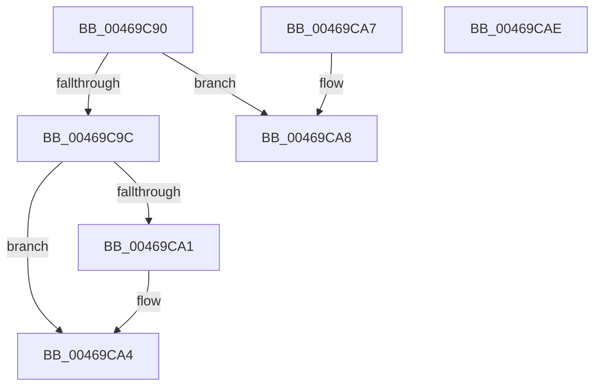

# HvlQueryConnection

- RVA: `0x00469C90`–`0x00469CAF` (길이 `31` bytes)
- VA: `0x0000000140469C90`
- 실행 섹션: `.text`
- PDB 이름 있음: `예`; PDB Function 태그: `아니요`
- unwind 정보 RVA: `0x000DB714`
- 디코드: `12`개 명령, `31/31` bytes 표시
- 미해석 바이트: `0` (있으면 어셈블리에 `.byte`로 보존)

> 이 문서는 커널 이미지의 기계어와 PDB 기호를 분석해 생성했습니다. 4번과 5번은 함수 원형과 자료형을 바이너리 사용 방식에서 추정한 C 해석이며 원본 소스 복구 결과는 아닙니다.

## 1. Dependencies

- 직접 호출 지점: **0**; 고유 호출 대상: **0**
- 직접 호출자로 확인된 함수: **2**
- RIP 상대 이미지 참조: **1**

### Outgoing calls
- 직접 디코드된 call 명령이 없습니다.

### Direct callers
- [HvlPhase0Initialize](../../page/71/HvlPhase0Initialize_function_00717AC8.md) at `0x00717AF8`
- [EtwpSysModuleRunDown](../../page/8A/EtwpSysModuleRunDown_function_008A43C0.md) at `0x008A44DA`

### Static image references
- `0x00469C90` → RVA `0x01201850` (`CFGRO`; read)

## 2. Other-region calls and transfers

- 다른 실행 섹션으로 향하는 call: **0**
- 별도 외부 분기/꼬리 이동을 확인하지 못했습니다.

## 3. Assembly (complete function range)

```asm
00469C90  48 8B 05 B9 7B D9 00            mov rax, qword ptr [rip + 0xd97bb9]
00469C97  48 85 C0                        test rax, rax
00469C9A  74 0C                           je 0x140469ca8
00469C9C  48 85 C9                        test rcx, rcx
00469C9F  74 03                           je 0x140469ca4
00469CA1  48 89 01                        mov qword ptr [rcx], rax
00469CA4  33 C0                           xor eax, eax
00469CA6  C3                              ret
00469CA7  CC                              int3
00469CA8  B8 01 00 00 C0                  mov eax, 0xc0000001
00469CAD  C3                              ret
00469CAE  CC                              int3
```

## 4. C-style interpretation (structured pseudocode)

```c
__int64 __fastcall HvlQueryConnection(__int64 a1)
{
    __int64 result;

    if (*(unsigned __int64 *)(v_rip + 14252985) == 0) goto loc_00469CA8;
    if (a1 != 0) {
        *(unsigned __int64 *)(a1) = *(unsigned __int64 *)(v_rip + 14252985);
    }
    result = 0;
    return result;
loc_00469CA8:
    return (unsigned int)(0xC0000001ULL);
}
```

## 5. (Beta) C Style

```c
int64_t HvlQueryConnection(int64_t Arg1)
{
    int64_t result;

    if (*(uint64_t *)(v_rip + 0xD97BB9) == 0) goto loc_00469CA8;
    if (Arg1 != 0) {
        *(uint64_t *)(Arg1) = *(uint64_t *)(v_rip + 0xD97BB9);
    }
    result = 0;
    return result;
loc_00469CA8:
    return (uint32_t)(0xC0000001ULL);
}
```

## 6. Execution-region graph

[열기: 2D/3D 그래프와 함수 탐색 컨트롤 패널](../../../control-panel.html?section=text&rva=0x00469C90&view=graph)

- 2D 그래프는 위에서 아래로 흐르고, 3D 그래프는 빈 공간을 드래그해 회전합니다. Shift+드래그는 이동, 휠은 확대·축소, 함수 노드 선택은 대상 보고서 이동입니다.

### Static fallback


