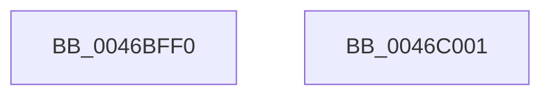

# IoClearActivityIdThread

- RVA: `0x0046BFF0`–`0x0046C002` (길이 `18` bytes)
- VA: `0x000000014046BFF0`
- 실행 섹션: `.text`
- PDB 이름 있음: `예`; PDB Function 태그: `아니요`
- unwind 정보 RVA: `0x000DB714`
- 디코드: `4`개 명령, `18/18` bytes 표시
- 미해석 바이트: `0` (있으면 어셈블리에 `.byte`로 보존)

> 이 문서는 커널 이미지의 기계어와 PDB 기호를 분석해 생성했습니다. 4번과 5번은 함수 원형과 자료형을 바이너리 사용 방식에서 추정한 C 해석이며 원본 소스 복구 결과는 아닙니다.

## 1. Dependencies

- 직접 호출 지점: **0**; 고유 호출 대상: **0**
- 직접 호출자로 확인된 함수: **10**
- RIP 상대 이미지 참조: **0**

### Outgoing calls
- 직접 디코드된 call 명령이 없습니다.

### Direct callers
- [PopAdaptiveStandbyActionWorker](../../page/76/PopAdaptiveStandbyActionWorker_function_0076C9B0.md) at `0x0076CAFC`
- [PopAdaptiveStandbyHandlePowerMessage](../../page/76/PopAdaptiveStandbyHandlePowerMessage_function_0076DB70.md) at `0x0076DDC4`
- [PopAdaptiveStandbyInitialize](../../page/76/PopAdaptiveStandbyInitialize_function_0076DDF8.md) at `0x0076E140`
- [PopAdaptiveStandbyInitializeActivator](../../page/76/PopAdaptiveStandbyInitializeActivator_function_0076E174.md) at `0x0076E29C`
- [PopAdaptiveStandbyNotifyShellPhaseState](../../page/76/PopAdaptiveStandbyNotifyShellPhaseState_function_0076E2CC.md) at `0x0076E3DC`
- [PopAdaptiveStandbyPolicyTimerWorker](../../page/76/PopAdaptiveStandbyPolicyTimerWorker_function_0076E410.md) at `0x0076E503`
- [PopAdaptiveStandbyPowerSettingCallback](../../page/76/PopAdaptiveStandbyPowerSettingCallback_function_0076E530.md) at `0x0076E6A5`
- [PopAdaptiveStandbyWnfCallback](../../page/76/PopAdaptiveStandbyWnfCallback_function_0076F910.md) at `0x0076FEAA`
- [PiDqIrpQueryCreate](../../page/8D/PiDqIrpQueryCreate_function_008DCC04.md) at `0x008DCE78`
- [PiDqObjectManagerServiceActionQueue](../../page/8D/PiDqObjectManagerServiceActionQueue_function_008DD640.md) at `0x008DD96D`

### Static image references
- 디코드된 RIP-relative 메모리 참조가 없습니다.

## 2. Other-region calls and transfers

- 다른 실행 섹션으로 향하는 call: **0**
- 별도 외부 분기/꼬리 이동을 확인하지 못했습니다.

## 3. Assembly (complete function range)

```asm
0046BFF0  65 48 8B 04 25 88 01 00 00      mov rax, qword ptr gs:[0x188]
0046BFF9  48 89 88 30 06 00 00            mov qword ptr [rax + 0x630], rcx
0046C000  C3                              ret
0046C001  CC                              int3
```

## 4. C-style interpretation (structured pseudocode)

```c
__int64 __fastcall IoClearActivityIdThread(__int64 a1)
{
    *(unsigned __int64 *)(*(unsigned __int64 *)(gs_base + (0 + 392)) + 1584) = a1;
    return *(unsigned __int64 *)(gs_base + (0 + 392));
}
```

## 5. (Beta) C Style

```c
int64_t IoClearActivityIdThread(int64_t Arg1)
{
    *(uint64_t *)(*(uint64_t *)(gs_base + (0 + 0x188)) + 0x630) = Arg1;
    return *(uint64_t *)(gs_base + (0 + 0x188));
}
```

## 6. Execution-region graph

[열기: 2D/3D 그래프와 함수 탐색 컨트롤 패널](../../../control-panel.html?section=text&rva=0x0046BFF0&view=graph)

- 2D 그래프는 위에서 아래로 흐르고, 3D 그래프는 빈 공간을 드래그해 회전합니다. Shift+드래그는 이동, 휠은 확대·축소, 함수 노드 선택은 대상 보고서 이동입니다.

### Static fallback


