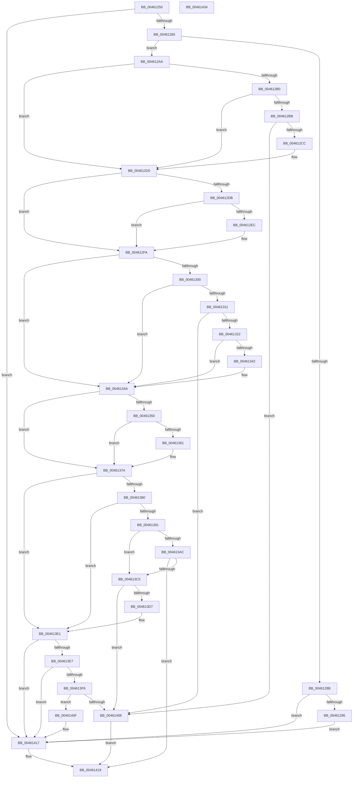

# IoPropagateIrpExtensionEx

- RVA: `0x00461250`–`0x00461435` (길이 `485` bytes)
- VA: `0x0000000140461250`
- 실행 섹션: `.text`
- PDB 이름 있음: `예`; PDB Function 태그: `아니요`
- unwind 정보 RVA: `0x0005D7BC`
- 디코드: `133`개 명령, `485/485` bytes 표시
- 미해석 바이트: `0` (있으면 어셈블리에 `.byte`로 보존)

> 이 문서는 커널 이미지의 기계어와 PDB 기호를 분석해 생성했습니다. 4번과 5번은 함수 원형과 자료형을 바이너리 사용 방식에서 추정한 C 해석이며 원본 소스 복구 결과는 아닙니다.

## 1. Dependencies

- 직접 호출 지점: **15**; 고유 호출 대상: **4**
- 직접 호출자로 확인된 함수: **1**
- RIP 상대 이미지 참조: **0**

### Outgoing calls
- `0x0046129D` → [IopAllocateIrpExtension](../44/IopAllocateIrpExtension_function_00444F30.md) (function, `0x00444F30`)
- `0x004612B2` → [IopIrpHasExtensionType](../3F/IopIrpHasExtensionType_function_003F4080.md) (function, `0x003F4080`)
- `0x004612BE` → [IopAllocateIrpExtension](../44/IopAllocateIrpExtension_function_00444F30.md) (function, `0x00444F30`)
- `0x004612E3` → [IopIrpHasExtensionType](../3F/IopIrpHasExtensionType_function_003F4080.md) (function, `0x003F4080`)
- `0x004612EF` → [IopAllocateIrpExtension](../44/IopAllocateIrpExtension_function_00444F30.md) (function, `0x00444F30`)
- `0x00461308` → [IopIrpHasExtensionType](../3F/IopIrpHasExtensionType_function_003F4080.md) (function, `0x003F4080`)
- `0x00461314` → [IopAllocateIrpExtension](../44/IopAllocateIrpExtension_function_00444F30.md) (function, `0x00444F30`)
- `0x00461345` → [guard_dispatch_icall](../6B/guard_dispatch_icall_function_006BAAD0.md) (function, `0x006BAAD0`)
- `0x00461358` → [IopIrpHasExtensionType](../3F/IopIrpHasExtensionType_function_003F4080.md) (function, `0x003F4080`)
- `0x00461375` → [IopSetDiskIoAttributionExtension](../29/IopSetDiskIoAttributionExtension_function_0029C0E4.md) (function, `0x0029C0E4`)
- `0x00461388` → [IopIrpHasExtensionType](../3F/IopIrpHasExtensionType_function_003F4080.md) (function, `0x003F4080`)
- `0x004613BC` → [guard_dispatch_icall](../6B/guard_dispatch_icall_function_006BAAD0.md) (function, `0x006BAAD0`)
- `0x004613CD` → [IopAllocateIrpExtension](../44/IopAllocateIrpExtension_function_00444F30.md) (function, `0x00444F30`)
- `0x004613EF` → [IopIrpHasExtensionType](../3F/IopIrpHasExtensionType_function_003F4080.md) (function, `0x003F4080`)
- `0x004613FB` → [IopAllocateIrpExtension](../44/IopAllocateIrpExtension_function_00444F30.md) (function, `0x00444F30`)

### Direct callers
- [IoPropagateIrpExtension](IoPropagateIrpExtension_function_00461230.md) at `0x0046123A`

### Static image references
- 디코드된 RIP-relative 메모리 참조가 없습니다.

## 2. Other-region calls and transfers

- 다른 실행 섹션으로 향하는 call: **0**
- 별도 외부 분기/꼬리 이동을 확인하지 못했습니다.

## 3. Assembly (complete function range)

```asm
00461250  48 8B C4                        mov rax, rsp
00461253  48 89 58 08                     mov qword ptr [rax + 8], rbx
00461257  48 89 68 10                     mov qword ptr [rax + 0x10], rbp
0046125B  48 89 70 18                     mov qword ptr [rax + 0x18], rsi
0046125F  48 89 78 20                     mov qword ptr [rax + 0x20], rdi
00461263  41 56                           push r14
00461265  48 83 EC 30                     sub rsp, 0x30
00461269  48 8B 99 C8 00 00 00            mov rbx, qword ptr [rcx + 0xc8]
00461270  41 8B F9                        mov edi, r9d
00461273  4D 8B F0                        mov r14, r8
00461276  48 8B EA                        mov rbp, rdx
00461279  48 8B F1                        mov rsi, rcx
0046127C  48 85 DB                        test rbx, rbx
0046127F  0F 84 92 01 00 00               je 0x140461417
00461285  80 79 47 00                     cmp byte ptr [rcx + 0x47], 0
00461289  7D 1F                           jge 0x1404612aa
0046128B  40 F6 C7 01                     test dil, 1
0046128F  0F 84 82 01 00 00               je 0x140461417
00461295  BA 02 00 00 00                  mov edx, 2
0046129A  48 8B CD                        mov rcx, rbp
0046129D  E8 8E 3C FE FF                  call 0x140444f30
004612A2  89 58 04                        mov dword ptr [rax + 4], ebx
004612A5  E9 6D 01 00 00                  jmp 0x140461417
004612AA  40 F6 C7 02                     test dil, 2
004612AE  74 25                           je 0x1404612d5
004612B0  33 D2                           xor edx, edx
004612B2  E8 C9 2D F9 FF                  call 0x1403f4080
004612B7  84 C0                           test al, al
004612B9  74 1A                           je 0x1404612d5
004612BB  48 8B CD                        mov rcx, rbp
004612BE  E8 6D 3C FE FF                  call 0x140444f30
004612C3  48 85 C0                        test rax, rax
004612C6  0F 84 3C 01 00 00               je 0x140461408
004612CC  0F 10 43 18                     movups xmm0, xmmword ptr [rbx + 0x18]
004612D0  F3 0F 7F 40 18                  movdqu xmmword ptr [rax + 0x18], xmm0
004612D5  40 F6 C7 01                     test dil, 1
004612D9  74 1F                           je 0x1404612fa
004612DB  BA 02 00 00 00                  mov edx, 2
004612E0  48 8B CE                        mov rcx, rsi
004612E3  E8 98 2D F9 FF                  call 0x1403f4080
004612E8  84 C0                           test al, al
004612EA  74 0E                           je 0x1404612fa
004612EC  48 8B CD                        mov rcx, rbp
004612EF  E8 3C 3C FE FF                  call 0x140444f30
004612F4  8B 4B 04                        mov ecx, dword ptr [rbx + 4]
004612F7  89 48 04                        mov dword ptr [rax + 4], ecx
004612FA  40 F6 C7 04                     test dil, 4
004612FE  74 4A                           je 0x14046134a
00461300  BA 05 00 00 00                  mov edx, 5
00461305  48 8B CE                        mov rcx, rsi
00461308  E8 73 2D F9 FF                  call 0x1403f4080
0046130D  84 C0                           test al, al
0046130F  74 39                           je 0x14046134a
00461311  48 8B CD                        mov rcx, rbp
00461314  E8 17 3C FE FF                  call 0x140444f30
00461319  48 85 C0                        test rax, rax
0046131C  0F 84 E6 00 00 00               je 0x140461408
00461322  48 8B 53 30                     mov rdx, qword ptr [rbx + 0x30]
00461326  49 03 D6                        add rdx, r14
00461329  48 89 50 30                     mov qword ptr [rax + 0x30], rdx
0046132D  48 8B 53 28                     mov rdx, qword ptr [rbx + 0x28]
00461331  48 89 50 28                     mov qword ptr [rax + 0x28], rdx
00461335  48 8B 4B 28                     mov rcx, qword ptr [rbx + 0x28]
00461339  48 8B 41 08                     mov rax, qword ptr [rcx + 8]
0046133D  48 85 C0                        test rax, rax
00461340  74 08                           je 0x14046134a
00461342  4D 8B C6                        mov r8, r14
00461345  E8 86 97 25 00                  call 0x1406baad0
0046134A  40 F6 C7 08                     test dil, 8
0046134E  74 2A                           je 0x14046137a
00461350  BA 06 00 00 00                  mov edx, 6
00461355  48 8B CE                        mov rcx, rsi
00461358  E8 23 2D F9 FF                  call 0x1403f4080
0046135D  84 C0                           test al, al
0046135F  74 19                           je 0x14046137a
00461361  65 4C 8B 04 25 88 01 00 00      mov r8, qword ptr gs:[0x188]
0046136A  44 8D 4A FB                     lea r9d, [rdx - 5]
0046136E  48 8B 53 10                     mov rdx, qword ptr [rbx + 0x10]
00461372  48 8B CD                        mov rcx, rbp
00461375  E8 6A AD E3 FF                  call 0x14029c0e4
0046137A  40 F6 C7 10                     test dil, 0x10
0046137E  74 61                           je 0x1404613e1
00461380  BA 07 00 00 00                  mov edx, 7
00461385  48 8B CE                        mov rcx, rsi
00461388  E8 F3 2C F9 FF                  call 0x1403f4080
0046138D  84 C0                           test al, al
0046138F  74 50                           je 0x1404613e1
00461391  0F 57 C0                        xorps xmm0, xmm0
00461394  0F 11 44 24 20                  movups xmmword ptr [rsp + 0x20], xmm0
00461399  48 8B 4B 30                     mov rcx, qword ptr [rbx + 0x30]
0046139D  0F 10 4B 28                     movups xmm1, xmmword ptr [rbx + 0x28]
004613A1  F3 0F 7F 4C 24 20               movdqu xmmword ptr [rsp + 0x20], xmm1
004613A7  48 85 C9                        test rcx, rcx
004613AA  74 19                           je 0x1404613c5
004613AC  48 8B 41 60                     mov rax, qword ptr [rcx + 0x60]
004613B0  48 8D 54 24 20                  lea rdx, [rsp + 0x20]
004613B5  48 8B 49 68                     mov rcx, qword ptr [rcx + 0x68]
004613B9  4D 8B C6                        mov r8, r14
004613BC  E8 0F 97 25 00                  call 0x1406baad0
004613C1  85 C0                           test eax, eax
004613C3  78 54                           js 0x140461419
004613C5  BA 07 00 00 00                  mov edx, 7
004613CA  48 8B CD                        mov rcx, rbp
004613CD  E8 5E 3B FE FF                  call 0x140444f30
004613D2  48 85 C0                        test rax, rax
004613D5  74 31                           je 0x140461408
004613D7  0F 10 44 24 20                  movups xmm0, xmmword ptr [rsp + 0x20]
004613DC  F3 0F 7F 40 28                  movdqu xmmword ptr [rax + 0x28], xmm0
004613E1  40 F6 C7 20                     test dil, 0x20
004613E5  74 30                           je 0x140461417
004613E7  BA 08 00 00 00                  mov edx, 8
004613EC  48 8B CE                        mov rcx, rsi
004613EF  E8 8C 2C F9 FF                  call 0x1403f4080
004613F4  84 C0                           test al, al
004613F6  74 1F                           je 0x140461417
004613F8  48 8B CD                        mov rcx, rbp
004613FB  E8 30 3B FE FF                  call 0x140444f30
00461400  48 8B C8                        mov rcx, rax
00461403  48 85 C0                        test rax, rax
00461406  75 07                           jne 0x14046140f
00461408  B8 9A 00 00 C0                  mov eax, 0xc000009a
0046140D  EB 0A                           jmp 0x140461419
0046140F  48 8B 43 38                     mov rax, qword ptr [rbx + 0x38]
00461413  48 89 41 38                     mov qword ptr [rcx + 0x38], rax
00461417  33 C0                           xor eax, eax
00461419  48 8B 5C 24 40                  mov rbx, qword ptr [rsp + 0x40]
0046141E  48 8B 6C 24 48                  mov rbp, qword ptr [rsp + 0x48]
00461423  48 8B 74 24 50                  mov rsi, qword ptr [rsp + 0x50]
00461428  48 8B 7C 24 58                  mov rdi, qword ptr [rsp + 0x58]
0046142D  48 83 C4 30                     add rsp, 0x30
00461431  41 5E                           pop r14
00461433  C3                              ret
00461434  CC                              int3
```

## 4. C-style interpretation (structured pseudocode)

```c
__int64 __fastcall IoPropagateIrpExtensionEx(__int64 a1, __int64 a2, __int64 a3, int a4)
{
    __int64 result;
    __int64 v_rsp;
    unsigned __int64 v_stack_m18;
    unsigned __int64 v_stack_p10;
    unsigned __int64 v_stack_p18;
    unsigned __int64 v_stack_p20;
    unsigned __int64 v_stack_p8;

    *(unsigned __int64 *)(v_rsp + 8) = v_rbx;
    *(unsigned __int64 *)(v_rsp + 16) = v_rbp;
    *(unsigned __int64 *)(v_rsp + 24) = v_rsi;
    *(unsigned __int64 *)(v_rsp + 32) = v_rdi;
    v_rsp = (v_rsp) - (48);
    if (*(unsigned __int64 *)(a1 + 200) == 0) goto loc_00461417;
    if ((*(unsigned __int8 *)(a1 + 71)) >= 0) goto loc_004612AA;
    if ((((unsigned __int8)((unsigned int)(a4))) & (1)) == 0) goto loc_00461417;
    result = IopAllocateIrpExtension(a2, 2, a3, a4);
    *(unsigned int *)(result + 4) = (unsigned int)(*(unsigned __int64 *)(a1 + 200));
    goto loc_00461417;
loc_004612AA:
    if ((((unsigned __int8)((unsigned int)(a4))) & (2)) == 0) goto loc_004612D5;
    a2 = 0;
    result = IopIrpHasExtensionType(a2, a2, a3, a4);
    if ((unsigned __int8)(result) == 0) goto loc_004612D5;
    result = IopAllocateIrpExtension(0, a2, a3, a4);
    if (result == 0) goto loc_00461408;
    *(unsigned __int64 *)(result + 24) = v_xmm0;
loc_004612D5:
    if ((((unsigned __int8)((unsigned int)(a4))) & (1)) == 0) goto loc_004612FA;
    result = IopIrpHasExtensionType(a1, 2, a3, a4);
    if ((unsigned __int8)(result) != 0) {
        a1 = 0;
        result = IopAllocateIrpExtension(a1, 2, a3, a4);
        a1 = *(unsigned int *)(*(unsigned __int64 *)(a1 + 200) + 4);
        *(unsigned int *)(result + 4) = (unsigned int)(a1);
    }
    if ((((unsigned __int8)((unsigned int)(a4))) & (4)) == 0) goto loc_0046134A;
    result = IopIrpHasExtensionType(a1, 5, a3, a4);
    if ((unsigned __int8)(result) == 0) goto loc_0046134A;
    result = IopAllocateIrpExtension(0, 5, a3, a4);
    if (result == 0) goto loc_00461408;
    a2 = (*(unsigned __int64 *)(*(unsigned __int64 *)(a1 + 200) + 48)) + (a3);
    *(unsigned __int64 *)(result + 48) = a2;
    *(unsigned __int64 *)(result + 40) = *(unsigned __int64 *)(*(unsigned __int64 *)(a1 + 200) + 40);
    result = *(unsigned __int64 *)(*(unsigned __int64 *)(*(unsigned __int64 *)(a1 + 200) + 40) + 8);
    if (*(unsigned __int64 *)(*(unsigned __int64 *)(*(unsigned __int64 *)(a1 + 200) + 40) + 8) != 0) {
        a3 = a3;
        result = guard_dispatch_icall(*(unsigned __int64 *)(*(unsigned __int64 *)(a1 + 200) + 40), *(unsigned __int64 *)(*(unsigned __int64 *)(a1 + 200) + 40), a3, a4);
    }
    if ((((unsigned __int8)((unsigned int)(a4))) & (8)) == 0) goto loc_0046137A;
    result = IopIrpHasExtensionType(a1, 6, a3, a4);
    if ((unsigned __int8)(result) != 0) {
        a3 = *(unsigned __int64 *)(gs_base + (0 + 392));
        a4 = 6 - 5;
        a2 = *(unsigned __int64 *)(*(unsigned __int64 *)(a1 + 200) + 16);
        a1 = a2;
        result = IopSetDiskIoAttributionExtension(a1, a2, a3, a4);
    }
    if ((((unsigned __int8)((unsigned int)(a4))) & (16)) == 0) goto loc_004613E1;
    result = IopIrpHasExtensionType(a1, 7, a3, a4);
    if ((unsigned __int8)(result) == 0) goto loc_004613E1;
    v_stack_m18 = v_xmm0;
    v_stack_m18 = v_xmm1;
    if (*(unsigned __int64 *)(*(unsigned __int64 *)(a1 + 200) + 48) == 0) goto loc_004613C5;
    result = guard_dispatch_icall(*(unsigned __int64 *)(*(unsigned __int64 *)(*(unsigned __int64 *)(a1 + 200) + 48) + 104), v_stack_m18, a3, a4);
    if (sign_flag) goto loc_00461419;
loc_004613C5:
    result = IopAllocateIrpExtension(a2, 7, a3, a4);
    if (result == 0) goto loc_00461408;
    *(unsigned __int64 *)(result + 40) = v_xmm0;
loc_004613E1:
    if ((((unsigned __int8)((unsigned int)(a4))) & (32)) == 0) goto loc_00461417;
    result = IopIrpHasExtensionType(a1, 8, a3, a4);
    if ((unsigned __int8)(result) == 0) goto loc_00461417;
    result = IopAllocateIrpExtension(a2, 8, a3, a4);
    if (result != 0) goto loc_0046140F;
loc_00461408:
    goto loc_00461419;
loc_0046140F:
    *(unsigned __int64 *)(result + 56) = *(unsigned __int64 *)(*(unsigned __int64 *)(a1 + 200) + 56);
loc_00461417:
    result = 0;
loc_00461419:
    v_rsp = (v_rsp) + (48);
    return result;
}
```

## 5. (Beta) C Style

```c
int64_t IoPropagateIrpExtensionEx(void *Arg1, int64_t Arg2, int64_t Arg3, int32_t Arg4)
{
    uint8_t *arg1 = (uint8_t *)Arg1;

    int64_t result;
    int64_t local_rsp;
    uint64_t v_stack_m18;
    uint64_t v_stack_p10;
    uint64_t v_stack_p18;
    uint64_t v_stack_p20;
    uint64_t v_stack_p8;

    *(uint64_t *)(local_rsp + 0x8) = local_rbx;
    *(uint64_t *)(local_rsp + 0x10) = local_rbp;
    *(uint64_t *)(local_rsp + 0x18) = local_rsi;
    *(uint64_t *)(local_rsp + 0x20) = local_rdi;
    local_rsp = (local_rsp) - (48);
    if (*(uint64_t *)(arg1 + 0xC8) == 0) goto loc_00461417;
    if ((*(uint8_t *)(arg1 + 0x47)) >= 0) goto loc_004612AA;
    if ((((uint8_t)((uint32_t)(Arg4))) & (1)) == 0) goto loc_00461417;
    result = IopAllocateIrpExtension(Arg2, 2, Arg3, Arg4);
    *(uint32_t *)(result + 0x4) = (uint32_t)(*(uint64_t *)(arg1 + 0xC8));
    goto loc_00461417;
loc_004612AA:
    if ((((uint8_t)((uint32_t)(Arg4))) & (2)) == 0) goto loc_004612D5;
    Arg2 = 0;
    result = IopIrpHasExtensionType(Arg2, Arg2, Arg3, Arg4);
    if ((uint8_t)(result) == 0) goto loc_004612D5;
    result = IopAllocateIrpExtension(0, Arg2, Arg3, Arg4);
    if (result == 0) goto loc_00461408;
    *(uint64_t *)(result + 0x18) = v_xmm0;
loc_004612D5:
    if ((((uint8_t)((uint32_t)(Arg4))) & (1)) == 0) goto loc_004612FA;
    result = IopIrpHasExtensionType(Arg1, 2, Arg3, Arg4);
    if ((uint8_t)(result) != 0) {
        Arg1 = 0;
        result = IopAllocateIrpExtension(Arg1, 2, Arg3, Arg4);
        Arg1 = *(uint32_t *)(*(uint64_t *)(arg1 + 0xC8) + 0x4);
        *(uint32_t *)(result + 0x4) = (uint32_t)(Arg1);
    }
    if ((((uint8_t)((uint32_t)(Arg4))) & (4)) == 0) goto loc_0046134A;
    result = IopIrpHasExtensionType(Arg1, 5, Arg3, Arg4);
    if ((uint8_t)(result) == 0) goto loc_0046134A;
    result = IopAllocateIrpExtension(0, 5, Arg3, Arg4);
    if (result == 0) goto loc_00461408;
    Arg2 = (*(uint64_t *)(*(uint64_t *)(arg1 + 0xC8) + 0x30)) + (Arg3);
    *(uint64_t *)(result + 0x30) = Arg2;
    *(uint64_t *)(result + 0x28) = *(uint64_t *)(*(uint64_t *)(arg1 + 0xC8) + 0x28);
    result = *(uint64_t *)(*(uint64_t *)(*(uint64_t *)(arg1 + 0xC8) + 0x28) + 0x8);
    if (*(uint64_t *)(*(uint64_t *)(*(uint64_t *)(arg1 + 0xC8) + 0x28) + 0x8) != 0) {
        Arg3 = Arg3;
        result = guard_dispatch_icall(*(uint64_t *)(*(uint64_t *)(arg1 + 0xC8) + 0x28), *(uint64_t *)(*(uint64_t *)(arg1 + 0xC8) + 0x28), Arg3, Arg4);
    }
    if ((((uint8_t)((uint32_t)(Arg4))) & (8)) == 0) goto loc_0046137A;
    result = IopIrpHasExtensionType(Arg1, 6, Arg3, Arg4);
    if ((uint8_t)(result) != 0) {
        Arg3 = *(uint64_t *)(gs_base + (0 + 0x188));
        Arg4 = 6 - 5;
        Arg2 = *(uint64_t *)(*(uint64_t *)(arg1 + 0xC8) + 0x10);
        Arg1 = Arg2;
        result = IopSetDiskIoAttributionExtension(Arg1, Arg2, Arg3, Arg4);
    }
    if ((((uint8_t)((uint32_t)(Arg4))) & (16)) == 0) goto loc_004613E1;
    result = IopIrpHasExtensionType(Arg1, 7, Arg3, Arg4);
    if ((uint8_t)(result) == 0) goto loc_004613E1;
    v_stack_m18 = v_xmm0;
    v_stack_m18 = v_xmm1;
    if (*(uint64_t *)(*(uint64_t *)(arg1 + 0xC8) + 0x30) == 0) goto loc_004613C5;
    result = guard_dispatch_icall(*(uint64_t *)(*(uint64_t *)(*(uint64_t *)(arg1 + 0xC8) + 0x30) + 0x68), v_stack_m18, Arg3, Arg4);
    if (sign_flag) goto loc_00461419;
loc_004613C5:
    result = IopAllocateIrpExtension(Arg2, 7, Arg3, Arg4);
    if (result == 0) goto loc_00461408;
    *(uint64_t *)(result + 0x28) = v_xmm0;
loc_004613E1:
    if ((((uint8_t)((uint32_t)(Arg4))) & (32)) == 0) goto loc_00461417;
    result = IopIrpHasExtensionType(Arg1, 8, Arg3, Arg4);
    if ((uint8_t)(result) == 0) goto loc_00461417;
    result = IopAllocateIrpExtension(Arg2, 8, Arg3, Arg4);
    if (result != 0) goto loc_0046140F;
loc_00461408:
    goto loc_00461419;
loc_0046140F:
    *(uint64_t *)(result + 0x38) = *(uint64_t *)(*(uint64_t *)(arg1 + 0xC8) + 0x38);
loc_00461417:
    result = 0;
loc_00461419:
    local_rsp = (local_rsp) + (48);
    return result;
}
```

### 관측된 메모리 오프셋

구조체 형식이 확인되지 않은 접근은 인자 기준의 오프셋으로만 기록했습니다.

| 기준 인자 | 오프셋 표현 | 폭 (bit) | 접근 |
|---|---:|---:|---|
| `Arg1` | `+ 0x47` | `8` | `R` |
| `Arg1` | `+ 0xC8` | `64` | `R` |

## 6. Execution-region graph

[열기: 2D/3D 그래프와 함수 탐색 컨트롤 패널](../../../control-panel.html?section=text&rva=0x00461250&view=graph)

- 2D 그래프는 위에서 아래로 흐르고, 3D 그래프는 빈 공간을 드래그해 회전합니다. Shift+드래그는 이동, 휠은 확대·축소, 함수 노드 선택은 대상 보고서 이동입니다.

### Static fallback


