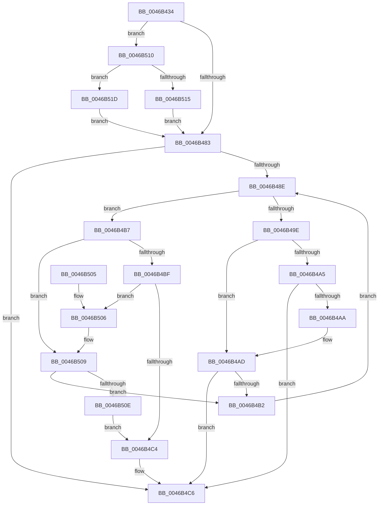

# IoStartDiskIoAttributionForContext

- RVA: `0x0046B434`–`0x0046B525` (길이 `241` bytes)
- VA: `0x000000014046B434`
- 실행 섹션: `.text`
- PDB 이름 있음: `예`; PDB Function 태그: `아니요`
- unwind 정보 RVA: `0x00068BCC`
- 디코드: `72`개 명령, `241/241` bytes 표시
- 미해석 바이트: `0` (있으면 어셈블리에 `.byte`로 보존)

> 이 문서는 커널 이미지의 기계어와 PDB 기호를 분석해 생성했습니다. 4번과 5번은 함수 원형과 자료형을 바이너리 사용 방식에서 추정한 C 해석이며 원본 소스 복구 결과는 아닙니다.

## 1. Dependencies

- 직접 호출 지점: **4**; 고유 호출 대상: **4**
- 직접 호출자로 확인된 함수: **2**
- RIP 상대 이미지 참조: **3**

### Outgoing calls
- `0x0046B45B` → [ExAcquireSpinLockExclusive](../24/ExAcquireSpinLockExclusive_function_00248690.md) (function, `0x00248690`)
- `0x0046B495` → [IopDiskIoAttributionTreeCompare](IopDiskIoAttributionTreeCompare_function_0046B52C.md) (function, `0x0046B52C`)
- `0x0046B4D2` → [RtlRbInsertNodeEx](../2E/RtlRbInsertNodeEx_function_002E4570.md) (function, `0x002E4570`)
- `0x0046B4E1` → [ExReleaseSpinLockExclusive](../2C/ExReleaseSpinLockExclusive_function_002C0EF0.md) (function, `0x002C0EF0`)

### Direct callers
- [PspSetJobIoAttribution](../../page/9F/PspSetJobIoAttribution_function_009F7C50.md) at `0x009F7D7A`
- [sub_00B31590](../../page/B3/Unknown_function_00B31590.md) at `0x00B31629`

### Static image references
- `0x0046B454` → RVA `0x00F8D1E0` (`.data`; read)
- `0x0046B460` → RVA `0x00F8D428` (`.data`; read)
- `0x0046B467` → RVA `0x00F8D420` (`.data`; read)

## 2. Other-region calls and transfers

- 다른 실행 섹션으로 향하는 call: **0**
- 별도 외부 분기/꼬리 이동을 확인하지 못했습니다.

## 3. Assembly (complete function range)

```asm
0046B434  48 8B C4                        mov rax, rsp
0046B437  48 89 58 08                     mov qword ptr [rax + 8], rbx
0046B43B  48 89 68 10                     mov qword ptr [rax + 0x10], rbp
0046B43F  48 89 70 18                     mov qword ptr [rax + 0x18], rsi
0046B443  48 89 78 20                     mov qword ptr [rax + 0x20], rdi
0046B447  41 54                           push r12
0046B449  41 56                           push r14
0046B44B  41 57                           push r15
0046B44D  48 83 EC 20                     sub rsp, 0x20
0046B451  4C 8B F1                        mov r14, rcx
0046B454  48 8D 0D 85 1D B2 00            lea rcx, [rip + 0xb21d85]
0046B45B  E8 30 D2 DD FF                  call 0x140248690
0046B460  48 8B 15 C1 1F B2 00            mov rdx, qword ptr [rip + 0xb21fc1]
0046B467  4C 8D 25 B2 1F B2 00            lea r12, [rip + 0xb21fb2]
0046B46E  48 8B 3D AB 1F B2 00            mov rdi, qword ptr [rip + 0xb21fab]
0046B475  33 DB                           xor ebx, ebx
0046B477  44 8A F8                        mov r15b, al
0046B47A  F6 C2 01                        test dl, 1
0046B47D  0F 85 8D 00 00 00               jne 0x14046b510
0046B483  0F B6 F2                        movzx esi, dl
0046B486  83 E6 01                        and esi, 1
0046B489  48 85 FF                        test rdi, rdi
0046B48C  74 38                           je 0x14046b4c6
0046B48E  48 8B D7                        mov rdx, rdi
0046B491  49 8D 4E 18                     lea rcx, [r14 + 0x18]
0046B495  E8 92 00 00 00                  call 0x14046b52c
0046B49A  85 C0                           test eax, eax
0046B49C  79 19                           jns 0x14046b4b7
0046B49E  48 8B 07                        mov rax, qword ptr [rdi]
0046B4A1  85 F6                           test esi, esi
0046B4A3  74 08                           je 0x14046b4ad
0046B4A5  48 85 C0                        test rax, rax
0046B4A8  74 1C                           je 0x14046b4c6
0046B4AA  48 33 C7                        xor rax, rdi
0046B4AD  48 85 C0                        test rax, rax
0046B4B0  74 14                           je 0x14046b4c6
0046B4B2  48 8B F8                        mov rdi, rax
0046B4B5  EB D7                           jmp 0x14046b48e
0046B4B7  48 8B 47 08                     mov rax, qword ptr [rdi + 8]
0046B4BB  85 F6                           test esi, esi
0046B4BD  74 4A                           je 0x14046b509
0046B4BF  48 85 C0                        test rax, rax
0046B4C2  75 42                           jne 0x14046b506
0046B4C4  B3 01                           mov bl, 1
0046B4C6  4D 8B CE                        mov r9, r14
0046B4C9  44 8A C3                        mov r8b, bl
0046B4CC  48 8B D7                        mov rdx, rdi
0046B4CF  49 8B CC                        mov rcx, r12
0046B4D2  E8 99 90 E7 FF                  call 0x1402e4570
0046B4D7  41 8A D7                        mov dl, r15b
0046B4DA  48 8D 0D FF 1C B2 00            lea rcx, [rip + 0xb21cff]
0046B4E1  E8 0A 5A E5 FF                  call 0x1402c0ef0
0046B4E6  48 8B 5C 24 40                  mov rbx, qword ptr [rsp + 0x40]
0046B4EB  48 8B 6C 24 48                  mov rbp, qword ptr [rsp + 0x48]
0046B4F0  48 8B 74 24 50                  mov rsi, qword ptr [rsp + 0x50]
0046B4F5  48 8B 7C 24 58                  mov rdi, qword ptr [rsp + 0x58]
0046B4FA  48 83 C4 20                     add rsp, 0x20
0046B4FE  41 5F                           pop r15
0046B500  41 5E                           pop r14
0046B502  41 5C                           pop r12
0046B504  C3                              ret
0046B505  CC                              int3
0046B506  48 33 C7                        xor rax, rdi
0046B509  48 85 C0                        test rax, rax
0046B50C  75 A4                           jne 0x14046b4b2
0046B50E  EB B4                           jmp 0x14046b4c4
0046B510  48 85 FF                        test rdi, rdi
0046B513  74 08                           je 0x14046b51d
0046B515  49 33 FC                        xor rdi, r12
0046B518  E9 66 FF FF FF                  jmp 0x14046b483
0046B51D  48 8B FB                        mov rdi, rbx
0046B520  E9 5E FF FF FF                  jmp 0x14046b483
```

## 4. C-style interpretation (structured pseudocode)

```c
__int64 __fastcall IoStartDiskIoAttributionForContext(__int64 a1)
{
    __int64 result;
    __int64 v_rbx;
    __int64 v_rdi;
    __int64 v_rsi;
    __int64 v_rsp;
    unsigned __int64 v_stack_p10;
    unsigned __int64 v_stack_p18;
    unsigned __int64 v_stack_p20;
    unsigned __int64 v_stack_p8;

    *(unsigned __int64 *)(v_rsp + 8) = v_rbx;
    *(unsigned __int64 *)(v_rsp + 16) = v_rbp;
    *(unsigned __int64 *)(v_rsp + 24) = v_rsi;
    *(unsigned __int64 *)(v_rsp + 32) = v_rdi;
    v_rsp = (v_rsp) - (32);
    result = ExAcquireSpinLockExclusive(v_rip + 11672965, a2, a3, a4);
    v_rbx = 0;
    if ((((unsigned __int8)(*(unsigned __int64 *)(v_rip + 11673537))) & (1)) != 0) goto loc_0046B510;
loc_0046B483:
    v_rsi = (unsigned int)(((unsigned __int8)(*(unsigned __int64 *)(v_rip + 11673537))) & (1));
    if (*(unsigned __int64 *)(v_rip + 11673515) == 0) goto loc_0046B4C6;
loc_0046B48E:
    result = IopDiskIoAttributionTreeCompare(a1 + 24, *(unsigned __int64 *)(v_rip + 11673515), a3, a4);
    if (!sign_flag) goto loc_0046B4B7;
    if ((unsigned int)(v_rsi) == 0) goto loc_0046B4AD;
    if (*(unsigned __int64 *)(*(unsigned __int64 *)(v_rip + 11673515)) == 0) goto loc_0046B4C6;
    result = (*(unsigned __int64 *)(*(unsigned __int64 *)(v_rip + 11673515))) ^ (*(unsigned __int64 *)(v_rip + 11673515));
loc_0046B4AD:
    if (result == 0) goto loc_0046B4C6;
loc_0046B4B2:
    goto loc_0046B48E;
loc_0046B4B7:
    if ((unsigned int)(v_rsi) == 0) goto loc_0046B509;
    if (*(unsigned __int64 *)(result + 8) != 0) goto loc_0046B506;
loc_0046B4C4:
loc_0046B4C6:
    result = RtlRbInsertNodeEx(v_rip + 11673522, result, 1, a1);
    result = ExReleaseSpinLockExclusive(v_rip + 11672831, (unsigned __int8)((unsigned __int8)(result)), 1, a1);
    v_rsp = (v_rsp) + (32);
    return result;
loc_0046B506:
    result = (result) ^ (v_stack_p20);
loc_0046B509:
    if (result != 0) goto loc_0046B4B2;
    goto loc_0046B4C4;
loc_0046B510:
    if (v_stack_p20 == 0) goto loc_0046B51D;
    v_rdi = (v_stack_p20) ^ (v_rip + 11673522);
    goto loc_0046B483;
loc_0046B51D:
    goto loc_0046B483;
}
```

## 5. (Beta) C Style

```c
int64_t IoStartDiskIoAttributionForContext(void *Arg1)
{
    uint8_t *arg1 = (uint8_t *)Arg1;

    int64_t result;
    int64_t local_rbx;
    int64_t local_rdi;
    int64_t local_rsi;
    int64_t local_rsp;
    uint64_t v_stack_p10;
    uint64_t v_stack_p18;
    uint64_t v_stack_p20;
    uint64_t v_stack_p8;

    *(uint64_t *)(local_rsp + 0x8) = local_rbx;
    *(uint64_t *)(local_rsp + 0x10) = local_rbp;
    *(uint64_t *)(local_rsp + 0x18) = local_rsi;
    *(uint64_t *)(local_rsp + 0x20) = local_rdi;
    local_rsp = (local_rsp) - (32);
    result = ExAcquireSpinLockExclusive(v_rip + 11672965, a2, a3, a4);
    local_rbx = 0;
    if ((((uint8_t)(*(uint64_t *)(v_rip + 0xB21FC1))) & (1)) != 0) goto loc_0046B510;
loc_0046B483:
    local_rsi = (uint32_t)(((uint8_t)(*(uint64_t *)(v_rip + 0xB21FC1))) & (1));
    if (*(uint64_t *)(v_rip + 0xB21FAB) == 0) goto loc_0046B4C6;
loc_0046B48E:
    result = IopDiskIoAttributionTreeCompare(Arg1 + 24, *(uint64_t *)(v_rip + 0xB21FAB), a3, a4);
    if (!sign_flag) goto loc_0046B4B7;
    if ((uint32_t)(local_rsi) == 0) goto loc_0046B4AD;
    if (*(uint64_t *)(*(uint64_t *)(v_rip + 0xB21FAB)) == 0) goto loc_0046B4C6;
    result = (*(uint64_t *)(*(uint64_t *)(v_rip + 0xB21FAB))) ^ (*(uint64_t *)(v_rip + 0xB21FAB));
loc_0046B4AD:
    if (result == 0) goto loc_0046B4C6;
loc_0046B4B2:
    goto loc_0046B48E;
loc_0046B4B7:
    if ((uint32_t)(local_rsi) == 0) goto loc_0046B509;
    if (*(uint64_t *)(result + 0x8) != 0) goto loc_0046B506;
loc_0046B4C4:
loc_0046B4C6:
    result = RtlRbInsertNodeEx(v_rip + 11673522, result, 1, Arg1);
    result = ExReleaseSpinLockExclusive(v_rip + 11672831, (uint8_t)((uint8_t)(result)), 1, Arg1);
    local_rsp = (local_rsp) + (32);
    return result;
loc_0046B506:
    result = (result) ^ (v_stack_p20);
loc_0046B509:
    if (result != 0) goto loc_0046B4B2;
    goto loc_0046B4C4;
loc_0046B510:
    if (v_stack_p20 == 0) goto loc_0046B51D;
    local_rdi = (v_stack_p20) ^ (v_rip + 11673522);
    goto loc_0046B483;
loc_0046B51D:
    goto loc_0046B483;
}
```

### 관측된 메모리 오프셋

구조체 형식이 확인되지 않은 접근은 인자 기준의 오프셋으로만 기록했습니다.

| 기준 인자 | 오프셋 표현 | 폭 (bit) | 접근 |
|---|---:|---:|---|
| `Arg1` | `+ 0x18` | `64` | `R` |

## 6. Execution-region graph

[열기: 2D/3D 그래프와 함수 탐색 컨트롤 패널](../../../control-panel.html?section=text&rva=0x0046B434&view=graph)

- 2D 그래프는 위에서 아래로 흐르고, 3D 그래프는 빈 공간을 드래그해 회전합니다. Shift+드래그는 이동, 휠은 확대·축소, 함수 노드 선택은 대상 보고서 이동입니다.

### Static fallback


