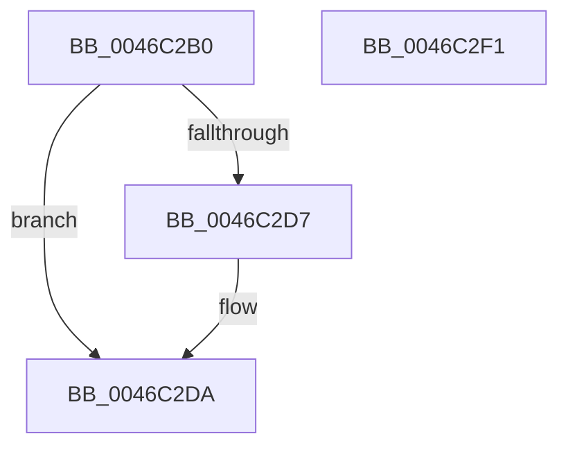

# IoWMIDeviceObjectToProviderId

- RVA: `0x0046C2B0`–`0x0046C2F2` (길이 `66` bytes)
- VA: `0x000000014046C2B0`
- 실행 섹션: `.text`
- PDB 이름 있음: `예`; PDB Function 태그: `아니요`
- unwind 정보 RVA: `0x0005CF00`
- 디코드: `20`개 명령, `66/66` bytes 표시
- 미해석 바이트: `0` (있으면 어셈블리에 `.byte`로 보존)

> 이 문서는 커널 이미지의 기계어와 PDB 기호를 분석해 생성했습니다. 4번과 5번은 함수 원형과 자료형을 바이너리 사용 방식에서 추정한 C 해석이며 원본 소스 복구 결과는 아닙니다.

## 1. Dependencies

- 직접 호출 지점: **3**; 고유 호출 대상: **3**
- 직접 호출자로 확인된 함수: **2**
- RIP 상대 이미지 참조: **1**

### Outgoing calls
- `0x0046C2C0` → [KeAcquireSpinLockRaiseToDpc](../20/KeAcquireSpinLockRaiseToDpc_function_00208470.md) (function, `0x00208470`)
- `0x0046C2CB` → [WmipDoFindRegEntryByDevice](WmipDoFindRegEntryByDevice_function_0046C2F8.md) (function, `0x0046C2F8`)
- `0x0046C2E4` → [KeReleaseSpinLock](../39/KeReleaseSpinLock_function_00392BA0.md) (function, `0x00392BA0`)

### Direct callers
- [PpmAllocWmiEvent](../5D/PpmAllocWmiEvent_function_005D95DC.md) at `0x005D962F`
- [WmipSetTraceNotify](../../page/AB/WmipSetTraceNotify_function_00ABF0E0.md) at `0x00ABF1B8`

### Static image references
- `0x0046C2B9` → RVA `0x00EFFC28` (`.data`; read)

## 2. Other-region calls and transfers

- 다른 실행 섹션으로 향하는 call: **0**
- 별도 외부 분기/꼬리 이동을 확인하지 못했습니다.

## 3. Assembly (complete function range)

```asm
0046C2B0  40 53                           push rbx
0046C2B2  48 83 EC 20                     sub rsp, 0x20
0046C2B6  48 8B D9                        mov rbx, rcx
0046C2B9  48 8D 0D 68 39 A9 00            lea rcx, [rip + 0xa93968]
0046C2C0  E8 AB C1 D9 FF                  call 0x140208470
0046C2C5  48 8B CB                        mov rcx, rbx
0046C2C8  44 8A C0                        mov r8b, al
0046C2CB  E8 28 00 00 00                  call 0x14046c2f8
0046C2D0  33 DB                           xor ebx, ebx
0046C2D2  48 85 C0                        test rax, rax
0046C2D5  74 03                           je 0x14046c2da
0046C2D7  8B 58 38                        mov ebx, dword ptr [rax + 0x38]
0046C2DA  41 8A D0                        mov dl, r8b
0046C2DD  48 8D 0D 44 39 A9 00            lea rcx, [rip + 0xa93944]
0046C2E4  E8 B7 68 F2 FF                  call 0x140392ba0
0046C2E9  8B C3                           mov eax, ebx
0046C2EB  48 83 C4 20                     add rsp, 0x20
0046C2EF  5B                              pop rbx
0046C2F0  C3                              ret
0046C2F1  CC                              int3
```

## 4. C-style interpretation (structured pseudocode)

```c
__int64 __fastcall IoWMIDeviceObjectToProviderId(__int64 a1)
{
    __int64 result;
    __int64 v_rbx;
    __int64 v_rsp;

    v_rsp = (v_rsp) - (32);
    result = KeAcquireSpinLockRaiseToDpc(v_rip + 11090280, a2, a3, a4);
    result = WmipDoFindRegEntryByDevice(a1, a2, (unsigned __int8)(result), a4);
    v_rbx = 0;
    if (result != 0) {
        v_rbx = *(unsigned int *)(result + 56);
    }
    result = KeReleaseSpinLock(v_rip + 11090244, (unsigned __int8)((unsigned __int8)(result)), (unsigned __int8)(result), a4);
    v_rsp = (v_rsp) + (32);
    return (unsigned int)((unsigned int)(v_rbx));
}
```

## 5. (Beta) C Style

```c
int64_t IoWMIDeviceObjectToProviderId(int64_t Arg1)
{
    int64_t result;
    int64_t local_rbx;
    int64_t local_rsp;

    local_rsp = (local_rsp) - (32);
    result = KeAcquireSpinLockRaiseToDpc(v_rip + 11090280, a2, a3, a4);
    result = WmipDoFindRegEntryByDevice(Arg1, a2, (uint8_t)(result), a4);
    local_rbx = 0;
    if (result != 0) {
        local_rbx = *(uint32_t *)(result + 0x38);
    }
    result = KeReleaseSpinLock(v_rip + 11090244, (uint8_t)((uint8_t)(result)), (uint8_t)(result), a4);
    local_rsp = (local_rsp) + (32);
    return (uint32_t)((uint32_t)(local_rbx));
}
```

## 6. Execution-region graph

[열기: 2D/3D 그래프와 함수 탐색 컨트롤 패널](../../../control-panel.html?section=text&rva=0x0046C2B0&view=graph)

- 2D 그래프는 위에서 아래로 흐르고, 3D 그래프는 빈 공간을 드래그해 회전합니다. Shift+드래그는 이동, 휠은 확대·축소, 함수 노드 선택은 대상 보고서 이동입니다.

### Static fallback


