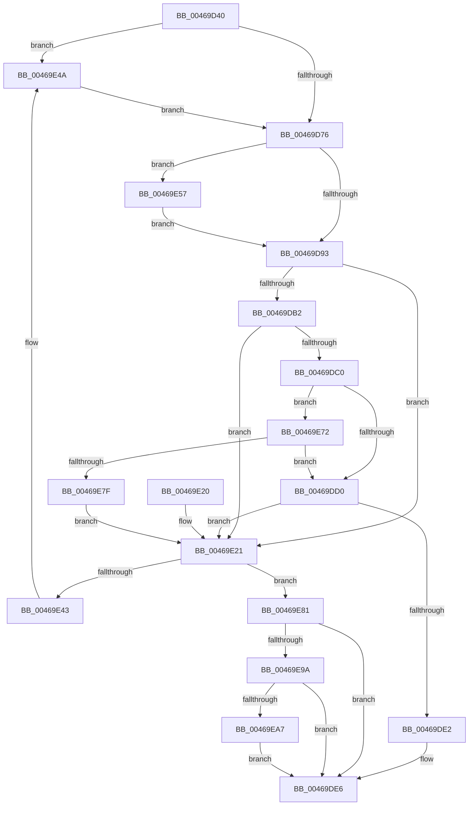

# IopPassiveInterruptDpc

- RVA: `0x00469D40`–`0x00469EB7` (길이 `375` bytes)
- VA: `0x0000000140469D40`
- 실행 섹션: `.text`
- PDB 이름 있음: `예`; PDB Function 태그: `아니요`
- unwind 정보 RVA: `0x00067B08`
- 디코드: `86`개 명령, `375/375` bytes 표시
- 미해석 바이트: `0` (있으면 어셈블리에 `.byte`로 보존)

> 이 문서는 커널 이미지의 기계어와 PDB 기호를 분석해 생성했습니다. 4번과 5번은 함수 원형과 자료형을 바이너리 사용 방식에서 추정한 C 해석이며 원본 소스 복구 결과는 아닙니다.

## 1. Dependencies

- 직접 호출 지점: **7**; 고유 호출 대상: **7**
- 직접 호출자로 확인된 함수: **0**
- RIP 상대 이미지 참조: **12**

### Outgoing calls
- `0x00469D9D` → [KiAcquireKobjectLockSafe](../25/KiAcquireKobjectLockSafe_function_00251C90.md) (function, `0x00251C90`)
- `0x00469DD9` → [KiWakeQueueWaiter](../34/KiWakeQueueWaiter_function_00344C10.md) (function, `0x00344C10`)
- `0x00469E02` → [KiExitDispatcher](../25/KiExitDispatcher_function_00251CF0.md) (function, `0x00251CF0`)
- `0x00469E4D` → [KiRaiseIrqlProcessIrqlFlags](../4F/KiRaiseIrqlProcessIrqlFlags_function_004F56FC.md) (function, `0x004F56FC`)
- `0x00469E5A` → [KeIsThreadRunning](../39/KeIsThreadRunning_function_00396720.md) (function, `0x00396720`)
- `0x00469E68` → [EtwTraceEnqueueWork](../39/EtwTraceEnqueueWork_function_0039674C.md) (function, `0x0039674C`)
- `0x00469EAD` → [KiWakeOtherQueueWaiters](../39/KiWakeOtherQueueWaiters_function_003964D0.md) (function, `0x003964D0`)

### Direct callers
- 이 함수 시작 RVA로 연결되는 직접 call은 확인되지 않았습니다. 간접 호출은 완전히 역산할 수 없습니다.

### Static image references
- `0x00469D69` → RVA `0x00FC6D20` (`ALMOSTRO`; read)
- `0x00469D7F` → RVA `0x00FC6B04` (`ALMOSTRO`; read)
- `0x00469D93` → RVA `0x00F8CC40` (`.data`; read)
- `0x00469DA2` → RVA `0x00F8CC48` (`.data`; read)
- `0x00469DB2` → RVA `0x00F8CC68` (`.data`; read)
- `0x00469DB8` → RVA `0x00F8CC6C` (`.data`; read)
- `0x00469DE6` → RVA `0x00F8CC40` (`.data`; read/write)
- `0x00469E21` → RVA `0x00F8CC44` (`.data`; read)
- `0x00469E27` → RVA `0x00F8CC58` (`.data`; read)
- `0x00469E31` → RVA `0x00F8CC44` (`.data`; write)
- `0x00469E37` → RVA `0x00F8CC60` (`.data`; read)
- `0x00469E8B` → RVA `0x00F8CC60` (`.data`; write)

## 2. Other-region calls and transfers

- 다른 실행 섹션으로 향하는 call: **0**
- 별도 외부 분기/꼬리 이동을 확인하지 못했습니다.

## 3. Assembly (complete function range)

```asm
00469D40  48 89 5C 24 08                  mov qword ptr [rsp + 8], rbx
00469D45  48 89 6C 24 10                  mov qword ptr [rsp + 0x10], rbp
00469D4A  48 89 74 24 18                  mov qword ptr [rsp + 0x18], rsi
00469D4F  57                              push rdi
00469D50  41 56                           push r14
00469D52  41 57                           push r15
00469D54  48 83 EC 30                     sub rsp, 0x30
00469D58  48 8D 5A 48                     lea rbx, [rdx + 0x48]
00469D5C  44 0F 20 C5                     mov rbp, cr8
00469D60  BA 02 00 00 00                  mov edx, 2
00469D65  44 0F 22 C2                     mov cr8, rdx
00469D69  83 3D B0 CF B5 00 00            cmp dword ptr [rip + 0xb5cfb0], 0
00469D70  0F 85 D4 00 00 00               jne 0x140469e4a
00469D76  65 48 8B 3C 25 20 00 00 00      mov rdi, qword ptr gs:[0x20]
00469D7F  F7 05 7B CD B5 00 00 00 00 01   test dword ptr [rip + 0xb5cd7b], 0x1000000
00469D89  48 8B 77 08                     mov rsi, qword ptr [rdi + 8]
00469D8D  0F 85 C4 00 00 00               jne 0x140469e57
00469D93  4C 8D 35 A6 2E B2 00            lea r14, [rip + 0xb22ea6]
00469D9A  49 8B CE                        mov rcx, r14
00469D9D  E8 EE 7E DE FF                  call 0x140251c90
00469DA2  4C 8D 3D 9F 2E B2 00            lea r15, [rip + 0xb22e9f]
00469DA9  4C 39 3D 98 2E B2 00            cmp qword ptr [rip + 0xb22e98], r15
00469DB0  74 6F                           je 0x140469e21
00469DB2  8B 05 B0 2E B2 00               mov eax, dword ptr [rip + 0xb22eb0]
00469DB8  3B 05 AE 2E B2 00               cmp eax, dword ptr [rip + 0xb22eae]
00469DBE  73 61                           jae 0x140469e21
00469DC0  48 8B 86 E8 00 00 00            mov rax, qword ptr [rsi + 0xe8]
00469DC7  49 3B C6                        cmp rax, r14
00469DCA  0F 84 A2 00 00 00               je 0x140469e72
00469DD0  4C 8B C3                        mov r8, rbx
00469DD3  49 8B D6                        mov rdx, r14
00469DD6  48 8B CF                        mov rcx, rdi
00469DD9  E8 32 AE ED FF                  call 0x140344c10
00469DDE  84 C0                           test al, al
00469DE0  74 3F                           je 0x140469e21
00469DE2  48 83 23 00                     and qword ptr [rbx], 0
00469DE6  F0 81 25 4F 2E B2 00 7F FF FF FF  lock and dword ptr [rip + 0xb22e4f], 0xffffff7f
00469DF1  45 33 C9                        xor r9d, r9d
00469DF4  40 88 6C 24 20                  mov byte ptr [rsp + 0x20], bpl
00469DF9  33 D2                           xor edx, edx
00469DFB  48 8B CF                        mov rcx, rdi
00469DFE  45 8D 41 01                     lea r8d, [r9 + 1]
00469E02  E8 E9 7E DE FF                  call 0x140251cf0
00469E07  48 8B 5C 24 50                  mov rbx, qword ptr [rsp + 0x50]
00469E0C  48 8B 6C 24 58                  mov rbp, qword ptr [rsp + 0x58]
00469E11  48 8B 74 24 60                  mov rsi, qword ptr [rsp + 0x60]
00469E16  48 83 C4 30                     add rsp, 0x30
00469E1A  41 5F                           pop r15
00469E1C  41 5E                           pop r14
00469E1E  5F                              pop rdi
00469E1F  C3                              ret
00469E20  CC                              int3
00469E21  8B 0D 1D 2E B2 00               mov ecx, dword ptr [rip + 0xb22e1d]
00469E27  48 8D 15 2A 2E B2 00            lea rdx, [rip + 0xb22e2a]
00469E2E  8D 41 01                        lea eax, [rcx + 1]
00469E31  89 05 0D 2E B2 00               mov dword ptr [rip + 0xb22e0d], eax
00469E37  48 8B 05 22 2E B2 00            mov rax, qword ptr [rip + 0xb22e22]
00469E3E  48 39 10                        cmp qword ptr [rax], rdx
00469E41  74 3E                           je 0x140469e81
00469E43  B9 03 00 00 00                  mov ecx, 3
00469E48  CD 29                           int 0x29
00469E4A  40 8A CD                        mov cl, bpl
00469E4D  E8 AA B8 08 00                  call 0x1404f56fc
00469E52  E9 1F FF FF FF                  jmp 0x140469d76
00469E57  48 8B CE                        mov rcx, rsi
00469E5A  E8 C1 C8 F2 FF                  call 0x140396720
00469E5F  44 8A C0                        mov r8b, al
00469E62  48 8B CE                        mov rcx, rsi
00469E65  48 8B D3                        mov rdx, rbx
00469E68  E8 DF C8 F2 FF                  call 0x14039674c
00469E6D  E9 21 FF FF FF                  jmp 0x140469d93
00469E72  80 BE 83 02 00 00 0F            cmp byte ptr [rsi + 0x283], 0xf
00469E79  0F 85 51 FF FF FF               jne 0x140469dd0
00469E7F  EB A0                           jmp 0x140469e21
00469E81  48 89 13                        mov qword ptr [rbx], rdx
00469E84  48 89 43 08                     mov qword ptr [rbx + 8], rax
00469E88  48 89 18                        mov qword ptr [rax], rbx
00469E8B  48 89 1D CE 2D B2 00            mov qword ptr [rip + 0xb22dce], rbx
00469E92  85 C9                           test ecx, ecx
00469E94  0F 85 4C FF FF FF               jne 0x140469de6
00469E9A  4C 39 3D A7 2D B2 00            cmp qword ptr [rip + 0xb22da7], r15
00469EA1  0F 84 3F FF FF FF               je 0x140469de6
00469EA7  49 8B D6                        mov rdx, r14
00469EAA  48 8B CF                        mov rcx, rdi
00469EAD  E8 1E C6 F2 FF                  call 0x1403964d0
00469EB2  E9 2F FF FF FF                  jmp 0x140469de6
```

## 4. C-style interpretation (structured pseudocode)

```c
__int64 __fastcall IopPassiveInterruptDpc(__int64 a1, __int64 a2, __int64 a3, int a4)
{
    __int64 result;
    __int64 v_rsp;
    unsigned __int8 v_stack_m28;
    unsigned __int64 v_stack_p10;
    unsigned __int64 v_stack_p18;
    unsigned __int64 v_stack_p8;

    v_stack_p8 = v_rbx;
    v_stack_p10 = v_rbp;
    v_stack_p18 = v_rsi;
    v_rsp = (v_rsp) - (48);
    if ((*(unsigned int *)(v_rip + 11915184)) != 0) goto loc_00469E4A;
loc_00469D76:
    if (((*(unsigned int *)(v_rip + 11914619)) & (0x1000000ULL)) != 0) goto loc_00469E57;
loc_00469D93:
    result = KiAcquireKobjectLockSafe(v_rip + 11677350, 2, a3, a4);
    if ((*(unsigned __int64 *)(v_rip + 11677336)) == (v_rip + 11677343)) goto loc_00469E21;
    if (((unsigned int)((unsigned int)(*(unsigned int *)(v_rip + 11677360)))) >= (*(unsigned int *)(v_rip + 11677358))) goto loc_00469E21;
    if ((*(unsigned __int64 *)(*(unsigned __int64 *)(*(unsigned __int64 *)(gs_base + (0 + 32)) + 8) + 232)) == (v_rip + 11677350)) goto loc_00469E72;
loc_00469DD0:
    result = KiWakeQueueWaiter(*(unsigned __int64 *)(gs_base + (0 + 32)), v_rip + 11677350, a2 + 72, a4);
    if ((unsigned __int8)(result) == 0) goto loc_00469E21;
loc_00469DE6:
    a4 = 0;
    v_stack_m28 = (unsigned __int8)(v_cr8);
    a2 = 0;
    result = KiExitDispatcher(*(unsigned __int64 *)(gs_base + (0 + 32)), a2, a4 + 1, a4);
    v_rsp = (v_rsp) + (48);
    return result;
loc_00469E21:
    *(unsigned int *)(v_rip + 11677197) = (unsigned int)((unsigned int)(*(unsigned int *)(v_rip + 11677213)) + 1);
    if ((*(unsigned __int64 *)(*(unsigned __int64 *)(v_rip + 11677218))) == (v_rip + 11677226)) goto loc_00469E81;
loc_00469E4A:
    result = KiRaiseIrqlProcessIrqlFlags((unsigned __int8)(v_stack_p10), v_rip + 11677226, a4 + 1, a4);
    goto loc_00469D76;
loc_00469E57:
    result = KeIsThreadRunning(v_stack_p18, v_rip + 11677226, a4 + 1, a4);
    result = EtwTraceEnqueueWork(v_stack_p18, v_stack_p8, (unsigned __int8)(result), a4);
    goto loc_00469D93;
loc_00469E72:
    if ((*(unsigned __int8 *)(v_stack_p18 + 643)) != 15) goto loc_00469DD0;
    goto loc_00469E21;
loc_00469E81:
    *(unsigned __int64 *)(v_stack_p8) = v_stack_p8;
    *(unsigned __int64 *)(v_stack_p8 + 8) = result;
    *(unsigned __int64 *)(result) = v_stack_p8;
    *(unsigned __int64 *)(v_rip + 11677134) = v_stack_p8;
    if ((unsigned int)(v_stack_p18) != 0) goto loc_00469DE6;
    if ((*(unsigned __int64 *)(v_rip + 11677095)) == (v_rip + 11677343)) goto loc_00469DE6;
    result = KiWakeOtherQueueWaiters(*(unsigned __int64 *)(gs_base + (0 + 32)), v_rip + 11677350, (unsigned __int8)(result), a4);
    goto loc_00469DE6;
}
```

## 5. (Beta) C Style

```c
int64_t IopPassiveInterruptDpc(int64_t Arg1, void *Arg2, int64_t Arg3, int32_t Arg4)
{
    uint8_t *arg2 = (uint8_t *)Arg2;

    int64_t result;
    int64_t local_rsp;
    uint8_t v_stack_m28;
    uint64_t v_stack_p10;
    uint64_t v_stack_p18;
    uint64_t v_stack_p8;

    v_stack_p8 = local_rbx;
    v_stack_p10 = local_rbp;
    v_stack_p18 = local_rsi;
    local_rsp = (local_rsp) - (48);
    if ((*(uint32_t *)(v_rip + 0xB5CFB0)) != 0) goto loc_00469E4A;
loc_00469D76:
    if (((*(uint32_t *)(v_rip + 0xB5CD7B)) & (0x1000000ULL)) != 0) goto loc_00469E57;
loc_00469D93:
    result = KiAcquireKobjectLockSafe(v_rip + 11677350, 2, Arg3, Arg4);
    if ((*(uint64_t *)(v_rip + 0xB22E98)) == (v_rip + 11677343)) goto loc_00469E21;
    if (((uint32_t)((uint32_t)(*(uint32_t *)(v_rip + 0xB22EB0)))) >= (*(uint32_t *)(v_rip + 0xB22EAE))) goto loc_00469E21;
    if ((*(uint64_t *)(*(uint64_t *)(*(uint64_t *)(gs_base + (0 + 0x20)) + 0x8) + 0xE8)) == (v_rip + 11677350)) goto loc_00469E72;
loc_00469DD0:
    result = KiWakeQueueWaiter(*(uint64_t *)(gs_base + (0 + 0x20)), v_rip + 11677350, Arg2 + 72, Arg4);
    if ((uint8_t)(result) == 0) goto loc_00469E21;
loc_00469DE6:
    Arg4 = 0;
    v_stack_m28 = (uint8_t)(v_cr8);
    Arg2 = 0;
    result = KiExitDispatcher(*(uint64_t *)(gs_base + (0 + 0x20)), Arg2, Arg4 + 1, Arg4);
    local_rsp = (local_rsp) + (48);
    return result;
loc_00469E21:
    *(uint32_t *)(v_rip + 0xB22E0D) = (uint32_t)((uint32_t)(*(uint32_t *)(v_rip + 0xB22E1D)) + 1);
    if ((*(uint64_t *)(*(uint64_t *)(v_rip + 0xB22E22))) == (v_rip + 11677226)) goto loc_00469E81;
loc_00469E4A:
    result = KiRaiseIrqlProcessIrqlFlags((uint8_t)(v_stack_p10), v_rip + 11677226, Arg4 + 1, Arg4);
    goto loc_00469D76;
loc_00469E57:
    result = KeIsThreadRunning(v_stack_p18, v_rip + 11677226, Arg4 + 1, Arg4);
    result = EtwTraceEnqueueWork(v_stack_p18, v_stack_p8, (uint8_t)(result), Arg4);
    goto loc_00469D93;
loc_00469E72:
    if ((*(uint8_t *)(v_stack_p18 + 0x283)) != 15) goto loc_00469DD0;
    goto loc_00469E21;
loc_00469E81:
    *(uint64_t *)(v_stack_p8) = v_stack_p8;
    *(uint64_t *)(v_stack_p8 + 0x8) = result;
    *(uint64_t *)(result) = v_stack_p8;
    *(uint64_t *)(v_rip + 0xB22DCE) = v_stack_p8;
    if ((uint32_t)(v_stack_p18) != 0) goto loc_00469DE6;
    if ((*(uint64_t *)(v_rip + 0xB22DA7)) == (v_rip + 11677343)) goto loc_00469DE6;
    result = KiWakeOtherQueueWaiters(*(uint64_t *)(gs_base + (0 + 0x20)), v_rip + 11677350, (uint8_t)(result), Arg4);
    goto loc_00469DE6;
}
```

### 관측된 메모리 오프셋

구조체 형식이 확인되지 않은 접근은 인자 기준의 오프셋으로만 기록했습니다.

| 기준 인자 | 오프셋 표현 | 폭 (bit) | 접근 |
|---|---:|---:|---|
| `Arg2` | `+ 0x0` | `64` | `R/W` |
| `Arg2` | `+ 0x0` | `64` | `W` |
| `Arg2` | `+ 0x8` | `64` | `W` |
| `Arg2` | `+ 0x48` | `64` | `R` |

## 6. Execution-region graph

[열기: 2D/3D 그래프와 함수 탐색 컨트롤 패널](../../../control-panel.html?section=text&rva=0x00469D40&view=graph)

- 2D 그래프는 위에서 아래로 흐르고, 3D 그래프는 빈 공간을 드래그해 회전합니다. Shift+드래그는 이동, 휠은 확대·축소, 함수 노드 선택은 대상 보고서 이동입니다.

### Static fallback


