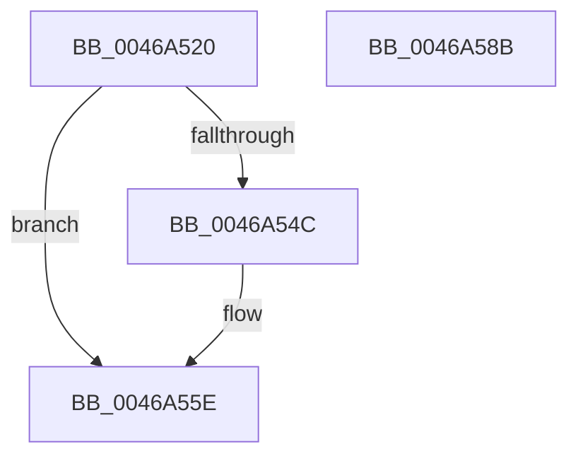

# IvtInvalidateRemappingTableEntries

- RVA: `0x0046A520`–`0x0046A58C` (길이 `108` bytes)
- VA: `0x000000014046A520`
- 실행 섹션: `.text`
- PDB 이름 있음: `예`; PDB Function 태그: `아니요`
- unwind 정보 RVA: `0x000AB2E4`
- 디코드: `29`개 명령, `108/108` bytes 표시
- 미해석 바이트: `0` (있으면 어셈블리에 `.byte`로 보존)

> 이 문서는 커널 이미지의 기계어와 PDB 기호를 분석해 생성했습니다. 4번과 5번은 함수 원형과 자료형을 바이너리 사용 방식에서 추정한 C 해석이며 원본 소스 복구 결과는 아닙니다.

## 1. Dependencies

- 직접 호출 지점: **3**; 고유 호출 대상: **3**
- 직접 호출자로 확인된 함수: **3**
- RIP 상대 이미지 참조: **1**

### Outgoing calls
- `0x0046A566` → [IvtIommuSendCommand](IvtIommuSendCommand_function_0046A6E4.md) (function, `0x0046A6E4`)
- `0x0046A573` → [IvtIommuWaitCommand](IvtIommuWaitCommand_function_0046A594.md) (function, `0x0046A594`)
- `0x0046A580` → [_security_check_cookie](../6A/_security_check_cookie_function_006AC640.md) (function, `0x006AC640`)

### Direct callers
- [IvtInvalidateRemappingTableEntry](IvtInvalidateRemappingTableEntry_function_0046A500.md) at `0x0046A50D`
- [IvtUpdateRemappingDestination](../57/IvtUpdateRemappingDestination_function_00572910.md) at `0x00572A11`
- [IvtInitializeIommu](../../pagelk/B6/IvtInitializeIommu_function_00B61FE0.md) at `0x00B6207F`

### Static image references
- `0x0046A526` → RVA `0x00E0A740` (`.data`; read)

## 2. Other-region calls and transfers

- 다른 실행 섹션으로 향하는 call: **0**
- 별도 외부 분기/꼬리 이동을 확인하지 못했습니다.

## 3. Assembly (complete function range)

```asm
0046A520  40 53                           push rbx
0046A522  48 83 EC 40                     sub rsp, 0x40
0046A526  48 8B 05 13 02 9A 00            mov rax, qword ptr [rip + 0x9a0213]
0046A52D  48 33 C4                        xor rax, rsp
0046A530  48 89 44 24 30                  mov qword ptr [rsp + 0x30], rax
0046A535  48 83 64 24 28 00               and qword ptr [rsp + 0x28], 0
0046A53B  48 8B D9                        mov rbx, rcx
0046A53E  48 C7 44 24 20 04 00 00 00      mov qword ptr [rsp + 0x20], 4
0046A547  48 85 D2                        test rdx, rdx
0046A54A  74 12                           je 0x14046a55e
0046A54C  8B 02                           mov eax, dword ptr [rdx]
0046A54E  0F B7 D0                        movzx edx, ax
0046A551  48 C1 E2 20                     shl rdx, 0x20
0046A555  48 83 CA 14                     or rdx, 0x14
0046A559  48 89 54 24 20                  mov qword ptr [rsp + 0x20], rdx
0046A55E  45 33 C0                        xor r8d, r8d
0046A561  48 8D 54 24 20                  lea rdx, [rsp + 0x20]
0046A566  E8 79 01 00 00                  call 0x14046a6e4
0046A56B  45 33 C0                        xor r8d, r8d
0046A56E  33 D2                           xor edx, edx
0046A570  48 8B CB                        mov rcx, rbx
0046A573  E8 1C 00 00 00                  call 0x14046a594
0046A578  48 8B 4C 24 30                  mov rcx, qword ptr [rsp + 0x30]
0046A57D  48 33 CC                        xor rcx, rsp
0046A580  E8 BB 20 24 00                  call 0x1406ac640
0046A585  48 83 C4 40                     add rsp, 0x40
0046A589  5B                              pop rbx
0046A58A  C3                              ret
0046A58B  CC                              int3
```

## 4. C-style interpretation (structured pseudocode)

```c
__int64 __fastcall IvtInvalidateRemappingTableEntries(__int64 a1, __int64 a2, int a3)
{
    __int64 result;
    __int64 v_rsp;
    unsigned __int64 v_stack_m18;
    unsigned __int64 v_stack_m20;
    unsigned __int64 v_stack_m28;

    v_rsp = (v_rsp) - (64);
    result = (*(unsigned __int64 *)(v_rip + 10093075)) ^ (v_rsp);
    v_stack_m18 = result;
    v_stack_m28 = 4;
    if (a2 != 0) {
        result = *(unsigned int *)(a2);
        a2 = (unsigned __int16)(result);
        a2 = (a2) << (32);
        a2 = (a2) | (20);
        v_stack_m28 = a2;
    }
    a3 = 0;
    result = IvtIommuSendCommand(a1, v_stack_m28, a3, a4);
    a3 = 0;
    a2 = 0;
    result = IvtIommuWaitCommand(a1, a2, a3, a4);
    a1 = (v_stack_m18) ^ (v_rsp);
    result = _security_check_cookie(a1, a2, a3, a4);
    v_rsp = (v_rsp) + (64);
    return result;
}
```

## 5. (Beta) C Style

```c
int64_t IvtInvalidateRemappingTableEntries(int64_t Arg1, int64_t Arg2, int32_t Arg3)
{
    int64_t result;
    int64_t local_rsp;
    uint64_t v_stack_m18;
    uint64_t v_stack_m20;
    uint64_t v_stack_m28;

    local_rsp = (local_rsp) - (64);
    result = (*(uint64_t *)(v_rip + 0x9A0213)) ^ (local_rsp);
    v_stack_m18 = result;
    v_stack_m28 = 4;
    if (Arg2 != 0) {
        result = *(uint32_t *)(Arg2);
        Arg2 = (uint16_t)(result);
        Arg2 = (Arg2) << (32);
        Arg2 = (Arg2) | (20);
        v_stack_m28 = Arg2;
    }
    Arg3 = 0;
    result = IvtIommuSendCommand(Arg1, v_stack_m28, Arg3, a4);
    Arg3 = 0;
    Arg2 = 0;
    result = IvtIommuWaitCommand(Arg1, Arg2, Arg3, a4);
    Arg1 = (v_stack_m18) ^ (local_rsp);
    result = _security_check_cookie(Arg1, Arg2, Arg3, a4);
    local_rsp = (local_rsp) + (64);
    return result;
}
```

## 6. Execution-region graph

[열기: 2D/3D 그래프와 함수 탐색 컨트롤 패널](../../../control-panel.html?section=text&rva=0x0046A520&view=graph)

- 2D 그래프는 위에서 아래로 흐르고, 3D 그래프는 빈 공간을 드래그해 회전합니다. Shift+드래그는 이동, 휠은 확대·축소, 함수 노드 선택은 대상 보고서 이동입니다.

### Static fallback


