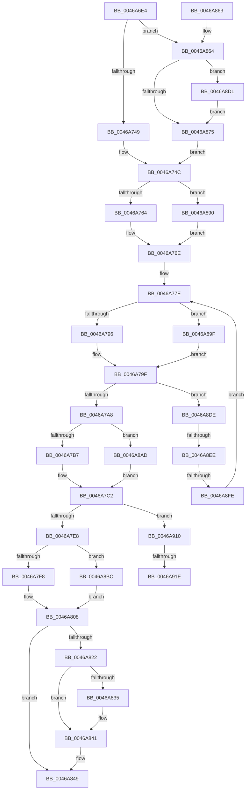

# IvtIommuSendCommand

- RVA: `0x0046A6E4`–`0x0046A928` (길이 `580` bytes)
- VA: `0x000000014046A6E4`
- 실행 섹션: `.text`
- PDB 이름 있음: `예`; PDB Function 태그: `예`
- unwind 정보 RVA: `0x000AB318`
- 디코드: `144`개 명령, `580/580` bytes 표시
- 미해석 바이트: `0` (있으면 어셈블리에 `.byte`로 보존)

> 이 문서는 커널 이미지의 기계어와 PDB 기호를 분석해 생성했습니다. 4번과 5번은 함수 원형과 자료형을 바이너리 사용 방식에서 추정한 C 해석이며 원본 소스 복구 결과는 아닙니다.

## 1. Dependencies

- 직접 호출 지점: **5**; 고유 호출 대상: **5**
- 직접 호출자로 확인된 함수: **10**
- RIP 상대 이미지 참조: **3**

### Outgoing calls
- `0x0046A827` → [KeReleaseInStackQueuedSpinLockFromDpcLevel](../21/KeReleaseInStackQueuedSpinLockFromDpcLevel_function_002171B0.md) (function, `0x002171B0`)
- `0x0046A83C` → [KiLowerIrqlProcessIrqlFlags](../4F/KiLowerIrqlProcessIrqlFlags_function_004F5698.md) (function, `0x004F5698`)
- `0x0046A881` → [KeAcquireInStackQueuedSpinLockAtDpcLevel](../27/KeAcquireInStackQueuedSpinLockAtDpcLevel_function_00275740.md) (function, `0x00275740`)
- `0x0046A8D7` → [KiRaiseIrqlProcessIrqlFlags](../4F/KiRaiseIrqlProcessIrqlFlags_function_004F56FC.md) (function, `0x004F56FC`)
- `0x0046A901` → [guard_dispatch_icall](../6B/guard_dispatch_icall_function_006BAAD0.md) (function, `0x006BAAD0`)

### Direct callers
- [IvtFlushTbInternal](../2D/IvtFlushTbInternal_function_002D2548.md) at `0x002D26EA`
- [IvtFlushTbInternal](../2D/IvtFlushTbInternal_function_002D2548.md) at `0x002D2A01`
- [IvtInvalidateRemappingTableEntries](IvtInvalidateRemappingTableEntries_function_0046A520.md) at `0x0046A566`
- [IvtIommuWaitCommand](IvtIommuWaitCommand_function_0046A594.md) at `0x0046A636`
- [IvtDismissPageFault](../56/IvtDismissPageFault_function_0056F3E0.md) at `0x0056F491`
- [IvtDrainSvmPageRequests](../56/IvtDrainSvmPageRequests_function_0056F4B0.md) at `0x0056F542`
- [IvtDrainSvmPageRequests](../56/IvtDrainSvmPageRequests_function_0056F4B0.md) at `0x0056F57B`
- [IvtDrainSvmPageRequests](../56/IvtDrainSvmPageRequests_function_0056F4B0.md) at `0x0056F597`
- [IvtDrainSvmPageRequests](../56/IvtDrainSvmPageRequests_function_0056F4B0.md) at `0x0056F5A6`
- [IvtFlushDeviceTbOnly](../56/IvtFlushDeviceTbOnly_function_0056F7A0.md) at `0x0056F801`
- [IvtInvalidateAllContextEntries](../57/IvtInvalidateAllContextEntries_function_00570858.md) at `0x00570887`
- [IvtInvalidateContextEntry](../57/IvtInvalidateContextEntry_function_005708B4.md) at `0x0057090C`
- [IvtInvalidateScalableModePasidCache](../57/IvtInvalidateScalableModePasidCache_function_005709B8.md) at `0x00570A32`
- [IvtInvalidateScalableModePasidCache](../57/IvtInvalidateScalableModePasidCache_function_005709B8.md) at `0x00570A7C`
- [IvtInvalidateScalableModePasidCache](../57/IvtInvalidateScalableModePasidCache_function_005709B8.md) at `0x00570AE8`
- [IvtLegacyFlushTbInternal](../57/IvtLegacyFlushTbInternal_function_005714E8.md) at `0x00571721`
- [IvtLegacyFlushTbInternal](../57/IvtLegacyFlushTbInternal_function_005714E8.md) at `0x00571A59`

### Static image references
- `0x0046A82C` → RVA `0x00FC6D20` (`ALMOSTRO`; read)
- `0x0046A8E1` → RVA `0x00FC1C7C` (`.data`; reference)
- `0x0046A8EE` → RVA `0x00FC1C80` (`.data`; read)

## 2. Other-region calls and transfers

- 다른 실행 섹션으로 향하는 call: **0**
- call이 아닌 외부 분기/꼬리 이동: **4**
  - `0x0046A8E8` → [sub_006F2F7A](../6F/Unknown_function_006F2F7A.md) (`tail-transfer`)
  - `0x0046A8F8` → [sub_006F2F7A](../6F/Unknown_function_006F2F7A.md) (`tail-transfer`)
  - `0x0046A918` → [sub_006F2F7A + 0x1E](../6F/Unknown_function_006F2F7A.md) (`tail-transfer`)
  - `0x0046A923` → [sub_006F2F7A + 0x7](../6F/Unknown_function_006F2F7A.md) (`tail-transfer`)

## 3. Assembly (complete function range)

```asm
0046A6E4  4C 8B DC                        mov r11, rsp
0046A6E7  49 89 5B 10                     mov qword ptr [r11 + 0x10], rbx
0046A6EB  49 89 6B 20                     mov qword ptr [r11 + 0x20], rbp
0046A6EF  45 89 43 18                     mov dword ptr [r11 + 0x18], r8d
0046A6F3  56                              push rsi
0046A6F4  41 54                           push r12
0046A6F6  41 55                           push r13
0046A6F8  41 56                           push r14
0046A6FA  41 57                           push r15
0046A6FC  48 83 EC 40                     sub rsp, 0x40
0046A700  4C 8B 49 08                     mov r9, qword ptr [rcx + 8]
0046A704  33 C0                           xor eax, eax
0046A706  48 8B F1                        mov rsi, rcx
0046A709  4C 89 4C 24 70                  mov qword ptr [rsp + 0x70], r9
0046A70E  0F 57 C0                        xorps xmm0, xmm0
0046A711  4C 8B E2                        mov r12, rdx
0046A714  0F 11 44 24 20                  movups xmmword ptr [rsp + 0x20], xmm0
0046A719  49 89 43 C8                     mov qword ptr [r11 - 0x38], rax
0046A71D  41 BB 0F 00 00 00               mov r11d, 0xf
0046A723  8A 81 40 01 00 00               mov al, byte ptr [rcx + 0x140]
0046A729  4C 8B BE 80 00 00 00            mov r15, qword ptr [rsi + 0x80]
0046A730  F6 D8                           neg al
0046A732  48 1B C9                        sbb rcx, rcx
0046A735  48 F7 D9                        neg rcx
0046A738  48 83 C1 04                     add rcx, 4
0046A73C  49 D3 EF                        shr r15, cl
0046A73F  41 83 F8 01                     cmp r8d, 1
0046A743  0F 85 1B 01 00 00               jne 0x14046a864
0046A749  45 32 F6                        xor r14b, r14b
0046A74C  90                              nop
0046A74D  49 8B 99 88 00 00 00            mov rbx, qword ptr [r9 + 0x88]
0046A754  80 BE 40 01 00 00 00            cmp byte ptr [rsi + 0x140], 0
0046A75B  48 8B EB                        mov rbp, rbx
0046A75E  0F 85 2C 01 00 00               jne 0x14046a890
0046A764  48 C1 ED 04                     shr rbp, 4
0046A768  81 E5 FF 7F 00 00               and ebp, 0x7fff
0046A76E  45 33 ED                        xor r13d, r13d
0046A771  8D 45 01                        lea eax, [rbp + 1]
0046A774  41 3B C7                        cmp eax, r15d
0046A777  44 0F 45 E8                     cmovne r13d, eax
0046A77B  45 33 FF                        xor r15d, r15d
0046A77E  90                              nop
0046A77F  49 8B 81 80 00 00 00            mov rax, qword ptr [r9 + 0x80]
0046A786  44 8A 86 40 01 00 00            mov r8b, byte ptr [rsi + 0x140]
0046A78D  45 84 C0                        test r8b, r8b
0046A790  0F 85 09 01 00 00               jne 0x14046a89f
0046A796  48 C1 E8 04                     shr rax, 4
0046A79A  25 FF 7F 00 00                  and eax, 0x7fff
0046A79F  44 3B E8                        cmp r13d, eax
0046A7A2  0F 84 36 01 00 00               je 0x14046a8de
0046A7A8  48 8B 46 70                     mov rax, qword ptr [rsi + 0x70]
0046A7AC  8B CD                           mov ecx, ebp
0046A7AE  45 84 C0                        test r8b, r8b
0046A7B1  0F 85 F6 00 00 00               jne 0x14046a8ad
0046A7B7  8B D1                           mov edx, ecx
0046A7B9  48 C1 E2 04                     shl rdx, 4
0046A7BD  48 03 D0                        add rdx, rax
0046A7C0  33 C9                           xor ecx, ecx
0046A7C2  49 8B 04 24                     mov rax, qword ptr [r12]
0046A7C6  41 F6 D8                        neg r8b
0046A7C9  48 89 02                        mov qword ptr [rdx], rax
0046A7CC  49 8B 44 24 08                  mov rax, qword ptr [r12 + 8]
0046A7D1  4D 1B C0                        sbb r8, r8
0046A7D4  4D 23 C4                        and r8, r12
0046A7D7  48 89 42 08                     mov qword ptr [rdx + 8], rax
0046A7DB  80 BE 40 01 00 00 00            cmp byte ptr [rsi + 0x140], 0
0046A7E2  0F 85 28 01 00 00               jne 0x14046a910
0046A7E8  80 BE 40 01 00 00 00            cmp byte ptr [rsi + 0x140], 0
0046A7EF  41 8B CD                        mov ecx, r13d
0046A7F2  0F 85 C4 00 00 00               jne 0x14046a8bc
0046A7F8  48 C1 E1 04                     shl rcx, 4
0046A7FC  48 8B C1                        mov rax, rcx
0046A7FF  48 33 C3                        xor rax, rbx
0046A802  48 25 0F 00 F8 FF               and rax, 0xfffffffffff8000f
0046A808  48 33 C1                        xor rax, rcx
0046A80B  90                              nop
0046A80C  49 89 81 88 00 00 00            mov qword ptr [r9 + 0x88], rax
0046A813  F0 83 0C 24 00                  lock or dword ptr [rsp], 0
0046A818  83 BC 24 80 00 00 00 00         cmp dword ptr [rsp + 0x80], 0
0046A820  75 27                           jne 0x14046a849
0046A822  48 8D 4C 24 20                  lea rcx, [rsp + 0x20]
0046A827  E8 84 C9 DA FF                  call 0x1402171b0
0046A82C  83 3D ED C4 B5 00 00            cmp dword ptr [rip + 0xb5c4ed], 0
0046A833  74 0C                           je 0x14046a841
0046A835  44 0F 20 C1                     mov rcx, cr8
0046A839  41 8A D6                        mov dl, r14b
0046A83C  E8 57 AE 08 00                  call 0x1404f5698
0046A841  41 0F B6 C6                     movzx eax, r14b
0046A845  44 0F 22 C0                     mov cr8, rax
0046A849  4C 8D 5C 24 40                  lea r11, [rsp + 0x40]
0046A84E  49 8B 5B 38                     mov rbx, qword ptr [r11 + 0x38]
0046A852  49 8B 6B 48                     mov rbp, qword ptr [r11 + 0x48]
0046A856  49 8B E3                        mov rsp, r11
0046A859  41 5F                           pop r15
0046A85B  41 5E                           pop r14
0046A85D  41 5D                           pop r13
0046A85F  41 5C                           pop r12
0046A861  5E                              pop rsi
0046A862  C3                              ret
0046A863  CC                              int3
0046A864  45 0F 20 C6                     mov r14, cr8
0046A868  45 0F 22 C3                     mov cr8, r11
0046A86C  83 3D AD C4 B5 00 00            cmp dword ptr [rip + 0xb5c4ad], 0
0046A873  75 5C                           jne 0x14046a8d1
0046A875  48 8D 8E D0 00 00 00            lea rcx, [rsi + 0xd0]
0046A87C  48 8D 54 24 20                  lea rdx, [rsp + 0x20]
0046A881  E8 BA AE E0 FF                  call 0x140275740
0046A886  4C 8B 4C 24 70                  mov r9, qword ptr [rsp + 0x70]
0046A88B  E9 BC FE FF FF                  jmp 0x14046a74c
0046A890  48 C1 ED 05                     shr rbp, 5
0046A894  81 E5 FF 3F 00 00               and ebp, 0x3fff
0046A89A  E9 CF FE FF FF                  jmp 0x14046a76e
0046A89F  48 C1 E8 05                     shr rax, 5
0046A8A3  25 FF 3F 00 00                  and eax, 0x3fff
0046A8A8  E9 F2 FE FF FF                  jmp 0x14046a79f
0046A8AD  48 C1 E1 05                     shl rcx, 5
0046A8B1  48 03 C8                        add rcx, rax
0046A8B4  48 8B D1                        mov rdx, rcx
0046A8B7  E9 06 FF FF FF                  jmp 0x14046a7c2
0046A8BC  48 C1 E1 05                     shl rcx, 5
0046A8C0  48 8B C1                        mov rax, rcx
0046A8C3  48 33 C3                        xor rax, rbx
0046A8C6  48 25 1F 00 F8 FF               and rax, 0xfffffffffff8001f
0046A8CC  E9 37 FF FF FF                  jmp 0x14046a808
0046A8D1  41 8A D3                        mov dl, r11b
0046A8D4  41 8A CE                        mov cl, r14b
0046A8D7  E8 20 AE 08 00                  call 0x1404f56fc
0046A8DC  EB 97                           jmp 0x14046a875
0046A8DE  41 FF C7                        inc r15d
0046A8E1  44 85 3D 94 73 B5 00            test dword ptr [rip + 0xb57394], r15d
0046A8E8  0F 85 8C 86 28 00               jne 0x1406f2f7a
0046A8EE  48 8B 05 8B 73 B5 00            mov rax, qword ptr [rip + 0xb5738b]
0046A8F5  48 85 C0                        test rax, rax
0046A8F8  0F 84 7C 86 28 00               je 0x1406f2f7a
0046A8FE  41 8B CF                        mov ecx, r15d
0046A901  E8 CA 01 25 00                  call 0x1406baad0
0046A906  4C 8B 4C 24 70                  mov r9, qword ptr [rsp + 0x70]
0046A90B  E9 6E FE FF FF                  jmp 0x14046a77e
0046A910  41 8A 04 24                     mov al, byte ptr [r12]
0046A914  24 0F                           and al, 0xf
0046A916  3C 09                           cmp al, 9
0046A918  0F 85 7A 86 28 00               jne 0x1406f2f98
0046A91E  BA 10 00 00 00                  mov edx, 0x10
0046A923  E9 59 86 28 00                  jmp 0x1406f2f81
```

## 4. C-style interpretation (structured pseudocode)

```c
__int64 __fastcall IvtIommuSendCommand(__int64 a1, __int64 a2, int a3)
{
    __int64 result;
    __int64 v_r13;
    __int64 v_r14;
    __int64 v_r15;
    __int64 v_rbp;
    __int64 v_rsp;
    unsigned __int64 v_stack_m20;
    unsigned __int64 v_stack_m28;
    unsigned __int64 v_stack_m48;
    unsigned int v_stack_m68;
    unsigned int v_stack_p18;
    unsigned __int64 v_stack_p30;
    unsigned __int64 v_stack_p8;

    *(unsigned __int64 *)(v_rsp + 16) = v_rbx;
    *(unsigned __int64 *)(v_rsp + 32) = v_rbp;
    *(unsigned int *)(v_rsp + 24) = a3;
    v_rsp = (v_rsp) - (64);
    result = 0;
    v_stack_p8 = *(unsigned __int64 *)(a1 + 8);
    v_stack_m48 = v_xmm0;
    *(unsigned __int64 *)(v_rsp - 56) = 0;
    result = (unsigned __int8)(-(*(unsigned __int8 *)(a1 + 320)));
    a1 = -(a1);
    a1 = (a1) + (4);
    v_r15 = (*(unsigned __int64 *)(a1 + 128)) >> ((unsigned __int8)(a1));
    if (a3 != 1) goto loc_0046A864;
    v_r14 = 0;
loc_0046A74C:
    if ((*(unsigned __int8 *)(a1 + 320)) != 0) goto loc_0046A890;
    v_rbp = (*(unsigned __int64 *)(*(unsigned __int64 *)(a1 + 8) + 136)) >> (4);
    v_rbp = (unsigned int)((v_rbp) & (0x7FFFULL));
loc_0046A76E:
    v_r13 = 0;
    if (((unsigned int)(v_rbp + 1)) != ((unsigned int)(v_r15))) { v_r13 = (unsigned int)(v_rbp + 1); }
    v_r15 = 0;
loc_0046A77E:
    if ((unsigned __int8)(*(unsigned __int8 *)(a1 + 320)) != 0) goto loc_0046A89F;
    result = (*(unsigned __int64 *)(*(unsigned __int64 *)(a1 + 8) + 128)) >> (4);
    result = (unsigned int)((result) & (0x7FFFULL));
loc_0046A79F:
    if (((unsigned int)(v_r13)) == ((unsigned int)(result))) goto loc_0046A8DE;
    if ((unsigned __int8)(*(unsigned __int8 *)(a1 + 320)) != 0) goto loc_0046A8AD;
    a2 = ((unsigned int)((unsigned int)((unsigned int)((unsigned int)(v_rbp))))) << (4);
    a2 = (a2) + (*(unsigned __int64 *)(a1 + 112));
    a1 = 0;
loc_0046A7C2:
    a3 = (unsigned __int8)(-(*(unsigned __int8 *)(a1 + 320)));
    *(unsigned __int64 *)(a2) = *(unsigned __int64 *)(a2);
    a3 = (a3) & (a2);
    *(unsigned __int64 *)(a2 + 8) = *(unsigned __int64 *)(a2 + 8);
    if ((*(unsigned __int8 *)(a1 + 320)) != 0) goto loc_0046A910;
    if ((*(unsigned __int8 *)(a1 + 320)) != 0) goto loc_0046A8BC;
    a1 = ((unsigned int)((unsigned int)(v_r13))) << (4);
    result = (a1) ^ (*(unsigned __int64 *)(*(unsigned __int64 *)(a1 + 8) + 136));
    result = (result) & (0xFFFFFFFFFFF8000FULL);
loc_0046A808:
    result = (result) ^ (a1);
    *(unsigned __int64 *)(*(unsigned __int64 *)(a1 + 8) + 136) = result;
    if (v_stack_p18 != 0) goto loc_0046A849;
    result = KeReleaseInStackQueuedSpinLockFromDpcLevel(v_stack_m48, a2, a3, *(unsigned __int64 *)(a1 + 8));
    if ((*(unsigned int *)(v_rip + 11912429)) != 0) {
        a1 = v_cr8;
        a2 = 0;
        result = KiLowerIrqlProcessIrqlFlags(a1, a2, a3, *(unsigned __int64 *)(a1 + 8));
    }
loc_0046A849:
    return 0;
loc_0046A864:
    if ((*(unsigned int *)(v_rip + 11912365)) != 0) goto loc_0046A8D1;
loc_0046A875:
    result = KeAcquireInStackQueuedSpinLockAtDpcLevel(a1 + 208, v_stack_m20, a3, *(unsigned __int64 *)(a1 + 8));
    goto loc_0046A74C;
loc_0046A890:
    v_rbp = (*(unsigned __int64 *)(v_stack_m28 + 72)) >> (5);
    v_rbp = (unsigned int)((v_rbp) & (0x3FFFULL));
    goto loc_0046A76E;
loc_0046A89F:
    result = (result) >> (5);
    result = (unsigned int)((result) & (0x3FFFULL));
    goto loc_0046A79F;
loc_0046A8AD:
    a1 = (a1 + 208) << (5);
    a1 = (a1) + (result);
    goto loc_0046A7C2;
loc_0046A8BC:
    a1 = (a1) << (5);
    result = (a1) ^ (*(unsigned __int64 *)(v_stack_m28 + 56));
    result = (result) & (0xFFFFFFFFFFF8001FULL);
    goto loc_0046A808;
loc_0046A8D1:
    result = KiRaiseIrqlProcessIrqlFlags(0, (unsigned __int8)(v_stack_m28), a3, v_stack_p30);
    goto loc_0046A875;
loc_0046A8DE:
    v_r15 = (unsigned int)((v_r15) + 1);
    result = guard_dispatch_icall((unsigned int)((unsigned int)(v_r15)), (unsigned __int8)(v_stack_m28), a3, v_stack_p30);
    goto loc_0046A77E;
loc_0046A910:
    result = (unsigned __int8)((*(unsigned __int8 *)(a2)) & (15));
}
```

## 5. (Beta) C Style

```c
int64_t IvtIommuSendCommand(void *Arg1, void *Arg2, int32_t Arg3)
{
    uint8_t *arg1 = (uint8_t *)Arg1;
    uint8_t *arg2 = (uint8_t *)Arg2;

    int64_t result;
    int64_t local_r13;
    int64_t local_r14;
    int64_t local_r15;
    int64_t local_rbp;
    int64_t local_rsp;
    uint64_t v_stack_m20;
    uint64_t v_stack_m28;
    uint64_t v_stack_m48;
    uint32_t v_stack_m68;
    uint32_t v_stack_p18;
    uint64_t v_stack_p30;
    uint64_t v_stack_p8;

    *(uint64_t *)(local_rsp + 0x10) = local_rbx;
    *(uint64_t *)(local_rsp + 0x20) = local_rbp;
    *(uint32_t *)(local_rsp + 0x18) = Arg3;
    local_rsp = (local_rsp) - (64);
    result = 0;
    v_stack_p8 = *(uint64_t *)(arg1 + 0x8);
    v_stack_m48 = v_xmm0;
    *(uint64_t *)(local_rsp - 0x38) = 0;
    result = (uint8_t)(-(*(uint8_t *)(arg1 + 0x140)));
    Arg1 = -(Arg1);
    Arg1 = (Arg1) + (4);
    local_r15 = (*(uint64_t *)(arg1 + 0x80)) >> ((uint8_t)(Arg1));
    if (Arg3 != 1) goto loc_0046A864;
    local_r14 = 0;
loc_0046A74C:
    if ((*(uint8_t *)(arg1 + 0x140)) != 0) goto loc_0046A890;
    local_rbp = (*(uint64_t *)(*(uint64_t *)(arg1 + 0x8) + 0x88)) >> (4);
    local_rbp = (uint32_t)((local_rbp) & (0x7FFFULL));
loc_0046A76E:
    local_r13 = 0;
    if (((uint32_t)(local_rbp + 1)) != ((uint32_t)(local_r15))) { local_r13 = (uint32_t)(local_rbp + 1); }
    local_r15 = 0;
loc_0046A77E:
    if ((uint8_t)(*(uint8_t *)(arg1 + 0x140)) != 0) goto loc_0046A89F;
    result = (*(uint64_t *)(*(uint64_t *)(arg1 + 0x8) + 0x80)) >> (4);
    result = (uint32_t)((result) & (0x7FFFULL));
loc_0046A79F:
    if (((uint32_t)(local_r13)) == ((uint32_t)(result))) goto loc_0046A8DE;
    if ((uint8_t)(*(uint8_t *)(arg1 + 0x140)) != 0) goto loc_0046A8AD;
    Arg2 = ((uint32_t)((uint32_t)((uint32_t)((uint32_t)(local_rbp))))) << (4);
    Arg2 = (Arg2) + (*(uint64_t *)(arg1 + 0x70));
    Arg1 = 0;
loc_0046A7C2:
    Arg3 = (uint8_t)(-(*(uint8_t *)(arg1 + 0x140)));
    *(uint64_t *)(arg2) = *(uint64_t *)(arg2);
    Arg3 = (Arg3) & (Arg2);
    *(uint64_t *)(arg2 + 0x8) = *(uint64_t *)(arg2 + 0x8);
    if ((*(uint8_t *)(arg1 + 0x140)) != 0) goto loc_0046A910;
    if ((*(uint8_t *)(arg1 + 0x140)) != 0) goto loc_0046A8BC;
    Arg1 = ((uint32_t)((uint32_t)(local_r13))) << (4);
    result = (Arg1) ^ (*(uint64_t *)(*(uint64_t *)(arg1 + 0x8) + 0x88));
    result = (result) & (0xFFFFFFFFFFF8000FULL);
loc_0046A808:
    result = (result) ^ (Arg1);
    *(uint64_t *)(*(uint64_t *)(arg1 + 0x8) + 0x88) = result;
    if (v_stack_p18 != 0) goto loc_0046A849;
    result = KeReleaseInStackQueuedSpinLockFromDpcLevel(v_stack_m48, Arg2, Arg3, *(uint64_t *)(arg1 + 0x8));
    if ((*(uint32_t *)(v_rip + 0xB5C4ED)) != 0) {
        Arg1 = v_cr8;
        Arg2 = 0;
        result = KiLowerIrqlProcessIrqlFlags(Arg1, Arg2, Arg3, *(uint64_t *)(arg1 + 0x8));
    }
loc_0046A849:
    return 0;
loc_0046A864:
    if ((*(uint32_t *)(v_rip + 0xB5C4AD)) != 0) goto loc_0046A8D1;
loc_0046A875:
    result = KeAcquireInStackQueuedSpinLockAtDpcLevel(Arg1 + 208, v_stack_m20, Arg3, *(uint64_t *)(arg1 + 0x8));
    goto loc_0046A74C;
loc_0046A890:
    local_rbp = (*(uint64_t *)(v_stack_m28 + 0x48)) >> (5);
    local_rbp = (uint32_t)((local_rbp) & (0x3FFFULL));
    goto loc_0046A76E;
loc_0046A89F:
    result = (result) >> (5);
    result = (uint32_t)((result) & (0x3FFFULL));
    goto loc_0046A79F;
loc_0046A8AD:
    Arg1 = (Arg1 + 208) << (5);
    Arg1 = (Arg1) + (result);
    goto loc_0046A7C2;
loc_0046A8BC:
    Arg1 = (Arg1) << (5);
    result = (Arg1) ^ (*(uint64_t *)(v_stack_m28 + 0x38));
    result = (result) & (0xFFFFFFFFFFF8001FULL);
    goto loc_0046A808;
loc_0046A8D1:
    result = KiRaiseIrqlProcessIrqlFlags(0, (uint8_t)(v_stack_m28), Arg3, v_stack_p30);
    goto loc_0046A875;
loc_0046A8DE:
    local_r15 = (uint32_t)((local_r15) + 1);
    result = guard_dispatch_icall((uint32_t)((uint32_t)(local_r15)), (uint8_t)(v_stack_m28), Arg3, v_stack_p30);
    goto loc_0046A77E;
loc_0046A910:
    result = (uint8_t)((*(uint8_t *)(arg2)) & (15));
}
```

### 관측된 메모리 오프셋

구조체 형식이 확인되지 않은 접근은 인자 기준의 오프셋으로만 기록했습니다.

| 기준 인자 | 오프셋 표현 | 폭 (bit) | 접근 |
|---|---:|---:|---|
| `Arg1` | `+ 0x8` | `64` | `R` |
| `Arg1` | `+ 0x70` | `64` | `R` |
| `Arg1` | `+ 0x80` | `64` | `R` |
| `Arg1` | `+ 0xD0` | `64` | `R` |
| `Arg1` | `+ 0x140` | `8` | `R` |
| `Arg2` | `+ 0x0` | `8` | `R` |
| `Arg2` | `+ 0x0` | `64` | `R` |
| `Arg2` | `+ 0x8` | `64` | `R` |

## 6. Execution-region graph

[열기: 2D/3D 그래프와 함수 탐색 컨트롤 패널](../../../control-panel.html?section=text&rva=0x0046A6E4&view=graph)

- 2D 그래프는 위에서 아래로 흐르고, 3D 그래프는 빈 공간을 드래그해 회전합니다. Shift+드래그는 이동, 휠은 확대·축소, 함수 노드 선택은 대상 보고서 이동입니다.

### Static fallback


