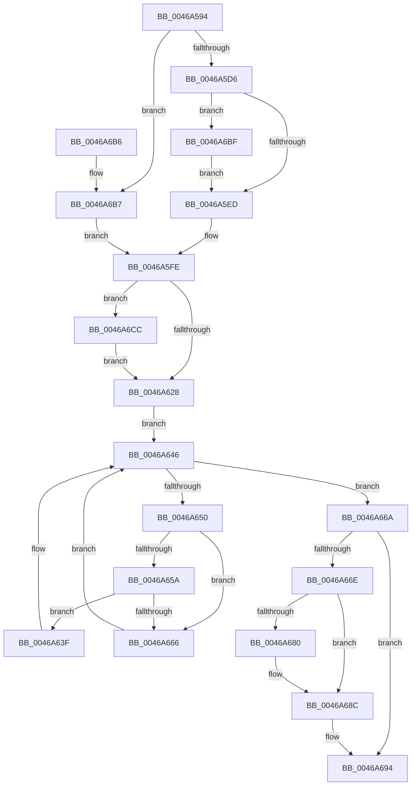

# IvtIommuWaitCommand

- RVA: `0x0046A594`–`0x0046A6DB` (길이 `327` bytes)
- VA: `0x000000014046A594`
- 실행 섹션: `.text`
- PDB 이름 있음: `예`; PDB Function 태그: `아니요`
- unwind 정보 RVA: `0x000AB2F8`
- 디코드: `81`개 명령, `327/327` bytes 표시
- 미해석 바이트: `0` (있으면 어셈블리에 `.byte`로 보존)

> 이 문서는 커널 이미지의 기계어와 PDB 기호를 분석해 생성했습니다. 4번과 5번은 함수 원형과 자료형을 바이너리 사용 방식에서 추정한 C 해석이며 원본 소스 복구 결과는 아닙니다.

## 1. Dependencies

- 직접 호출 지점: **7**; 고유 호출 대상: **7**
- 직접 호출자로 확인된 함수: **8**
- RIP 상대 이미지 참조: **4**

### Outgoing calls
- `0x0046A5F9` → [KeAcquireInStackQueuedSpinLockAtDpcLevel](../27/KeAcquireInStackQueuedSpinLockAtDpcLevel_function_00275740.md) (function, `0x00275740`)
- `0x0046A636` → [IvtIommuSendCommand](IvtIommuSendCommand_function_0046A6E4.md) (function, `0x0046A6E4`)
- `0x0046A641` → [guard_dispatch_icall](../6B/guard_dispatch_icall_function_006BAAD0.md) (function, `0x006BAAD0`)
- `0x0046A673` → [KeReleaseInStackQueuedSpinLockFromDpcLevel](../21/KeReleaseInStackQueuedSpinLockFromDpcLevel_function_002171B0.md) (function, `0x002171B0`)
- `0x0046A687` → [KiLowerIrqlProcessIrqlFlags](../4F/KiLowerIrqlProcessIrqlFlags_function_004F5698.md) (function, `0x004F5698`)
- `0x0046A69C` → [_security_check_cookie](../6A/_security_check_cookie_function_006AC640.md) (function, `0x006AC640`)
- `0x0046A6C2` → [KiRaiseIrqlProcessIrqlFlags](../4F/KiRaiseIrqlProcessIrqlFlags_function_004F56FC.md) (function, `0x004F56FC`)

### Direct callers
- [IvtFlushTbInternal](../2D/IvtFlushTbInternal_function_002D2548.md) at `0x002D27D4`
- [IvtInvalidateRemappingTableEntries](IvtInvalidateRemappingTableEntries_function_0046A520.md) at `0x0046A573`
- [IvtDrainSvmPageRequests](../56/IvtDrainSvmPageRequests_function_0056F4B0.md) at `0x0056F52B`
- [IvtDrainSvmPageRequests](../56/IvtDrainSvmPageRequests_function_0056F4B0.md) at `0x0056F588`
- [IvtDrainSvmPageRequests](../56/IvtDrainSvmPageRequests_function_0056F4B0.md) at `0x0056F5B4`
- [IvtFlushDeviceTbOnly](../56/IvtFlushDeviceTbOnly_function_0056F7A0.md) at `0x0056F80E`
- [IvtInvalidateAllContextEntries](../57/IvtInvalidateAllContextEntries_function_00570858.md) at `0x00570894`
- [IvtInvalidateContextEntry](../57/IvtInvalidateContextEntry_function_005708B4.md) at `0x00570921`
- [IvtInvalidateScalableModePasidCache](../57/IvtInvalidateScalableModePasidCache_function_005709B8.md) at `0x00570AF6`
- [IvtLegacyFlushTbInternal](../57/IvtLegacyFlushTbInternal_function_005714E8.md) at `0x00571B3B`

### Static image references
- `0x0046A5A8` → RVA `0x00E0A740` (`.data`; read)
- `0x0046A5E1` → RVA `0x00FC6D20` (`ALMOSTRO`; read)
- `0x0046A652` → RVA `0x00FC1C7C` (`.data`; reference)
- `0x0046A65A` → RVA `0x00FC1C80` (`.data`; read)

## 2. Other-region calls and transfers

- 다른 실행 섹션으로 향하는 call: **0**
- 별도 외부 분기/꼬리 이동을 확인하지 못했습니다.

## 3. Assembly (complete function range)

```asm
0046A594  4C 8B DC                        mov r11, rsp
0046A597  49 89 5B 10                     mov qword ptr [r11 + 0x10], rbx
0046A59B  49 89 6B 18                     mov qword ptr [r11 + 0x18], rbp
0046A59F  49 89 73 20                     mov qword ptr [r11 + 0x20], rsi
0046A5A3  57                              push rdi
0046A5A4  48 83 EC 50                     sub rsp, 0x50
0046A5A8  48 8B 05 91 01 9A 00            mov rax, qword ptr [rip + 0x9a0191]
0046A5AF  48 33 C4                        xor rax, rsp
0046A5B2  48 89 44 24 48                  mov qword ptr [rsp + 0x48], rax
0046A5B7  33 C0                           xor eax, eax
0046A5B9  0F 57 C0                        xorps xmm0, xmm0
0046A5BC  41 8B E8                        mov ebp, r8d
0046A5BF  8B F2                           mov esi, edx
0046A5C1  48 8B D9                        mov rbx, rcx
0046A5C4  0F 11 44 24 20                  movups xmmword ptr [rsp + 0x20], xmm0
0046A5C9  49 89 43 D8                     mov qword ptr [r11 - 0x28], rax
0046A5CD  45 85 C0                        test r8d, r8d
0046A5D0  0F 85 E1 00 00 00               jne 0x14046a6b7
0046A5D6  44 0F 20 C7                     mov rdi, cr8
0046A5DA  8D 50 0F                        lea edx, [rax + 0xf]
0046A5DD  44 0F 22 C2                     mov cr8, rdx
0046A5E1  39 05 39 C7 B5 00               cmp dword ptr [rip + 0xb5c739], eax
0046A5E7  0F 85 D2 00 00 00               jne 0x14046a6bf
0046A5ED  48 8D 8B D0 00 00 00            lea rcx, [rbx + 0xd0]
0046A5F4  48 8D 54 24 20                  lea rdx, [rsp + 0x20]
0046A5F9  E8 42 B1 E0 FF                  call 0x140275740
0046A5FE  48 8B 8B C0 00 00 00            mov rcx, qword ptr [rbx + 0xc0]
0046A605  48 8B 83 C8 00 00 00            mov rax, qword ptr [rbx + 0xc8]
0046A60C  48 89 4C 24 38                  mov qword ptr [rsp + 0x38], rcx
0046A611  48 89 44 24 40                  mov qword ptr [rsp + 0x40], rax
0046A616  C7 83 B0 00 00 00 01 00 00 00   mov dword ptr [rbx + 0xb0], 1
0046A620  85 F6                           test esi, esi
0046A622  0F 85 A4 00 00 00               jne 0x14046a6cc
0046A628  41 B8 01 00 00 00               mov r8d, 1
0046A62E  48 8D 54 24 38                  lea rdx, [rsp + 0x38]
0046A633  48 8B CB                        mov rcx, rbx
0046A636  E8 A9 00 00 00                  call 0x14046a6e4
0046A63B  33 F6                           xor esi, esi
0046A63D  EB 07                           jmp 0x14046a646
0046A63F  8B CE                           mov ecx, esi
0046A641  E8 8A 04 25 00                  call 0x1406baad0
0046A646  8B 83 B0 00 00 00               mov eax, dword ptr [rbx + 0xb0]
0046A64C  85 C0                           test eax, eax
0046A64E  74 1A                           je 0x14046a66a
0046A650  FF C6                           inc esi
0046A652  85 35 24 76 B5 00               test dword ptr [rip + 0xb57624], esi
0046A658  75 0C                           jne 0x14046a666
0046A65A  48 8B 05 1F 76 B5 00            mov rax, qword ptr [rip + 0xb5761f]
0046A661  48 85 C0                        test rax, rax
0046A664  75 D9                           jne 0x14046a63f
0046A666  F3 90                           pause
0046A668  EB DC                           jmp 0x14046a646
0046A66A  85 ED                           test ebp, ebp
0046A66C  75 26                           jne 0x14046a694
0046A66E  48 8D 4C 24 20                  lea rcx, [rsp + 0x20]
0046A673  E8 38 CB DA FF                  call 0x1402171b0
0046A678  39 2D A2 C6 B5 00               cmp dword ptr [rip + 0xb5c6a2], ebp
0046A67E  74 0C                           je 0x14046a68c
0046A680  44 0F 20 C1                     mov rcx, cr8
0046A684  40 8A D7                        mov dl, dil
0046A687  E8 0C B0 08 00                  call 0x1404f5698
0046A68C  40 0F B6 C7                     movzx eax, dil
0046A690  44 0F 22 C0                     mov cr8, rax
0046A694  48 8B 4C 24 48                  mov rcx, qword ptr [rsp + 0x48]
0046A699  48 33 CC                        xor rcx, rsp
0046A69C  E8 9F 1F 24 00                  call 0x1406ac640
0046A6A1  48 8B 5C 24 68                  mov rbx, qword ptr [rsp + 0x68]
0046A6A6  48 8B 6C 24 70                  mov rbp, qword ptr [rsp + 0x70]
0046A6AB  48 8B 74 24 78                  mov rsi, qword ptr [rsp + 0x78]
0046A6B0  48 83 C4 50                     add rsp, 0x50
0046A6B4  5F                              pop rdi
0046A6B5  C3                              ret
0046A6B6  CC                              int3
0046A6B7  40 32 FF                        xor dil, dil
0046A6BA  E9 3F FF FF FF                  jmp 0x14046a5fe
0046A6BF  40 8A CF                        mov cl, dil
0046A6C2  E8 35 B0 08 00                  call 0x1404f56fc
0046A6C7  E9 21 FF FF FF                  jmp 0x14046a5ed
0046A6CC  48 0F BA E9 07                  bts rcx, 7
0046A6D1  48 89 4C 24 38                  mov qword ptr [rsp + 0x38], rcx
0046A6D6  E9 4D FF FF FF                  jmp 0x14046a628
```

## 4. C-style interpretation (structured pseudocode)

```c
__int64 __fastcall IvtIommuWaitCommand(__int64 a1, int a2, int a3)
{
    __int64 result;
    __int64 v_rdi;
    __int64 v_rsi;
    __int64 v_rsp;
    unsigned __int64 v_stack_m10;
    unsigned __int64 v_stack_m18;
    unsigned __int64 v_stack_m20;
    unsigned __int64 v_stack_m38;
    unsigned __int64 v_stack_p10;
    unsigned __int64 v_stack_p18;
    unsigned __int64 v_stack_p20;
    unsigned __int64 v_stack_p38;

    *(unsigned __int64 *)(v_rsp + 16) = v_rbx;
    *(unsigned __int64 *)(v_rsp + 24) = v_rbp;
    *(unsigned __int64 *)(v_rsp + 32) = v_rsi;
    v_rsp = (v_rsp) - (80);
    result = (*(unsigned __int64 *)(v_rip + 10092945)) ^ (v_rsp);
    v_stack_m10 = result;
    result = 0;
    v_stack_m38 = v_xmm0;
    *(unsigned __int64 *)(v_rsp - 40) = 0;
    if (a3 != 0) goto loc_0046A6B7;
    if ((*(unsigned int *)(v_rip + 11913017)) != 0) goto loc_0046A6BF;
loc_0046A5ED:
    result = KeAcquireInStackQueuedSpinLockAtDpcLevel(a1 + 208, v_stack_m38, a3, a4);
loc_0046A5FE:
    v_stack_m20 = *(unsigned __int64 *)(a1 + 192);
    v_stack_m18 = *(unsigned __int64 *)(a1 + 200);
    *(unsigned int *)(a1 + 176) = 1;
    if ((unsigned int)((unsigned int)(a2)) != 0) goto loc_0046A6CC;
loc_0046A628:
    result = IvtIommuSendCommand(a1, v_stack_m20, 1, a4);
    v_rsi = 0;
    goto loc_0046A646;
loc_0046A63F:
    result = guard_dispatch_icall(0, v_stack_m20, 1, a4);
loc_0046A646:
    if ((unsigned int)((unsigned int)(*(unsigned int *)(a1 + 176))) == 0) goto loc_0046A66A;
    v_rsi = (unsigned int)((v_rsi) + 1);
    if (((*(unsigned int *)(v_rip + 11892260)) & ((unsigned int)(v_rsi))) != 0) goto loc_0046A666;
    if (*(unsigned __int64 *)(v_rip + 11892255) != 0) goto loc_0046A63F;
loc_0046A666:
    goto loc_0046A646;
loc_0046A66A:
    if ((unsigned int)((unsigned int)(a3)) != 0) goto loc_0046A694;
    result = KeReleaseInStackQueuedSpinLockFromDpcLevel(v_stack_m38, v_stack_m20, 1, a4);
    if ((*(unsigned int *)(v_rip + 11912866)) != ((unsigned int)((unsigned int)(a3)))) {
        a1 = result + 15;
        a2 = (unsigned __int8)(v_cr8);
        result = KiLowerIrqlProcessIrqlFlags(a1, a2, 1, a4);
    }
loc_0046A694:
    a1 = (v_stack_m10) ^ (v_rsp);
    result = _security_check_cookie(a1, a2, 1, a4);
    v_rsp = (v_rsp) + (80);
    return result;
loc_0046A6B7:
    v_rdi = 0;
    goto loc_0046A5FE;
loc_0046A6BF:
    result = KiRaiseIrqlProcessIrqlFlags(0, a2, 1, a4);
    goto loc_0046A5ED;
loc_0046A6CC:
    v_stack_p38 = 0;
    goto loc_0046A628;
}
```

## 5. (Beta) C Style

```c
int64_t IvtIommuWaitCommand(void *Arg1, int32_t Arg2, int32_t Arg3)
{
    uint8_t *arg1 = (uint8_t *)Arg1;

    int64_t result;
    int64_t local_rdi;
    int64_t local_rsi;
    int64_t local_rsp;
    uint64_t v_stack_m10;
    uint64_t v_stack_m18;
    uint64_t v_stack_m20;
    uint64_t v_stack_m38;
    uint64_t v_stack_p10;
    uint64_t v_stack_p18;
    uint64_t v_stack_p20;
    uint64_t v_stack_p38;

    *(uint64_t *)(local_rsp + 0x10) = local_rbx;
    *(uint64_t *)(local_rsp + 0x18) = local_rbp;
    *(uint64_t *)(local_rsp + 0x20) = local_rsi;
    local_rsp = (local_rsp) - (80);
    result = (*(uint64_t *)(v_rip + 0x9A0191)) ^ (local_rsp);
    v_stack_m10 = result;
    result = 0;
    v_stack_m38 = v_xmm0;
    *(uint64_t *)(local_rsp - 0x28) = 0;
    if (Arg3 != 0) goto loc_0046A6B7;
    if ((*(uint32_t *)(v_rip + 0xB5C739)) != 0) goto loc_0046A6BF;
loc_0046A5ED:
    result = KeAcquireInStackQueuedSpinLockAtDpcLevel(Arg1 + 208, v_stack_m38, Arg3, a4);
loc_0046A5FE:
    v_stack_m20 = *(uint64_t *)(arg1 + 0xC0);
    v_stack_m18 = *(uint64_t *)(arg1 + 0xC8);
    *(uint32_t *)(arg1 + 0xB0) = 1;
    if ((uint32_t)((uint32_t)(Arg2)) != 0) goto loc_0046A6CC;
loc_0046A628:
    result = IvtIommuSendCommand(Arg1, v_stack_m20, 1, a4);
    local_rsi = 0;
    goto loc_0046A646;
loc_0046A63F:
    result = guard_dispatch_icall(0, v_stack_m20, 1, a4);
loc_0046A646:
    if ((uint32_t)((uint32_t)(*(uint32_t *)(arg1 + 0xB0))) == 0) goto loc_0046A66A;
    local_rsi = (uint32_t)((local_rsi) + 1);
    if (((*(uint32_t *)(v_rip + 0xB57624)) & ((uint32_t)(local_rsi))) != 0) goto loc_0046A666;
    if (*(uint64_t *)(v_rip + 0xB5761F) != 0) goto loc_0046A63F;
loc_0046A666:
    goto loc_0046A646;
loc_0046A66A:
    if ((uint32_t)((uint32_t)(Arg3)) != 0) goto loc_0046A694;
    result = KeReleaseInStackQueuedSpinLockFromDpcLevel(v_stack_m38, v_stack_m20, 1, a4);
    if ((*(uint32_t *)(v_rip + 0xB5C6A2)) != ((uint32_t)((uint32_t)(Arg3)))) {
        Arg1 = result + 15;
        Arg2 = (uint8_t)(v_cr8);
        result = KiLowerIrqlProcessIrqlFlags(Arg1, Arg2, 1, a4);
    }
loc_0046A694:
    Arg1 = (v_stack_m10) ^ (local_rsp);
    result = _security_check_cookie(Arg1, Arg2, 1, a4);
    local_rsp = (local_rsp) + (80);
    return result;
loc_0046A6B7:
    local_rdi = 0;
    goto loc_0046A5FE;
loc_0046A6BF:
    result = KiRaiseIrqlProcessIrqlFlags(0, Arg2, 1, a4);
    goto loc_0046A5ED;
loc_0046A6CC:
    v_stack_p38 = 0;
    goto loc_0046A628;
}
```

### 관측된 메모리 오프셋

구조체 형식이 확인되지 않은 접근은 인자 기준의 오프셋으로만 기록했습니다.

| 기준 인자 | 오프셋 표현 | 폭 (bit) | 접근 |
|---|---:|---:|---|
| `Arg1` | `+ 0xB0` | `32` | `R` |
| `Arg1` | `+ 0xB0` | `32` | `W` |
| `Arg1` | `+ 0xC0` | `64` | `R` |
| `Arg1` | `+ 0xC8` | `64` | `R` |
| `Arg1` | `+ 0xD0` | `64` | `R` |

## 6. Execution-region graph

[열기: 2D/3D 그래프와 함수 탐색 컨트롤 패널](../../../control-panel.html?section=text&rva=0x0046A594&view=graph)

- 2D 그래프는 위에서 아래로 흐르고, 3D 그래프는 빈 공간을 드래그해 회전합니다. Shift+드래그는 이동, 휠은 확대·축소, 함수 노드 선택은 대상 보고서 이동입니다.

### Static fallback


