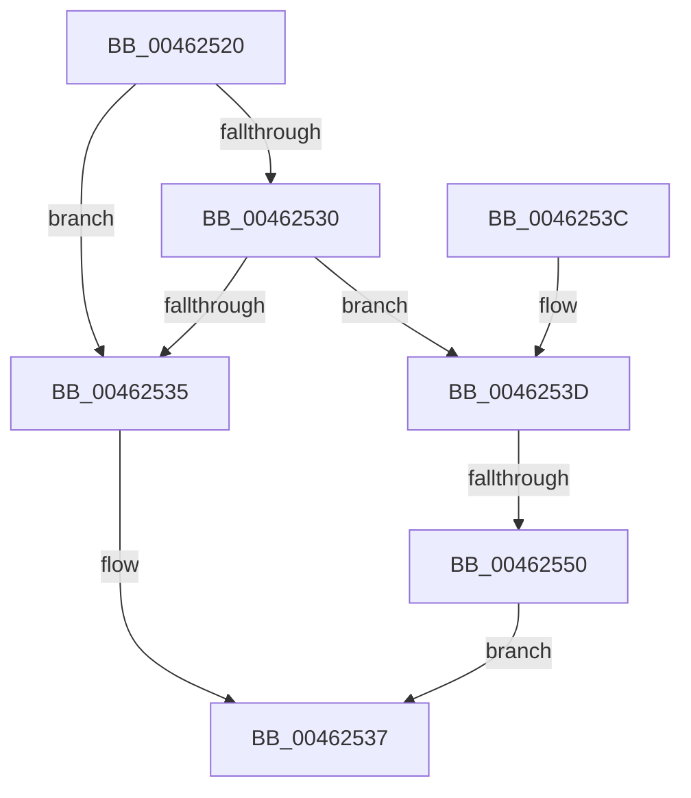

# KasanTrackAddress

- RVA: `0x00462520`–`0x00462557` (길이 `55` bytes)
- VA: `0x0000000140462520`
- 실행 섹션: `.text`
- PDB 이름 있음: `예`; PDB Function 태그: `예`
- unwind 정보 RVA: `0x0009D63C`
- 디코드: `15`개 명령, `55/55` bytes 표시
- 미해석 바이트: `0` (있으면 어셈블리에 `.byte`로 보존)

> 이 문서는 커널 이미지의 기계어와 PDB 기호를 분석해 생성했습니다. 4번과 5번은 함수 원형과 자료형을 바이너리 사용 방식에서 추정한 C 해석이며 원본 소스 복구 결과는 아닙니다.

## 1. Dependencies

- 직접 호출 지점: **0**; 고유 호출 대상: **0**
- 직접 호출자로 확인된 함수: **7**
- RIP 상대 이미지 참조: **1**

### Outgoing calls
- 직접 디코드된 call 명령이 없습니다.

### Direct callers
- [MiMapContiguousMemory](../32/MiMapContiguousMemory_function_0032787C.md) at `0x00327AAC`
- [KcsanMarkAddressIgnored](../4A/KcsanMarkAddressIgnored_function_004AE500.md) at `0x004AE520`
- [KasanDriverLoadImageInternal](../4C/KasanDriverLoadImageInternal_function_004C2840.md) at `0x004C2A62`
- [MmAllocateIsrStack](../../page/80/MmAllocateIsrStack_function_00807ECC.md) at `0x00807F6F`
- [sub_00C36AE9](../../init/C3/Unknown_function_00C36AE9.md) at `0x00C36C3F`
- [MiInitializeSharedUserData](../../init/C5/MiInitializeSharedUserData_function_00C5F098.md) at `0x00C5F274`
- [MiInitializeKasan](../../init/C6/MiInitializeKasan_function_00C60810.md) at `0x00C6086E`
- [MiInitializeKasan](../../init/C6/MiInitializeKasan_function_00C60810.md) at `0x00C60895`
- [MiInitializeKasan](../../init/C6/MiInitializeKasan_function_00C60810.md) at `0x00C608C1`
- [MiInitializeKasan](../../init/C6/MiInitializeKasan_function_00C60810.md) at `0x00C608EB`

### Static image references
- `0x00462524` → RVA `0x00FCEC68` (`ALMOSTRO`; read)

## 2. Other-region calls and transfers

- 다른 실행 섹션으로 향하는 call: **0**
- call이 아닌 외부 분기/꼬리 이동: **1**
  - `0x0046254A` → [sub_006F269E](../6F/Unknown_function_006F269E.md) (`tail-transfer`)

## 3. Assembly (complete function range)

```asm
00462520  48 83 EC 28                     sub rsp, 0x28
00462524  80 3D 3D C7 B6 00 00            cmp byte ptr [rip + 0xb6c73d], 0
0046252B  4C 8B C9                        mov r9, rcx
0046252E  74 05                           je 0x140462535
00462530  48 85 D2                        test rdx, rdx
00462533  75 08                           jne 0x14046253d
00462535  33 C0                           xor eax, eax
00462537  48 83 C4 28                     add rsp, 0x28
0046253B  C3                              ret
0046253C  CC                              int3
0046253D  48 B8 00 00 00 00 00 80 FF FF   movabs rax, 0xffff800000000000
00462547  4C 3B C8                        cmp r9, rax
0046254A  0F 83 4E 01 29 00               jae 0x1406f269e
00462550  B8 EF 00 00 C0                  mov eax, 0xc00000ef
00462555  EB E0                           jmp 0x140462537
```

## 4. C-style interpretation (structured pseudocode)

```c
__int64 __fastcall KasanTrackAddress(__int64 a1, __int64 a2)
{
    __int64 result;
    __int64 v_rsp;

    v_rsp = (v_rsp) - (40);
    if ((*(unsigned __int8 *)(v_rip + 11978557)) == 0) goto loc_00462535;
    if (a2 != 0) goto loc_0046253D;
loc_00462535:
    result = 0;
loc_00462537:
    v_rsp = (v_rsp) + (40);
    return result;
loc_0046253D:
    goto loc_00462537;
}
```

## 5. (Beta) C Style

```c
int64_t KasanTrackAddress(int64_t Arg1, int64_t Arg2)
{
    int64_t result;
    int64_t local_rsp;

    local_rsp = (local_rsp) - (40);
    if ((*(uint8_t *)(v_rip + 0xB6C73D)) == 0) goto loc_00462535;
    if (Arg2 != 0) goto loc_0046253D;
loc_00462535:
    result = 0;
loc_00462537:
    local_rsp = (local_rsp) + (40);
    return result;
loc_0046253D:
    goto loc_00462537;
}
```

## 6. Execution-region graph

[열기: 2D/3D 그래프와 함수 탐색 컨트롤 패널](../../../control-panel.html?section=text&rva=0x00462520&view=graph)

- 2D 그래프는 위에서 아래로 흐르고, 3D 그래프는 빈 공간을 드래그해 회전합니다. Shift+드래그는 이동, 휠은 확대·축소, 함수 노드 선택은 대상 보고서 이동입니다.

### Static fallback


