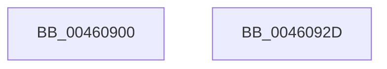

# KeCheckProcessorGroupAffinity

- RVA: `0x00460900`–`0x0046092E` (길이 `46` bytes)
- VA: `0x0000000140460900`
- 실행 섹션: `.text`
- PDB 이름 있음: `예`; PDB Function 태그: `아니요`
- unwind 정보 RVA: `0x000DB714`
- 디코드: `16`개 명령, `46/46` bytes 표시
- 미해석 바이트: `0` (있으면 어셈블리에 `.byte`로 보존)

> 이 문서는 커널 이미지의 기계어와 PDB 기호를 분석해 생성했습니다. 4번과 5번은 함수 원형과 자료형을 바이너리 사용 방식에서 추정한 C 해석이며 원본 소스 복구 결과는 아닙니다.

## 1. Dependencies

- 직접 호출 지점: **0**; 고유 호출 대상: **0**
- 직접 호출자로 확인된 함수: **1**
- RIP 상대 이미지 참조: **1**

### Outgoing calls
- 직접 디코드된 call 명령이 없습니다.

### Direct callers
- [sub_0050C0E0](../50/Unknown_function_0050C0E0.md) at `0x0050C8EB`

### Static image references
- `0x00460900` → RVA `0x00F231B0` (`.data`; read)

## 2. Other-region calls and transfers

- 다른 실행 섹션으로 향하는 call: **0**
- 별도 외부 분기/꼬리 이동을 확인하지 못했습니다.

## 3. Assembly (complete function range)

```asm
00460900  48 8B 05 A9 28 AC 00            mov rax, qword ptr [rip + 0xac28a9]
00460907  4C 8B C9                        mov r9, rcx
0046090A  8B D2                           mov edx, edx
0046090C  45 0F B7 41 08                  movzx r8d, word ptr [r9 + 8]
00460911  8B 0C 90                        mov ecx, dword ptr [rax + rdx*4]
00460914  8B D1                           mov edx, ecx
00460916  C1 EA 06                        shr edx, 6
00460919  33 C0                           xor eax, eax
0046091B  41 3B D0                        cmp edx, r8d
0046091E  49 8B 11                        mov rdx, qword ptr [r9]
00460921  0F 94 C0                        sete al
00460924  83 E1 3F                        and ecx, 0x3f
00460927  48 D3 EA                        shr rdx, cl
0046092A  23 C2                           and eax, edx
0046092C  C3                              ret
0046092D  CC                              int3
```

## 4. C-style interpretation (structured pseudocode)

```c
__int64 __fastcall KeCheckProcessorGroupAffinity(__int64 a1, int a2)
{
    __int64 result;

    a2 = (unsigned int)(((unsigned int)((unsigned int)((unsigned int)(*(unsigned int *)(*(unsigned __int64 *)(v_rip + 11282601) + (unsigned int)(a2) * 4))))) >> (6));
    result = 0;
    result = (a2 == ((unsigned int)(*(unsigned __int16 *)(a1 + 8)))) ? 1 : 0;
    a1 = (unsigned int)(((unsigned int)(*(unsigned int *)(*(unsigned __int64 *)(v_rip + 11282601) + (unsigned int)(a2) * 4))) & (63));
    a2 = (*(unsigned __int64 *)(a1)) >> ((unsigned __int8)(a1));
    result = (unsigned int)((result) & (a2));
    return result;
}
```

## 5. (Beta) C Style

```c
int64_t KeCheckProcessorGroupAffinity(void *Arg1, int32_t Arg2)
{
    uint8_t *arg1 = (uint8_t *)Arg1;

    int64_t result;

    Arg2 = (uint32_t)(((uint32_t)((uint32_t)((uint32_t)(*(uint32_t *)(*(uint64_t *)(v_rip + 0xAC28A9) + (uint32_t)(Arg2) * 4))))) >> (6));
    result = 0;
    result = (Arg2 == ((uint32_t)(*(uint16_t *)(arg1 + 0x8)))) ? 1 : 0;
    Arg1 = (uint32_t)(((uint32_t)(*(uint32_t *)(*(uint64_t *)(v_rip + 0xAC28A9) + (uint32_t)(Arg2) * 4))) & (63));
    Arg2 = (*(uint64_t *)(arg1)) >> ((uint8_t)(Arg1));
    result = (uint32_t)((result) & (Arg2));
    return result;
}
```

### 관측된 메모리 오프셋

구조체 형식이 확인되지 않은 접근은 인자 기준의 오프셋으로만 기록했습니다.

| 기준 인자 | 오프셋 표현 | 폭 (bit) | 접근 |
|---|---:|---:|---|
| `Arg1` | `+ 0x0` | `64` | `R` |
| `Arg1` | `+ 0x8` | `16` | `R` |

## 6. Execution-region graph

[열기: 2D/3D 그래프와 함수 탐색 컨트롤 패널](../../../control-panel.html?section=text&rva=0x00460900&view=graph)

- 2D 그래프는 위에서 아래로 흐르고, 3D 그래프는 빈 공간을 드래그해 회전합니다. Shift+드래그는 이동, 휠은 확대·축소, 함수 노드 선택은 대상 보고서 이동입니다.

### Static fallback


