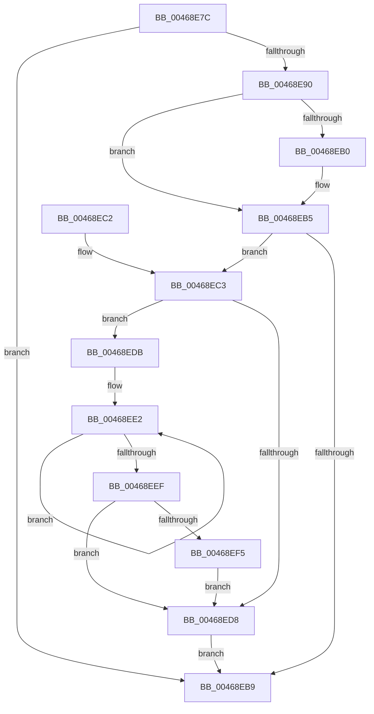

# KeExitRetpoline

- RVA: `0x00468E7C`–`0x00468EFC` (길이 `128` bytes)
- VA: `0x0000000140468E7C`
- 실행 섹션: `.text`
- PDB 이름 있음: `예`; PDB Function 태그: `아니요`
- unwind 정보 RVA: `0x0005E698`
- 디코드: `35`개 명령, `128/128` bytes 표시
- 미해석 바이트: `0` (있으면 어셈블리에 `.byte`로 보존)

> 이 문서는 커널 이미지의 기계어와 PDB 기호를 분석해 생성했습니다. 4번과 5번은 함수 원형과 자료형을 바이너리 사용 방식에서 추정한 C 해석이며 원본 소스 복구 결과는 아닙니다.

## 1. Dependencies

- 직접 호출 지점: **3**; 고유 호출 대상: **3**
- 직접 호출자로 확인된 함수: **13**
- RIP 상대 이미지 참조: **1**

### Outgoing calls
- `0x00468E90` → [KeDisableInterrupts](../21/KeDisableInterrupts_function_00217BE0.md) (function, `0x00217BE0`)
- `0x00468EB0` → [_guard_retpoline_exit](../../kscp/BC/_guard_retpoline_exit_function_00BCE580.md) (function, `0x00BCE580`)
- `0x00468EF5` → [KiRemoveSystemWorkPriorityKick](../26/KiRemoveSystemWorkPriorityKick_function_002631D0.md) (function, `0x002631D0`)

### Direct callers
- [KiDispatchCallout](KiDispatchCallout_function_00468CE0.md) at `0x00468CF5`
- [CcBcbProfiler](../50/CcBcbProfiler_function_005099B0.md) at `0x005099CF`
- [sub_0050A560](../50/Unknown_function_0050A560.md) at `0x0050A585`
- [KiSwInterruptDispatch](../50/KiSwInterruptDispatch_function_0050A5C0.md) at `0x0050A5F3`
- [sub_0050BDE0](../50/Unknown_function_0050BDE0.md) at `0x0050BDFD`
- [sub_0051AC80](../51/Unknown_function_0051AC80.md) at `0x0051AC8D`
- [RtlpComputeEpilogueOffset](../51/RtlpComputeEpilogueOffset_function_0051C81C.md) at `0x0051C88B`
- [KiOptimizeSpecCtrlSettingsWorker](../5B/KiOptimizeSpecCtrlSettingsWorker_function_005BF5A0.md) at `0x005BFDA0`
- [sub_0069B640](../69/Unknown_function_0069B640.md) at `0x0069B657`
- [FsRtlTruncateSmallMcb](../69/FsRtlTruncateSmallMcb_function_0069BA30.md) at `0x0069BA58`
- [KiLockServiceTable](../69/KiLockServiceTable_function_0069BC98.md) at `0x0069BCBE`
- [sub_00705ED0](../../page/70/Unknown_function_00705ED0.md) at `0x00705EE7`
- [KeUserModeCallback](../../page/8E/KeUserModeCallback_function_008E8A00.md) at `0x008E8CBA`

### Static image references
- `0x00468E82` → RVA `0x00FC6B48` (`ALMOSTRO`; read)

## 2. Other-region calls and transfers

- 다른 실행 섹션으로 향하는 call: **1**
  - `0x00468EB0` → [_guard_retpoline_exit](../../kscp/BC/_guard_retpoline_exit_function_00BCE580.md) (`.text` → `KSCP`)
- 별도 외부 분기/꼬리 이동을 확인하지 못했습니다.

## 3. Assembly (complete function range)

```asm
00468E7C  40 53                           push rbx
00468E7E  48 83 EC 20                     sub rsp, 0x20
00468E82  48 8B 05 BF DC B5 00            mov rax, qword ptr [rip + 0xb5dcbf]
00468E89  48 0F BA E0 29                  bt rax, 0x29
00468E8E  73 29                           jae 0x140468eb9
00468E90  E8 4B ED DA FF                  call 0x140217be0
00468E95  65 48 8B 0C 25 20 00 00 00      mov rcx, qword ptr gs:[0x20]
00468E9E  8A D8                           mov bl, al
00468EA0  80 89 DE 06 00 00 01            or byte ptr [rcx + 0x6de], 1
00468EA7  F6 81 DE 06 00 00 02            test byte ptr [rcx + 0x6de], 2
00468EAE  75 05                           jne 0x140468eb5
00468EB0  E8 CB 56 76 00                  call 0x140bce580
00468EB5  84 DB                           test bl, bl
00468EB7  75 0A                           jne 0x140468ec3
00468EB9  0F AE E8                        lfence
00468EBC  48 83 C4 20                     add rsp, 0x20
00468EC0  5B                              pop rbx
00468EC1  C3                              ret
00468EC2  CC                              int3
00468EC3  65 48 8B 0C 25 20 00 00 00      mov rcx, qword ptr gs:[0x20]
00468ECC  4C 8B 81 B8 8E 00 00            mov r8, qword ptr [rcx + 0x8eb8]
00468ED3  4D 85 C0                        test r8, r8
00468ED6  75 03                           jne 0x140468edb
00468ED8  FB                              sti
00468ED9  EB DE                           jmp 0x140468eb9
00468EDB  41 0F 0D 08                     prefetchw byte ptr [r8]
00468EDF  41 8B 00                        mov eax, dword ptr [r8]
00468EE2  8B D0                           mov edx, eax
00468EE4  0F BA F2 15                     btr edx, 0x15
00468EE8  F0 41 0F B1 10                  lock cmpxchg dword ptr [r8], edx
00468EED  75 F3                           jne 0x140468ee2
00468EEF  0F BA E0 15                     bt eax, 0x15
00468EF3  73 E3                           jae 0x140468ed8
00468EF5  E8 D6 A2 DF FF                  call 0x1402631d0
00468EFA  EB DC                           jmp 0x140468ed8
```

## 4. C-style interpretation (structured pseudocode)

```c
__int64 __fastcall KeExitRetpoline(void)
{
    __int64 result;
    __int64 v_rsp;

    v_rsp = (v_rsp) - (32);
    if (condition_is_above_or_equal) goto loc_00468EB9;
    result = KeDisableInterrupts(a1, a2, a3, a4);
    if (((*(unsigned __int8 *)(*(unsigned __int64 *)(gs_base + (0 + 32)) + 1758)) & (2)) == 0) {
        result = _guard_retpoline_exit(*(unsigned __int64 *)(gs_base + (0 + 32)), a2, a3, a4);
    }
    if ((unsigned __int8)((unsigned __int8)(result)) != 0) goto loc_00468EC3;
loc_00468EB9:
    v_rsp = (v_rsp) + (32);
    return result;
loc_00468EC3:
    if (*(unsigned __int64 *)(*(unsigned __int64 *)(gs_base + (0 + 32)) + 36536) != 0) goto loc_00468EDB;
loc_00468ED8:
    goto loc_00468EB9;
loc_00468EDB:
loc_00468EE2:
    if (*(unsigned __int64 *)(*(unsigned __int64 *)(gs_base + (0 + 32)) + 36536) != 0) goto loc_00468EE2;
    if (condition_is_above_or_equal) goto loc_00468ED8;
    result = KiRemoveSystemWorkPriorityKick(*(unsigned __int64 *)(gs_base + (0 + 32)), (unsigned int)((unsigned int)((unsigned int)(*(unsigned int *)(*(unsigned __int64 *)(*(unsigned __int64 *)(gs_base + (0 + 32)) + 36536))))), *(unsigned __int64 *)(*(unsigned __int64 *)(gs_base + (0 + 32)) + 36536), a4);
    goto loc_00468ED8;
}
```

## 5. (Beta) C Style

```c
void KeExitRetpoline(void)
{
    int64_t result;
    int64_t local_rsp;

    local_rsp = (local_rsp) - (32);
    if (condition_is_above_or_equal) goto loc_00468EB9;
    result = KeDisableInterrupts(a1, a2, a3, a4);
    if (((*(uint8_t *)(*(uint64_t *)(gs_base + (0 + 0x20)) + 0x6DE)) & (2)) == 0) {
        result = _guard_retpoline_exit(*(uint64_t *)(gs_base + (0 + 0x20)), a2, a3, a4);
    }
    if ((uint8_t)((uint8_t)(result)) != 0) goto loc_00468EC3;
loc_00468EB9:
    local_rsp = (local_rsp) + (32);
    return result;
loc_00468EC3:
    if (*(uint64_t *)(*(uint64_t *)(gs_base + (0 + 0x20)) + 0x8EB8) != 0) goto loc_00468EDB;
loc_00468ED8:
    goto loc_00468EB9;
loc_00468EDB:
loc_00468EE2:
    if (*(uint64_t *)(*(uint64_t *)(gs_base + (0 + 0x20)) + 0x8EB8) != 0) goto loc_00468EE2;
    if (condition_is_above_or_equal) goto loc_00468ED8;
    result = KiRemoveSystemWorkPriorityKick(*(uint64_t *)(gs_base + (0 + 0x20)), (uint32_t)((uint32_t)((uint32_t)(*(uint32_t *)(*(uint64_t *)(*(uint64_t *)(gs_base + (0 + 0x20)) + 0x8EB8))))), *(uint64_t *)(*(uint64_t *)(gs_base + (0 + 0x20)) + 0x8EB8), a4);
    goto loc_00468ED8;
}
```

## 6. Execution-region graph

[열기: 2D/3D 그래프와 함수 탐색 컨트롤 패널](../../../control-panel.html?section=text&rva=0x00468E7C&view=graph)

- 2D 그래프는 위에서 아래로 흐르고, 3D 그래프는 빈 공간을 드래그해 회전합니다. Shift+드래그는 이동, 휠은 확대·축소, 함수 노드 선택은 대상 보고서 이동입니다.

### Static fallback


