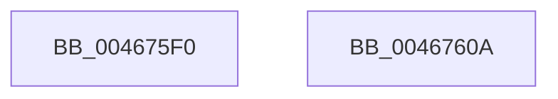

# KeExpandKernelStackAndCallout

- RVA: `0x004675F0`–`0x0046760B` (길이 `27` bytes)
- VA: `0x00000001404675F0`
- 실행 섹션: `.text`
- PDB 이름 있음: `예`; PDB Function 태그: `아니요`
- unwind 정보 RVA: `0x0005D2F4`
- 디코드: `7`개 명령, `27/27` bytes 표시
- 미해석 바이트: `0` (있으면 어셈블리에 `.byte`로 보존)

> 이 문서는 커널 이미지의 기계어와 PDB 기호를 분석해 생성했습니다. 4번과 5번은 함수 원형과 자료형을 바이너리 사용 방식에서 추정한 C 해석이며 원본 소스 복구 결과는 아닙니다.

## 1. Dependencies

- 직접 호출 지점: **1**; 고유 호출 대상: **1**
- 직접 호출자로 확인된 함수: **11**
- RIP 상대 이미지 참조: **0**

### Outgoing calls
- `0x00467600` → [KeExpandKernelStackAndCalloutInternal](../2F/KeExpandKernelStackAndCalloutInternal_function_002F8450.md) (function, `0x002F8450`)

### Direct callers
- [MiInitializePartitionSpecialPurposeMemory](../../page/80/MiInitializePartitionSpecialPurposeMemory_function_0080F704.md) at `0x0080F7DC`
- [NtEnumerateKey](../../page/8B/NtEnumerateKey_function_008B1F70.md) at `0x008B21EC`
- [NtQueryValueKey](../../page/8B/NtQueryValueKey_function_008B2A00.md) at `0x008B2E8D`
- [NtOpenKeyEx](../../page/A4/NtOpenKeyEx_function_00A45CC0.md) at `0x00A45D3B`
- [NtCreateKey](../../page/A7/NtCreateKey_function_00A7A150.md) at `0x00A7A1DA`
- [NtCreateKeyTransacted](../../page/AA/NtCreateKeyTransacted_function_00AAF830.md) at `0x00AAF973`
- [sub_00B1A740](../../page/B1/Unknown_function_00B1A740.md) at `0x00B1A7BC`
- [IovpLogStackTrace](../../pagevrfy/BB/IovpLogStackTrace_function_00BB6A5C.md) at `0x00BB6AF0`
- [KeCheckedKernelInitialize](../../init/BE/KeCheckedKernelInitialize_function_00BEFA6C.md) at `0x00BEFAF0`
- [KiFilterFiberContext](../../init/BE/KiFilterFiberContext_function_00BEFB50.md) at `0x00BEFD67`
- [KiFilterFiberContext](../../init/BE/KiFilterFiberContext_function_00BEFB50.md) at `0x00BEFE4B`
- [KiFilterFiberContext](../../init/BE/KiFilterFiberContext_function_00BEFB50.md) at `0x00BEFEC1`
- [sub_00C7F7B0](../../init/C7/Unknown_function_00C7F7B0.md) at `0x00C7F82D`

### Static image references
- 디코드된 RIP-relative 메모리 참조가 없습니다.

## 2. Other-region calls and transfers

- 다른 실행 섹션으로 향하는 call: **0**
- 별도 외부 분기/꼬리 이동을 확인하지 못했습니다.

## 3. Assembly (complete function range)

```asm
004675F0  48 83 EC 38                     sub rsp, 0x38
004675F4  48 83 64 24 20 00               and qword ptr [rsp + 0x20], 0
004675FA  41 B9 02 00 00 00               mov r9d, 2
00467600  E8 4B 0E E9 FF                  call 0x1402f8450
00467605  48 83 C4 38                     add rsp, 0x38
00467609  C3                              ret
0046760A  CC                              int3
```

## 4. C-style interpretation (structured pseudocode)

```c
__int64 __fastcall KeExpandKernelStackAndCallout(void)
{
    __int64 result;
    __int64 v_rsp;
    unsigned __int64 v_stack_m18;

    v_rsp = (v_rsp) - (56);
    result = KeExpandKernelStackAndCalloutInternal(a1, a2, a3, 2);
    v_rsp = (v_rsp) + (56);
    return result;
}
```

## 5. (Beta) C Style

```c
void KeExpandKernelStackAndCallout(void)
{
    int64_t result;
    int64_t local_rsp;
    uint64_t v_stack_m18;

    local_rsp = (local_rsp) - (56);
    result = KeExpandKernelStackAndCalloutInternal(a1, a2, a3, 2);
    local_rsp = (local_rsp) + (56);
    return result;
}
```

## 6. Execution-region graph

[열기: 2D/3D 그래프와 함수 탐색 컨트롤 패널](../../../control-panel.html?section=text&rva=0x004675F0&view=graph)

- 2D 그래프는 위에서 아래로 흐르고, 3D 그래프는 빈 공간을 드래그해 회전합니다. Shift+드래그는 이동, 휠은 확대·축소, 함수 노드 선택은 대상 보고서 이동입니다.

### Static fallback


