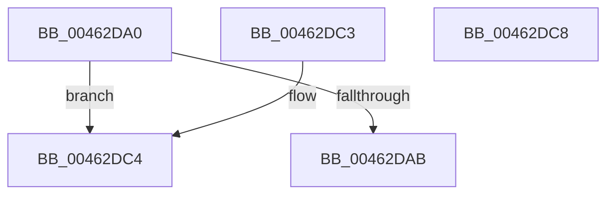

# KeFindFirstSetLeftGroupAffinity

- RVA: `0x00462DA0`–`0x00462DC9` (길이 `41` bytes)
- VA: `0x0000000140462DA0`
- 실행 섹션: `.text`
- PDB 이름 있음: `예`; PDB Function 태그: `아니요`
- unwind 정보 RVA: `0x000DB714`
- 디코드: `15`개 명령, `41/41` bytes 표시
- 미해석 바이트: `0` (있으면 어셈블리에 `.byte`로 보존)

> 이 문서는 커널 이미지의 기계어와 PDB 기호를 분석해 생성했습니다. 4번과 5번은 함수 원형과 자료형을 바이너리 사용 방식에서 추정한 C 해석이며 원본 소스 복구 결과는 아닙니다.

## 1. Dependencies

- 직접 호출 지점: **0**; 고유 호출 대상: **0**
- 직접 호출자로 확인된 함수: **0**
- RIP 상대 이미지 참조: **1**

### Outgoing calls
- 직접 디코드된 call 명령이 없습니다.

### Direct callers
- 이 함수 시작 RVA로 연결되는 직접 call은 확인되지 않았습니다. 간접 호출은 완전히 역산할 수 없습니다.

### Static image references
- `0x00462DB8` → RVA `0x00F231B8` (`.data`; read)

## 2. Other-region calls and transfers

- 다른 실행 섹션으로 향하는 call: **0**
- 별도 외부 분기/꼬리 이동을 확인하지 못했습니다.

## 3. Assembly (complete function range)

```asm
00462DA0  48 8B C1                        mov rax, rcx
00462DA3  48 8B 09                        mov rcx, qword ptr [rcx]
00462DA6  48 85 C9                        test rcx, rcx
00462DA9  74 19                           je 0x140462dc4
00462DAB  0F B7 40 08                     movzx eax, word ptr [rax + 8]
00462DAF  C1 E0 06                        shl eax, 6
00462DB2  48 0F BD C9                     bsr rcx, rcx
00462DB6  03 C8                           add ecx, eax
00462DB8  48 8B 05 F9 03 AC 00            mov rax, qword ptr [rip + 0xac03f9]
00462DBF  8B 04 88                        mov eax, dword ptr [rax + rcx*4]
00462DC2  C3                              ret
00462DC3  CC                              int3
00462DC4  83 C8 FF                        or eax, 0xffffffff
00462DC7  C3                              ret
00462DC8  CC                              int3
```

## 4. C-style interpretation (structured pseudocode)

```c
__int64 __fastcall KeFindFirstSetLeftGroupAffinity(__int64 a1)
{
    __int64 result;

    if (*(unsigned __int64 *)(a1) == 0) goto loc_00462DC4;
    result = (unsigned int)((*(unsigned __int16 *)(a1 + 8)) << (6));
    a1 = (unsigned int)((*(unsigned __int64 *)(a1)) + ((unsigned int)(result)));
    return (unsigned int)(*(unsigned int *)(*(unsigned __int64 *)(v_rip + 11273209) + a1 * 4));
loc_00462DC4:
    result = (unsigned int)(((unsigned int)(*(unsigned int *)(*(unsigned __int64 *)(v_rip + 11273209) + a1 * 4))) | (0xFFFFFFFFULL));
    return result;
}
```

## 5. (Beta) C Style

```c
int64_t KeFindFirstSetLeftGroupAffinity(void *Arg1)
{
    uint8_t *arg1 = (uint8_t *)Arg1;

    int64_t result;

    if (*(uint64_t *)(arg1) == 0) goto loc_00462DC4;
    result = (uint32_t)((*(uint16_t *)(arg1 + 0x8)) << (6));
    Arg1 = (uint32_t)((*(uint64_t *)(arg1)) + ((uint32_t)(result)));
    return (uint32_t)(*(uint32_t *)(*(uint64_t *)(v_rip + 0xAC03F9) + arg1 * 4));
loc_00462DC4:
    result = (uint32_t)(((uint32_t)(*(uint32_t *)(*(uint64_t *)(v_rip + 0xAC03F9) + arg1 * 4))) | (0xFFFFFFFFULL));
    return result;
}
```

### 관측된 메모리 오프셋

구조체 형식이 확인되지 않은 접근은 인자 기준의 오프셋으로만 기록했습니다.

| 기준 인자 | 오프셋 표현 | 폭 (bit) | 접근 |
|---|---:|---:|---|
| `Arg1` | `+ 0x0` | `64` | `R` |
| `Arg1` | `+ 0x8` | `16` | `R` |

## 6. Execution-region graph

[열기: 2D/3D 그래프와 함수 탐색 컨트롤 패널](../../../control-panel.html?section=text&rva=0x00462DA0&view=graph)

- 2D 그래프는 위에서 아래로 흐르고, 3D 그래프는 빈 공간을 드래그해 회전합니다. Shift+드래그는 이동, 휠은 확대·축소, 함수 노드 선택은 대상 보고서 이동입니다.

### Static fallback


