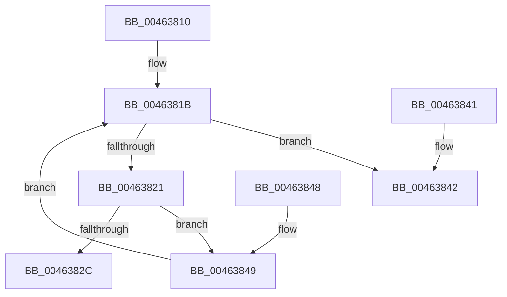

# KeFirstGroupAffinityEx

- RVA: `0x00463810`–`0x0046384E` (길이 `62` bytes)
- VA: `0x0000000140463810`
- 실행 섹션: `.text`
- PDB 이름 있음: `예`; PDB Function 태그: `아니요`
- unwind 정보 RVA: `0x000DB714`
- 디코드: `21`개 명령, `62/62` bytes 표시
- 미해석 바이트: `0` (있으면 어셈블리에 `.byte`로 보존)

> 이 문서는 커널 이미지의 기계어와 PDB 기호를 분석해 생성했습니다. 4번과 5번은 함수 원형과 자료형을 바이너리 사용 방식에서 추정한 C 해석이며 원본 소스 복구 결과는 아닙니다.

## 1. Dependencies

- 직접 호출 지점: **0**; 고유 호출 대상: **0**
- 직접 호출자로 확인된 함수: **7**
- RIP 상대 이미지 참조: **0**

### Outgoing calls
- 직접 디코드된 call 명령이 없습니다.

### Direct callers
- [KeSetSystemMultipleGroupAffinityThread](../4D/KeSetSystemMultipleGroupAffinityThread_function_004D0C88.md) at `0x004D0EEF`
- [PpmIdleInstallNewVetoList](../5C/PpmIdleInstallNewVetoList_function_005CFE90.md) at `0x005CFED1`
- [sub_006D65FC](../6D/Unknown_function_006D65FC.md) at `0x006D6608`
- [sub_006E5A28](../6E/Unknown_function_006E5A28.md) at `0x006E5A34`
- [PpmIdleInitializeConcurrency](../../page/75/PpmIdleInitializeConcurrency_function_00754F30.md) at `0x00754F8A`
- [PpmRegisterPerfStates](../../page/75/PpmRegisterPerfStates_function_0075B084.md) at `0x0075B5CB`
- [NtSetInformationJobObject](../../page/9F/NtSetInformationJobObject_function_009F84C0.md) at `0x009F90B9`

### Static image references
- 디코드된 RIP-relative 메모리 참조가 없습니다.

## 2. Other-region calls and transfers

- 다른 실행 섹션으로 향하는 call: **0**
- 별도 외부 분기/꼬리 이동을 확인하지 못했습니다.

## 3. Assembly (complete function range)

```asm
00463810  44 0F B7 0A                     movzx r9d, word ptr [rdx]
00463814  45 33 D2                        xor r10d, r10d
00463817  41 0F B7 C2                     movzx eax, r10w
0046381B  66 41 3B C1                     cmp ax, r9w
0046381F  73 21                           jae 0x140463842
00463821  44 0F B7 C0                     movzx r8d, ax
00463825  4E 39 54 C2 08                  cmp qword ptr [rdx + r8*8 + 8], r10
0046382A  74 1D                           je 0x140463849
0046382C  0F 57 C0                        xorps xmm0, xmm0
0046382F  0F 11 01                        movups xmmword ptr [rcx], xmm0
00463832  66 89 41 08                     mov word ptr [rcx + 8], ax
00463836  4A 8B 44 C2 08                  mov rax, qword ptr [rdx + r8*8 + 8]
0046383B  48 89 01                        mov qword ptr [rcx], rax
0046383E  33 C0                           xor eax, eax
00463840  C3                              ret
00463841  CC                              int3
00463842  B8 25 02 00 C0                  mov eax, 0xc0000225
00463847  C3                              ret
00463848  CC                              int3
00463849  66 FF C0                        inc ax
0046384C  EB CD                           jmp 0x14046381b
```

## 4. C-style interpretation (structured pseudocode)

```c
__int64 __fastcall KeFirstGroupAffinityEx(__int64 a1, __int64 a2)
{
    __int64 result;
    __int64 v_r10;

    v_r10 = 0;
loc_0046381B:
    if (0 >= ((unsigned __int16)(*(unsigned __int16 *)(a2)))) goto loc_00463842;
    if ((*(unsigned __int64 *)(a2 + 0 * 8 + 8)) == 0) goto loc_00463849;
    *(unsigned __int64 *)(a1) = v_xmm0;
    *(unsigned __int16 *)(a1 + 8) = 0;
    *(unsigned __int64 *)(a1) = *(unsigned __int64 *)(a2 + 0 * 8 + 8);
    result = 0;
    return result;
loc_00463842:
    return (unsigned int)(0xC0000225ULL);
loc_00463849:
    result = (unsigned __int16)(((unsigned int)(0xC0000225ULL)) + 1);
    goto loc_0046381B;
}
```

## 5. (Beta) C Style

```c
int64_t KeFirstGroupAffinityEx(void *Arg1, void *Arg2)
{
    uint8_t *arg1 = (uint8_t *)Arg1;
    uint8_t *arg2 = (uint8_t *)Arg2;

    int64_t result;
    int64_t local_r10;

    local_r10 = 0;
loc_0046381B:
    if (0 >= ((uint16_t)(*(uint16_t *)(arg2)))) goto loc_00463842;
    if ((*(uint64_t *)(arg2 + 0x0 * 8 + 0x8)) == 0) goto loc_00463849;
    *(uint64_t *)(arg1) = v_xmm0;
    *(uint16_t *)(arg1 + 0x8) = 0;
    *(uint64_t *)(arg1) = *(uint64_t *)(arg2 + 0x0 * 8 + 0x8);
    result = 0;
    return result;
loc_00463842:
    return (uint32_t)(0xC0000225ULL);
loc_00463849:
    result = (uint16_t)(((uint32_t)(0xC0000225ULL)) + 1);
    goto loc_0046381B;
}
```

### 관측된 메모리 오프셋

구조체 형식이 확인되지 않은 접근은 인자 기준의 오프셋으로만 기록했습니다.

| 기준 인자 | 오프셋 표현 | 폭 (bit) | 접근 |
|---|---:|---:|---|
| `Arg1` | `+ 0x0` | `64` | `W` |
| `Arg1` | `+ 0x0` | `128` | `R` |
| `Arg1` | `+ 0x8` | `16` | `W` |
| `Arg2` | `+ 0x0` | `16` | `R` |
| `Arg2` | `+ 0x8 + r8*8` | `64` | `R` |

## 6. Execution-region graph

[열기: 2D/3D 그래프와 함수 탐색 컨트롤 패널](../../../control-panel.html?section=text&rva=0x00463810&view=graph)

- 2D 그래프는 위에서 아래로 흐르고, 3D 그래프는 빈 공간을 드래그해 회전합니다. Shift+드래그는 이동, 휠은 확대·축소, 함수 노드 선택은 대상 보고서 이동입니다.

### Static fallback


