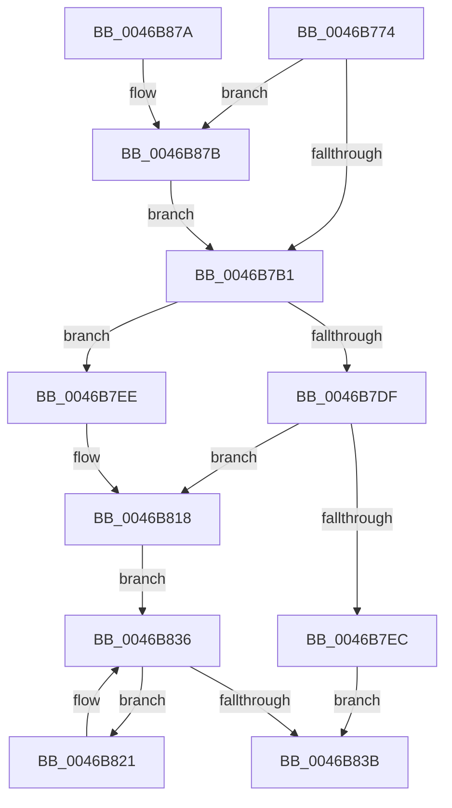

# KeFreezeProcess

- RVA: `0x0046B774`–`0x0046B888` (길이 `276` bytes)
- VA: `0x000000014046B774`
- 실행 섹션: `.text`
- PDB 이름 있음: `예`; PDB Function 태그: `아니요`
- unwind 정보 RVA: `0x000AB500`
- 디코드: `71`개 명령, `276/276` bytes 표시
- 미해석 바이트: `0` (있으면 어셈블리에 `.byte`로 보존)

> 이 문서는 커널 이미지의 기계어와 PDB 기호를 분석해 생성했습니다. 4번과 5번은 함수 원형과 자료형을 바이너리 사용 방식에서 추정한 C 해석이며 원본 소스 복구 결과는 아닙니다.

## 1. Dependencies

- 직접 호출 지점: **5**; 고유 호출 대상: **5**
- 직접 호출자로 확인된 함수: **2**
- RIP 상대 이미지 참조: **1**

### Outgoing calls
- `0x0046B7C1` → [ExAcquireSpinLockExclusiveAtDpcLevel](../24/ExAcquireSpinLockExclusiveAtDpcLevel_function_00248E80.md) (function, `0x00248E80`)
- `0x0046B82E` → [KiFreezeSingleThread](KiFreezeSingleThread_function_0046B890.md) (function, `0x0046B890`)
- `0x0046B83E` → [ExReleaseSpinLockExclusiveFromDpcLevel](../24/ExReleaseSpinLockExclusiveFromDpcLevel_function_002497E0.md) (function, `0x002497E0`)
- `0x0046B854` → [KiExitDispatcher](../25/KiExitDispatcher_function_00251CF0.md) (function, `0x00251CF0`)
- `0x0046B87E` → [KiRaiseIrqlProcessIrqlFlags](../4F/KiRaiseIrqlProcessIrqlFlags_function_004F56FC.md) (function, `0x004F56FC`)

### Direct callers
- [MiReAcquireOutSwappedProcessCommit](../66/MiReAcquireOutSwappedProcessCommit_function_0066F598.md) at `0x0066F6BE`
- [PsFreezeProcess](../../page/AA/PsFreezeProcess_function_00AA6D04.md) at `0x00AA6D2A`

### Static image references
- `0x0046B7A4` → RVA `0x00FC6D20` (`ALMOSTRO`; read)

## 2. Other-region calls and transfers

- 다른 실행 섹션으로 향하는 call: **0**
- 별도 외부 분기/꼬리 이동을 확인하지 못했습니다.

## 3. Assembly (complete function range)

```asm
0046B774  48 8B C4                        mov rax, rsp
0046B777  48 89 58 08                     mov qword ptr [rax + 8], rbx
0046B77B  48 89 68 10                     mov qword ptr [rax + 0x10], rbp
0046B77F  48 89 70 18                     mov qword ptr [rax + 0x18], rsi
0046B783  48 89 78 20                     mov qword ptr [rax + 0x20], rdi
0046B787  41 54                           push r12
0046B789  41 56                           push r14
0046B78B  41 57                           push r15
0046B78D  48 83 EC 30                     sub rsp, 0x30
0046B791  44 8A F2                        mov r14b, dl
0046B794  48 8B D9                        mov rbx, rcx
0046B797  44 0F 20 C5                     mov rbp, cr8
0046B79B  BA 02 00 00 00                  mov edx, 2
0046B7A0  44 0F 22 C2                     mov cr8, rdx
0046B7A4  83 3D 75 B5 B5 00 00            cmp dword ptr [rip + 0xb5b575], 0
0046B7AB  0F 85 CA 00 00 00               jne 0x14046b87b
0046B7B1  65 4C 8B 3C 25 20 00 00 00      mov r15, qword ptr gs:[0x20]
0046B7BA  4C 8D 63 40                     lea r12, [rbx + 0x40]
0046B7BE  49 8B CC                        mov rcx, r12
0046B7C1  E8 BA D6 DD FF                  call 0x140248e80
0046B7C6  8B B3 88 00 00 00               mov esi, dword ptr [rbx + 0x88]
0046B7CC  8B 8B 50 01 00 00               mov ecx, dword ptr [rbx + 0x150]
0046B7D2  C1 EE 03                        shr esi, 3
0046B7D5  83 E6 01                        and esi, 1
0046B7D8  03 F1                           add esi, ecx
0046B7DA  45 84 F6                        test r14b, r14b
0046B7DD  75 0F                           jne 0x14046b7ee
0046B7DF  8D 41 01                        lea eax, [rcx + 1]
0046B7E2  89 83 50 01 00 00               mov dword ptr [rbx + 0x150], eax
0046B7E8  85 C9                           test ecx, ecx
0046B7EA  74 2C                           je 0x14046b818
0046B7EC  EB 4D                           jmp 0x14046b83b
0046B7EE  48 B9 B0 03 00 00 80 F7 FF FF   movabs rcx, 0xfffff780000003b0
0046B7F8  48 B8 08 00 00 00 80 F7 FF FF   movabs rax, 0xfffff78000000008
0046B802  48 8B 09                        mov rcx, qword ptr [rcx]
0046B805  48 8B 00                        mov rax, qword ptr [rax]
0046B808  48 2B C1                        sub rax, rcx
0046B80B  48 89 43 48                     mov qword ptr [rbx + 0x48], rax
0046B80F  F0 0F BA AB 88 00 00 00 03      lock bts dword ptr [rbx + 0x88], 3
0046B818  48 8D 7B 30                     lea rdi, [rbx + 0x30]
0046B81C  48 8B 1F                        mov rbx, qword ptr [rdi]
0046B81F  EB 15                           jmp 0x14046b836
0046B821  48 8D 93 08 FD FF FF            lea rdx, [rbx - 0x2f8]
0046B828  45 8A C6                        mov r8b, r14b
0046B82B  49 8B CF                        mov rcx, r15
0046B82E  E8 5D 00 00 00                  call 0x14046b890
0046B833  48 8B 1B                        mov rbx, qword ptr [rbx]
0046B836  48 3B DF                        cmp rbx, rdi
0046B839  75 E6                           jne 0x14046b821
0046B83B  49 8B CC                        mov rcx, r12
0046B83E  E8 9D DF DD FF                  call 0x1402497e0
0046B843  45 33 C9                        xor r9d, r9d
0046B846  40 88 6C 24 20                  mov byte ptr [rsp + 0x20], bpl
0046B84B  33 D2                           xor edx, edx
0046B84D  49 8B CF                        mov rcx, r15
0046B850  45 8D 41 01                     lea r8d, [r9 + 1]
0046B854  E8 97 64 DE FF                  call 0x140251cf0
0046B859  48 8B 5C 24 50                  mov rbx, qword ptr [rsp + 0x50]
0046B85E  8B C6                           mov eax, esi
0046B860  48 8B 74 24 60                  mov rsi, qword ptr [rsp + 0x60]
0046B865  48 8B 6C 24 58                  mov rbp, qword ptr [rsp + 0x58]
0046B86A  48 8B 7C 24 68                  mov rdi, qword ptr [rsp + 0x68]
0046B86F  48 83 C4 30                     add rsp, 0x30
0046B873  41 5F                           pop r15
0046B875  41 5E                           pop r14
0046B877  41 5C                           pop r12
0046B879  C3                              ret
0046B87A  CC                              int3
0046B87B  40 8A CD                        mov cl, bpl
0046B87E  E8 79 9E 08 00                  call 0x1404f56fc
0046B883  E9 29 FF FF FF                  jmp 0x14046b7b1
```

## 4. C-style interpretation (structured pseudocode)

```c
__int64 __fastcall KeFreezeProcess(__int64 a1, unsigned __int8 a2, __int64 a3, int a4)
{
    __int64 result;
    __int64 v_rsi;
    __int64 v_rsp;
    unsigned __int8 v_stack_m28;
    unsigned __int64 v_stack_p10;
    unsigned __int64 v_stack_p18;
    unsigned __int64 v_stack_p20;
    unsigned __int64 v_stack_p8;

    *(unsigned __int64 *)(v_rsp + 8) = v_rbx;
    *(unsigned __int64 *)(v_rsp + 16) = v_rbp;
    *(unsigned __int64 *)(v_rsp + 24) = v_rsi;
    *(unsigned __int64 *)(v_rsp + 32) = v_rdi;
    v_rsp = (v_rsp) - (48);
    if ((*(unsigned int *)(v_rip + 11908469)) != 0) goto loc_0046B87B;
loc_0046B7B1:
    result = ExAcquireSpinLockExclusiveAtDpcLevel(a1 + 64, 2, a3, a4);
    v_rsi = (unsigned int)(((unsigned int)(*(unsigned int *)(a1 + 136))) >> (3));
    v_rsi = (unsigned int)((v_rsi) & (1));
    v_rsi = (unsigned int)((v_rsi) + ((unsigned int)((unsigned int)(*(unsigned int *)(a1 + 336)))));
    if (a2 != 0) goto loc_0046B7EE;
    *(unsigned int *)(a1 + 336) = (unsigned int)((unsigned int)(*(unsigned int *)(a1 + 336)) + 1);
    if ((unsigned int)((unsigned int)(*(unsigned int *)(a1 + 336))) == 0) goto loc_0046B818;
    goto loc_0046B83B;
loc_0046B7EE:
    result = (*(unsigned __int64 *)((unsigned int)(*(unsigned int *)(a1 + 336)) + 1)) - (*(unsigned __int64 *)((unsigned int)(*(unsigned int *)(a1 + 336))));
    *(unsigned __int64 *)(a1 + 72) = result;
loc_0046B818:
    goto loc_0046B836;
loc_0046B821:
    result = KiFreezeSingleThread(*(unsigned __int64 *)(gs_base + (0 + 32)), *(unsigned __int64 *)(a1 + 48) - 760, a2, a4);
loc_0046B836:
    if ((*(unsigned __int64 *)(*(unsigned __int64 *)(a1 + 48))) != (a1 + 48)) goto loc_0046B821;
loc_0046B83B:
    result = ExReleaseSpinLockExclusiveFromDpcLevel(a1 + 64, *(unsigned __int64 *)(a1 + 48) - 760, a2, a4);
    a4 = 0;
    v_stack_m28 = (unsigned __int8)(v_cr8);
    a2 = 0;
    result = KiExitDispatcher(*(unsigned __int64 *)(gs_base + (0 + 32)), a2, a4 + 1, a4);
    v_rsp = (v_rsp) + (48);
    return (unsigned int)((unsigned int)(v_rsi));
loc_0046B87B:
    result = KiRaiseIrqlProcessIrqlFlags((unsigned __int8)(v_stack_p10), a2, a4 + 1, a4);
    goto loc_0046B7B1;
}
```

## 5. (Beta) C Style

```c
int64_t KeFreezeProcess(void *Arg1, uint8_t Arg2, int64_t Arg3, int32_t Arg4)
{
    uint8_t *arg1 = (uint8_t *)Arg1;

    int64_t result;
    int64_t local_rsi;
    int64_t local_rsp;
    uint8_t v_stack_m28;
    uint64_t v_stack_p10;
    uint64_t v_stack_p18;
    uint64_t v_stack_p20;
    uint64_t v_stack_p8;

    *(uint64_t *)(local_rsp + 0x8) = local_rbx;
    *(uint64_t *)(local_rsp + 0x10) = local_rbp;
    *(uint64_t *)(local_rsp + 0x18) = local_rsi;
    *(uint64_t *)(local_rsp + 0x20) = local_rdi;
    local_rsp = (local_rsp) - (48);
    if ((*(uint32_t *)(v_rip + 0xB5B575)) != 0) goto loc_0046B87B;
loc_0046B7B1:
    result = ExAcquireSpinLockExclusiveAtDpcLevel(Arg1 + 64, 2, Arg3, Arg4);
    local_rsi = (uint32_t)(((uint32_t)(*(uint32_t *)(arg1 + 0x88))) >> (3));
    local_rsi = (uint32_t)((local_rsi) & (1));
    local_rsi = (uint32_t)((local_rsi) + ((uint32_t)((uint32_t)(*(uint32_t *)(arg1 + 0x150)))));
    if (Arg2 != 0) goto loc_0046B7EE;
    *(uint32_t *)(arg1 + 0x150) = (uint32_t)((uint32_t)(*(uint32_t *)(arg1 + 0x150)) + 1);
    if ((uint32_t)((uint32_t)(*(uint32_t *)(arg1 + 0x150))) == 0) goto loc_0046B818;
    goto loc_0046B83B;
loc_0046B7EE:
    result = (*(uint64_t *)((uint32_t)(*(uint32_t *)(arg1 + 0x150)) + 0x1)) - (*(uint64_t *)((uint32_t)(*(uint32_t *)(arg1 + 0x150))));
    *(uint64_t *)(arg1 + 0x48) = result;
loc_0046B818:
    goto loc_0046B836;
loc_0046B821:
    result = KiFreezeSingleThread(*(uint64_t *)(gs_base + (0 + 0x20)), *(uint64_t *)(arg1 + 0x30) - 760, Arg2, Arg4);
loc_0046B836:
    if ((*(uint64_t *)(*(uint64_t *)(arg1 + 0x30))) != (Arg1 + 48)) goto loc_0046B821;
loc_0046B83B:
    result = ExReleaseSpinLockExclusiveFromDpcLevel(Arg1 + 64, *(uint64_t *)(arg1 + 0x30) - 760, Arg2, Arg4);
    Arg4 = 0;
    v_stack_m28 = (uint8_t)(v_cr8);
    Arg2 = 0;
    result = KiExitDispatcher(*(uint64_t *)(gs_base + (0 + 0x20)), Arg2, Arg4 + 1, Arg4);
    local_rsp = (local_rsp) + (48);
    return (uint32_t)((uint32_t)(local_rsi));
loc_0046B87B:
    result = KiRaiseIrqlProcessIrqlFlags((uint8_t)(v_stack_p10), Arg2, Arg4 + 1, Arg4);
    goto loc_0046B7B1;
}
```

### 관측된 메모리 오프셋

구조체 형식이 확인되지 않은 접근은 인자 기준의 오프셋으로만 기록했습니다.

| 기준 인자 | 오프셋 표현 | 폭 (bit) | 접근 |
|---|---:|---:|---|
| `Arg1` | `+ 0x0` | `64` | `R` |
| `Arg1` | `+ 0x30` | `64` | `R` |
| `Arg1` | `+ 0x40` | `64` | `R` |
| `Arg1` | `+ 0x48` | `64` | `W` |
| `Arg1` | `+ 0x88` | `32` | `R` |
| `Arg1` | `+ 0x88` | `32` | `R/W` |
| `Arg1` | `+ 0x150` | `32` | `R` |
| `Arg1` | `+ 0x150` | `32` | `W` |

## 6. Execution-region graph

[열기: 2D/3D 그래프와 함수 탐색 컨트롤 패널](../../../control-panel.html?section=text&rva=0x0046B774&view=graph)

- 2D 그래프는 위에서 아래로 흐르고, 3D 그래프는 빈 공간을 드래그해 회전합니다. Shift+드래그는 이동, 휠은 확대·축소, 함수 노드 선택은 대상 보고서 이동입니다.

### Static fallback


