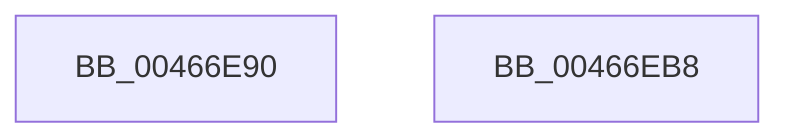

# KeInitializeGuardedMutex

- RVA: `0x00466E90`–`0x00466EB9` (길이 `41` bytes)
- VA: `0x0000000140466E90`
- 실행 섹션: `.text`
- PDB 이름 있음: `예`; PDB Function 태그: `아니요`
- unwind 정보 RVA: `0x000DB714`
- 디코드: `12`개 명령, `41/41` bytes 표시
- 미해석 바이트: `0` (있으면 어셈블리에 `.byte`로 보존)

> 이 문서는 커널 이미지의 기계어와 PDB 기호를 분석해 생성했습니다. 4번과 5번은 함수 원형과 자료형을 바이너리 사용 방식에서 추정한 C 해석이며 원본 소스 복구 결과는 아닙니다.

## 1. Dependencies

- 직접 호출 지점: **0**; 고유 호출 대상: **0**
- 직접 호출자로 확인된 함수: **7**
- RIP 상대 이미지 참조: **0**

### Outgoing calls
- 직접 디코드된 call 명령이 없습니다.

### Direct callers
- [PiDqObjectManagerInit](../../page/73/PiDqObjectManagerInit_function_00731A18.md) at `0x00731A46`
- [PfTInitialize](../../page/75/PfTInitialize_function_00751554.md) at `0x0075162F`
- [EtwpInitializeProviderTraits](../../page/7C/EtwpInitializeProviderTraits_function_007C12D4.md) at `0x007C12DF`
- [EtwpInitializeProviderTraits](../../page/7C/EtwpInitializeProviderTraits_function_007C12D4.md) at `0x007C12F6`
- [CmpInitSIDToHiveMapping](../../page/7E/CmpInitSIDToHiveMapping_function_007EBA2C.md) at `0x007EBA37`
- [CmpInitializeDelayedCloseTable](../../page/7E/CmpInitializeDelayedCloseTable_function_007EDA34.md) at `0x007EDA5D`
- [PiUEventInitClientRegistrationContext](../../page/91/PiUEventInitClientRegistrationContext_function_00916A54.md) at `0x00916B02`
- [PiUEventNotifyUserMode](../../page/95/PiUEventNotifyUserMode_function_00954CB4.md) at `0x00954E4C`

### Static image references
- 디코드된 RIP-relative 메모리 참조가 없습니다.

## 2. Other-region calls and transfers

- 다른 실행 섹션으로 향하는 call: **0**
- 별도 외부 분기/꼬리 이동을 확인하지 못했습니다.

## 3. Assembly (complete function range)

```asm
00466E90  C7 01 01 00 00 00               mov dword ptr [rcx], 1
00466E96  33 C0                           xor eax, eax
00466E98  48 89 41 08                     mov qword ptr [rcx + 8], rax
00466E9C  89 41 10                        mov dword ptr [rcx + 0x10], eax
00466E9F  89 41 1C                        mov dword ptr [rcx + 0x1c], eax
00466EA2  48 8D 41 20                     lea rax, [rcx + 0x20]
00466EA6  66 C7 41 18 01 00               mov word ptr [rcx + 0x18], 1
00466EAC  C6 41 1A 06                     mov byte ptr [rcx + 0x1a], 6
00466EB0  48 89 40 08                     mov qword ptr [rax + 8], rax
00466EB4  48 89 00                        mov qword ptr [rax], rax
00466EB7  C3                              ret
00466EB8  CC                              int3
```

## 4. C-style interpretation (structured pseudocode)

```c
__int64 __fastcall KeInitializeGuardedMutex(__int64 a1)
{
    __int64 result;

    *(unsigned int *)(a1) = 1;
    result = 0;
    *(unsigned __int64 *)(a1 + 8) = 0;
    *(unsigned int *)(a1 + 16) = 0;
    *(unsigned int *)(a1 + 28) = 0;
    *(unsigned __int16 *)(a1 + 24) = 1;
    *(unsigned __int8 *)(a1 + 26) = 6;
    *(unsigned __int64 *)(a1 + 32 + 8) = a1 + 32;
    *(unsigned __int64 *)(a1 + 32) = a1 + 32;
    return a1 + 32;
}
```

## 5. (Beta) C Style

```c
void *KeInitializeGuardedMutex(void *GuardedMutex)
{
    uint8_t *guardedMutex = (uint8_t *)GuardedMutex;

    int64_t result;

    *(uint32_t *)(guardedMutex) = 1;
    result = 0;
    *(uint64_t *)(guardedMutex + 0x8) = 0;
    *(uint32_t *)(guardedMutex + 0x10) = 0;
    *(uint32_t *)(guardedMutex + 0x1C) = 0;
    *(uint16_t *)(guardedMutex + 0x18) = 1;
    *(uint8_t *)(guardedMutex + 0x1A) = 6;
    *(void **)(guardedMutex + 0x20 + 0x8) = GuardedMutex + 32;
    *(void **)(guardedMutex + 0x20) = GuardedMutex + 32;
    return GuardedMutex + 32;
}
```

### 관측된 메모리 오프셋

구조체 형식이 확인되지 않은 접근은 인자 기준의 오프셋으로만 기록했습니다.

| 기준 인자 | 오프셋 표현 | 폭 (bit) | 접근 |
|---|---:|---:|---|
| `GuardedMutex` | `+ 0x0` | `32` | `W` |
| `GuardedMutex` | `+ 0x0` | `64` | `W` |
| `GuardedMutex` | `+ 0x8` | `64` | `W` |
| `GuardedMutex` | `+ 0x10` | `32` | `W` |
| `GuardedMutex` | `+ 0x18` | `16` | `W` |
| `GuardedMutex` | `+ 0x1A` | `8` | `W` |
| `GuardedMutex` | `+ 0x1C` | `32` | `W` |
| `GuardedMutex` | `+ 0x20` | `64` | `R` |

## 6. Execution-region graph

[열기: 2D/3D 그래프와 함수 탐색 컨트롤 패널](../../../control-panel.html?section=text&rva=0x00466E90&view=graph)

- 2D 그래프는 위에서 아래로 흐르고, 3D 그래프는 빈 공간을 드래그해 회전합니다. Shift+드래그는 이동, 휠은 확대·축소, 함수 노드 선택은 대상 보고서 이동입니다.

### Static fallback


