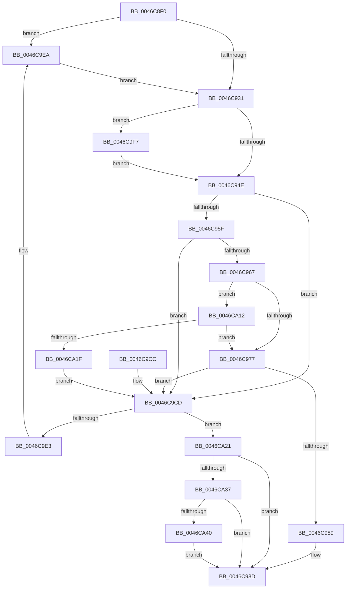

# KeInsertQueue

- RVA: `0x0046C8F0`–`0x0046CA50` (길이 `352` bytes)
- VA: `0x000000014046C8F0`
- 실행 섹션: `.text`
- PDB 이름 있음: `예`; PDB Function 태그: `아니요`
- unwind 정보 RVA: `0x00093FA4`
- 디코드: `91`개 명령, `352/352` bytes 표시
- 미해석 바이트: `0` (있으면 어셈블리에 `.byte`로 보존)

> 이 문서는 커널 이미지의 기계어와 PDB 기호를 분석해 생성했습니다. 4번과 5번은 함수 원형과 자료형을 바이너리 사용 방식에서 추정한 C 해석이며 원본 소스 복구 결과는 아닙니다.

## 1. Dependencies

- 직접 호출 지점: **7**; 고유 호출 대상: **7**
- 직접 호출자로 확인된 함수: **0**
- RIP 상대 이미지 참조: **2**

### Outgoing calls
- `0x0046C951` → [KiAcquireKobjectLockSafe](../25/KiAcquireKobjectLockSafe_function_00251C90.md) (function, `0x00251C90`)
- `0x0046C980` → [KiWakeQueueWaiter](../34/KiWakeQueueWaiter_function_00344C10.md) (function, `0x00344C10`)
- `0x0046C9A5` → [KiExitDispatcher](../25/KiExitDispatcher_function_00251CF0.md) (function, `0x00251CF0`)
- `0x0046C9ED` → [KiRaiseIrqlProcessIrqlFlags](../4F/KiRaiseIrqlProcessIrqlFlags_function_004F56FC.md) (function, `0x004F56FC`)
- `0x0046C9FA` → [KeIsThreadRunning](../39/KeIsThreadRunning_function_00396720.md) (function, `0x00396720`)
- `0x0046CA08` → [EtwTraceEnqueueWork](../39/EtwTraceEnqueueWork_function_0039674C.md) (function, `0x0039674C`)
- `0x0046CA46` → [KiWakeOtherQueueWaiters](../39/KiWakeOtherQueueWaiters_function_003964D0.md) (function, `0x003964D0`)

### Direct callers
- 이 함수 시작 RVA로 연결되는 직접 call은 확인되지 않았습니다. 간접 호출은 완전히 역산할 수 없습니다.

### Static image references
- `0x0046C924` → RVA `0x00FC6D20` (`ALMOSTRO`; read)
- `0x0046C93A` → RVA `0x00FC6B04` (`ALMOSTRO`; read)

## 2. Other-region calls and transfers

- 다른 실행 섹션으로 향하는 call: **0**
- 별도 외부 분기/꼬리 이동을 확인하지 못했습니다.

## 3. Assembly (complete function range)

```asm
0046C8F0  48 8B C4                        mov rax, rsp
0046C8F3  48 89 58 08                     mov qword ptr [rax + 8], rbx
0046C8F7  48 89 68 10                     mov qword ptr [rax + 0x10], rbp
0046C8FB  48 89 70 18                     mov qword ptr [rax + 0x18], rsi
0046C8FF  48 89 78 20                     mov qword ptr [rax + 0x20], rdi
0046C903  41 54                           push r12
0046C905  41 56                           push r14
0046C907  41 57                           push r15
0046C909  48 83 EC 30                     sub rsp, 0x30
0046C90D  48 8B FA                        mov rdi, rdx
0046C910  48 8D 71 08                     lea rsi, [rcx + 8]
0046C914  48 8B D9                        mov rbx, rcx
0046C917  45 0F 20 C7                     mov r15, cr8
0046C91B  BA 02 00 00 00                  mov edx, 2
0046C920  44 0F 22 C2                     mov cr8, rdx
0046C924  83 3D F5 A3 B5 00 00            cmp dword ptr [rip + 0xb5a3f5], 0
0046C92B  0F 85 B9 00 00 00               jne 0x14046c9ea
0046C931  65 4C 8B 34 25 20 00 00 00      mov r14, qword ptr gs:[0x20]
0046C93A  F7 05 C0 A1 B5 00 00 00 00 01   test dword ptr [rip + 0xb5a1c0], 0x1000000
0046C944  49 8B 6E 08                     mov rbp, qword ptr [r14 + 8]
0046C948  0F 85 A9 00 00 00               jne 0x14046c9f7
0046C94E  48 8B CB                        mov rcx, rbx
0046C951  E8 3A 53 DE FF                  call 0x140251c90
0046C956  44 8B 63 04                     mov r12d, dword ptr [rbx + 4]
0046C95A  48 39 36                        cmp qword ptr [rsi], rsi
0046C95D  74 6E                           je 0x14046c9cd
0046C95F  8B 43 28                        mov eax, dword ptr [rbx + 0x28]
0046C962  3B 43 2C                        cmp eax, dword ptr [rbx + 0x2c]
0046C965  73 66                           jae 0x14046c9cd
0046C967  48 8B 85 E8 00 00 00            mov rax, qword ptr [rbp + 0xe8]
0046C96E  48 3B C3                        cmp rax, rbx
0046C971  0F 84 9B 00 00 00               je 0x14046ca12
0046C977  4C 8B C7                        mov r8, rdi
0046C97A  48 8B D3                        mov rdx, rbx
0046C97D  49 8B CE                        mov rcx, r14
0046C980  E8 8B 82 ED FF                  call 0x140344c10
0046C985  84 C0                           test al, al
0046C987  74 44                           je 0x14046c9cd
0046C989  48 83 27 00                     and qword ptr [rdi], 0
0046C98D  F0 81 23 7F FF FF FF            lock and dword ptr [rbx], 0xffffff7f
0046C994  45 33 C9                        xor r9d, r9d
0046C997  44 88 7C 24 20                  mov byte ptr [rsp + 0x20], r15b
0046C99C  33 D2                           xor edx, edx
0046C99E  49 8B CE                        mov rcx, r14
0046C9A1  45 8D 41 01                     lea r8d, [r9 + 1]
0046C9A5  E8 46 53 DE FF                  call 0x140251cf0
0046C9AA  48 8B 5C 24 50                  mov rbx, qword ptr [rsp + 0x50]
0046C9AF  41 8B C4                        mov eax, r12d
0046C9B2  48 8B 6C 24 58                  mov rbp, qword ptr [rsp + 0x58]
0046C9B7  48 8B 74 24 60                  mov rsi, qword ptr [rsp + 0x60]
0046C9BC  48 8B 7C 24 68                  mov rdi, qword ptr [rsp + 0x68]
0046C9C1  48 83 C4 30                     add rsp, 0x30
0046C9C5  41 5F                           pop r15
0046C9C7  41 5E                           pop r14
0046C9C9  41 5C                           pop r12
0046C9CB  C3                              ret
0046C9CC  CC                              int3
0046C9CD  8B 53 04                        mov edx, dword ptr [rbx + 4]
0046C9D0  8D 42 01                        lea eax, [rdx + 1]
0046C9D3  89 43 04                        mov dword ptr [rbx + 4], eax
0046C9D6  48 8D 43 18                     lea rax, [rbx + 0x18]
0046C9DA  48 8B 48 08                     mov rcx, qword ptr [rax + 8]
0046C9DE  48 39 01                        cmp qword ptr [rcx], rax
0046C9E1  74 3E                           je 0x14046ca21
0046C9E3  B9 03 00 00 00                  mov ecx, 3
0046C9E8  CD 29                           int 0x29
0046C9EA  41 8A CF                        mov cl, r15b
0046C9ED  E8 0A 8D 08 00                  call 0x1404f56fc
0046C9F2  E9 3A FF FF FF                  jmp 0x14046c931
0046C9F7  48 8B CD                        mov rcx, rbp
0046C9FA  E8 21 9D F2 FF                  call 0x140396720
0046C9FF  44 8A C0                        mov r8b, al
0046CA02  48 8B CD                        mov rcx, rbp
0046CA05  48 8B D7                        mov rdx, rdi
0046CA08  E8 3F 9D F2 FF                  call 0x14039674c
0046CA0D  E9 3C FF FF FF                  jmp 0x14046c94e
0046CA12  80 BD 83 02 00 00 0F            cmp byte ptr [rbp + 0x283], 0xf
0046CA19  0F 85 58 FF FF FF               jne 0x14046c977
0046CA1F  EB AC                           jmp 0x14046c9cd
0046CA21  48 89 07                        mov qword ptr [rdi], rax
0046CA24  48 89 4F 08                     mov qword ptr [rdi + 8], rcx
0046CA28  48 89 39                        mov qword ptr [rcx], rdi
0046CA2B  48 89 78 08                     mov qword ptr [rax + 8], rdi
0046CA2F  85 D2                           test edx, edx
0046CA31  0F 85 56 FF FF FF               jne 0x14046c98d
0046CA37  48 39 36                        cmp qword ptr [rsi], rsi
0046CA3A  0F 84 4D FF FF FF               je 0x14046c98d
0046CA40  48 8B D3                        mov rdx, rbx
0046CA43  49 8B CE                        mov rcx, r14
0046CA46  E8 85 9A F2 FF                  call 0x1403964d0
0046CA4B  E9 3D FF FF FF                  jmp 0x14046c98d
```

## 4. C-style interpretation (structured pseudocode)

```c
__int64 __fastcall KeInsertQueue(__int64 a1, __int64 a2, __int64 a3, int a4)
{
    __int64 result;
    __int64 v_rsp;
    unsigned __int8 v_stack_m28;
    unsigned __int64 v_stack_p10;
    unsigned __int64 v_stack_p18;
    unsigned __int64 v_stack_p20;
    unsigned __int64 v_stack_p8;

    *(unsigned __int64 *)(v_rsp + 8) = v_rbx;
    *(unsigned __int64 *)(v_rsp + 16) = v_rbp;
    *(unsigned __int64 *)(v_rsp + 24) = v_rsi;
    *(unsigned __int64 *)(v_rsp + 32) = v_rdi;
    v_rsp = (v_rsp) - (48);
    if ((*(unsigned int *)(v_rip + 11903989)) != 0) goto loc_0046C9EA;
loc_0046C931:
    if (((*(unsigned int *)(v_rip + 11903424)) & (0x1000000ULL)) != 0) goto loc_0046C9F7;
loc_0046C94E:
    result = KiAcquireKobjectLockSafe(a1, 2, a3, a4);
    if ((*(unsigned __int64 *)(a1 + 8)) == (a1 + 8)) goto loc_0046C9CD;
    if (((unsigned int)((unsigned int)(*(unsigned int *)(a1 + 40)))) >= (*(unsigned int *)(a1 + 44))) goto loc_0046C9CD;
    if ((*(unsigned __int64 *)(*(unsigned __int64 *)(*(unsigned __int64 *)(gs_base + (0 + 32)) + 8) + 232)) == a1) goto loc_0046CA12;
loc_0046C977:
    result = KiWakeQueueWaiter(*(unsigned __int64 *)(gs_base + (0 + 32)), a1, a2, a4);
    if ((unsigned __int8)(result) == 0) goto loc_0046C9CD;
loc_0046C98D:
    a4 = 0;
    v_stack_m28 = (unsigned __int8)(v_cr8);
    a2 = 0;
    result = KiExitDispatcher(*(unsigned __int64 *)(gs_base + (0 + 32)), a2, a4 + 1, a4);
    v_rsp = (v_rsp) + (48);
    return (unsigned int)((unsigned int)((unsigned int)(*(unsigned int *)(a1 + 4))));
loc_0046C9CD:
    *(unsigned int *)(v_stack_p8 + 4) = (unsigned int)((unsigned int)(*(unsigned int *)(v_stack_p8 + 4)) + 1);
    if ((*(unsigned __int64 *)(*(unsigned __int64 *)(v_stack_p8 + 24 + 8))) == (v_stack_p8 + 24)) goto loc_0046CA21;
loc_0046C9EA:
    result = KiRaiseIrqlProcessIrqlFlags((unsigned __int8)(v_cr8), (unsigned int)(*(unsigned int *)(v_stack_p8 + 4)), a4 + 1, a4);
    goto loc_0046C931;
loc_0046C9F7:
    result = KeIsThreadRunning(v_stack_p10, (unsigned int)(*(unsigned int *)(v_stack_p8 + 4)), a4 + 1, a4);
    result = EtwTraceEnqueueWork(v_stack_p10, v_stack_p20, (unsigned __int8)(result), a4);
    goto loc_0046C94E;
loc_0046CA12:
    if ((*(unsigned __int8 *)(v_stack_p10 + 643)) != 15) goto loc_0046C977;
    goto loc_0046C9CD;
loc_0046CA21:
    *(unsigned __int64 *)(v_stack_p20) = result;
    *(unsigned __int64 *)(v_stack_p20 + 8) = v_stack_p10;
    *(unsigned __int64 *)(v_stack_p10) = v_stack_p20;
    *(unsigned __int64 *)(result + 8) = v_stack_p20;
    if ((unsigned int)(v_stack_p20) != 0) goto loc_0046C98D;
    if ((*(unsigned __int64 *)(v_stack_p18)) == v_stack_p18) goto loc_0046C98D;
    result = KiWakeOtherQueueWaiters(*(unsigned __int64 *)(gs_base + (0 + 32)), v_stack_p8, (unsigned __int8)(result), a4);
    goto loc_0046C98D;
}
```

## 5. (Beta) C Style

```c
int64_t KeInsertQueue(void *Arg1, void *Arg2, int64_t Arg3, int32_t Arg4)
{
    uint8_t *arg1 = (uint8_t *)Arg1;
    uint8_t *arg2 = (uint8_t *)Arg2;

    int64_t result;
    int64_t local_rsp;
    uint8_t v_stack_m28;
    uint64_t v_stack_p10;
    uint64_t v_stack_p18;
    uint64_t v_stack_p20;
    uint64_t v_stack_p8;

    *(uint64_t *)(local_rsp + 0x8) = local_rbx;
    *(uint64_t *)(local_rsp + 0x10) = local_rbp;
    *(uint64_t *)(local_rsp + 0x18) = local_rsi;
    *(uint64_t *)(local_rsp + 0x20) = local_rdi;
    local_rsp = (local_rsp) - (48);
    if ((*(uint32_t *)(v_rip + 0xB5A3F5)) != 0) goto loc_0046C9EA;
loc_0046C931:
    if (((*(uint32_t *)(v_rip + 0xB5A1C0)) & (0x1000000ULL)) != 0) goto loc_0046C9F7;
loc_0046C94E:
    result = KiAcquireKobjectLockSafe(Arg1, 2, Arg3, Arg4);
    if ((*(uint64_t *)(arg1 + 0x8)) == (Arg1 + 8)) goto loc_0046C9CD;
    if (((uint32_t)((uint32_t)(*(uint32_t *)(arg1 + 0x28)))) >= (*(uint32_t *)(arg1 + 0x2C))) goto loc_0046C9CD;
    if ((*(uint64_t *)(*(uint64_t *)(*(uint64_t *)(gs_base + (0 + 0x20)) + 0x8) + 0xE8)) == Arg1) goto loc_0046CA12;
loc_0046C977:
    result = KiWakeQueueWaiter(*(uint64_t *)(gs_base + (0 + 0x20)), Arg1, Arg2, Arg4);
    if ((uint8_t)(result) == 0) goto loc_0046C9CD;
loc_0046C98D:
    Arg4 = 0;
    v_stack_m28 = (uint8_t)(v_cr8);
    Arg2 = 0;
    result = KiExitDispatcher(*(uint64_t *)(gs_base + (0 + 0x20)), Arg2, Arg4 + 1, Arg4);
    local_rsp = (local_rsp) + (48);
    return (uint32_t)((uint32_t)((uint32_t)(*(uint32_t *)(arg1 + 0x4))));
loc_0046C9CD:
    *(uint32_t *)(v_stack_p8 + 0x4) = (uint32_t)((uint32_t)(*(uint32_t *)(v_stack_p8 + 0x4)) + 1);
    if ((*(uint64_t *)(*(uint64_t *)(v_stack_p8 + 0x18 + 0x8))) == (v_stack_p8 + 24)) goto loc_0046CA21;
loc_0046C9EA:
    result = KiRaiseIrqlProcessIrqlFlags((uint8_t)(v_cr8), (uint32_t)(*(uint32_t *)(v_stack_p8 + 0x4)), Arg4 + 1, Arg4);
    goto loc_0046C931;
loc_0046C9F7:
    result = KeIsThreadRunning(v_stack_p10, (uint32_t)(*(uint32_t *)(v_stack_p8 + 0x4)), Arg4 + 1, Arg4);
    result = EtwTraceEnqueueWork(v_stack_p10, v_stack_p20, (uint8_t)(result), Arg4);
    goto loc_0046C94E;
loc_0046CA12:
    if ((*(uint8_t *)(v_stack_p10 + 0x283)) != 15) goto loc_0046C977;
    goto loc_0046C9CD;
loc_0046CA21:
    *(uint64_t *)(v_stack_p20) = result;
    *(uint64_t *)(v_stack_p20 + 0x8) = v_stack_p10;
    *(uint64_t *)(v_stack_p10) = v_stack_p20;
    *(uint64_t *)(result + 0x8) = v_stack_p20;
    if ((uint32_t)(v_stack_p20) != 0) goto loc_0046C98D;
    if ((*(uint64_t *)(v_stack_p18)) == v_stack_p18) goto loc_0046C98D;
    result = KiWakeOtherQueueWaiters(*(uint64_t *)(gs_base + (0 + 0x20)), v_stack_p8, (uint8_t)(result), Arg4);
    goto loc_0046C98D;
}
```

### 관측된 메모리 오프셋

구조체 형식이 확인되지 않은 접근은 인자 기준의 오프셋으로만 기록했습니다.

| 기준 인자 | 오프셋 표현 | 폭 (bit) | 접근 |
|---|---:|---:|---|
| `Arg1` | `+ 0x0` | `32` | `R/W` |
| `Arg1` | `+ 0x0` | `64` | `R` |
| `Arg1` | `+ 0x4` | `32` | `R` |
| `Arg1` | `+ 0x4` | `32` | `W` |
| `Arg1` | `+ 0x8` | `64` | `R` |
| `Arg1` | `+ 0x8` | `64` | `W` |
| `Arg1` | `+ 0x18` | `64` | `R` |
| `Arg1` | `+ 0x28` | `32` | `R` |
| `Arg1` | `+ 0x2C` | `32` | `R` |
| `Arg2` | `+ 0x0` | `64` | `R/W` |
| `Arg2` | `+ 0x0` | `64` | `W` |
| `Arg2` | `+ 0x8` | `64` | `W` |

## 6. Execution-region graph

[열기: 2D/3D 그래프와 함수 탐색 컨트롤 패널](../../../control-panel.html?section=text&rva=0x0046C8F0&view=graph)

- 2D 그래프는 위에서 아래로 흐르고, 3D 그래프는 빈 공간을 드래그해 회전합니다. Shift+드래그는 이동, 휠은 확대·축소, 함수 노드 선택은 대상 보고서 이동입니다.

### Static fallback


