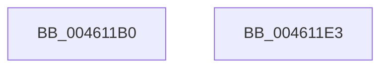

# KeProcessorGroupAffinity

- RVA: `0x004611B0`–`0x004611E4` (길이 `52` bytes)
- VA: `0x00000001404611B0`
- 실행 섹션: `.text`
- PDB 이름 있음: `예`; PDB Function 태그: `아니요`
- unwind 정보 RVA: `0x000DB714`
- 디코드: `16`개 명령, `52/52` bytes 표시
- 미해석 바이트: `0` (있으면 어셈블리에 `.byte`로 보존)

> 이 문서는 커널 이미지의 기계어와 PDB 기호를 분석해 생성했습니다. 4번과 5번은 함수 원형과 자료형을 바이너리 사용 방식에서 추정한 C 해석이며 원본 소스 복구 결과는 아닙니다.

## 1. Dependencies

- 직접 호출 지점: **0**; 고유 호출 대상: **0**
- 직접 호출자로 확인된 함수: **0**
- RIP 상대 이미지 참조: **1**

### Outgoing calls
- 직접 디코드된 call 명령이 없습니다.

### Direct callers
- 이 함수 시작 RVA로 연결되는 직접 call은 확인되지 않았습니다. 간접 호출은 완전히 역산할 수 없습니다.

### Static image references
- `0x004611B0` → RVA `0x00F231B0` (`.data`; read)

## 2. Other-region calls and transfers

- 다른 실행 섹션으로 향하는 call: **0**
- 별도 외부 분기/꼬리 이동을 확인하지 못했습니다.

## 3. Assembly (complete function range)

```asm
004611B0  48 8B 05 F9 1F AC 00            mov rax, qword ptr [rip + 0xac1ff9]
004611B7  4C 8B C1                        mov r8, rcx
004611BA  8B D2                           mov edx, edx
004611BC  8B 0C 90                        mov ecx, dword ptr [rax + rdx*4]
004611BF  33 C0                           xor eax, eax
004611C1  41 89 40 0A                     mov dword ptr [r8 + 0xa], eax
004611C5  66 41 89 40 0E                  mov word ptr [r8 + 0xe], ax
004611CA  8B C1                           mov eax, ecx
004611CC  C1 E8 06                        shr eax, 6
004611CF  83 E1 3F                        and ecx, 0x3f
004611D2  66 41 89 40 08                  mov word ptr [r8 + 8], ax
004611D7  B8 01 00 00 00                  mov eax, 1
004611DC  48 D3 E0                        shl rax, cl
004611DF  49 89 00                        mov qword ptr [r8], rax
004611E2  C3                              ret
004611E3  CC                              int3
```

## 4. C-style interpretation (structured pseudocode)

```c
__int64 __fastcall KeProcessorGroupAffinity(__int64 a1, int a2)
{
    __int64 result;

    result = 0;
    *(unsigned int *)(a1 + 10) = 0;
    *(unsigned __int16 *)(a1 + 14) = 0;
    result = (unsigned int)(((unsigned int)((unsigned int)((unsigned int)(*(unsigned int *)(*(unsigned __int64 *)(v_rip + 11280377) + (unsigned int)(a2) * 4))))) >> (6));
    a1 = (unsigned int)(((unsigned int)(*(unsigned int *)(*(unsigned __int64 *)(v_rip + 11280377) + (unsigned int)(a2) * 4))) & (63));
    *(unsigned __int16 *)(a1 + 8) = (unsigned __int16)(result);
    result = (1) << ((unsigned __int8)(a1));
    *(unsigned __int64 *)(a1) = result;
    return result;
}
```

## 5. (Beta) C Style

```c
int64_t KeProcessorGroupAffinity(void *Arg1, int32_t Arg2)
{
    uint8_t *arg1 = (uint8_t *)Arg1;

    int64_t result;

    result = 0;
    *(uint32_t *)(arg1 + 0xA) = 0;
    *(uint16_t *)(arg1 + 0xE) = 0;
    result = (uint32_t)(((uint32_t)((uint32_t)((uint32_t)(*(uint32_t *)(*(uint64_t *)(v_rip + 0xAC1FF9) + (uint32_t)(Arg2) * 4))))) >> (6));
    Arg1 = (uint32_t)(((uint32_t)(*(uint32_t *)(*(uint64_t *)(v_rip + 0xAC1FF9) + (uint32_t)(Arg2) * 4))) & (63));
    *(uint16_t *)(arg1 + 0x8) = (uint16_t)(result);
    result = (1) << ((uint8_t)(Arg1));
    *(uint64_t *)(arg1) = result;
    return result;
}
```

### 관측된 메모리 오프셋

구조체 형식이 확인되지 않은 접근은 인자 기준의 오프셋으로만 기록했습니다.

| 기준 인자 | 오프셋 표현 | 폭 (bit) | 접근 |
|---|---:|---:|---|
| `Arg1` | `+ 0x0` | `64` | `W` |
| `Arg1` | `+ 0x8` | `16` | `W` |
| `Arg1` | `+ 0xA` | `32` | `W` |
| `Arg1` | `+ 0xE` | `16` | `W` |

## 6. Execution-region graph

[열기: 2D/3D 그래프와 함수 탐색 컨트롤 패널](../../../control-panel.html?section=text&rva=0x004611B0&view=graph)

- 2D 그래프는 위에서 아래로 흐르고, 3D 그래프는 빈 공간을 드래그해 회전합니다. Shift+드래그는 이동, 휠은 확대·축소, 함수 노드 선택은 대상 보고서 이동입니다.

### Static fallback


