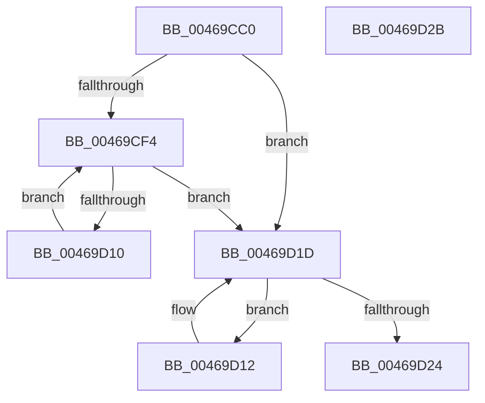

# KeQueryActiveProcessorAffinity2

- RVA: `0x00469CC0`–`0x00469D2C` (길이 `108` bytes)
- VA: `0x0000000140469CC0`
- 실행 섹션: `.text`
- PDB 이름 있음: `예`; PDB Function 태그: `아니요`
- unwind 정보 RVA: `0x000DB714`
- 디코드: `28`개 명령, `108/108` bytes 표시
- 미해석 바이트: `0` (있으면 어셈블리에 `.byte`로 보존)

> 이 문서는 커널 이미지의 기계어와 PDB 기호를 분석해 생성했습니다. 4번과 5번은 함수 원형과 자료형을 바이너리 사용 방식에서 추정한 C 해석이며 원본 소스 복구 결과는 아닙니다.

## 1. Dependencies

- 직접 호출 지점: **0**; 고유 호출 대상: **0**
- 직접 호출자로 확인된 함수: **4**
- RIP 상대 이미지 참조: **3**

### Outgoing calls
- 직접 디코드된 call 명령이 없습니다.

### Direct callers
- [PpmRegisterPerfStates](../../page/75/PpmRegisterPerfStates_function_0075B084.md) at `0x0075B15B`
- [EtwpGetMicroarchitecturalPmcAffinity](../../page/7B/EtwpGetMicroarchitecturalPmcAffinity_function_007B67CC.md) at `0x007B67F6`
- [PpmCheckInitProcessors](../../page/A8/PpmCheckInitProcessors_function_00A84AE8.md) at `0x00A84B7B`
- [sub_00B3B244](../../page/B3/Unknown_function_00B3B244.md) at `0x00B3B37A`

### Static image references
- `0x00469CC7` → RVA `0x00FC7120` (`ALMOSTRO`; read)
- `0x00469CF7` → RVA `0x00FC7128` (`ALMOSTRO`; read)
- `0x00469D24` → RVA `0x00FC6A80` (`ALMOSTRO`; read)

## 2. Other-region calls and transfers

- 다른 실행 섹션으로 향하는 call: **0**
- 별도 외부 분기/꼬리 이동을 확인하지 못했습니다.

## 3. Assembly (complete function range)

```asm
00469CC0  0F B7 51 02                     movzx edx, word ptr [rcx + 2]
00469CC4  4C 8B C1                        mov r8, rcx
00469CC7  66 39 15 52 D4 B5 00            cmp word ptr [rip + 0xb5d452], dx
00469CCE  44 0F B7 CA                     movzx r9d, dx
00469CD2  66 44 0F 46 0D 45 D4 B5 00      cmovbe r9w, word ptr [rip + 0xb5d445]
00469CDB  45 33 D2                        xor r10d, r10d
00469CDE  66 89 51 02                     mov word ptr [rcx + 2], dx
00469CE2  41 0F B7 D2                     movzx edx, r10w
00469CE6  66 44 89 09                     mov word ptr [rcx], r9w
00469CEA  44 89 51 04                     mov dword ptr [rcx + 4], r10d
00469CEE  66 45 3B D1                     cmp r10w, r9w
00469CF2  73 29                           jae 0x140469d1d
00469CF4  0F B7 CA                        movzx ecx, dx
00469CF7  48 8D 05 2A D4 B5 00            lea rax, [rip + 0xb5d42a]
00469CFE  66 FF C2                        inc dx
00469D01  48 8B 04 C8                     mov rax, qword ptr [rax + rcx*8]
00469D05  49 89 44 C8 08                  mov qword ptr [r8 + rcx*8 + 8], rax
00469D0A  66 41 3B D1                     cmp dx, r9w
00469D0E  73 0D                           jae 0x140469d1d
00469D10  EB E2                           jmp 0x140469cf4
00469D12  0F B7 C2                        movzx eax, dx
00469D15  66 FF C2                        inc dx
00469D18  4D 89 54 C0 08                  mov qword ptr [r8 + rax*8 + 8], r10
00469D1D  66 41 3B 50 02                  cmp dx, word ptr [r8 + 2]
00469D22  72 EE                           jb 0x140469d12
00469D24  8B 05 56 CD B5 00               mov eax, dword ptr [rip + 0xb5cd56]
00469D2A  C3                              ret
00469D2B  CC                              int3
```

## 4. C-style interpretation (structured pseudocode)

```c
__int64 __fastcall KeQueryActiveProcessorAffinity2(__int64 a1)
{
    __int64 v_r10;

    a4 = (unsigned __int16)(*(unsigned __int16 *)(a1 + 2));
    if ((*(unsigned __int16 *)(v_rip + 11916370)) <= ((unsigned __int16)(*(unsigned __int16 *)(a1 + 2)))) { a4 = *(unsigned __int16 *)(v_rip + 11916357); }
    v_r10 = 0;
    *(unsigned __int16 *)(a1 + 2) = (unsigned __int16)(*(unsigned __int16 *)(a1 + 2));
    *(unsigned __int16 *)(a1) = (unsigned __int16)(a4);
    *(unsigned int *)(a1 + 4) = 0;
    if (0 >= ((unsigned __int16)(a4))) goto loc_00469D1D;
loc_00469CF4:
    a2 = (unsigned __int16)((0) + 1);
    *(unsigned __int64 *)(a1 + 0 * 8 + 8) = *(unsigned __int64 *)(v_rip + 11916330 + 0 * 8);
    if (((unsigned __int16)(a2)) >= ((unsigned __int16)(a4))) goto loc_00469D1D;
    goto loc_00469CF4;
loc_00469D12:
    a2 = (unsigned __int16)((a2) + 1);
    *(unsigned __int64 *)(a1 + (unsigned __int16)(a2) * 8 + 8) = 0;
loc_00469D1D:
    if (((unsigned __int16)(a2)) < (*(unsigned __int16 *)(a1 + 2))) goto loc_00469D12;
    return (unsigned int)(*(unsigned int *)(v_rip + 11914582));
}
```

## 5. (Beta) C Style

```c
int64_t KeQueryActiveProcessorAffinity2(void *Arg1)
{
    uint8_t *arg1 = (uint8_t *)Arg1;

    int64_t local_r10;

    a4 = (uint16_t)(*(uint16_t *)(arg1 + 0x2));
    if ((*(uint16_t *)(v_rip + 0xB5D452)) <= ((uint16_t)(*(uint16_t *)(arg1 + 0x2)))) { a4 = *(uint16_t *)(v_rip + 0xB5D445); }
    local_r10 = 0;
    *(uint16_t *)(arg1 + 0x2) = (uint16_t)(*(uint16_t *)(arg1 + 0x2));
    *(uint16_t *)(arg1) = (uint16_t)(a4);
    *(uint32_t *)(arg1 + 0x4) = 0;
    if (0 >= ((uint16_t)(a4))) goto loc_00469D1D;
loc_00469CF4:
    a2 = (uint16_t)((0) + 1);
    *(uint64_t *)(arg1 + 0x0 * 8 + 0x8) = *(uint64_t *)(v_rip + 0xB5D42A + 0x0 * 8);
    if (((uint16_t)(a2)) >= ((uint16_t)(a4))) goto loc_00469D1D;
    goto loc_00469CF4;
loc_00469D12:
    a2 = (uint16_t)((a2) + 1);
    *(uint64_t *)(arg1 + (uint16_t)(a2) * 8 + 0x8) = 0;
loc_00469D1D:
    if (((uint16_t)(a2)) < (*(uint16_t *)(arg1 + 0x2))) goto loc_00469D12;
    return (uint32_t)(*(uint32_t *)(v_rip + 0xB5CD56));
}
```

### 관측된 메모리 오프셋

구조체 형식이 확인되지 않은 접근은 인자 기준의 오프셋으로만 기록했습니다.

| 기준 인자 | 오프셋 표현 | 폭 (bit) | 접근 |
|---|---:|---:|---|
| `Arg1` | `+ 0x0` | `16` | `W` |
| `Arg1` | `+ 0x2` | `16` | `R` |
| `Arg1` | `+ 0x2` | `16` | `W` |
| `Arg1` | `+ 0x4` | `32` | `W` |
| `Arg1` | `+ 0x8 + rax*8` | `64` | `W` |
| `Arg1` | `+ 0x8 + rcx*8` | `64` | `W` |

## 6. Execution-region graph

[열기: 2D/3D 그래프와 함수 탐색 컨트롤 패널](../../../control-panel.html?section=text&rva=0x00469CC0&view=graph)

- 2D 그래프는 위에서 아래로 흐르고, 3D 그래프는 빈 공간을 드래그해 회전합니다. Shift+드래그는 이동, 휠은 확대·축소, 함수 노드 선택은 대상 보고서 이동입니다.

### Static fallback


