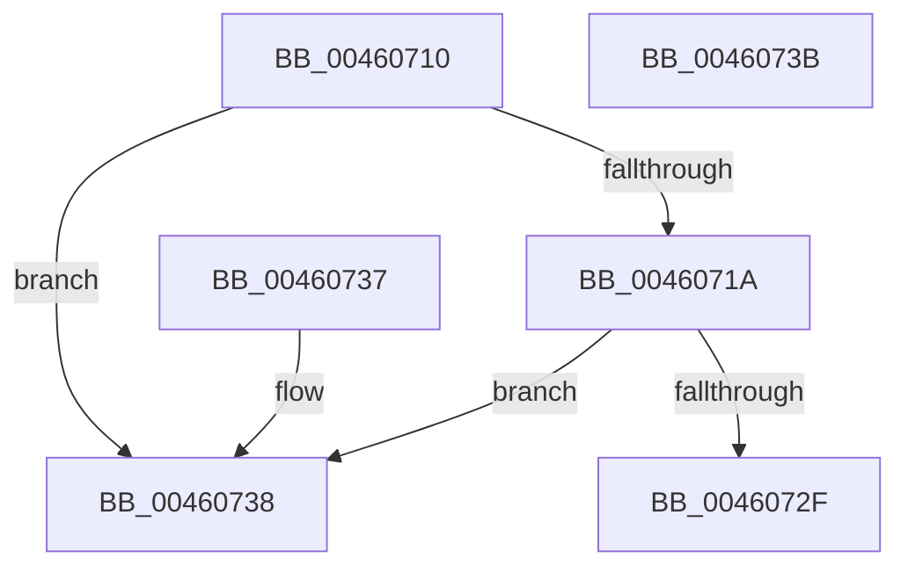

# KeQueryProcessorTotalCyclesImprecise

- RVA: `0x00460710`–`0x0046073C` (길이 `44` bytes)
- VA: `0x0000000140460710`
- 실행 섹션: `.text`
- PDB 이름 있음: `예`; PDB Function 태그: `아니요`
- unwind 정보 RVA: `0x000DB714`
- 디코드: `15`개 명령, `44/44` bytes 표시
- 미해석 바이트: `0` (있으면 어셈블리에 `.byte`로 보존)

> 이 문서는 커널 이미지의 기계어와 PDB 기호를 분석해 생성했습니다. 4번과 5번은 함수 원형과 자료형을 바이너리 사용 방식에서 추정한 C 해석이며 원본 소스 복구 결과는 아닙니다.

## 1. Dependencies

- 직접 호출 지점: **0**; 고유 호출 대상: **0**
- 직접 호출자로 확인된 함수: **0**
- RIP 상대 이미지 참조: **2**

### Outgoing calls
- 직접 디코드된 call 명령이 없습니다.

### Direct callers
- 이 함수 시작 RVA로 연결되는 직접 call은 확인되지 않았습니다. 간접 호출은 완전히 역산할 수 없습니다.

### Static image references
- `0x00460710` → RVA `0x00FC6A80` (`ALMOSTRO`; read)
- `0x0046071F` → RVA `0x00FC8C40` (`ALMOSTRO`; read)

## 2. Other-region calls and transfers

- 다른 실행 섹션으로 향하는 call: **0**
- 별도 외부 분기/꼬리 이동을 확인하지 못했습니다.

## 3. Assembly (complete function range)

```asm
00460710  8B 05 6A 63 B6 00               mov eax, dword ptr [rip + 0xb6636a]
00460716  3B C8                           cmp ecx, eax
00460718  73 1E                           jae 0x140460738
0046071A  0F AE E8                        lfence
0046071D  8B C1                           mov eax, ecx
0046071F  48 8D 0D 1A 85 B6 00            lea rcx, [rip + 0xb6851a]
00460726  48 8B 04 C1                     mov rax, qword ptr [rcx + rax*8]
0046072A  48 85 C0                        test rax, rax
0046072D  74 09                           je 0x140460738
0046072F  48 8B 80 80 86 00 00            mov rax, qword ptr [rax + 0x8680]
00460736  C3                              ret
00460737  CC                              int3
00460738  33 C0                           xor eax, eax
0046073A  C3                              ret
0046073B  CC                              int3
```

## 4. C-style interpretation (structured pseudocode)

```c
__int64 __fastcall KeQueryProcessorTotalCyclesImprecise(int a1)
{
    __int64 result;

    if (a1 >= ((unsigned int)((unsigned int)(*(unsigned int *)(v_rip + 11953002))))) goto loc_00460738;
    if (*(unsigned __int64 *)(v_rip + 11961626 + (unsigned int)(a1) * 8) == 0) goto loc_00460738;
    return *(unsigned __int64 *)(*(unsigned __int64 *)(v_rip + 11961626 + (unsigned int)(a1) * 8) + 34432);
loc_00460738:
    result = 0;
    return result;
}
```

## 5. (Beta) C Style

```c
int64_t KeQueryProcessorTotalCyclesImprecise(int32_t Arg1)
{
    int64_t result;

    if (Arg1 >= ((uint32_t)((uint32_t)(*(uint32_t *)(v_rip + 0xB6636A))))) goto loc_00460738;
    if (*(uint64_t *)(v_rip + 0xB6851A + (uint32_t)(Arg1) * 8) == 0) goto loc_00460738;
    return *(uint64_t *)(*(uint64_t *)(v_rip + 0xB6851A + (uint32_t)(Arg1) * 8) + 0x8680);
loc_00460738:
    result = 0;
    return result;
}
```

## 6. Execution-region graph

[열기: 2D/3D 그래프와 함수 탐색 컨트롤 패널](../../../control-panel.html?section=text&rva=0x00460710&view=graph)

- 2D 그래프는 위에서 아래로 흐르고, 3D 그래프는 빈 공간을 드래그해 회전합니다. Shift+드래그는 이동, 휠은 확대·축소, 함수 노드 선택은 대상 보고서 이동입니다.

### Static fallback


