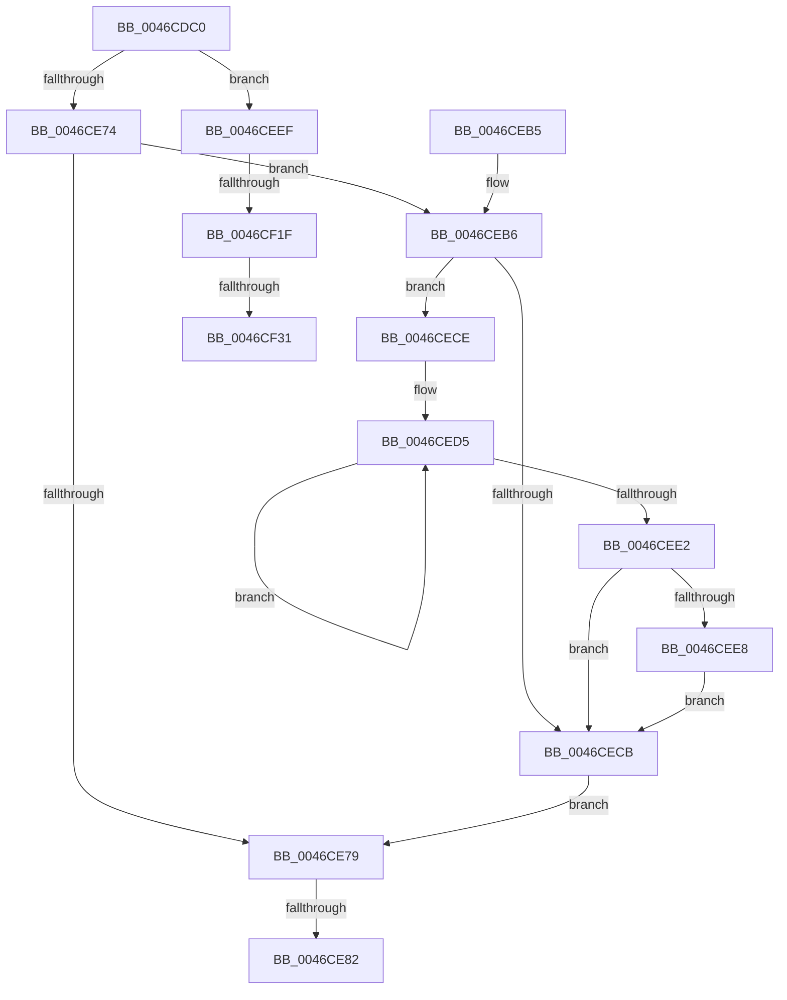

# KeRemoveQueueDpcEx

- RVA: `0x0046CDC0`–`0x0046CF36` (길이 `374` bytes)
- VA: `0x000000014046CDC0`
- 실행 섹션: `.text`
- PDB 이름 있음: `예`; PDB Function 태그: `예`
- unwind 정보 RVA: `0x000AB9F4`
- 디코드: `98`개 명령, `374/374` bytes 표시
- 미해석 바이트: `0` (있으면 어셈블리에 `.byte`로 보존)

> 이 문서는 커널 이미지의 기계어와 PDB 기호를 분석해 생성했습니다. 4번과 5번은 함수 원형과 자료형을 바이너리 사용 방식에서 추정한 C 해석이며 원본 소스 복구 결과는 아닙니다.

## 1. Dependencies

- 직접 호출 지점: **5**; 고유 호출 대상: **4**
- 직접 호출자로 확인된 함수: **13**
- RIP 상대 이미지 참조: **2**

### Outgoing calls
- `0x0046CE2F` → [memset](../6C/memset_function_006C6C40.md) (function, `0x006C6C40`)
- `0x0046CE50` → [memset](../6C/memset_function_006C6C40.md) (function, `0x006C6C40`)
- `0x0046CE58` → [KeDisableInterrupts](../21/KeDisableInterrupts_function_00217BE0.md) (function, `0x00217BE0`)
- `0x0046CE8F` → [_security_check_cookie](../6A/_security_check_cookie_function_006AC640.md) (function, `0x006AC640`)
- `0x0046CEE8` → [KiRemoveSystemWorkPriorityKick](../26/KiRemoveSystemWorkPriorityKick_function_002631D0.md) (function, `0x002631D0`)

### Direct callers
- [ExpSetTimerObject](../23/ExpSetTimerObject_function_00231730.md) at `0x0023259E`
- [ExpCancelTimer](../23/ExpCancelTimer_function_00232700.md) at `0x002327CC`
- [KiCheckAndRearmForceIdle](../3A/KiCheckAndRearmForceIdle_function_003A1C58.md) at `0x003A1D1D`
- [EtwpFreeCompression](EtwpFreeCompression_function_0046CCD8.md) at `0x0046CCF3`
- [KeRemoveQueueDpc](KeRemoveQueueDpc_function_0046CDA0.md) at `0x0046CDA6`
- [KeClearForceIdle](../48/KeClearForceIdle_function_0048D69C.md) at `0x0048D79A`
- [KiForceIdleUpdateSchedulerParkState](../48/KiForceIdleUpdateSchedulerParkState_function_0048D874.md) at `0x0048D930`
- [KeSrcuFree](../5C/KeSrcuFree_function_005C1F60.md) at `0x005C1FBF`
- [KiSrcuNotifyWorkerAcquire](../5C/KiSrcuNotifyWorkerAcquire_function_005C2860.md) at `0x005C28A6`
- [KiBugCheckRecoveryFreezeOtherProcessors](../5C/KiBugCheckRecoveryFreezeOtherProcessors_function_005C7120.md) at `0x005C72C4`
- [DifKeRemoveQueueDpcWrapper](../63/DifKeRemoveQueueDpcWrapper_function_00632370.md) at `0x0063243F`
- [sub_006DDA8E](../6D/Unknown_function_006DDA8E.md) at `0x006DDAAF`
- [VfWdCheckForSettingsChange](../../pagevrfy/BA/VfWdCheckForSettingsChange_function_00BAC888.md) at `0x00BAC8B9`

### Static image references
- `0x0046CDE6` → RVA `0x00E0A740` (`.data`; read)
- `0x0046CE61` → RVA `0x00FC8C40` (`ALMOSTRO`; read)

## 2. Other-region calls and transfers

- 다른 실행 섹션으로 향하는 call: **0**
- call이 아닌 외부 분기/꼬리 이동: **4**
  - `0x0046CE7C` → [sub_006F322E + 0x8C](../6F/Unknown_function_006F322E.md) (`tail-transfer`)
  - `0x0046CF19` → [sub_006F322E](../6F/Unknown_function_006F322E.md) (`tail-transfer`)
  - `0x0046CF2B` → [sub_006F322E](../6F/Unknown_function_006F322E.md) (`tail-transfer`)
  - `0x0046CF31` → [sub_006F322E + 0x5](../6F/Unknown_function_006F322E.md) (`tail-transfer`)

## 3. Assembly (complete function range)

```asm
0046CDC0  48 8B C4                        mov rax, rsp
0046CDC3  48 89 58 10                     mov qword ptr [rax + 0x10], rbx
0046CDC7  48 89 70 18                     mov qword ptr [rax + 0x18], rsi
0046CDCB  48 89 78 20                     mov qword ptr [rax + 0x20], rdi
0046CDCF  55                              push rbp
0046CDD0  41 54                           push r12
0046CDD2  41 55                           push r13
0046CDD4  41 56                           push r14
0046CDD6  41 57                           push r15
0046CDD8  48 8D A8 28 FE FF FF            lea rbp, [rax - 0x1d8]
0046CDDF  48 81 EC B0 02 00 00            sub rsp, 0x2b0
0046CDE6  48 8B 05 53 D9 99 00            mov rax, qword ptr [rip + 0x99d953]
0046CDED  48 33 C4                        xor rax, rsp
0046CDF0  48 89 85 A0 01 00 00            mov qword ptr [rbp + 0x1a0], rax
0046CDF7  0F 57 C0                        xorps xmm0, xmm0
0046CDFA  88 54 24 20                     mov byte ptr [rsp + 0x20], dl
0046CDFE  33 C0                           xor eax, eax
0046CE00  40 8A FA                        mov dil, dl
0046CE03  48 8B D9                        mov rbx, rcx
0046CE06  48 89 44 24 70                  mov qword ptr [rsp + 0x70], rax
0046CE0B  BE 00 01 00 00                  mov esi, 0x100
0046CE10  89 44 24 78                     mov dword ptr [rsp + 0x78], eax
0046CE14  44 8B C6                        mov r8d, esi
0046CE17  48 8D 8D 98 00 00 00            lea rcx, [rbp + 0x98]
0046CE1E  33 D2                           xor edx, edx
0046CE20  0F 11 44 24 40                  movups xmmword ptr [rsp + 0x40], xmm0
0046CE25  0F 11 44 24 50                  movups xmmword ptr [rsp + 0x50], xmm0
0046CE2A  0F 11 44 24 60                  movups xmmword ptr [rsp + 0x60], xmm0
0046CE2F  E8 0C 9E 25 00                  call 0x1406c6c40
0046CE34  45 33 F6                        xor r14d, r14d
0046CE37  48 8D 4D 88                     lea rcx, [rbp - 0x78]
0046CE3B  44 8B C6                        mov r8d, esi
0046CE3E  44 89 74 24 3A                  mov dword ptr [rsp + 0x3a], r14d
0046CE43  33 D2                           xor edx, edx
0046CE45  66 44 89 74 24 3E               mov word ptr [rsp + 0x3e], r14w
0046CE4B  44 89 74 24 24                  mov dword ptr [rsp + 0x24], r14d
0046CE50  E8 EB 9D 25 00                  call 0x1406c6c40
0046CE55  45 8A FE                        mov r15b, r14b
0046CE58  E8 83 AD DA FF                  call 0x140217be0
0046CE5D  4C 8B 6B 38                     mov r13, qword ptr [rbx + 0x38]
0046CE61  4C 8D 0D D8 BD B5 00            lea r9, [rip + 0xb5bdd8]
0046CE68  41 8D 76 01                     lea esi, [r14 + 1]
0046CE6C  44 8A E0                        mov r12b, al
0046CE6F  4D 85 ED                        test r13, r13
0046CE72  75 7B                           jne 0x14046ceef
0046CE74  45 84 E4                        test r12b, r12b
0046CE77  75 3D                           jne 0x14046ceb6
0046CE79  40 84 FF                        test dil, dil
0046CE7C  0F 85 38 64 28 00               jne 0x1406f32ba
0046CE82  41 8A C7                        mov al, r15b
0046CE85  48 8B 8D A0 01 00 00            mov rcx, qword ptr [rbp + 0x1a0]
0046CE8C  48 33 CC                        xor rcx, rsp
0046CE8F  E8 AC F7 23 00                  call 0x1406ac640
0046CE94  4C 8D 9C 24 B0 02 00 00         lea r11, [rsp + 0x2b0]
0046CE9C  49 8B 5B 38                     mov rbx, qword ptr [r11 + 0x38]
0046CEA0  49 8B 73 40                     mov rsi, qword ptr [r11 + 0x40]
0046CEA4  49 8B 7B 48                     mov rdi, qword ptr [r11 + 0x48]
0046CEA8  49 8B E3                        mov rsp, r11
0046CEAB  41 5F                           pop r15
0046CEAD  41 5E                           pop r14
0046CEAF  41 5D                           pop r13
0046CEB1  41 5C                           pop r12
0046CEB3  5D                              pop rbp
0046CEB4  C3                              ret
0046CEB5  CC                              int3
0046CEB6  65 48 8B 0C 25 20 00 00 00      mov rcx, qword ptr gs:[0x20]
0046CEBF  4C 8B 81 B8 8E 00 00            mov r8, qword ptr [rcx + 0x8eb8]
0046CEC6  4D 85 C0                        test r8, r8
0046CEC9  75 03                           jne 0x14046cece
0046CECB  FB                              sti
0046CECC  EB AB                           jmp 0x14046ce79
0046CECE  41 0F 0D 08                     prefetchw byte ptr [r8]
0046CED2  41 8B 00                        mov eax, dword ptr [r8]
0046CED5  8B D0                           mov edx, eax
0046CED7  0F BA F2 15                     btr edx, 0x15
0046CEDB  F0 41 0F B1 10                  lock cmpxchg dword ptr [r8], edx
0046CEE0  75 F3                           jne 0x14046ced5
0046CEE2  0F BA E0 15                     bt eax, 0x15
0046CEE6  73 E3                           jae 0x14046cecb
0046CEE8  E8 E3 62 DF FF                  call 0x1402631d0
0046CEED  EB DC                           jmp 0x14046cecb
0046CEEF  8B 13                           mov edx, dword ptr [rbx]
0046CEF1  41 B8 00 08 00 00               mov r8d, 0x800
0046CEF7  8B CA                           mov ecx, edx
0046CEF9  89 54 24 40                     mov dword ptr [rsp + 0x40], edx
0046CEFD  C1 E9 10                        shr ecx, 0x10
0046CF00  0F B7 C1                        movzx eax, cx
0046CF03  66 41 2B C0                     sub ax, r8w
0046CF07  66 41 3B C8                     cmp cx, r8w
0046CF0B  66 0F 42 C1                     cmovb ax, cx
0046CF0F  0F B7 C0                        movzx eax, ax
0046CF12  49 8B 34 C1                     mov rsi, qword ptr [r9 + rax*8]
0046CF16  80 FA 1A                        cmp dl, 0x1a
0046CF19  0F 85 0F 63 28 00               jne 0x1406f322e
0046CF1F  B8 70 38 00 00                  mov eax, 0x3870
0046CF24  44 38 B6 B8 38 00 00            cmp byte ptr [rsi + 0x38b8], r14b
0046CF2B  0F 84 FD 62 28 00               je 0x1406f322e
0046CF31  E9 FD 62 28 00                  jmp 0x1406f3233
```

## 4. C-style interpretation (structured pseudocode)

```c
__int64 __fastcall KeRemoveQueueDpcEx(__int64 a1, int a2)
{
    __int64 result;
    __int64 v_r14;
    __int64 v_rsp;
    unsigned int v_stack_m260;
    unsigned __int64 v_stack_m268;
    unsigned int v_stack_m270;
    unsigned __int64 v_stack_m278;
    unsigned __int64 v_stack_m28;
    unsigned __int64 v_stack_m288;
    unsigned __int64 v_stack_m298;
    unsigned __int16 v_stack_m29A;
    unsigned int v_stack_m29E;
    unsigned int v_stack_m2B4;
    unsigned __int8 v_stack_m2B8;

    *(unsigned __int64 *)(v_rsp + 16) = v_rbx;
    *(unsigned __int64 *)(v_rsp + 24) = v_rsi;
    *(unsigned __int64 *)(v_rsp + 32) = v_rdi;
    v_rsp = (v_rsp) - (688);
    result = (*(unsigned __int64 *)(v_rip + 10082643)) ^ (v_rsp);
    *(unsigned __int64 *)(v_rsp - 472 + 416) = result;
    v_stack_m2B8 = (unsigned __int8)(a2);
    result = 0;
    v_stack_m268 = 0;
    v_stack_m260 = 0;
    a2 = 0;
    v_stack_m298 = v_xmm0;
    v_stack_m288 = v_xmm0;
    v_stack_m278 = v_xmm0;
    result = memset(v_rsp - 472 + 152, a2, 256, a4);
    v_r14 = 0;
    v_stack_m29E = 0;
    a2 = 0;
    v_stack_m29A = 0;
    v_stack_m2B4 = 0;
    result = memset(v_rsp - 472 - 120, a2, 256, a4);
    result = KeDisableInterrupts(v_rsp - 472 - 120, a2, 256, a4);
    if (*(unsigned __int64 *)(a1 + 56) != 0) goto loc_0046CEEF;
    if ((unsigned __int8)((unsigned __int8)(result)) != 0) goto loc_0046CEB6;
loc_0046CE79:
    a1 = (*(unsigned __int64 *)(v_rsp - 472 + 416)) ^ (v_rsp);
    result = _security_check_cookie(a1, a2, 256, v_rip + 11910616);
    return result;
loc_0046CEB6:
    if (*(unsigned __int64 *)(*(unsigned __int64 *)(gs_base + (0 + 32)) + 36536) != 0) goto loc_0046CECE;
loc_0046CECB:
    goto loc_0046CE79;
loc_0046CECE:
loc_0046CED5:
    if (*(unsigned __int64 *)(*(unsigned __int64 *)(gs_base + (0 + 32)) + 36536) != 0) goto loc_0046CED5;
    if (condition_is_above_or_equal) goto loc_0046CECB;
    result = KiRemoveSystemWorkPriorityKick(*(unsigned __int64 *)(gs_base + (0 + 32)), (unsigned int)((unsigned int)((unsigned int)(*(unsigned int *)(*(unsigned __int64 *)(*(unsigned __int64 *)(gs_base + (0 + 32)) + 36536))))), *(unsigned __int64 *)(*(unsigned __int64 *)(gs_base + (0 + 32)) + 36536), v_rip + 11910616);
    goto loc_0046CECB;
loc_0046CEEF:
    v_stack_m270 = (unsigned int)((unsigned int)(*(unsigned int *)(*(unsigned __int64 *)(v_stack_m28 + 56))));
    a1 = (unsigned int)(((unsigned int)((unsigned int)((unsigned int)(*(unsigned int *)(*(unsigned __int64 *)(v_stack_m28 + 56)))))) >> (16));
    result = (unsigned __int16)(((unsigned __int16)(a1)) - ((unsigned __int16)((unsigned int)(0x800ULL))));
    if (((unsigned __int16)(a1)) < ((unsigned __int16)((unsigned int)(0x800ULL)))) { result = (unsigned __int16)(a1); }
}
```

## 5. (Beta) C Style

```c
int64_t KeRemoveQueueDpcEx(void *Arg1, int32_t Arg2)
{
    uint8_t *arg1 = (uint8_t *)Arg1;

    int64_t result;
    int64_t local_r14;
    int64_t local_rsp;
    uint32_t v_stack_m260;
    uint64_t v_stack_m268;
    uint32_t v_stack_m270;
    uint64_t v_stack_m278;
    uint64_t v_stack_m28;
    uint64_t v_stack_m288;
    uint64_t v_stack_m298;
    uint16_t v_stack_m29A;
    uint32_t v_stack_m29E;
    uint32_t v_stack_m2B4;
    uint8_t v_stack_m2B8;

    *(uint64_t *)(local_rsp + 0x10) = local_rbx;
    *(uint64_t *)(local_rsp + 0x18) = local_rsi;
    *(uint64_t *)(local_rsp + 0x20) = local_rdi;
    local_rsp = (local_rsp) - (688);
    result = (*(uint64_t *)(v_rip + 0x99D953)) ^ (local_rsp);
    *(uint64_t *)(local_rsp - 0x1D8 + 0x1A0) = result;
    v_stack_m2B8 = (uint8_t)(Arg2);
    result = 0;
    v_stack_m268 = 0;
    v_stack_m260 = 0;
    Arg2 = 0;
    v_stack_m298 = v_xmm0;
    v_stack_m288 = v_xmm0;
    v_stack_m278 = v_xmm0;
    result = memset(local_rsp - 472 + 152, Arg2, 256, a4);
    local_r14 = 0;
    v_stack_m29E = 0;
    Arg2 = 0;
    v_stack_m29A = 0;
    v_stack_m2B4 = 0;
    result = memset(local_rsp - 472 - 120, Arg2, 256, a4);
    result = KeDisableInterrupts(local_rsp - 472 - 120, Arg2, 256, a4);
    if (*(uint64_t *)(arg1 + 0x38) != 0) goto loc_0046CEEF;
    if ((uint8_t)((uint8_t)(result)) != 0) goto loc_0046CEB6;
loc_0046CE79:
    Arg1 = (*(uint64_t *)(local_rsp - 0x1D8 + 0x1A0)) ^ (local_rsp);
    result = _security_check_cookie(Arg1, Arg2, 256, v_rip + 11910616);
    return result;
loc_0046CEB6:
    if (*(uint64_t *)(*(uint64_t *)(gs_base + (0 + 0x20)) + 0x8EB8) != 0) goto loc_0046CECE;
loc_0046CECB:
    goto loc_0046CE79;
loc_0046CECE:
loc_0046CED5:
    if (*(uint64_t *)(*(uint64_t *)(gs_base + (0 + 0x20)) + 0x8EB8) != 0) goto loc_0046CED5;
    if (condition_is_above_or_equal) goto loc_0046CECB;
    result = KiRemoveSystemWorkPriorityKick(*(uint64_t *)(gs_base + (0 + 0x20)), (uint32_t)((uint32_t)((uint32_t)(*(uint32_t *)(*(uint64_t *)(*(uint64_t *)(gs_base + (0 + 0x20)) + 0x8EB8))))), *(uint64_t *)(*(uint64_t *)(gs_base + (0 + 0x20)) + 0x8EB8), v_rip + 11910616);
    goto loc_0046CECB;
loc_0046CEEF:
    v_stack_m270 = (uint32_t)((uint32_t)(*(uint32_t *)(*(uint64_t *)(v_stack_m28 + 0x38))));
    Arg1 = (uint32_t)(((uint32_t)((uint32_t)((uint32_t)(*(uint32_t *)(*(uint64_t *)(v_stack_m28 + 0x38)))))) >> (16));
    result = (uint16_t)(((uint16_t)(Arg1)) - ((uint16_t)((uint32_t)(0x800ULL))));
    if (((uint16_t)(Arg1)) < ((uint16_t)((uint32_t)(0x800ULL)))) { result = (uint16_t)(Arg1); }
}
```

### 관측된 메모리 오프셋

구조체 형식이 확인되지 않은 접근은 인자 기준의 오프셋으로만 기록했습니다.

| 기준 인자 | 오프셋 표현 | 폭 (bit) | 접근 |
|---|---:|---:|---|
| `Arg1` | `+ 0x0` | `32` | `R` |
| `Arg1` | `+ 0x38` | `64` | `R` |

## 6. Execution-region graph

[열기: 2D/3D 그래프와 함수 탐색 컨트롤 패널](../../../control-panel.html?section=text&rva=0x0046CDC0&view=graph)

- 2D 그래프는 위에서 아래로 흐르고, 3D 그래프는 빈 공간을 드래그해 회전합니다. Shift+드래그는 이동, 휠은 확대·축소, 함수 노드 선택은 대상 보고서 이동입니다.

### Static fallback


