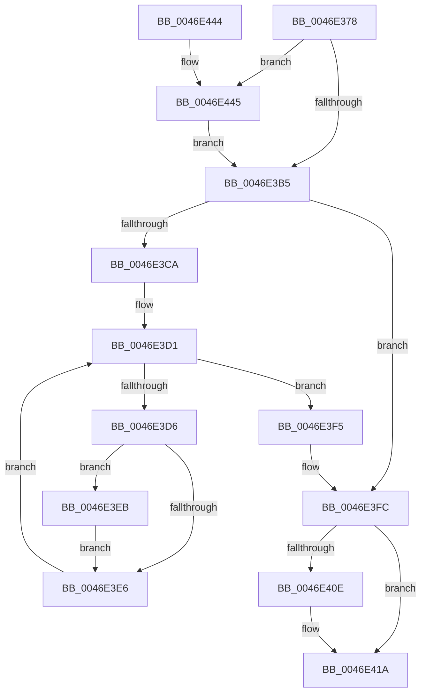

# KeSetProcessSchedulingGroup

- RVA: `0x0046E378`–`0x0046E452` (길이 `218` bytes)
- VA: `0x000000014046E378`
- 실행 섹션: `.text`
- PDB 이름 있음: `예`; PDB Function 태그: `아니요`
- unwind 정보 RVA: `0x0009E140`
- 디코드: `58`개 명령, `218/218` bytes 표시
- 미해석 바이트: `0` (있으면 어셈블리에 `.byte`로 보존)

> 이 문서는 커널 이미지의 기계어와 PDB 기호를 분석해 생성했습니다. 4번과 5번은 함수 원형과 자료형을 바이너리 사용 방식에서 추정한 C 해석이며 원본 소스 복구 결과는 아닙니다.

## 1. Dependencies

- 직접 호출 지점: **5**; 고유 호출 대상: **5**
- 직접 호출자로 확인된 함수: **2**
- RIP 상대 이미지 참조: **1**

### Outgoing calls
- `0x0046E3B9` → [ExAcquireSpinLockExclusiveAtDpcLevel](../24/ExAcquireSpinLockExclusiveAtDpcLevel_function_00248E80.md) (function, `0x00248E80`)
- `0x0046E3EE` → [KiSetThreadSchedulingGroup](KiSetThreadSchedulingGroup_function_0046E458.md) (function, `0x0046E458`)
- `0x0046E400` → [ExReleaseSpinLockExclusiveFromDpcLevel](../24/ExReleaseSpinLockExclusiveFromDpcLevel_function_002497E0.md) (function, `0x002497E0`)
- `0x0046E415` → [KiLowerIrqlProcessIrqlFlags](../4F/KiLowerIrqlProcessIrqlFlags_function_004F5698.md) (function, `0x004F5698`)
- `0x0046E448` → [KiRaiseIrqlProcessIrqlFlags](../4F/KiRaiseIrqlProcessIrqlFlags_function_004F56FC.md) (function, `0x004F56FC`)

### Direct callers
- [PspTerminateProcess](../../page/90/PspTerminateProcess_function_00903FFC.md) at `0x0090406E`
- [PspSetProcessSchedulingGroup](../../page/A6/PspSetProcessSchedulingGroup_function_00A66D08.md) at `0x00A66D4C`
- [PspSetProcessSchedulingGroup](../../page/A6/PspSetProcessSchedulingGroup_function_00A66D08.md) at `0x00A66D5D`

### Static image references
- `0x0046E3A8` → RVA `0x00FC6D20` (`ALMOSTRO`; read)

## 2. Other-region calls and transfers

- 다른 실행 섹션으로 향하는 call: **0**
- 별도 외부 분기/꼬리 이동을 확인하지 못했습니다.

## 3. Assembly (complete function range)

```asm
0046E378  48 8B C4                        mov rax, rsp
0046E37B  48 89 58 08                     mov qword ptr [rax + 8], rbx
0046E37F  48 89 68 10                     mov qword ptr [rax + 0x10], rbp
0046E383  48 89 70 18                     mov qword ptr [rax + 0x18], rsi
0046E387  48 89 78 20                     mov qword ptr [rax + 0x20], rdi
0046E38B  41 54                           push r12
0046E38D  41 56                           push r14
0046E38F  41 57                           push r15
0046E391  48 83 EC 20                     sub rsp, 0x20
0046E395  48 8B EA                        mov rbp, rdx
0046E398  48 8B F1                        mov rsi, rcx
0046E39B  44 0F 20 C7                     mov rdi, cr8
0046E39F  BA 02 00 00 00                  mov edx, 2
0046E3A4  44 0F 22 C2                     mov cr8, rdx
0046E3A8  83 3D 71 89 B5 00 00            cmp dword ptr [rip + 0xb58971], 0
0046E3AF  0F 85 90 00 00 00               jne 0x14046e445
0046E3B5  48 8D 4E 40                     lea rcx, [rsi + 0x40]
0046E3B9  E8 C2 AA DD FF                  call 0x140248e80
0046E3BE  4C 8B BE 30 01 00 00            mov r15, qword ptr [rsi + 0x130]
0046E3C5  4C 3B FD                        cmp r15, rbp
0046E3C8  74 32                           je 0x14046e3fc
0046E3CA  4C 8D 76 30                     lea r14, [rsi + 0x30]
0046E3CE  49 8B 1E                        mov rbx, qword ptr [r14]
0046E3D1  49 3B DE                        cmp rbx, r14
0046E3D4  74 1F                           je 0x14046e3f5
0046E3D6  48 8D 8B 08 FD FF FF            lea rcx, [rbx - 0x2f8]
0046E3DD  48 8B 41 68                     mov rax, qword ptr [rcx + 0x68]
0046E3E1  48 3B C5                        cmp rax, rbp
0046E3E4  75 05                           jne 0x14046e3eb
0046E3E6  48 8B 1B                        mov rbx, qword ptr [rbx]
0046E3E9  EB E6                           jmp 0x14046e3d1
0046E3EB  48 8B D5                        mov rdx, rbp
0046E3EE  E8 65 00 00 00                  call 0x14046e458
0046E3F3  EB F1                           jmp 0x14046e3e6
0046E3F5  48 89 AE 30 01 00 00            mov qword ptr [rsi + 0x130], rbp
0046E3FC  48 8D 4E 40                     lea rcx, [rsi + 0x40]
0046E400  E8 DB B3 DD FF                  call 0x1402497e0
0046E405  83 3D 14 89 B5 00 00            cmp dword ptr [rip + 0xb58914], 0
0046E40C  74 0C                           je 0x14046e41a
0046E40E  44 0F 20 C1                     mov rcx, cr8
0046E412  40 8A D7                        mov dl, dil
0046E415  E8 7E 72 08 00                  call 0x1404f5698
0046E41A  40 0F B6 CF                     movzx ecx, dil
0046E41E  44 0F 22 C1                     mov cr8, rcx
0046E422  48 8B 5C 24 40                  mov rbx, qword ptr [rsp + 0x40]
0046E427  49 8B C7                        mov rax, r15
0046E42A  48 8B 6C 24 48                  mov rbp, qword ptr [rsp + 0x48]
0046E42F  48 8B 74 24 50                  mov rsi, qword ptr [rsp + 0x50]
0046E434  48 8B 7C 24 58                  mov rdi, qword ptr [rsp + 0x58]
0046E439  48 83 C4 20                     add rsp, 0x20
0046E43D  41 5F                           pop r15
0046E43F  41 5E                           pop r14
0046E441  41 5C                           pop r12
0046E443  C3                              ret
0046E444  CC                              int3
0046E445  40 8A CF                        mov cl, dil
0046E448  E8 AF 72 08 00                  call 0x1404f56fc
0046E44D  E9 63 FF FF FF                  jmp 0x14046e3b5
```

## 4. C-style interpretation (structured pseudocode)

```c
__int64 __fastcall KeSetProcessSchedulingGroup(__int64 a1, __int64 a2)
{
    __int64 result;
    __int64 v_rsp;
    unsigned __int64 v_stack_p10;
    unsigned __int64 v_stack_p18;
    unsigned __int64 v_stack_p20;
    unsigned __int64 v_stack_p8;

    *(unsigned __int64 *)(v_rsp + 8) = v_rbx;
    *(unsigned __int64 *)(v_rsp + 16) = v_rbp;
    *(unsigned __int64 *)(v_rsp + 24) = v_rsi;
    *(unsigned __int64 *)(v_rsp + 32) = v_rdi;
    v_rsp = (v_rsp) - (32);
    if ((*(unsigned int *)(v_rip + 11897201)) != 0) goto loc_0046E445;
loc_0046E3B5:
    result = ExAcquireSpinLockExclusiveAtDpcLevel(a1 + 64, 2, a3, a4);
    if ((*(unsigned __int64 *)(a1 + 304)) == a2) goto loc_0046E3FC;
loc_0046E3D1:
    if ((*(unsigned __int64 *)(a1 + 48)) == (a1 + 48)) goto loc_0046E3F5;
    if ((*(unsigned __int64 *)(*(unsigned __int64 *)(a1 + 48) - 760 + 104)) != a2) goto loc_0046E3EB;
loc_0046E3E6:
    goto loc_0046E3D1;
loc_0046E3EB:
    result = KiSetThreadSchedulingGroup(*(unsigned __int64 *)(a1 + 48) - 760, a2, a3, a4);
    goto loc_0046E3E6;
loc_0046E3F5:
    *(unsigned __int64 *)(a1 + 304) = a2;
loc_0046E3FC:
    result = ExReleaseSpinLockExclusiveFromDpcLevel(a1 + 64, a2, a3, a4);
    if ((*(unsigned int *)(v_rip + 11897108)) != 0) {
        a1 = 2;
        a2 = (unsigned __int8)(v_cr8);
        result = KiLowerIrqlProcessIrqlFlags(a1, a2, a3, a4);
    }
    v_rsp = (v_rsp) + (32);
    return *(unsigned __int64 *)(a1 + 304);
loc_0046E445:
    result = KiRaiseIrqlProcessIrqlFlags((unsigned __int8)(v_stack_p20), a2, a3, a4);
    goto loc_0046E3B5;
}
```

## 5. (Beta) C Style

```c
int64_t KeSetProcessSchedulingGroup(void *Arg1, int64_t Arg2)
{
    uint8_t *arg1 = (uint8_t *)Arg1;

    int64_t result;
    int64_t local_rsp;
    uint64_t v_stack_p10;
    uint64_t v_stack_p18;
    uint64_t v_stack_p20;
    uint64_t v_stack_p8;

    *(uint64_t *)(local_rsp + 0x8) = local_rbx;
    *(uint64_t *)(local_rsp + 0x10) = local_rbp;
    *(uint64_t *)(local_rsp + 0x18) = local_rsi;
    *(uint64_t *)(local_rsp + 0x20) = local_rdi;
    local_rsp = (local_rsp) - (32);
    if ((*(uint32_t *)(v_rip + 0xB58971)) != 0) goto loc_0046E445;
loc_0046E3B5:
    result = ExAcquireSpinLockExclusiveAtDpcLevel(Arg1 + 64, 2, a3, a4);
    if ((*(uint64_t *)(arg1 + 0x130)) == Arg2) goto loc_0046E3FC;
loc_0046E3D1:
    if ((*(uint64_t *)(arg1 + 0x30)) == (Arg1 + 48)) goto loc_0046E3F5;
    if ((*(uint64_t *)(*(uint64_t *)(arg1 + 0x30) - 0x2F8 + 0x68)) != Arg2) goto loc_0046E3EB;
loc_0046E3E6:
    goto loc_0046E3D1;
loc_0046E3EB:
    result = KiSetThreadSchedulingGroup(*(uint64_t *)(arg1 + 0x30) - 760, Arg2, a3, a4);
    goto loc_0046E3E6;
loc_0046E3F5:
    *(uint64_t *)(arg1 + 0x130) = Arg2;
loc_0046E3FC:
    result = ExReleaseSpinLockExclusiveFromDpcLevel(Arg1 + 64, Arg2, a3, a4);
    if ((*(uint32_t *)(v_rip + 0xB58914)) != 0) {
        Arg1 = 2;
        Arg2 = (uint8_t)(v_cr8);
        result = KiLowerIrqlProcessIrqlFlags(Arg1, Arg2, a3, a4);
    }
    local_rsp = (local_rsp) + (32);
    return *(uint64_t *)(arg1 + 0x130);
loc_0046E445:
    result = KiRaiseIrqlProcessIrqlFlags((uint8_t)(v_stack_p20), Arg2, a3, a4);
    goto loc_0046E3B5;
}
```

### 관측된 메모리 오프셋

구조체 형식이 확인되지 않은 접근은 인자 기준의 오프셋으로만 기록했습니다.

| 기준 인자 | 오프셋 표현 | 폭 (bit) | 접근 |
|---|---:|---:|---|
| `Arg1` | `+ 0x0` | `64` | `R` |
| `Arg1` | `+ 0x30` | `64` | `R` |
| `Arg1` | `+ 0x40` | `64` | `R` |
| `Arg1` | `+ 0x130` | `64` | `R` |
| `Arg1` | `+ 0x130` | `64` | `W` |

## 6. Execution-region graph

[열기: 2D/3D 그래프와 함수 탐색 컨트롤 패널](../../../control-panel.html?section=text&rva=0x0046E378&view=graph)

- 2D 그래프는 위에서 아래로 흐르고, 3D 그래프는 빈 공간을 드래그해 회전합니다. Shift+드래그는 이동, 휠은 확대·축소, 함수 노드 선택은 대상 보고서 이동입니다.

### Static fallback


