# KeSetSchedulingGroupCpuRates

- RVA: `0x0046DE5C`–`0x0046E0D7` (길이 `635` bytes)
- VA: `0x000000014046DE5C`
- 실행 섹션: `.text`
- PDB 이름 있음: `예`; PDB Function 태그: `예`
- unwind 정보 RVA: `0x000ABAF0`
- 디코드: `169`개 명령, `635/635` bytes 표시
- 미해석 바이트: `0` (있으면 어셈블리에 `.byte`로 보존)

> 이 문서는 커널 이미지의 기계어와 PDB 기호를 분석해 생성했습니다. 4번과 5번은 함수 원형과 자료형을 바이너리 사용 방식에서 추정한 C 해석이며 원본 소스 복구 결과는 아닙니다.

## 1. Dependencies

- 직접 호출 지점: **5**; 고유 호출 대상: **5**
- 직접 호출자로 확인된 함수: **1**
- RIP 상대 이미지 참조: **9**

### Outgoing calls
- `0x0046DE93` → [KeAcquireInStackQueuedSpinLock](../27/KeAcquireInStackQueuedSpinLock_function_002757A0.md) (function, `0x002757A0`)
- `0x0046DF2E` → [KiUpdateCpuTargetByRate](KiUpdateCpuTargetByRate_function_0046D7E4.md) (function, `0x0046D7E4`)
- `0x0046DFB3` → [KeReleaseInStackQueuedSpinLock](../34/KeReleaseInStackQueuedSpinLock_function_00342CE0.md) (function, `0x00342CE0`)
- `0x0046E02E` → [KiUpdateCpuTargetByWeight](KiUpdateCpuTargetByWeight_function_0046E0E0.md) (function, `0x0046E0E0`)
- `0x0046E0CD` → [EtwTraceSchedulingGroup](../65/EtwTraceSchedulingGroup_function_00650108.md) (function, `0x00650108`)

### Direct callers
- [NtSetInformationJobObject](../../page/9F/NtSetInformationJobObject_function_009F84C0.md) at `0x009FA004`
- [NtSetInformationJobObject](../../page/9F/NtSetInformationJobObject_function_009F84C0.md) at `0x009FA095`

### Static image references
- `0x0046DE77` → RVA `0x00FCF180` (`CACHEALI`; read)
- `0x0046DE9B` → RVA `0x00F23420` (`.data`; read)
- `0x0046DEF8` → RVA `0x00F23434` (`.data`; read/write)
- `0x0046DEFE` → RVA `0x00F2343C` (`.data`; read/write)
- `0x0046DF14` → RVA `0x00F2343C` (`.data`; read)
- `0x0046DF7A` → RVA `0x00F23438` (`.data`; write)
- `0x0046DFB8` → RVA `0x00FC6B14` (`ALMOSTRO`; read)
- `0x0046DFF7` → RVA `0x00F23434` (`.data`; read)
- `0x0046E065` → RVA `0x00F23438` (`.data`; read)

## 2. Other-region calls and transfers

- 다른 실행 섹션으로 향하는 call: **0**
- call이 아닌 외부 분기/꼬리 이동: **2**
  - `0x0046E088` → [sub_006F34A6](../6F/Unknown_function_006F34A6.md) (`tail-transfer`)
  - `0x0046E0B6` → [sub_006F34A6 + 0x12](../6F/Unknown_function_006F34A6.md) (`tail-transfer`)

## 3. Assembly (complete function range)

```asm
0046DE5C  4C 8B DC                        mov r11, rsp
0046DE5F  49 89 5B 08                     mov qword ptr [r11 + 8], rbx
0046DE63  49 89 6B 10                     mov qword ptr [r11 + 0x10], rbp
0046DE67  49 89 73 18                     mov qword ptr [r11 + 0x18], rsi
0046DE6B  57                              push rdi
0046DE6C  41 56                           push r14
0046DE6E  41 57                           push r15
0046DE70  48 83 EC 40                     sub rsp, 0x40
0046DE74  0F 57 C0                        xorps xmm0, xmm0
0046DE77  48 8D 0D 02 13 B6 00            lea rcx, [rip + 0xb61302]
0046DE7E  48 8B FA                        mov rdi, rdx
0046DE81  33 C0                           xor eax, eax
0046DE83  0F 11 44 24 20                  movups xmmword ptr [rsp + 0x20], xmm0
0046DE88  49 8D 53 C8                     lea rdx, [r11 - 0x38]
0046DE8C  49 89 43 D8                     mov qword ptr [r11 - 0x28], rax
0046DE90  4D 8B F8                        mov r15, r8
0046DE93  E8 08 79 E0 FF                  call 0x1402757a0
0046DE98  48 8B 0F                        mov rcx, qword ptr [rdi]
0046DE9B  4C 8D 35 7E 55 AB 00            lea r14, [rip + 0xab557e]
0046DEA2  8B 41 04                        mov eax, dword ptr [rcx + 4]
0046DEA5  A8 01                           test al, 1
0046DEA7  75 77                           jne 0x14046df20
0046DEA9  83 C8 01                        or eax, 1
0046DEAC  BA 09 00 00 00                  mov edx, 9
0046DEB1  89 41 04                        mov dword ptr [rcx + 4], eax
0046DEB4  48 8B 07                        mov rax, qword ptr [rdi]
0046DEB7  48 8B 48 60                     mov rcx, qword ptr [rax + 0x60]
0046DEBB  4C 8D 49 50                     lea r9, [rcx + 0x50]
0046DEBF  48 85 C9                        test rcx, rcx
0046DEC2  75 03                           jne 0x14046dec7
0046DEC4  4D 8B CE                        mov r9, r14
0046DEC7  4D 8B 01                        mov r8, qword ptr [r9]
0046DECA  45 33 D2                        xor r10d, r10d
0046DECD  45 33 DB                        xor r11d, r11d
0046DED0  41 8B 40 CC                     mov eax, dword ptr [r8 - 0x34]
0046DED4  8B DA                           mov ebx, edx
0046DED6  A8 01                           test al, 1
0046DED8  0F 84 04 01 00 00               je 0x14046dfe2
0046DEDE  4D 8B 00                        mov r8, qword ptr [r8]
0046DEE1  4D 3B C1                        cmp r8, r9
0046DEE4  75 EA                           jne 0x14046ded0
0046DEE6  45 85 DB                        test r11d, r11d
0046DEE9  0F 85 96 01 00 00               jne 0x14046e085
0046DEEF  48 85 C9                        test rcx, rcx
0046DEF2  0F 85 80 01 00 00               jne 0x14046e078
0046DEF8  21 0D 36 55 AB 00               and dword ptr [rip + 0xab5536], ecx
0046DEFE  21 0D 38 55 AB 00               and dword ptr [rip + 0xab5538], ecx
0046DF04  48 8B 07                        mov rax, qword ptr [rdi]
0046DF07  48 8B 48 60                     mov rcx, qword ptr [rax + 0x60]
0046DF0B  48 85 C9                        test rcx, rcx
0046DF0E  0F 85 86 01 00 00               jne 0x14046e09a
0046DF14  39 0D 22 55 AB 00               cmp dword ptr [rip + 0xab5522], ecx
0046DF1A  0F 85 D7 00 00 00               jne 0x14046dff7
0046DF20  48 8B 0F                        mov rcx, qword ptr [rdi]
0046DF23  B2 01                           mov dl, 1
0046DF25  49 8B 07                        mov rax, qword ptr [r15]
0046DF28  48 89 01                        mov qword ptr [rcx], rax
0046DF2B  48 8B 0F                        mov rcx, qword ptr [rdi]
0046DF2E  E8 B1 F8 FF FF                  call 0x14046d7e4
0046DF33  48 8B 07                        mov rax, qword ptr [rdi]
0046DF36  B9 10 27 00 00                  mov ecx, 0x2710
0046DF3B  48 8B 50 60                     mov rdx, qword ptr [rax + 0x60]
0046DF3F  4C 8D 4A 50                     lea r9, [rdx + 0x50]
0046DF43  48 85 D2                        test rdx, rdx
0046DF46  75 03                           jne 0x14046df4b
0046DF48  4D 8B CE                        mov r9, r14
0046DF4B  4D 8B 01                        mov r8, qword ptr [r9]
0046DF4E  45 33 D2                        xor r10d, r10d
0046DF51  41 8B 40 CC                     mov eax, dword ptr [r8 - 0x34]
0046DF55  44 8B D9                        mov r11d, ecx
0046DF58  A8 01                           test al, 1
0046DF5A  0F 85 D5 00 00 00               jne 0x14046e035
0046DF60  4D 8B 00                        mov r8, qword ptr [r8]
0046DF63  4D 3B C1                        cmp r8, r9
0046DF66  75 E9                           jne 0x14046df51
0046DF68  45 85 D2                        test r10d, r10d
0046DF6B  0F 84 42 01 00 00               je 0x14046e0b3
0046DF71  48 85 D2                        test rdx, rdx
0046DF74  0F 85 E3 00 00 00               jne 0x14046e05d
0046DF7A  89 0D B8 54 AB 00               mov dword ptr [rip + 0xab54b8], ecx
0046DF80  48 8B 07                        mov rax, qword ptr [rdi]
0046DF83  48 8B 48 60                     mov rcx, qword ptr [rax + 0x60]
0046DF87  48 85 C9                        test rcx, rcx
0046DF8A  0F 84 D5 00 00 00               je 0x14046e065
0046DF90  44 8B 41 0C                     mov r8d, dword ptr [rcx + 0xc]
0046DF94  4C 8D 71 50                     lea r14, [rcx + 0x50]
0046DF98  49 8B 0E                        mov rcx, qword ptr [r14]
0046DF9B  8B 41 CC                        mov eax, dword ptr [rcx - 0x34]
0046DF9E  A8 01                           test al, 1
0046DFA0  0F 85 A3 00 00 00               jne 0x14046e049
0046DFA6  48 8B 09                        mov rcx, qword ptr [rcx]
0046DFA9  49 3B CE                        cmp rcx, r14
0046DFAC  75 ED                           jne 0x14046df9b
0046DFAE  48 8D 4C 24 20                  lea rcx, [rsp + 0x20]
0046DFB3  E8 28 4D ED FF                  call 0x140342ce0
0046DFB8  F7 05 52 8B B5 00 00 40 00 00   test dword ptr [rip + 0xb58b52], 0x4000
0046DFC2  0F 85 FD 00 00 00               jne 0x14046e0c5
0046DFC8  48 8B 5C 24 60                  mov rbx, qword ptr [rsp + 0x60]
0046DFCD  48 8B 6C 24 68                  mov rbp, qword ptr [rsp + 0x68]
0046DFD2  48 8B 74 24 70                  mov rsi, qword ptr [rsp + 0x70]
0046DFD7  48 83 C4 40                     add rsp, 0x40
0046DFDB  41 5F                           pop r15
0046DFDD  41 5E                           pop r14
0046DFDF  5F                              pop rdi
0046DFE0  C3                              ret
0046DFE1  CC                              int3
0046DFE2  41 0F B7 50 C8                  movzx edx, word ptr [r8 - 0x38]
0046DFE7  41 FF C3                        inc r11d
0046DFEA  44 03 D2                        add r10d, edx
0046DFED  3B D3                           cmp edx, ebx
0046DFEF  0F 43 D3                        cmovae edx, ebx
0046DFF2  E9 E7 FE FF FF                  jmp 0x14046dede
0046DFF7  8B 2D 37 54 AB 00               mov ebp, dword ptr [rip + 0xab5437]
0046DFFD  49 8B F6                        mov rsi, r14
0046E000  48 8B 1D 19 54 AB 00            mov rbx, qword ptr [rip + 0xab5419]
0046E007  48 8D 4B C8                     lea rcx, [rbx - 0x38]
0046E00B  8B 41 04                        mov eax, dword ptr [rcx + 4]
0046E00E  A8 01                           test al, 1
0046E010  74 0D                           je 0x14046e01f
0046E012  48 8B 1B                        mov rbx, qword ptr [rbx]
0046E015  48 3B DE                        cmp rbx, rsi
0046E018  75 ED                           jne 0x14046e007
0046E01A  E9 01 FF FF FF                  jmp 0x14046df20
0046E01F  0F B7 01                        movzx eax, word ptr [rcx]
0046E022  33 D2                           xor edx, edx
0046E024  C1 E0 07                        shl eax, 7
0046E027  F7 F5                           div ebp
0046E029  33 D2                           xor edx, edx
0046E02B  89 41 08                        mov dword ptr [rcx + 8], eax
0046E02E  E8 AD 00 00 00                  call 0x14046e0e0
0046E033  EB DD                           jmp 0x14046e012
0046E035  41 0F B7 48 C8                  movzx ecx, word ptr [r8 - 0x38]
0046E03A  41 FF C2                        inc r10d
0046E03D  41 3B CB                        cmp ecx, r11d
0046E040  41 0F 43 CB                     cmovae ecx, r11d
0046E044  E9 17 FF FF FF                  jmp 0x14046df60
0046E049  0F B7 41 C8                     movzx eax, word ptr [rcx - 0x38]
0046E04D  33 D2                           xor edx, edx
0046E04F  C1 E0 07                        shl eax, 7
0046E052  41 F7 F0                        div r8d
0046E055  89 41 D0                        mov dword ptr [rcx - 0x30], eax
0046E058  E9 49 FF FF FF                  jmp 0x14046dfa6
0046E05D  89 4A 0C                        mov dword ptr [rdx + 0xc], ecx
0046E060  E9 1B FF FF FF                  jmp 0x14046df80
0046E065  44 8B 05 CC 53 AB 00            mov r8d, dword ptr [rip + 0xab53cc]
0046E06C  48 8B 0D AD 53 AB 00            mov rcx, qword ptr [rip + 0xab53ad]
0046E073  E9 23 FF FF FF                  jmp 0x14046df9b
0046E078  83 61 10 00                     and dword ptr [rcx + 0x10], 0
0046E07C  83 61 14 00                     and dword ptr [rcx + 0x14], 0
0046E080  E9 7F FE FF FF                  jmp 0x14046df04
0046E085  48 85 C9                        test rcx, rcx
0046E088  0F 84 18 54 28 00               je 0x1406f34a6
0046E08E  89 51 10                        mov dword ptr [rcx + 0x10], edx
0046E091  44 89 51 14                     mov dword ptr [rcx + 0x14], r10d
0046E095  E9 6A FE FF FF                  jmp 0x14046df04
0046E09A  83 79 14 00                     cmp dword ptr [rcx + 0x14], 0
0046E09E  0F 84 7C FE FF FF               je 0x14046df20
0046E0A4  8B 69 10                        mov ebp, dword ptr [rcx + 0x10]
0046E0A7  48 8D 71 50                     lea rsi, [rcx + 0x50]
0046E0AB  48 8B 1E                        mov rbx, qword ptr [rsi]
0046E0AE  E9 54 FF FF FF                  jmp 0x14046e007
0046E0B3  48 85 D2                        test rdx, rdx
0046E0B6  0F 84 FC 53 28 00               je 0x1406f34b8
0046E0BC  83 62 0C 00                     and dword ptr [rdx + 0xc], 0
0046E0C0  E9 BB FE FF FF                  jmp 0x14046df80
0046E0C5  48 8B 0F                        mov rcx, qword ptr [rdi]
0046E0C8  BA 64 05 00 00                  mov edx, 0x564
0046E0CD  E8 36 20 1E 00                  call 0x140650108
0046E0D2  E9 F1 FE FF FF                  jmp 0x14046dfc8
```

## 4. C-style interpretation (structured pseudocode)

```c
__int64 __fastcall KeSetSchedulingGroupCpuRates(__int64 a1, __int64 a2, __int64 a3)
{
    __int64 result;
    __int64 v_r10;
    __int64 v_r11;
    __int64 v_rsp;
    unsigned __int64 v_stack_m38;
    unsigned __int64 v_stack_p10;
    unsigned __int64 v_stack_p18;
    unsigned __int64 v_stack_p8;

    *(unsigned __int64 *)(v_rsp + 8) = v_rbx;
    *(unsigned __int64 *)(v_rsp + 16) = v_rbp;
    *(unsigned __int64 *)(v_rsp + 24) = v_rsi;
    v_rsp = (v_rsp) - (64);
    result = 0;
    v_stack_m38 = v_xmm0;
    *(unsigned __int64 *)(v_rsp - 40) = 0;
    result = KeAcquireInStackQueuedSpinLock(v_rip + 11932418, v_rsp - 56, a3, a4);
    if ((((unsigned __int8)((unsigned int)(*(unsigned int *)(*(unsigned __int64 *)(a2) + 4)))) & (1)) != 0) goto loc_0046DF20;
    result = (unsigned int)(((unsigned int)(*(unsigned int *)(*(unsigned __int64 *)(a2) + 4))) | (1));
    *(unsigned int *)(*(unsigned __int64 *)(a2) + 4) = (unsigned int)(result);
    if (*(unsigned __int64 *)(*(unsigned __int64 *)(a2) + 96) == 0) {
        a4 = v_rip + 11228542;
    }
    v_r10 = 0;
    v_r11 = 0;
loc_0046DED0:
    if ((((unsigned __int8)((unsigned int)(*(unsigned int *)(*(unsigned __int64 *)(a4) - 52)))) & (1)) == 0) goto loc_0046DFE2;
loc_0046DEDE:
    if ((*(unsigned __int64 *)(*(unsigned __int64 *)(a4))) != a4) goto loc_0046DED0;
    if (0 != 0) goto loc_0046E085;
    if (*(unsigned __int64 *)(*(unsigned __int64 *)(a2) + 96) != 0) goto loc_0046E078;
loc_0046DF04:
    if (*(unsigned __int64 *)(*(unsigned __int64 *)(a2) + 96) != 0) goto loc_0046E09A;
    if ((*(unsigned int *)(v_rip + 11228450)) != ((unsigned int)(*(unsigned __int64 *)(*(unsigned __int64 *)(a2) + 96)))) goto loc_0046DFF7;
loc_0046DF20:
    *(unsigned __int64 *)(*(unsigned __int64 *)(a2)) = *(unsigned __int64 *)(a3);
    result = KiUpdateCpuTargetByRate(*(unsigned __int64 *)(a2), 1, *(unsigned __int64 *)(*(unsigned __int64 *)(a4)), a4);
    if (*(unsigned __int64 *)(*(unsigned __int64 *)(a2) + 96) == 0) {
        a4 = v_rip + 11228542;
    }
    v_r10 = 0;
loc_0046DF51:
    if ((((unsigned __int8)((unsigned int)(*(unsigned int *)(*(unsigned __int64 *)(a4) - 52)))) & (1)) != 0) goto loc_0046E035;
loc_0046DF60:
    if ((*(unsigned __int64 *)(*(unsigned __int64 *)(a4))) != a4) goto loc_0046DF51;
    if (0 == 0) goto loc_0046E0B3;
    if (*(unsigned __int64 *)(*(unsigned __int64 *)(a2) + 96) != 0) goto loc_0046E05D;
    *(unsigned int *)(v_rip + 11228344) = (unsigned int)((unsigned int)(0x2710ULL));
loc_0046DF80:
    if (*(unsigned __int64 *)(*(unsigned __int64 *)(a2) + 96) == 0) goto loc_0046E065;
loc_0046DF9B:
    if ((((unsigned __int8)((unsigned int)(*(unsigned int *)(*(unsigned __int64 *)(*(unsigned __int64 *)(*(unsigned __int64 *)(a2) + 96) + 80) - 52)))) & (1)) != 0) goto loc_0046E049;
loc_0046DFA6:
    if ((*(unsigned __int64 *)(*(unsigned __int64 *)(*(unsigned __int64 *)(*(unsigned __int64 *)(a2) + 96) + 80))) != (*(unsigned __int64 *)(*(unsigned __int64 *)(a2) + 96) + 80)) goto loc_0046DF9B;
    result = KeReleaseInStackQueuedSpinLock(v_stack_m38, *(unsigned __int64 *)(*(unsigned __int64 *)(a2) + 96), (unsigned int)(*(unsigned int *)(*(unsigned __int64 *)(*(unsigned __int64 *)(a2) + 96) + 12)), a4);
    if (((*(unsigned int *)(v_rip + 11897682)) & (0x4000ULL)) != 0) goto loc_0046E0C5;
loc_0046DFC8:
    v_rsp = (v_rsp) + (64);
    return result;
loc_0046DFE2:
    v_r11 = (unsigned int)(((unsigned int)((unsigned int)((unsigned int)(0x2710ULL)))) + 1);
    v_r10 = (unsigned int)((v_r10) + ((unsigned int)(*(unsigned __int16 *)((unsigned int)(*(unsigned int *)(*(unsigned __int64 *)(*(unsigned __int64 *)(a2) + 96) + 12)) - 56))));
    a2 = *(unsigned __int16 *)((unsigned int)(*(unsigned int *)(*(unsigned __int64 *)(*(unsigned __int64 *)(a2) + 96) + 12)) - 56);
    if (((unsigned int)(*(unsigned __int16 *)((unsigned int)(*(unsigned int *)(*(unsigned __int64 *)(*(unsigned __int64 *)(a2) + 96) + 12)) - 56))) >= ((unsigned int)(v_stack_p8))) { a2 = (unsigned int)(v_stack_p8); }
    goto loc_0046DEDE;
loc_0046DFF7:
loc_0046E007:
    if ((((unsigned __int8)((unsigned int)(*(unsigned int *)(*(unsigned __int64 *)(v_rip + 11228185) - 56 + 4)))) & (1)) == 0) goto loc_0046E01F;
loc_0046E012:
    if ((*(unsigned __int64 *)(*(unsigned __int64 *)(v_rip + 11228185))) != (*(unsigned __int64 *)(*(unsigned __int64 *)(a2) + 96) + 80)) goto loc_0046E007;
    goto loc_0046DF20;
loc_0046E01F:
    a2 = 0;
    result = (unsigned int)((*(unsigned __int16 *)(*(unsigned __int64 *)(v_rip + 11228185) - 56)) << (7));
    a2 = 0;
    *(unsigned int *)(*(unsigned __int64 *)(v_rip + 11228185) - 56 + 8) = (unsigned int)(result);
    result = KiUpdateCpuTargetByWeight(*(unsigned __int64 *)(v_rip + 11228185) - 56, a2, (unsigned int)(*(unsigned int *)(*(unsigned __int64 *)(*(unsigned __int64 *)(a2) + 96) + 12)), a4);
    goto loc_0046E012;
loc_0046E035:
    v_r10 = (unsigned int)((v_r10) + 1);
    a1 = *(unsigned __int16 *)((unsigned int)(*(unsigned int *)(*(unsigned __int64 *)(*(unsigned __int64 *)(a2) + 96) + 12)) - 56);
    if (((unsigned int)(*(unsigned __int16 *)((unsigned int)(*(unsigned int *)(*(unsigned __int64 *)(*(unsigned __int64 *)(a2) + 96) + 12)) - 56))) >= ((unsigned int)(v_r11))) { a1 = (unsigned int)(v_r11); }
    goto loc_0046DF60;
loc_0046E049:
    a2 = 0;
    result = (unsigned int)((*(unsigned __int16 *)(a1 - 56)) << (7));
    *(unsigned int *)(a1 - 48) = (unsigned int)(result);
    goto loc_0046DFA6;
loc_0046E05D:
    *(unsigned int *)(a2 + 12) = (unsigned int)(a1);
    goto loc_0046DF80;
loc_0046E065:
    goto loc_0046DF9B;
loc_0046E078:
    goto loc_0046DF04;
loc_0046E085:
    *(unsigned int *)(*(unsigned __int64 *)(v_rip + 11228077) + 16) = 0;
    *(unsigned int *)(*(unsigned __int64 *)(v_rip + 11228077) + 20) = (unsigned int)(v_r10);
    goto loc_0046DF04;
loc_0046E09A:
    if ((*(unsigned int *)(*(unsigned __int64 *)(v_rip + 11228077) + 20)) == 0) goto loc_0046DF20;
    goto loc_0046E007;
loc_0046E0B3:
    goto loc_0046DF80;
loc_0046E0C5:
    result = EtwTraceSchedulingGroup(*(unsigned __int64 *)(a2), (unsigned int)(0x564ULL), (unsigned int)(*(unsigned int *)(v_rip + 11228108)), a4);
    goto loc_0046DFC8;
}
```

## 5. (Beta) C Style

```c
int64_t KeSetSchedulingGroupCpuRates(int64_t Arg1, void *Arg2, void *Arg3)
{
    uint8_t *arg2 = (uint8_t *)Arg2;
    uint8_t *arg3 = (uint8_t *)Arg3;

    int64_t result;
    int64_t local_r10;
    int64_t local_r11;
    int64_t local_rsp;
    uint64_t v_stack_m38;
    uint64_t v_stack_p10;
    uint64_t v_stack_p18;
    uint64_t v_stack_p8;

    *(uint64_t *)(local_rsp + 0x8) = local_rbx;
    *(uint64_t *)(local_rsp + 0x10) = local_rbp;
    *(uint64_t *)(local_rsp + 0x18) = local_rsi;
    local_rsp = (local_rsp) - (64);
    result = 0;
    v_stack_m38 = v_xmm0;
    *(uint64_t *)(local_rsp - 0x28) = 0;
    result = KeAcquireInStackQueuedSpinLock(v_rip + 11932418, local_rsp - 56, Arg3, a4);
    if ((((uint8_t)((uint32_t)(*(uint32_t *)(*(uint64_t *)(arg2) + 0x4)))) & (1)) != 0) goto loc_0046DF20;
    result = (uint32_t)(((uint32_t)(*(uint32_t *)(*(uint64_t *)(arg2) + 0x4))) | (1));
    *(uint32_t *)(*(uint64_t *)(arg2) + 0x4) = (uint32_t)(result);
    if (*(uint64_t *)(*(uint64_t *)(arg2) + 0x60) == 0) {
        a4 = v_rip + 11228542;
    }
    local_r10 = 0;
    local_r11 = 0;
loc_0046DED0:
    if ((((uint8_t)((uint32_t)(*(uint32_t *)(*(uint64_t *)(a4) - 0x34)))) & (1)) == 0) goto loc_0046DFE2;
loc_0046DEDE:
    if ((*(uint64_t *)(*(uint64_t *)(a4))) != a4) goto loc_0046DED0;
    if (0 != 0) goto loc_0046E085;
    if (*(uint64_t *)(*(uint64_t *)(arg2) + 0x60) != 0) goto loc_0046E078;
loc_0046DF04:
    if (*(uint64_t *)(*(uint64_t *)(arg2) + 0x60) != 0) goto loc_0046E09A;
    if ((*(uint32_t *)(v_rip + 0xAB5522)) != ((uint32_t)(*(uint64_t *)(*(uint64_t *)(arg2) + 0x60)))) goto loc_0046DFF7;
loc_0046DF20:
    *(uint64_t *)(*(uint64_t *)(arg2)) = *(uint64_t *)(arg3);
    result = KiUpdateCpuTargetByRate(*(uint64_t *)(arg2), 1, *(uint64_t *)(*(uint64_t *)(a4)), a4);
    if (*(uint64_t *)(*(uint64_t *)(arg2) + 0x60) == 0) {
        a4 = v_rip + 11228542;
    }
    local_r10 = 0;
loc_0046DF51:
    if ((((uint8_t)((uint32_t)(*(uint32_t *)(*(uint64_t *)(a4) - 0x34)))) & (1)) != 0) goto loc_0046E035;
loc_0046DF60:
    if ((*(uint64_t *)(*(uint64_t *)(a4))) != a4) goto loc_0046DF51;
    if (0 == 0) goto loc_0046E0B3;
    if (*(uint64_t *)(*(uint64_t *)(arg2) + 0x60) != 0) goto loc_0046E05D;
    *(uint32_t *)(v_rip + 0xAB54B8) = (uint32_t)((uint32_t)(0x2710ULL));
loc_0046DF80:
    if (*(uint64_t *)(*(uint64_t *)(arg2) + 0x60) == 0) goto loc_0046E065;
loc_0046DF9B:
    if ((((uint8_t)((uint32_t)(*(uint32_t *)(*(uint64_t *)(*(uint64_t *)(*(uint64_t *)(arg2) + 0x60) + 0x50) - 0x34)))) & (1)) != 0) goto loc_0046E049;
loc_0046DFA6:
    if ((*(uint64_t *)(*(uint64_t *)(*(uint64_t *)(*(uint64_t *)(arg2) + 0x60) + 0x50))) != (*(uint64_t *)(*(uint64_t *)(arg2) + 0x60) + 80)) goto loc_0046DF9B;
    result = KeReleaseInStackQueuedSpinLock(v_stack_m38, *(uint64_t *)(*(uint64_t *)(arg2) + 0x60), (uint32_t)(*(uint32_t *)(*(uint64_t *)(*(uint64_t *)(arg2) + 0x60) + 0xC)), a4);
    if (((*(uint32_t *)(v_rip + 0xB58B52)) & (0x4000ULL)) != 0) goto loc_0046E0C5;
loc_0046DFC8:
    local_rsp = (local_rsp) + (64);
    return result;
loc_0046DFE2:
    local_r11 = (uint32_t)(((uint32_t)((uint32_t)((uint32_t)(0x2710ULL)))) + 1);
    local_r10 = (uint32_t)((local_r10) + ((uint32_t)(*(uint16_t *)((uint32_t)(*(uint32_t *)(*(uint64_t *)(*(uint64_t *)(arg2) + 0x60) + 0xC)) - 0x38))));
    Arg2 = *(uint16_t *)((uint32_t)(*(uint32_t *)(*(uint64_t *)(*(uint64_t *)(arg2) + 0x60) + 0xC)) - 0x38);
    if (((uint32_t)(*(uint16_t *)((uint32_t)(*(uint32_t *)(*(uint64_t *)(*(uint64_t *)(arg2) + 0x60) + 0xC)) - 0x38))) >= ((uint32_t)(v_stack_p8))) { Arg2 = (uint32_t)(v_stack_p8); }
    goto loc_0046DEDE;
loc_0046DFF7:
loc_0046E007:
    if ((((uint8_t)((uint32_t)(*(uint32_t *)(*(uint64_t *)(v_rip + 0xAB5419) - 0x38 + 0x4)))) & (1)) == 0) goto loc_0046E01F;
loc_0046E012:
    if ((*(uint64_t *)(*(uint64_t *)(v_rip + 0xAB5419))) != (*(uint64_t *)(*(uint64_t *)(arg2) + 0x60) + 80)) goto loc_0046E007;
    goto loc_0046DF20;
loc_0046E01F:
    Arg2 = 0;
    result = (uint32_t)((*(uint16_t *)(*(uint64_t *)(v_rip + 0xAB5419) - 0x38)) << (7));
    Arg2 = 0;
    *(uint32_t *)(*(uint64_t *)(v_rip + 0xAB5419) - 0x38 + 0x8) = (uint32_t)(result);
    result = KiUpdateCpuTargetByWeight(*(uint64_t *)(v_rip + 0xAB5419) - 56, Arg2, (uint32_t)(*(uint32_t *)(*(uint64_t *)(*(uint64_t *)(arg2) + 0x60) + 0xC)), a4);
    goto loc_0046E012;
loc_0046E035:
    local_r10 = (uint32_t)((local_r10) + 1);
    Arg1 = *(uint16_t *)((uint32_t)(*(uint32_t *)(*(uint64_t *)(*(uint64_t *)(arg2) + 0x60) + 0xC)) - 0x38);
    if (((uint32_t)(*(uint16_t *)((uint32_t)(*(uint32_t *)(*(uint64_t *)(*(uint64_t *)(arg2) + 0x60) + 0xC)) - 0x38))) >= ((uint32_t)(local_r11))) { Arg1 = (uint32_t)(local_r11); }
    goto loc_0046DF60;
loc_0046E049:
    Arg2 = 0;
    result = (uint32_t)((*(uint16_t *)(Arg1 - 0x38)) << (7));
    *(uint32_t *)(Arg1 - 0x30) = (uint32_t)(result);
    goto loc_0046DFA6;
loc_0046E05D:
    *(uint32_t *)(arg2 + 0xC) = (uint32_t)(Arg1);
    goto loc_0046DF80;
loc_0046E065:
    goto loc_0046DF9B;
loc_0046E078:
    goto loc_0046DF04;
loc_0046E085:
    *(uint32_t *)(*(uint64_t *)(v_rip + 0xAB53AD) + 0x10) = 0;
    *(uint32_t *)(*(uint64_t *)(v_rip + 0xAB53AD) + 0x14) = (uint32_t)(local_r10);
    goto loc_0046DF04;
loc_0046E09A:
    if ((*(uint32_t *)(*(uint64_t *)(v_rip + 0xAB53AD) + 0x14)) == 0) goto loc_0046DF20;
    goto loc_0046E007;
loc_0046E0B3:
    goto loc_0046DF80;
loc_0046E0C5:
    result = EtwTraceSchedulingGroup(*(uint64_t *)(arg2), (uint32_t)(0x564ULL), (uint32_t)(*(uint32_t *)(v_rip + 0xAB53CC)), a4);
    goto loc_0046DFC8;
}
```

### 관측된 메모리 오프셋

구조체 형식이 확인되지 않은 접근은 인자 기준의 오프셋으로만 기록했습니다.

| 기준 인자 | 오프셋 표현 | 폭 (bit) | 접근 |
|---|---:|---:|---|
| `Arg2` | `+ 0x0` | `64` | `R` |
| `Arg3` | `+ 0x0` | `64` | `R` |

## 6. Execution-region graph

[열기: 2D/3D 그래프와 함수 탐색 컨트롤 패널](../../../control-panel.html?section=text&rva=0x0046DE5C&view=graph)

- 2D 그래프는 위에서 아래로 흐르고, 3D 그래프는 빈 공간을 드래그해 회전합니다. Shift+드래그는 이동, 휠은 확대·축소, 함수 노드 선택은 대상 보고서 이동입니다.

### Static fallback

```mermaid
flowchart TD
  bb_0046DE5C[BB_0046DE5C]
  bb_0046DEA9[BB_0046DEA9]
  bb_0046DEC4[BB_0046DEC4]
  bb_0046DEC7[BB_0046DEC7]
  bb_0046DED0[BB_0046DED0]
  bb_0046DEDE[BB_0046DEDE]
  bb_0046DEE6[BB_0046DEE6]
  bb_0046DEEF[BB_0046DEEF]
  bb_0046DEF8[BB_0046DEF8]
  bb_0046DF04[BB_0046DF04]
  bb_0046DF14[BB_0046DF14]
  bb_0046DF20[BB_0046DF20]
  bb_0046DF48[BB_0046DF48]
  bb_0046DF4B[BB_0046DF4B]
  bb_0046DF51[BB_0046DF51]
  bb_0046DF60[BB_0046DF60]
  bb_0046DF68[BB_0046DF68]
  bb_0046DF71[BB_0046DF71]
  bb_0046DF7A[BB_0046DF7A]
  bb_0046DF80[BB_0046DF80]
  bb_0046DF90[BB_0046DF90]
  bb_0046DF9B[BB_0046DF9B]
  bb_0046DFA6[BB_0046DFA6]
  bb_0046DFAE[BB_0046DFAE]
  bb_0046DFC8[BB_0046DFC8]
  bb_0046DFE1[BB_0046DFE1]
  bb_0046DFE2[BB_0046DFE2]
  bb_0046DFF7[BB_0046DFF7]
  bb_0046E007[BB_0046E007]
  bb_0046E012[BB_0046E012]
  bb_0046E01A[BB_0046E01A]
  bb_0046E01F[BB_0046E01F]
  bb_0046E035[BB_0046E035]
  bb_0046E049[BB_0046E049]
  bb_0046E05D[BB_0046E05D]
  bb_0046E065[BB_0046E065]
  bb_0046E078[BB_0046E078]
  bb_0046E085[BB_0046E085]
  bb_0046E08E[BB_0046E08E]
  bb_0046E09A[BB_0046E09A]
  bb_0046E0A4[BB_0046E0A4]
  bb_0046E0B3[BB_0046E0B3]
  bb_0046E0BC[BB_0046E0BC]
  bb_0046E0C5[BB_0046E0C5]
  bb_0046DE5C -->|branch| bb_0046DF20
  bb_0046DE5C -->|fallthrough| bb_0046DEA9
  bb_0046DEA9 -->|branch| bb_0046DEC7
  bb_0046DEA9 -->|fallthrough| bb_0046DEC4
  bb_0046DEC4 -->|flow| bb_0046DEC7
  bb_0046DEC7 -->|flow| bb_0046DED0
  bb_0046DED0 -->|branch| bb_0046DFE2
  bb_0046DED0 -->|fallthrough| bb_0046DEDE
  bb_0046DEDE -->|branch| bb_0046DED0
  bb_0046DEDE -->|fallthrough| bb_0046DEE6
  bb_0046DEE6 -->|branch| bb_0046E085
  bb_0046DEE6 -->|fallthrough| bb_0046DEEF
  bb_0046DEEF -->|branch| bb_0046E078
  bb_0046DEEF -->|fallthrough| bb_0046DEF8
  bb_0046DEF8 -->|flow| bb_0046DF04
  bb_0046DF04 -->|branch| bb_0046E09A
  bb_0046DF04 -->|fallthrough| bb_0046DF14
  bb_0046DF14 -->|branch| bb_0046DFF7
  bb_0046DF14 -->|fallthrough| bb_0046DF20
  bb_0046DF20 -->|branch| bb_0046DF4B
  bb_0046DF20 -->|fallthrough| bb_0046DF48
  bb_0046DF48 -->|flow| bb_0046DF4B
  bb_0046DF4B -->|flow| bb_0046DF51
  bb_0046DF51 -->|branch| bb_0046E035
  bb_0046DF51 -->|fallthrough| bb_0046DF60
  bb_0046DF60 -->|branch| bb_0046DF51
  bb_0046DF60 -->|fallthrough| bb_0046DF68
  bb_0046DF68 -->|branch| bb_0046E0B3
  bb_0046DF68 -->|fallthrough| bb_0046DF71
  bb_0046DF71 -->|branch| bb_0046E05D
  bb_0046DF71 -->|fallthrough| bb_0046DF7A
  bb_0046DF7A -->|flow| bb_0046DF80
  bb_0046DF80 -->|branch| bb_0046E065
  bb_0046DF80 -->|fallthrough| bb_0046DF90
  bb_0046DF90 -->|flow| bb_0046DF9B
  bb_0046DF9B -->|branch| bb_0046E049
  bb_0046DF9B -->|fallthrough| bb_0046DFA6
  bb_0046DFA6 -->|branch| bb_0046DF9B
  bb_0046DFA6 -->|fallthrough| bb_0046DFAE
  bb_0046DFAE -->|branch| bb_0046E0C5
  bb_0046DFAE -->|fallthrough| bb_0046DFC8
  bb_0046DFE1 -->|flow| bb_0046DFE2
  bb_0046DFE2 -->|branch| bb_0046DEDE
  bb_0046DFF7 -->|flow| bb_0046E007
  bb_0046E007 -->|branch| bb_0046E01F
  bb_0046E007 -->|fallthrough| bb_0046E012
  bb_0046E012 -->|branch| bb_0046E007
  bb_0046E012 -->|fallthrough| bb_0046E01A
  bb_0046E01A -->|branch| bb_0046DF20
  bb_0046E01F -->|branch| bb_0046E012
  bb_0046E035 -->|branch| bb_0046DF60
  bb_0046E049 -->|branch| bb_0046DFA6
  bb_0046E05D -->|branch| bb_0046DF80
  bb_0046E065 -->|branch| bb_0046DF9B
  bb_0046E078 -->|branch| bb_0046DF04
  bb_0046E085 -->|fallthrough| bb_0046E08E
  bb_0046E08E -->|branch| bb_0046DF04
  bb_0046E09A -->|branch| bb_0046DF20
  bb_0046E09A -->|fallthrough| bb_0046E0A4
  bb_0046E0A4 -->|branch| bb_0046E007
  bb_0046E0B3 -->|fallthrough| bb_0046E0BC
  bb_0046E0BC -->|branch| bb_0046DF80
  bb_0046E0C5 -->|branch| bb_0046DFC8
```


