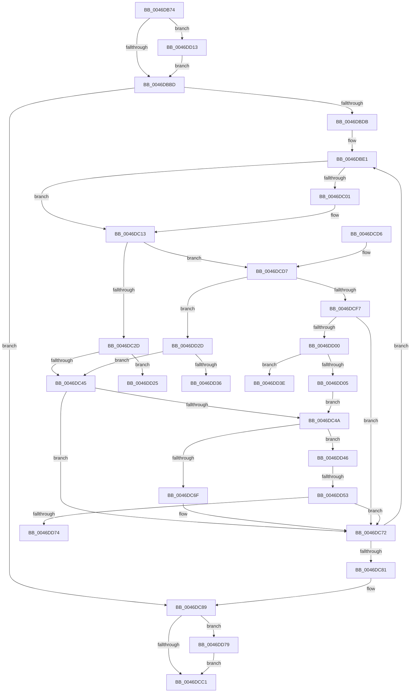

# KeSetSchedulingGroupRankBias

- RVA: `0x0046DB74`–`0x0046DD8B` (길이 `535` bytes)
- VA: `0x000000014046DB74`
- 실행 섹션: `.text`
- PDB 이름 있음: `예`; PDB Function 태그: `예`
- unwind 정보 RVA: `0x000ABAAC`
- 디코드: `138`개 명령, `535/535` bytes 표시
- 미해석 바이트: `0` (있으면 어셈블리에 `.byte`로 보존)

> 이 문서는 커널 이미지의 기계어와 PDB 기호를 분석해 생성했습니다. 4번과 5번은 함수 원형과 자료형을 바이너리 사용 방식에서 추정한 C 해석이며 원본 소스 복구 결과는 아닙니다.

## 1. Dependencies

- 직접 호출 지점: **6**; 고유 호출 대상: **6**
- 직접 호출자로 확인된 함수: **1**
- RIP 상대 이미지 참조: **4**

### Outgoing calls
- `0x0046DC0B` → [KiAcquirePrcbLocksForIsolationUnit](../30/KiAcquirePrcbLocksForIsolationUnit_function_0030ED60.md) (function, `0x0030ED60`)
- `0x0046DC50` → [KiCheckForEffectivePriorityChange](KiCheckForEffectivePriorityChange_function_0046DD94.md) (function, `0x0046DD94`)
- `0x0046DC5A` → [KiReleasePrcbLocksForIsolationUnit](../39/KiReleasePrcbLocksForIsolationUnit_function_00399C50.md) (function, `0x00399C50`)
- `0x0046DCAC` → [KiProcessDeferredReadyList](../25/KiProcessDeferredReadyList_function_00250800.md) (function, `0x00250800`)
- `0x0046DD18` → [KiRaiseIrqlProcessIrqlFlags](../4F/KiRaiseIrqlProcessIrqlFlags_function_004F56FC.md) (function, `0x004F56FC`)
- `0x0046DD81` → [EtwTraceSchedulingGroup](../65/EtwTraceSchedulingGroup_function_00650108.md) (function, `0x00650108`)

### Direct callers
- [NtSetInformationJobObject](../../page/9F/NtSetInformationJobObject_function_009F84C0.md) at `0x009F9C15`

### Static image references
- `0x0046DBB0` → RVA `0x00FC6D20` (`ALMOSTRO`; read)
- `0x0046DBC9` → RVA `0x00FC6AE8` (`ALMOSTRO`; read)
- `0x0046DBE3` → RVA `0x00FC8C40` (`ALMOSTRO`; read)
- `0x0046DC5F` → RVA `0x00FC6B14` (`ALMOSTRO`; read)

## 2. Other-region calls and transfers

- 다른 실행 섹션으로 향하는 call: **0**
- call이 아닌 외부 분기/꼬리 이동: **5**
  - `0x0046DD28` → [sub_006F340E](../6F/Unknown_function_006F340E.md) (`tail-transfer`)
  - `0x0046DD39` → [sub_006F340E](../6F/Unknown_function_006F340E.md) (`tail-transfer`)
  - `0x0046DD41` → [sub_006F340E + 0x13](../6F/Unknown_function_006F340E.md) (`tail-transfer`)
  - `0x0046DD4D` → [sub_006F340E + 0x7D](../6F/Unknown_function_006F340E.md) (`tail-transfer`)
  - `0x0046DD74` → [sub_006F340E + 0x7D](../6F/Unknown_function_006F340E.md) (`tail-transfer`)

## 3. Assembly (complete function range)

```asm
0046DB74  48 8B C4                        mov rax, rsp
0046DB77  48 89 58 10                     mov qword ptr [rax + 0x10], rbx
0046DB7B  55                              push rbp
0046DB7C  56                              push rsi
0046DB7D  57                              push rdi
0046DB7E  41 54                           push r12
0046DB80  41 55                           push r13
0046DB82  41 56                           push r14
0046DB84  41 57                           push r15
0046DB86  48 83 EC 30                     sub rsp, 0x30
0046DB8A  45 33 C9                        xor r9d, r9d
0046DB8D  44 0F B6 EA                     movzx r13d, dl
0046DB91  4C 89 48 08                     mov qword ptr [rax + 8], r9
0046DB95  48 8B E9                        mov rbp, rcx
0046DB98  4C 89 48 18                     mov qword ptr [rax + 0x18], r9
0046DB9C  45 0F 20 C6                     mov r14, cr8
0046DBA0  4C 89 B4 24 88 00 00 00         mov qword ptr [rsp + 0x88], r14
0046DBA8  41 8D 41 02                     lea eax, [r9 + 2]
0046DBAC  44 0F 22 C0                     mov cr8, rax
0046DBB0  44 39 0D 69 91 B5 00            cmp dword ptr [rip + 0xb59169], r9d
0046DBB7  0F 85 56 01 00 00               jne 0x14046dd13
0046DBBD  65 48 8B 04 25 20 00 00 00      mov rax, qword ptr gs:[0x20]
0046DBC6  41 8B F1                        mov esi, r9d
0046DBC9  44 39 0D 18 8F B5 00            cmp dword ptr [rip + 0xb58f18], r9d
0046DBD0  48 89 44 24 20                  mov qword ptr [rsp + 0x20], rax
0046DBD5  0F 86 AE 00 00 00               jbe 0x14046dc89
0046DBDB  41 BE 01 00 00 00               mov r14d, 1
0046DBE1  8B C6                           mov eax, esi
0046DBE3  48 8D 3D 56 B0 B5 00            lea rdi, [rip + 0xb5b056]
0046DBEA  48 69 D8 B8 01 00 00            imul rbx, rax, 0x1b8
0046DBF1  48 8B 3C C7                     mov rdi, qword ptr [rdi + rax*8]
0046DBF5  48 83 EB 80                     sub rbx, -0x80
0046DBF9  48 03 DD                        add rbx, rbp
0046DBFC  48 85 FF                        test rdi, rdi
0046DBFF  74 12                           je 0x14046dc13
0046DC01  4C 8D 44 24 70                  lea r8, [rsp + 0x70]
0046DC06  33 D2                           xor edx, edx
0046DC08  48 8B CF                        mov rcx, rdi
0046DC0B  E8 50 11 EA FF                  call 0x14030ed60
0046DC10  45 33 C9                        xor r9d, r9d
0046DC13  0F B7 53 70                     movzx edx, word ptr [rbx + 0x70]
0046DC17  44 8B 7B 7C                     mov r15d, dword ptr [rbx + 0x7c]
0046DC1B  44 0F B7 E2                     movzx r12d, dx
0046DC1F  66 41 83 E4 02                  and r12w, 2
0046DC24  45 84 ED                        test r13b, r13b
0046DC27  0F 84 AA 00 00 00               je 0x14046dcd7
0046DC2D  66 83 CA 0C                     or dx, 0xc
0046DC31  41 8D 47 01                     lea eax, [r15 + 1]
0046DC35  89 43 7C                        mov dword ptr [rbx + 0x7c], eax
0046DC38  66 89 53 70                     mov word ptr [rbx + 0x70], dx
0046DC3C  41 84 D6                        test r14b, dl
0046DC3F  0F 85 E0 00 00 00               jne 0x14046dd25
0046DC45  48 85 FF                        test rdi, rdi
0046DC48  74 28                           je 0x14046dc72
0046DC4A  4C 8B C3                        mov r8, rbx
0046DC4D  48 8B CF                        mov rcx, rdi
0046DC50  E8 3F 01 00 00                  call 0x14046dd94
0046DC55  48 8D 4C 24 70                  lea rcx, [rsp + 0x70]
0046DC5A  E8 F1 BF F2 FF                  call 0x140399c50
0046DC5F  F7 05 AB 8E B5 00 00 40 00 00   test dword ptr [rip + 0xb58eab], 0x4000
0046DC69  0F 85 D7 00 00 00               jne 0x14046dd46
0046DC6F  45 33 C9                        xor r9d, r9d
0046DC72  41 03 F6                        add esi, r14d
0046DC75  3B 35 6D 8E B5 00               cmp esi, dword ptr [rip + 0xb58e6d]
0046DC7B  0F 82 60 FF FF FF               jb 0x14046dbe1
0046DC81  4C 8B B4 24 88 00 00 00         mov r14, qword ptr [rsp + 0x88]
0046DC89  8B 45 04                        mov eax, dword ptr [rbp + 4]
0046DC8C  41 8B D5                        mov edx, r13d
0046DC8F  48 8B 4C 24 20                  mov rcx, qword ptr [rsp + 0x20]
0046DC94  45 8A C6                        mov r8b, r14b
0046DC97  C1 E2 02                        shl edx, 2
0046DC9A  33 D0                           xor edx, eax
0046DC9C  83 E2 04                        and edx, 4
0046DC9F  33 D0                           xor edx, eax
0046DCA1  89 55 04                        mov dword ptr [rbp + 4], edx
0046DCA4  48 8D 94 24 80 00 00 00         lea rdx, [rsp + 0x80]
0046DCAC  E8 4F 2B DE FF                  call 0x140250800
0046DCB1  F7 05 59 8E B5 00 00 40 00 00   test dword ptr [rip + 0xb58e59], 0x4000
0046DCBB  0F 85 B8 00 00 00               jne 0x14046dd79
0046DCC1  48 8B 5C 24 78                  mov rbx, qword ptr [rsp + 0x78]
0046DCC6  48 83 C4 30                     add rsp, 0x30
0046DCCA  41 5F                           pop r15
0046DCCC  41 5E                           pop r14
0046DCCE  41 5D                           pop r13
0046DCD0  41 5C                           pop r12
0046DCD2  5F                              pop rdi
0046DCD3  5E                              pop rsi
0046DCD4  5D                              pop rbp
0046DCD5  C3                              ret
0046DCD6  CC                              int3
0046DCD7  8B C2                           mov eax, edx
0046DCD9  41 8B CF                        mov ecx, r15d
0046DCDC  C1 E8 03                        shr eax, 3
0046DCDF  41 23 C6                        and eax, r14d
0046DCE2  2B C8                           sub ecx, eax
0046DCE4  B8 F7 FF 00 00                  mov eax, 0xfff7
0046DCE9  66 23 D0                        and dx, ax
0046DCEC  89 4B 7C                        mov dword ptr [rbx + 0x7c], ecx
0046DCEF  66 89 53 70                     mov word ptr [rbx + 0x70], dx
0046DCF3  85 C9                           test ecx, ecx
0046DCF5  75 36                           jne 0x14046dd2d
0046DCF7  48 85 FF                        test rdi, rdi
0046DCFA  0F 84 72 FF FF FF               je 0x14046dc72
0046DD00  41 84 D6                        test r14b, dl
0046DD03  75 39                           jne 0x14046dd3e
0046DD05  B8 FB FF 00 00                  mov eax, 0xfffb
0046DD0A  66 21 43 70                     and word ptr [rbx + 0x70], ax
0046DD0E  E9 37 FF FF FF                  jmp 0x14046dc4a
0046DD13  8A D0                           mov dl, al
0046DD15  41 8A CE                        mov cl, r14b
0046DD18  E8 DF 79 08 00                  call 0x1404f56fc
0046DD1D  45 33 C9                        xor r9d, r9d
0046DD20  E9 98 FE FF FF                  jmp 0x14046dbbd
0046DD25  45 8A C6                        mov r8b, r14b
0046DD28  E9 E1 56 28 00                  jmp 0x1406f340e
0046DD2D  41 84 D6                        test r14b, dl
0046DD30  0F 84 0F FF FF FF               je 0x14046dc45
0046DD36  45 33 C0                        xor r8d, r8d
0046DD39  E9 D0 56 28 00                  jmp 0x1406f340e
0046DD3E  48 8B D3                        mov rdx, rbx
0046DD41  E9 DB 56 28 00                  jmp 0x1406f3421
0046DD46  44 8B 43 7C                     mov r8d, dword ptr [rbx + 0x7c]
0046DD4A  45 3B F8                        cmp r15d, r8d
0046DD4D  0F 85 38 57 28 00               jne 0x1406f348b
0046DD53  0F B7 4B 70                     movzx ecx, word ptr [rbx + 0x70]
0046DD57  45 33 C9                        xor r9d, r9d
0046DD5A  66 D1 E9                        shr cx, 1
0046DD5D  41 8B C1                        mov eax, r9d
0046DD60  66 41 23 CE                     and cx, r14w
0046DD64  66 45 85 E4                     test r12w, r12w
0046DD68  0F 95 C0                        setne al
0046DD6B  66 3B C1                        cmp ax, cx
0046DD6E  0F 84 FE FE FF FF               je 0x14046dc72
0046DD74  E9 12 57 28 00                  jmp 0x1406f348b
0046DD79  BA 64 05 00 00                  mov edx, 0x564
0046DD7E  48 8B CD                        mov rcx, rbp
0046DD81  E8 82 23 1E 00                  call 0x140650108
0046DD86  E9 36 FF FF FF                  jmp 0x14046dcc1
```

## 4. C-style interpretation (structured pseudocode)

```c
__int64 __fastcall KeSetSchedulingGroupRankBias(__int64 a1, int a2, __int64 a3, int a4)
{
    __int64 result;
    __int64 v_r12;
    __int64 v_rbx;
    __int64 v_rsi;
    __int64 v_rsp;
    unsigned __int64 v_stack_m48;
    unsigned __int64 v_stack_p10;
    unsigned __int64 v_stack_p18;
    unsigned __int64 v_stack_p20;
    unsigned __int64 v_stack_p8;

    *(unsigned __int64 *)(v_rsp + 16) = v_rbx;
    v_rsp = (v_rsp) - (48);
    a4 = 0;
    *(unsigned __int64 *)(v_rsp + 8) = 0;
    *(unsigned __int64 *)(v_rsp + 24) = 0;
    v_stack_p20 = v_cr8;
    if ((*(unsigned int *)(v_rip + 11899241)) != 0) goto loc_0046DD13;
loc_0046DBBD:
    v_stack_m48 = *(unsigned __int64 *)(gs_base + (0 + 32));
    if ((*(unsigned int *)(v_rip + 11898648)) <= 0) goto loc_0046DC89;
loc_0046DBE1:
    v_rbx = (v_rbx) * (0);
    v_rbx = (v_rbx) - (-128);
    v_rbx = (v_rbx) + (a1);
    result = 0;
    if (*(unsigned __int64 *)(v_rip + 11907158 + 0 * 8) != 0) {
        a3 = v_stack_p8;
        a2 = 0;
        a1 = *(unsigned __int64 *)(v_rip + 11907158 + 0 * 8);
        result = KiAcquirePrcbLocksForIsolationUnit(a1, a2, a3, a4);
        a4 = 0;
    }
    v_r12 = (unsigned __int16)(((unsigned __int16)(*(unsigned __int16 *)(v_rbx + 112))) & (2));
    if ((unsigned __int8)((unsigned __int8)(a2)) == 0) goto loc_0046DCD7;
    a2 = (unsigned __int16)((*(unsigned __int16 *)(v_rbx + 112)) | (12));
    *(unsigned int *)(v_rbx + 124) = (unsigned int)((unsigned int)(*(unsigned int *)(v_rbx + 124)) + 1);
    *(unsigned __int16 *)(v_rbx + 112) = (unsigned __int16)(a2);
    if (((1) & ((unsigned __int8)(a2))) != 0) goto loc_0046DD25;
loc_0046DC45:
    if (*(unsigned __int64 *)(v_rip + 11907158 + 0 * 8) == 0) goto loc_0046DC72;
loc_0046DC4A:
    result = KiCheckForEffectivePriorityChange(*(unsigned __int64 *)(v_rip + 11907158 + 0 * 8), a2, v_rbx, a4);
    result = KiReleasePrcbLocksForIsolationUnit(v_stack_p8, a2, v_rbx, a4);
    if (((*(unsigned int *)(v_rip + 11898539)) & (0x4000ULL)) != 0) goto loc_0046DD46;
    a4 = 0;
loc_0046DC72:
    v_rsi = (unsigned int)((0) + (1));
    if (((unsigned int)(v_rsi)) < (*(unsigned int *)(v_rip + 11898477))) goto loc_0046DBE1;
loc_0046DC89:
    a2 = (unsigned int)(((unsigned int)((unsigned int)((unsigned __int8)(a2)))) << (2));
    a2 = (unsigned int)((a2) ^ ((unsigned int)((unsigned int)(*(unsigned int *)(a1 + 4)))));
    a2 = (unsigned int)((a2) & (4));
    a2 = (unsigned int)((a2) ^ ((unsigned int)((unsigned int)(*(unsigned int *)(a1 + 4)))));
    *(unsigned int *)(a1 + 4) = a2;
    result = KiProcessDeferredReadyList(v_stack_m48, v_stack_p18, (unsigned __int8)(v_stack_p20), a4);
    if (((*(unsigned int *)(v_rip + 11898457)) & (0x4000ULL)) != 0) goto loc_0046DD79;
loc_0046DCC1:
    v_rsp = (v_rsp) + (48);
    return result;
loc_0046DCD7:
    result = (unsigned int)(((unsigned int)((unsigned int)(v_stack_p18))) >> (3));
    result = (unsigned int)((result) & ((unsigned int)(v_stack_p20)));
    a1 = (unsigned int)(((unsigned int)((unsigned int)((unsigned int)(*(unsigned int *)(v_rbx + 124))))) - ((unsigned int)(result)));
    a2 = (unsigned __int16)((v_stack_p18) & ((unsigned __int16)((unsigned int)(0xFFF7ULL))));
    *(unsigned int *)(v_stack_p10 + 124) = (unsigned int)(a1);
    *(unsigned __int16 *)(v_stack_p10 + 112) = (unsigned __int16)(a2);
    if ((unsigned int)(a1) != 0) goto loc_0046DD2D;
    if (*(unsigned __int64 *)(v_rip + 11907158 + 0 * 8) == 0) goto loc_0046DC72;
    if ((((unsigned __int8)(v_stack_p20)) & ((unsigned __int8)(a2))) != 0) goto loc_0046DD3E;
    goto loc_0046DC4A;
loc_0046DD13:
    result = KiRaiseIrqlProcessIrqlFlags((unsigned __int8)(v_stack_p20), (unsigned __int8)((unsigned int)(0xFFFBULL)), (unsigned __int8)(v_stack_p20), a4);
    a4 = 0;
    goto loc_0046DBBD;
loc_0046DD25:
loc_0046DD2D:
    if ((((unsigned __int8)(v_stack_p20)) & ((unsigned __int8)((unsigned __int8)((unsigned int)(0xFFFBULL))))) == 0) goto loc_0046DC45;
    a3 = 0;
loc_0046DD3E:
loc_0046DD46:
    a4 = 0;
    a1 = (unsigned __int16)((*(unsigned __int16 *)(v_stack_p10 + 112)) >> (1));
    a1 = (unsigned __int16)((a1) & ((unsigned __int16)(v_stack_p20)));
    result = ((unsigned __int16)(v_r12) != 0) ? 1 : 0;
    if (((unsigned __int16)(result)) == ((unsigned __int16)(a1))) goto loc_0046DC72;
loc_0046DD79:
    result = EtwTraceSchedulingGroup(a1, (unsigned int)(0x564ULL), (unsigned int)(*(unsigned int *)(v_stack_p10 + 124)), a4);
    goto loc_0046DCC1;
}
```

## 5. (Beta) C Style

```c
int64_t KeSetSchedulingGroupRankBias(void *Arg1, int32_t Arg2, int64_t Arg3, int32_t Arg4)
{
    uint8_t *arg1 = (uint8_t *)Arg1;

    int64_t result;
    int64_t local_r12;
    int64_t local_rbx;
    int64_t local_rsi;
    int64_t local_rsp;
    uint64_t v_stack_m48;
    uint64_t v_stack_p10;
    uint64_t v_stack_p18;
    uint64_t v_stack_p20;
    uint64_t v_stack_p8;

    *(uint64_t *)(local_rsp + 0x10) = local_rbx;
    local_rsp = (local_rsp) - (48);
    Arg4 = 0;
    *(uint64_t *)(local_rsp + 0x8) = 0;
    *(uint64_t *)(local_rsp + 0x18) = 0;
    v_stack_p20 = v_cr8;
    if ((*(uint32_t *)(v_rip + 0xB59169)) != 0) goto loc_0046DD13;
loc_0046DBBD:
    v_stack_m48 = *(uint64_t *)(gs_base + (0 + 0x20));
    if ((*(uint32_t *)(v_rip + 0xB58F18)) <= 0) goto loc_0046DC89;
loc_0046DBE1:
    local_rbx = (local_rbx) * (0);
    local_rbx = (local_rbx) - (-128);
    local_rbx = (local_rbx) + (Arg1);
    result = 0;
    if (*(uint64_t *)(v_rip + 0xB5B056 + 0x0 * 8) != 0) {
        Arg3 = v_stack_p8;
        Arg2 = 0;
        Arg1 = *(uint64_t *)(v_rip + 0xB5B056 + 0x0 * 8);
        result = KiAcquirePrcbLocksForIsolationUnit(Arg1, Arg2, Arg3, Arg4);
        Arg4 = 0;
    }
    local_r12 = (uint16_t)(((uint16_t)(*(uint16_t *)(local_rbx + 0x70))) & (2));
    if ((uint8_t)((uint8_t)(Arg2)) == 0) goto loc_0046DCD7;
    Arg2 = (uint16_t)((*(uint16_t *)(local_rbx + 0x70)) | (12));
    *(uint32_t *)(local_rbx + 0x7C) = (uint32_t)((uint32_t)(*(uint32_t *)(local_rbx + 0x7C)) + 1);
    *(uint16_t *)(local_rbx + 0x70) = (uint16_t)(Arg2);
    if (((1) & ((uint8_t)(Arg2))) != 0) goto loc_0046DD25;
loc_0046DC45:
    if (*(uint64_t *)(v_rip + 0xB5B056 + 0x0 * 8) == 0) goto loc_0046DC72;
loc_0046DC4A:
    result = KiCheckForEffectivePriorityChange(*(uint64_t *)(v_rip + 0xB5B056 + 0x0 * 8), Arg2, local_rbx, Arg4);
    result = KiReleasePrcbLocksForIsolationUnit(v_stack_p8, Arg2, local_rbx, Arg4);
    if (((*(uint32_t *)(v_rip + 0xB58EAB)) & (0x4000ULL)) != 0) goto loc_0046DD46;
    Arg4 = 0;
loc_0046DC72:
    local_rsi = (uint32_t)((0) + (1));
    if (((uint32_t)(local_rsi)) < (*(uint32_t *)(v_rip + 0xB58E6D))) goto loc_0046DBE1;
loc_0046DC89:
    Arg2 = (uint32_t)(((uint32_t)((uint32_t)((uint8_t)(Arg2)))) << (2));
    Arg2 = (uint32_t)((Arg2) ^ ((uint32_t)((uint32_t)(*(uint32_t *)(arg1 + 0x4)))));
    Arg2 = (uint32_t)((Arg2) & (4));
    Arg2 = (uint32_t)((Arg2) ^ ((uint32_t)((uint32_t)(*(uint32_t *)(arg1 + 0x4)))));
    *(uint32_t *)(arg1 + 0x4) = Arg2;
    result = KiProcessDeferredReadyList(v_stack_m48, v_stack_p18, (uint8_t)(v_stack_p20), Arg4);
    if (((*(uint32_t *)(v_rip + 0xB58E59)) & (0x4000ULL)) != 0) goto loc_0046DD79;
loc_0046DCC1:
    local_rsp = (local_rsp) + (48);
    return result;
loc_0046DCD7:
    result = (uint32_t)(((uint32_t)((uint32_t)(v_stack_p18))) >> (3));
    result = (uint32_t)((result) & ((uint32_t)(v_stack_p20)));
    Arg1 = (uint32_t)(((uint32_t)((uint32_t)((uint32_t)(*(uint32_t *)(local_rbx + 0x7C))))) - ((uint32_t)(result)));
    Arg2 = (uint16_t)((v_stack_p18) & ((uint16_t)((uint32_t)(0xFFF7ULL))));
    *(uint32_t *)(v_stack_p10 + 0x7C) = (uint32_t)(Arg1);
    *(uint16_t *)(v_stack_p10 + 0x70) = (uint16_t)(Arg2);
    if ((uint32_t)(Arg1) != 0) goto loc_0046DD2D;
    if (*(uint64_t *)(v_rip + 0xB5B056 + 0x0 * 8) == 0) goto loc_0046DC72;
    if ((((uint8_t)(v_stack_p20)) & ((uint8_t)(Arg2))) != 0) goto loc_0046DD3E;
    goto loc_0046DC4A;
loc_0046DD13:
    result = KiRaiseIrqlProcessIrqlFlags((uint8_t)(v_stack_p20), (uint8_t)((uint32_t)(0xFFFBULL)), (uint8_t)(v_stack_p20), Arg4);
    Arg4 = 0;
    goto loc_0046DBBD;
loc_0046DD25:
loc_0046DD2D:
    if ((((uint8_t)(v_stack_p20)) & ((uint8_t)((uint8_t)((uint32_t)(0xFFFBULL))))) == 0) goto loc_0046DC45;
    Arg3 = 0;
loc_0046DD3E:
loc_0046DD46:
    Arg4 = 0;
    Arg1 = (uint16_t)((*(uint16_t *)(v_stack_p10 + 0x70)) >> (1));
    Arg1 = (uint16_t)((Arg1) & ((uint16_t)(v_stack_p20)));
    result = ((uint16_t)(local_r12) != 0) ? 1 : 0;
    if (((uint16_t)(result)) == ((uint16_t)(Arg1))) goto loc_0046DC72;
loc_0046DD79:
    result = EtwTraceSchedulingGroup(Arg1, (uint32_t)(0x564ULL), (uint32_t)(*(uint32_t *)(v_stack_p10 + 0x7C)), Arg4);
    goto loc_0046DCC1;
}
```

### 관측된 메모리 오프셋

구조체 형식이 확인되지 않은 접근은 인자 기준의 오프셋으로만 기록했습니다.

| 기준 인자 | 오프셋 표현 | 폭 (bit) | 접근 |
|---|---:|---:|---|
| `Arg1` | `+ 0x4` | `32` | `R` |
| `Arg1` | `+ 0x4` | `32` | `W` |

## 6. Execution-region graph

[열기: 2D/3D 그래프와 함수 탐색 컨트롤 패널](../../../control-panel.html?section=text&rva=0x0046DB74&view=graph)

- 2D 그래프는 위에서 아래로 흐르고, 3D 그래프는 빈 공간을 드래그해 회전합니다. Shift+드래그는 이동, 휠은 확대·축소, 함수 노드 선택은 대상 보고서 이동입니다.

### Static fallback


