# KeSetSchedulingGroupWeights

- RVA: `0x0046D024`–`0x0046D25A` (길이 `566` bytes)
- VA: `0x000000014046D024`
- 실행 섹션: `.text`
- PDB 이름 있음: `예`; PDB Function 태그: `아니요`
- unwind 정보 RVA: `0x00093E28`
- 디코드: `167`개 명령, `566/566` bytes 표시
- 미해석 바이트: `0` (있으면 어셈블리에 `.byte`로 보존)

> 이 문서는 커널 이미지의 기계어와 PDB 기호를 분석해 생성했습니다. 4번과 5번은 함수 원형과 자료형을 바이너리 사용 방식에서 추정한 C 해석이며 원본 소스 복구 결과는 아닙니다.

## 1. Dependencies

- 직접 호출 지점: **5**; 고유 호출 대상: **5**
- 직접 호출자로 확인된 함수: **2**
- RIP 상대 이미지 참조: **12**

### Outgoing calls
- `0x0046D05E` → [KeAcquireInStackQueuedSpinLock](../27/KeAcquireInStackQueuedSpinLock_function_002757A0.md) (function, `0x002757A0`)
- `0x0046D112` → [KiAssignSchedulingGroupWeights](KiAssignSchedulingGroupWeights_function_0046D260.md) (function, `0x0046D260`)
- `0x0046D1FE` → [KiUpdateCpuTargetByWeight](KiUpdateCpuTargetByWeight_function_0046E0E0.md) (function, `0x0046E0E0`)
- `0x0046D210` → [KeReleaseInStackQueuedSpinLock](../34/KeReleaseInStackQueuedSpinLock_function_00342CE0.md) (function, `0x00342CE0`)
- `0x0046D231` → [EtwTraceSchedulingGroup](../65/EtwTraceSchedulingGroup_function_00650108.md) (function, `0x00650108`)

### Direct callers
- [PsSetCpuQuotaInformation](../5E/PsSetCpuQuotaInformation_function_005E28F8.md) at `0x005E2ABB`
- [NtSetInformationJobObject](../../page/9F/NtSetInformationJobObject_function_009F84C0.md) at `0x009F9FFD`

### Static image references
- `0x0046D045` → RVA `0x00FCF180` (`CACHEALI`; read)
- `0x0046D063` → RVA `0x00F23420` (`.data`; read)
- `0x0046D0AB` → RVA `0x00F23438` (`.data`; read)
- `0x0046D0EC` → RVA `0x00F23438` (`.data`; write)
- `0x0046D0FF` → RVA `0x00F23438` (`.data`; read/write)
- `0x0046D185` → RVA `0x00F23434` (`.data`; write)
- `0x0046D18B` → RVA `0x00F2343C` (`.data`; write)
- `0x0046D1A3` → RVA `0x00F23434` (`.data`; read/write)
- `0x0046D1AA` → RVA `0x00F2343C` (`.data`; read/write)
- `0x0046D1BD` → RVA `0x00F2343C` (`.data`; read)
- `0x0046D1C5` → RVA `0x00F23434` (`.data`; read)
- `0x0046D215` → RVA `0x00FC6B14` (`ALMOSTRO`; read)

## 2. Other-region calls and transfers

- 다른 실행 섹션으로 향하는 call: **0**
- 별도 외부 분기/꼬리 이동을 확인하지 못했습니다.

## 3. Assembly (complete function range)

```asm
0046D024  4C 8B DC                        mov r11, rsp
0046D027  49 89 5B 08                     mov qword ptr [r11 + 8], rbx
0046D02B  49 89 6B 10                     mov qword ptr [r11 + 0x10], rbp
0046D02F  49 89 73 18                     mov qword ptr [r11 + 0x18], rsi
0046D033  57                              push rdi
0046D034  41 56                           push r14
0046D036  41 57                           push r15
0046D038  48 83 EC 40                     sub rsp, 0x40
0046D03C  0F 57 C0                        xorps xmm0, xmm0
0046D03F  44 8B F9                        mov r15d, ecx
0046D042  48 8B FA                        mov rdi, rdx
0046D045  48 8D 0D 34 21 B6 00            lea rcx, [rip + 0xb62134]
0046D04C  33 C0                           xor eax, eax
0046D04E  49 8D 53 C8                     lea rdx, [r11 - 0x38]
0046D052  0F 11 44 24 20                  movups xmmword ptr [rsp + 0x20], xmm0
0046D057  49 89 43 D8                     mov qword ptr [r11 - 0x28], rax
0046D05B  49 8B F0                        mov rsi, r8
0046D05E  E8 3D 87 E0 FF                  call 0x1402757a0
0046D063  4C 8D 35 B6 63 AB 00            lea r14, [rip + 0xab63b6]
0046D06A  45 85 FF                        test r15d, r15d
0046D06D  0F 84 BC 00 00 00               je 0x14046d12f
0046D073  48 8B DF                        mov rbx, rdi
0046D076  48 2B F7                        sub rsi, rdi
0046D079  41 8B EF                        mov ebp, r15d
0046D07C  48 8B 0B                        mov rcx, qword ptr [rbx]
0046D07F  8B 41 04                        mov eax, dword ptr [rcx + 4]
0046D082  A8 01                           test al, 1
0046D084  0F 84 8D 00 00 00               je 0x14046d117
0046D08A  83 E0 FE                        and eax, 0xfffffffe
0046D08D  BA 10 27 00 00                  mov edx, 0x2710
0046D092  89 41 04                        mov dword ptr [rcx + 4], eax
0046D095  48 8B 03                        mov rax, qword ptr [rbx]
0046D098  48 8B 48 60                     mov rcx, qword ptr [rax + 0x60]
0046D09C  48 85 C9                        test rcx, rcx
0046D09F  74 0A                           je 0x14046d0ab
0046D0A1  44 8B 59 0C                     mov r11d, dword ptr [rcx + 0xc]
0046D0A5  4C 8D 49 50                     lea r9, [rcx + 0x50]
0046D0A9  EB 0A                           jmp 0x14046d0b5
0046D0AB  44 8B 1D 86 63 AB 00            mov r11d, dword ptr [rip + 0xab6386]
0046D0B2  4D 8B CE                        mov r9, r14
0046D0B5  4D 8B 01                        mov r8, qword ptr [r9]
0046D0B8  45 33 D2                        xor r10d, r10d
0046D0BB  41 8B 40 CC                     mov eax, dword ptr [r8 - 0x34]
0046D0BF  A8 01                           test al, 1
0046D0C1  74 12                           je 0x14046d0d5
0046D0C3  41 0F B7 40 C8                  movzx eax, word ptr [r8 - 0x38]
0046D0C8  41 3B C3                        cmp eax, r11d
0046D0CB  74 4A                           je 0x14046d117
0046D0CD  3B C2                           cmp eax, edx
0046D0CF  0F 42 D0                        cmovb edx, eax
0046D0D2  41 FF C2                        inc r10d
0046D0D5  4D 8B 00                        mov r8, qword ptr [r8]
0046D0D8  4D 3B C1                        cmp r8, r9
0046D0DB  75 DE                           jne 0x14046d0bb
0046D0DD  45 85 D2                        test r10d, r10d
0046D0E0  74 12                           je 0x14046d0f4
0046D0E2  48 85 C9                        test rcx, rcx
0046D0E5  74 05                           je 0x14046d0ec
0046D0E7  89 51 0C                        mov dword ptr [rcx + 0xc], edx
0046D0EA  EB 1A                           jmp 0x14046d106
0046D0EC  89 15 46 63 AB 00               mov dword ptr [rip + 0xab6346], edx
0046D0F2  EB 12                           jmp 0x14046d106
0046D0F4  48 85 C9                        test rcx, rcx
0046D0F7  74 06                           je 0x14046d0ff
0046D0F9  83 61 0C 00                     and dword ptr [rcx + 0xc], 0
0046D0FD  EB 07                           jmp 0x14046d106
0046D0FF  83 25 32 63 AB 00 00            and dword ptr [rip + 0xab6332], 0
0046D106  4C 8B 03                        mov r8, qword ptr [rbx]
0046D109  33 D2                           xor edx, edx
0046D10B  4D 8B 40 60                     mov r8, qword ptr [r8 + 0x60]
0046D10F  8D 4A 01                        lea ecx, [rdx + 1]
0046D112  E8 49 01 00 00                  call 0x14046d260
0046D117  48 8B 0B                        mov rcx, qword ptr [rbx]
0046D11A  48 8B 04 1E                     mov rax, qword ptr [rsi + rbx]
0046D11E  48 83 C3 08                     add rbx, 8
0046D122  48 89 01                        mov qword ptr [rcx], rax
0046D125  48 83 ED 01                     sub rbp, 1
0046D129  0F 85 4D FF FF FF               jne 0x14046d07c
0046D12F  48 8B 07                        mov rax, qword ptr [rdi]
0046D132  BA 09 00 00 00                  mov edx, 9
0046D137  48 8B 48 60                     mov rcx, qword ptr [rax + 0x60]
0046D13B  4C 8D 51 50                     lea r10, [rcx + 0x50]
0046D13F  48 85 C9                        test rcx, rcx
0046D142  75 03                           jne 0x14046d147
0046D144  4D 8B D6                        mov r10, r14
0046D147  4D 8B 02                        mov r8, qword ptr [r10]
0046D14A  45 33 C9                        xor r9d, r9d
0046D14D  45 33 DB                        xor r11d, r11d
0046D150  41 8B 40 CC                     mov eax, dword ptr [r8 - 0x34]
0046D154  8B DA                           mov ebx, edx
0046D156  A8 01                           test al, 1
0046D158  75 10                           jne 0x14046d16a
0046D15A  41 0F B7 50 C8                  movzx edx, word ptr [r8 - 0x38]
0046D15F  41 FF C3                        inc r11d
0046D162  44 03 CA                        add r9d, edx
0046D165  3B D3                           cmp edx, ebx
0046D167  0F 43 D3                        cmovae edx, ebx
0046D16A  4D 8B 00                        mov r8, qword ptr [r8]
0046D16D  4D 3B C2                        cmp r8, r10
0046D170  75 DE                           jne 0x14046d150
0046D172  45 85 DB                        test r11d, r11d
0046D175  74 1D                           je 0x14046d194
0046D177  48 85 C9                        test rcx, rcx
0046D17A  74 09                           je 0x14046d185
0046D17C  89 51 10                        mov dword ptr [rcx + 0x10], edx
0046D17F  44 89 49 14                     mov dword ptr [rcx + 0x14], r9d
0046D183  EB 2C                           jmp 0x14046d1b1
0046D185  89 15 A9 62 AB 00               mov dword ptr [rip + 0xab62a9], edx
0046D18B  44 89 0D AA 62 AB 00            mov dword ptr [rip + 0xab62aa], r9d
0046D192  EB 1D                           jmp 0x14046d1b1
0046D194  48 85 C9                        test rcx, rcx
0046D197  74 0A                           je 0x14046d1a3
0046D199  83 61 10 00                     and dword ptr [rcx + 0x10], 0
0046D19D  83 61 14 00                     and dword ptr [rcx + 0x14], 0
0046D1A1  EB 0E                           jmp 0x14046d1b1
0046D1A3  83 25 8A 62 AB 00 00            and dword ptr [rip + 0xab628a], 0
0046D1AA  83 25 8B 62 AB 00 00            and dword ptr [rip + 0xab628b], 0
0046D1B1  48 8B 07                        mov rax, qword ptr [rdi]
0046D1B4  48 8B 48 60                     mov rcx, qword ptr [rax + 0x60]
0046D1B8  48 85 C9                        test rcx, rcx
0046D1BB  75 17                           jne 0x14046d1d4
0046D1BD  39 0D 79 62 AB 00               cmp dword ptr [rip + 0xab6279], ecx
0046D1C3  74 46                           je 0x14046d20b
0046D1C5  8B 35 69 62 AB 00               mov esi, dword ptr [rip + 0xab6269]
0046D1CB  48 8B 1D 4E 62 AB 00            mov rbx, qword ptr [rip + 0xab624e]
0046D1D2  EB 10                           jmp 0x14046d1e4
0046D1D4  83 79 14 00                     cmp dword ptr [rcx + 0x14], 0
0046D1D8  74 31                           je 0x14046d20b
0046D1DA  8B 71 10                        mov esi, dword ptr [rcx + 0x10]
0046D1DD  4C 8D 71 50                     lea r14, [rcx + 0x50]
0046D1E1  49 8B 1E                        mov rbx, qword ptr [r14]
0046D1E4  48 8D 4B C8                     lea rcx, [rbx - 0x38]
0046D1E8  8B 41 04                        mov eax, dword ptr [rcx + 4]
0046D1EB  A8 01                           test al, 1
0046D1ED  75 14                           jne 0x14046d203
0046D1EF  0F B7 01                        movzx eax, word ptr [rcx]
0046D1F2  33 D2                           xor edx, edx
0046D1F4  C1 E0 07                        shl eax, 7
0046D1F7  F7 F6                           div esi
0046D1F9  B2 01                           mov dl, 1
0046D1FB  89 41 08                        mov dword ptr [rcx + 8], eax
0046D1FE  E8 DD 0E 00 00                  call 0x14046e0e0
0046D203  48 8B 1B                        mov rbx, qword ptr [rbx]
0046D206  49 3B DE                        cmp rbx, r14
0046D209  75 D9                           jne 0x14046d1e4
0046D20B  48 8D 4C 24 20                  lea rcx, [rsp + 0x20]
0046D210  E8 CB 5A ED FF                  call 0x140342ce0
0046D215  F7 05 F5 98 B5 00 00 40 00 00   test dword ptr [rip + 0xb598f5], 0x4000
0046D21F  74 1F                           je 0x14046d240
0046D221  45 85 FF                        test r15d, r15d
0046D224  74 1A                           je 0x14046d240
0046D226  49 8B DF                        mov rbx, r15
0046D229  48 8B 0F                        mov rcx, qword ptr [rdi]
0046D22C  BA 64 05 00 00                  mov edx, 0x564
0046D231  E8 D2 2E 1E 00                  call 0x140650108
0046D236  48 8D 7F 08                     lea rdi, [rdi + 8]
0046D23A  48 83 EB 01                     sub rbx, 1
0046D23E  75 E9                           jne 0x14046d229
0046D240  48 8B 5C 24 60                  mov rbx, qword ptr [rsp + 0x60]
0046D245  48 8B 6C 24 68                  mov rbp, qword ptr [rsp + 0x68]
0046D24A  48 8B 74 24 70                  mov rsi, qword ptr [rsp + 0x70]
0046D24F  48 83 C4 40                     add rsp, 0x40
0046D253  41 5F                           pop r15
0046D255  41 5E                           pop r14
0046D257  5F                              pop rdi
0046D258  C3                              ret
0046D259  CC                              int3
```

## 4. C-style interpretation (structured pseudocode)

```c
__int64 __fastcall KeSetSchedulingGroupWeights(int a1, __int64 a2, __int64 a3)
{
    __int64 result;
    __int64 v_r10;
    __int64 v_r11;
    __int64 v_rbp;
    __int64 v_rbx;
    __int64 v_rsi;
    __int64 v_rsp;
    unsigned __int64 v_stack_m38;
    unsigned __int64 v_stack_p10;
    unsigned __int64 v_stack_p18;
    unsigned __int64 v_stack_p8;

    *(unsigned __int64 *)(v_rsp + 8) = v_rbx;
    *(unsigned __int64 *)(v_rsp + 16) = v_rbp;
    *(unsigned __int64 *)(v_rsp + 24) = v_rsi;
    v_rsp = (v_rsp) - (64);
    result = 0;
    v_stack_m38 = v_xmm0;
    *(unsigned __int64 *)(v_rsp - 40) = 0;
    result = KeAcquireInStackQueuedSpinLock(v_rip + 11936052, v_rsp - 56, a3, a4);
    if ((unsigned int)((unsigned int)(a1)) == 0) goto loc_0046D12F;
    v_rsi = (a3) - (a2);
loc_0046D07C:
    if ((((unsigned __int8)((unsigned int)(*(unsigned int *)(*(unsigned __int64 *)(a2) + 4)))) & (1)) == 0) goto loc_0046D117;
    result = (unsigned int)(((unsigned int)(*(unsigned int *)(*(unsigned __int64 *)(a2) + 4))) & (0xFFFFFFFEULL));
    *(unsigned int *)(*(unsigned __int64 *)(a2) + 4) = (unsigned int)(result);
    if (*(unsigned __int64 *)(*(unsigned __int64 *)(a2) + 96) == 0) goto loc_0046D0AB;
    goto loc_0046D0B5;
loc_0046D0AB:
loc_0046D0B5:
    v_r10 = 0;
loc_0046D0BB:
    if ((((unsigned __int8)((unsigned int)(*(unsigned int *)(*(unsigned __int64 *)(v_rip + 11232182) - 52)))) & (1)) == 0) goto loc_0046D0D5;
    if (((unsigned int)(*(unsigned __int16 *)(*(unsigned __int64 *)(v_rip + 11232182) - 56))) == ((unsigned int)((unsigned int)(*(unsigned int *)(v_rip + 11232134))))) goto loc_0046D117;
    a2 = (unsigned int)(0x2710ULL);
    if (((unsigned int)(*(unsigned __int16 *)(*(unsigned __int64 *)(v_rip + 11232182) - 56))) < ((unsigned int)((unsigned int)(0x2710ULL)))) { a2 = (unsigned int)(*(unsigned __int16 *)(*(unsigned __int64 *)(v_rip + 11232182) - 56)); }
    v_r10 = (unsigned int)((v_r10) + 1);
loc_0046D0D5:
    if ((*(unsigned __int64 *)(*(unsigned __int64 *)(v_rip + 11232182))) != (v_rip + 11232182)) goto loc_0046D0BB;
    if ((unsigned int)(v_r10) == 0) goto loc_0046D0F4;
    if (*(unsigned __int64 *)(*(unsigned __int64 *)(a2) + 96) == 0) goto loc_0046D0EC;
    *(unsigned int *)(*(unsigned __int64 *)(*(unsigned __int64 *)(a2) + 96) + 12) = (unsigned int)(a2);
    goto loc_0046D106;
loc_0046D0EC:
    *(unsigned int *)(v_rip + 11232070) = (unsigned int)(a2);
    goto loc_0046D106;
loc_0046D0F4:
    if (*(unsigned __int64 *)(*(unsigned __int64 *)(a2) + 96) == 0) goto loc_0046D0FF;
    goto loc_0046D106;
loc_0046D0FF:
loc_0046D106:
    a2 = 0;
    result = KiAssignSchedulingGroupWeights(a2 + 1, a2, *(unsigned __int64 *)(*(unsigned __int64 *)(a2) + 96), v_rip + 11232182);
loc_0046D117:
    v_rbx = (a2) + (8);
    *(unsigned __int64 *)(*(unsigned __int64 *)(a2)) = *(unsigned __int64 *)(v_rsi + a2 * 1);
    v_rbp = ((unsigned int)((unsigned int)((unsigned int)(a1)))) - (1);
    if (condition_is_not_equal) goto loc_0046D07C;
loc_0046D12F:
    v_r10 = *(unsigned __int64 *)(*(unsigned __int64 *)(a2) + 96) + 80;
    if (*(unsigned __int64 *)(*(unsigned __int64 *)(a2) + 96) == 0) {
        v_r10 = v_rip + 11232182;
    }
    a4 = 0;
    v_r11 = 0;
loc_0046D150:
    if ((((unsigned __int8)((unsigned int)(*(unsigned int *)(*(unsigned __int64 *)(v_r10) - 52)))) & (1)) == 0) {
        a2 = *(unsigned __int16 *)(*(unsigned __int64 *)(v_r10) - 56);
        v_r11 = (unsigned int)((v_r11) + 1);
        a4 = (unsigned int)((a4) + ((unsigned int)(a2)));
        if (((unsigned int)(a2)) >= 9) { a2 = 9; }
    }
    if ((*(unsigned __int64 *)(*(unsigned __int64 *)(v_r10))) != v_r10) goto loc_0046D150;
    if ((unsigned int)(v_r11) == 0) goto loc_0046D194;
    if (*(unsigned __int64 *)(*(unsigned __int64 *)(a2) + 96) == 0) goto loc_0046D185;
    *(unsigned int *)(*(unsigned __int64 *)(*(unsigned __int64 *)(a2) + 96) + 16) = (unsigned int)(a2);
    *(unsigned int *)(*(unsigned __int64 *)(*(unsigned __int64 *)(a2) + 96) + 20) = (unsigned int)(a4);
    goto loc_0046D1B1;
loc_0046D185:
    *(unsigned int *)(v_rip + 11231913) = (unsigned int)(a2);
    *(unsigned int *)(v_rip + 11231914) = (unsigned int)(a4);
    goto loc_0046D1B1;
loc_0046D194:
    if (*(unsigned __int64 *)(*(unsigned __int64 *)(a2) + 96) == 0) goto loc_0046D1A3;
    goto loc_0046D1B1;
loc_0046D1A3:
loc_0046D1B1:
    if (*(unsigned __int64 *)(*(unsigned __int64 *)(a2) + 96) != 0) goto loc_0046D1D4;
    if ((*(unsigned int *)(v_rip + 11231865)) == ((unsigned int)(*(unsigned __int64 *)(*(unsigned __int64 *)(a2) + 96)))) goto loc_0046D20B;
    goto loc_0046D1E4;
loc_0046D1D4:
    if ((*(unsigned int *)(*(unsigned __int64 *)(*(unsigned __int64 *)(a2) + 96) + 20)) == 0) goto loc_0046D20B;
loc_0046D1E4:
    result = (unsigned int)(*(unsigned int *)(*(unsigned __int64 *)(*(unsigned __int64 *)(*(unsigned __int64 *)(a2) + 96) + 80) - 56 + 4));
    if ((((unsigned __int8)((unsigned int)(*(unsigned int *)(*(unsigned __int64 *)(*(unsigned __int64 *)(*(unsigned __int64 *)(a2) + 96) + 80) - 56 + 4)))) & (1)) == 0) {
        result = *(unsigned __int16 *)(*(unsigned __int64 *)(*(unsigned __int64 *)(*(unsigned __int64 *)(a2) + 96) + 80) - 56);
        a2 = 0;
        result = (unsigned int)((result) << (7));
        a2 = 1;
        *(unsigned int *)(*(unsigned __int64 *)(*(unsigned __int64 *)(*(unsigned __int64 *)(a2) + 96) + 80) - 56 + 8) = (unsigned int)(result);
        result = KiUpdateCpuTargetByWeight(*(unsigned __int64 *)(*(unsigned __int64 *)(*(unsigned __int64 *)(a2) + 96) + 80) - 56, a2, *(unsigned __int64 *)(*(unsigned __int64 *)(v_r10)), a4);
    }
    if ((*(unsigned __int64 *)(*(unsigned __int64 *)(*(unsigned __int64 *)(*(unsigned __int64 *)(a2) + 96) + 80))) != (*(unsigned __int64 *)(*(unsigned __int64 *)(a2) + 96) + 80)) goto loc_0046D1E4;
loc_0046D20B:
    result = KeReleaseInStackQueuedSpinLock(v_stack_m38, a2, *(unsigned __int64 *)(*(unsigned __int64 *)(v_r10)), a4);
    if (((*(unsigned int *)(v_rip + 11901173)) & (0x4000ULL)) == 0) goto loc_0046D240;
    if ((unsigned int)((unsigned int)(a1)) == 0) goto loc_0046D240;
loc_0046D229:
    result = EtwTraceSchedulingGroup(*(unsigned __int64 *)(a2), (unsigned int)(0x564ULL), *(unsigned __int64 *)(*(unsigned __int64 *)(v_r10)), a4);
    v_rbx = ((unsigned int)(a1)) - (1);
    if (condition_is_not_equal) goto loc_0046D229;
loc_0046D240:
    v_rsp = (v_rsp) + (64);
    return result;
}
```

## 5. (Beta) C Style

```c
int64_t KeSetSchedulingGroupWeights(int32_t Arg1, void *Arg2, void *Arg3)
{
    uint8_t *arg2 = (uint8_t *)Arg2;
    uint8_t *arg3 = (uint8_t *)Arg3;

    int64_t result;
    int64_t local_r10;
    int64_t local_r11;
    int64_t local_rbp;
    int64_t local_rbx;
    int64_t local_rsi;
    int64_t local_rsp;
    uint64_t v_stack_m38;
    uint64_t v_stack_p10;
    uint64_t v_stack_p18;
    uint64_t v_stack_p8;

    *(uint64_t *)(local_rsp + 0x8) = local_rbx;
    *(uint64_t *)(local_rsp + 0x10) = local_rbp;
    *(uint64_t *)(local_rsp + 0x18) = local_rsi;
    local_rsp = (local_rsp) - (64);
    result = 0;
    v_stack_m38 = v_xmm0;
    *(uint64_t *)(local_rsp - 0x28) = 0;
    result = KeAcquireInStackQueuedSpinLock(v_rip + 11936052, local_rsp - 56, Arg3, a4);
    if ((uint32_t)((uint32_t)(Arg1)) == 0) goto loc_0046D12F;
    local_rsi = (Arg3) - (Arg2);
loc_0046D07C:
    if ((((uint8_t)((uint32_t)(*(uint32_t *)(*(uint64_t *)(arg2) + 0x4)))) & (1)) == 0) goto loc_0046D117;
    result = (uint32_t)(((uint32_t)(*(uint32_t *)(*(uint64_t *)(arg2) + 0x4))) & (0xFFFFFFFEULL));
    *(uint32_t *)(*(uint64_t *)(arg2) + 0x4) = (uint32_t)(result);
    if (*(uint64_t *)(*(uint64_t *)(arg2) + 0x60) == 0) goto loc_0046D0AB;
    goto loc_0046D0B5;
loc_0046D0AB:
loc_0046D0B5:
    local_r10 = 0;
loc_0046D0BB:
    if ((((uint8_t)((uint32_t)(*(uint32_t *)(*(uint64_t *)(v_rip + 0xAB63B6) - 0x34)))) & (1)) == 0) goto loc_0046D0D5;
    if (((uint32_t)(*(uint16_t *)(*(uint64_t *)(v_rip + 0xAB63B6) - 0x38))) == ((uint32_t)((uint32_t)(*(uint32_t *)(v_rip + 0xAB6386))))) goto loc_0046D117;
    Arg2 = (uint32_t)(0x2710ULL);
    if (((uint32_t)(*(uint16_t *)(*(uint64_t *)(v_rip + 0xAB63B6) - 0x38))) < ((uint32_t)((uint32_t)(0x2710ULL)))) { Arg2 = (uint32_t)(*(uint16_t *)(*(uint64_t *)(v_rip + 0xAB63B6) - 0x38)); }
    local_r10 = (uint32_t)((local_r10) + 1);
loc_0046D0D5:
    if ((*(uint64_t *)(*(uint64_t *)(v_rip + 0xAB63B6))) != (v_rip + 11232182)) goto loc_0046D0BB;
    if ((uint32_t)(local_r10) == 0) goto loc_0046D0F4;
    if (*(uint64_t *)(*(uint64_t *)(arg2) + 0x60) == 0) goto loc_0046D0EC;
    *(uint32_t *)(*(uint64_t *)(*(uint64_t *)(arg2) + 0x60) + 0xC) = (uint32_t)(Arg2);
    goto loc_0046D106;
loc_0046D0EC:
    *(uint32_t *)(v_rip + 0xAB6346) = (uint32_t)(Arg2);
    goto loc_0046D106;
loc_0046D0F4:
    if (*(uint64_t *)(*(uint64_t *)(arg2) + 0x60) == 0) goto loc_0046D0FF;
    goto loc_0046D106;
loc_0046D0FF:
loc_0046D106:
    Arg2 = 0;
    result = KiAssignSchedulingGroupWeights(Arg2 + 1, Arg2, *(uint64_t *)(*(uint64_t *)(arg2) + 0x60), v_rip + 11232182);
loc_0046D117:
    local_rbx = (Arg2) + (8);
    *(uint64_t *)(*(uint64_t *)(arg2)) = *(uint64_t *)(local_rsi + arg2 * 1);
    local_rbp = ((uint32_t)((uint32_t)((uint32_t)(Arg1)))) - (1);
    if (condition_is_not_equal) goto loc_0046D07C;
loc_0046D12F:
    local_r10 = *(uint64_t *)(*(uint64_t *)(arg2) + 0x60) + 80;
    if (*(uint64_t *)(*(uint64_t *)(arg2) + 0x60) == 0) {
        local_r10 = v_rip + 11232182;
    }
    a4 = 0;
    local_r11 = 0;
loc_0046D150:
    if ((((uint8_t)((uint32_t)(*(uint32_t *)(*(uint64_t *)(local_r10) - 0x34)))) & (1)) == 0) {
        Arg2 = *(uint16_t *)(*(uint64_t *)(local_r10) - 0x38);
        local_r11 = (uint32_t)((local_r11) + 1);
        a4 = (uint32_t)((a4) + ((uint32_t)(Arg2)));
        if (((uint32_t)(Arg2)) >= 9) { Arg2 = 9; }
    }
    if ((*(uint64_t *)(*(uint64_t *)(local_r10))) != local_r10) goto loc_0046D150;
    if ((uint32_t)(local_r11) == 0) goto loc_0046D194;
    if (*(uint64_t *)(*(uint64_t *)(arg2) + 0x60) == 0) goto loc_0046D185;
    *(uint32_t *)(*(uint64_t *)(*(uint64_t *)(arg2) + 0x60) + 0x10) = (uint32_t)(Arg2);
    *(uint32_t *)(*(uint64_t *)(*(uint64_t *)(arg2) + 0x60) + 0x14) = (uint32_t)(a4);
    goto loc_0046D1B1;
loc_0046D185:
    *(uint32_t *)(v_rip + 0xAB62A9) = (uint32_t)(Arg2);
    *(uint32_t *)(v_rip + 0xAB62AA) = (uint32_t)(a4);
    goto loc_0046D1B1;
loc_0046D194:
    if (*(uint64_t *)(*(uint64_t *)(arg2) + 0x60) == 0) goto loc_0046D1A3;
    goto loc_0046D1B1;
loc_0046D1A3:
loc_0046D1B1:
    if (*(uint64_t *)(*(uint64_t *)(arg2) + 0x60) != 0) goto loc_0046D1D4;
    if ((*(uint32_t *)(v_rip + 0xAB6279)) == ((uint32_t)(*(uint64_t *)(*(uint64_t *)(arg2) + 0x60)))) goto loc_0046D20B;
    goto loc_0046D1E4;
loc_0046D1D4:
    if ((*(uint32_t *)(*(uint64_t *)(*(uint64_t *)(arg2) + 0x60) + 0x14)) == 0) goto loc_0046D20B;
loc_0046D1E4:
    result = (uint32_t)(*(uint32_t *)(*(uint64_t *)(*(uint64_t *)(*(uint64_t *)(arg2) + 0x60) + 0x50) - 0x38 + 0x4));
    if ((((uint8_t)((uint32_t)(*(uint32_t *)(*(uint64_t *)(*(uint64_t *)(*(uint64_t *)(arg2) + 0x60) + 0x50) - 0x38 + 0x4)))) & (1)) == 0) {
        result = *(uint16_t *)(*(uint64_t *)(*(uint64_t *)(*(uint64_t *)(arg2) + 0x60) + 0x50) - 0x38);
        Arg2 = 0;
        result = (uint32_t)((result) << (7));
        Arg2 = 1;
        *(uint32_t *)(*(uint64_t *)(*(uint64_t *)(*(uint64_t *)(arg2) + 0x60) + 0x50) - 0x38 + 0x8) = (uint32_t)(result);
        result = KiUpdateCpuTargetByWeight(*(uint64_t *)(*(uint64_t *)(*(uint64_t *)(arg2) + 0x60) + 0x50) - 56, Arg2, *(uint64_t *)(*(uint64_t *)(local_r10)), a4);
    }
    if ((*(uint64_t *)(*(uint64_t *)(*(uint64_t *)(*(uint64_t *)(arg2) + 0x60) + 0x50))) != (*(uint64_t *)(*(uint64_t *)(arg2) + 0x60) + 80)) goto loc_0046D1E4;
loc_0046D20B:
    result = KeReleaseInStackQueuedSpinLock(v_stack_m38, Arg2, *(uint64_t *)(*(uint64_t *)(local_r10)), a4);
    if (((*(uint32_t *)(v_rip + 0xB598F5)) & (0x4000ULL)) == 0) goto loc_0046D240;
    if ((uint32_t)((uint32_t)(Arg1)) == 0) goto loc_0046D240;
loc_0046D229:
    result = EtwTraceSchedulingGroup(*(uint64_t *)(arg2), (uint32_t)(0x564ULL), *(uint64_t *)(*(uint64_t *)(local_r10)), a4);
    local_rbx = ((uint32_t)(Arg1)) - (1);
    if (condition_is_not_equal) goto loc_0046D229;
loc_0046D240:
    local_rsp = (local_rsp) + (64);
    return result;
}
```

### 관측된 메모리 오프셋

구조체 형식이 확인되지 않은 접근은 인자 기준의 오프셋으로만 기록했습니다.

| 기준 인자 | 오프셋 표현 | 폭 (bit) | 접근 |
|---|---:|---:|---|
| `Arg2` | `+ 0x0` | `64` | `R` |
| `Arg2` | `+ 0x8` | `64` | `R` |
| `Arg3` | `+ 0x0 + rbx*1` | `64` | `R` |

## 6. Execution-region graph

[열기: 2D/3D 그래프와 함수 탐색 컨트롤 패널](../../../control-panel.html?section=text&rva=0x0046D024&view=graph)

- 2D 그래프는 위에서 아래로 흐르고, 3D 그래프는 빈 공간을 드래그해 회전합니다. Shift+드래그는 이동, 휠은 확대·축소, 함수 노드 선택은 대상 보고서 이동입니다.

### Static fallback

```mermaid
flowchart TD
  bb_0046D024[BB_0046D024]
  bb_0046D073[BB_0046D073]
  bb_0046D07C[BB_0046D07C]
  bb_0046D08A[BB_0046D08A]
  bb_0046D0A1[BB_0046D0A1]
  bb_0046D0AB[BB_0046D0AB]
  bb_0046D0B5[BB_0046D0B5]
  bb_0046D0BB[BB_0046D0BB]
  bb_0046D0C3[BB_0046D0C3]
  bb_0046D0CD[BB_0046D0CD]
  bb_0046D0D5[BB_0046D0D5]
  bb_0046D0DD[BB_0046D0DD]
  bb_0046D0E2[BB_0046D0E2]
  bb_0046D0E7[BB_0046D0E7]
  bb_0046D0EC[BB_0046D0EC]
  bb_0046D0F4[BB_0046D0F4]
  bb_0046D0F9[BB_0046D0F9]
  bb_0046D0FF[BB_0046D0FF]
  bb_0046D106[BB_0046D106]
  bb_0046D117[BB_0046D117]
  bb_0046D12F[BB_0046D12F]
  bb_0046D144[BB_0046D144]
  bb_0046D147[BB_0046D147]
  bb_0046D150[BB_0046D150]
  bb_0046D15A[BB_0046D15A]
  bb_0046D16A[BB_0046D16A]
  bb_0046D172[BB_0046D172]
  bb_0046D177[BB_0046D177]
  bb_0046D17C[BB_0046D17C]
  bb_0046D185[BB_0046D185]
  bb_0046D194[BB_0046D194]
  bb_0046D199[BB_0046D199]
  bb_0046D1A3[BB_0046D1A3]
  bb_0046D1B1[BB_0046D1B1]
  bb_0046D1BD[BB_0046D1BD]
  bb_0046D1C5[BB_0046D1C5]
  bb_0046D1D4[BB_0046D1D4]
  bb_0046D1DA[BB_0046D1DA]
  bb_0046D1E4[BB_0046D1E4]
  bb_0046D1EF[BB_0046D1EF]
  bb_0046D203[BB_0046D203]
  bb_0046D20B[BB_0046D20B]
  bb_0046D221[BB_0046D221]
  bb_0046D226[BB_0046D226]
  bb_0046D229[BB_0046D229]
  bb_0046D240[BB_0046D240]
  bb_0046D259[BB_0046D259]
  bb_0046D024 -->|branch| bb_0046D12F
  bb_0046D024 -->|fallthrough| bb_0046D073
  bb_0046D073 -->|flow| bb_0046D07C
  bb_0046D07C -->|branch| bb_0046D117
  bb_0046D07C -->|fallthrough| bb_0046D08A
  bb_0046D08A -->|branch| bb_0046D0AB
  bb_0046D08A -->|fallthrough| bb_0046D0A1
  bb_0046D0A1 -->|branch| bb_0046D0B5
  bb_0046D0AB -->|flow| bb_0046D0B5
  bb_0046D0B5 -->|flow| bb_0046D0BB
  bb_0046D0BB -->|branch| bb_0046D0D5
  bb_0046D0BB -->|fallthrough| bb_0046D0C3
  bb_0046D0C3 -->|branch| bb_0046D117
  bb_0046D0C3 -->|fallthrough| bb_0046D0CD
  bb_0046D0CD -->|flow| bb_0046D0D5
  bb_0046D0D5 -->|branch| bb_0046D0BB
  bb_0046D0D5 -->|fallthrough| bb_0046D0DD
  bb_0046D0DD -->|branch| bb_0046D0F4
  bb_0046D0DD -->|fallthrough| bb_0046D0E2
  bb_0046D0E2 -->|branch| bb_0046D0EC
  bb_0046D0E2 -->|fallthrough| bb_0046D0E7
  bb_0046D0E7 -->|branch| bb_0046D106
  bb_0046D0EC -->|branch| bb_0046D106
  bb_0046D0F4 -->|branch| bb_0046D0FF
  bb_0046D0F4 -->|fallthrough| bb_0046D0F9
  bb_0046D0F9 -->|branch| bb_0046D106
  bb_0046D0FF -->|flow| bb_0046D106
  bb_0046D106 -->|flow| bb_0046D117
  bb_0046D117 -->|branch| bb_0046D07C
  bb_0046D117 -->|fallthrough| bb_0046D12F
  bb_0046D12F -->|branch| bb_0046D147
  bb_0046D12F -->|fallthrough| bb_0046D144
  bb_0046D144 -->|flow| bb_0046D147
  bb_0046D147 -->|flow| bb_0046D150
  bb_0046D150 -->|branch| bb_0046D16A
  bb_0046D150 -->|fallthrough| bb_0046D15A
  bb_0046D15A -->|flow| bb_0046D16A
  bb_0046D16A -->|branch| bb_0046D150
  bb_0046D16A -->|fallthrough| bb_0046D172
  bb_0046D172 -->|branch| bb_0046D194
  bb_0046D172 -->|fallthrough| bb_0046D177
  bb_0046D177 -->|branch| bb_0046D185
  bb_0046D177 -->|fallthrough| bb_0046D17C
  bb_0046D17C -->|branch| bb_0046D1B1
  bb_0046D185 -->|branch| bb_0046D1B1
  bb_0046D194 -->|branch| bb_0046D1A3
  bb_0046D194 -->|fallthrough| bb_0046D199
  bb_0046D199 -->|branch| bb_0046D1B1
  bb_0046D1A3 -->|flow| bb_0046D1B1
  bb_0046D1B1 -->|branch| bb_0046D1D4
  bb_0046D1B1 -->|fallthrough| bb_0046D1BD
  bb_0046D1BD -->|branch| bb_0046D20B
  bb_0046D1BD -->|fallthrough| bb_0046D1C5
  bb_0046D1C5 -->|branch| bb_0046D1E4
  bb_0046D1D4 -->|branch| bb_0046D20B
  bb_0046D1D4 -->|fallthrough| bb_0046D1DA
  bb_0046D1DA -->|flow| bb_0046D1E4
  bb_0046D1E4 -->|branch| bb_0046D203
  bb_0046D1E4 -->|fallthrough| bb_0046D1EF
  bb_0046D1EF -->|flow| bb_0046D203
  bb_0046D203 -->|branch| bb_0046D1E4
  bb_0046D203 -->|fallthrough| bb_0046D20B
  bb_0046D20B -->|branch| bb_0046D240
  bb_0046D20B -->|fallthrough| bb_0046D221
  bb_0046D221 -->|branch| bb_0046D240
  bb_0046D221 -->|fallthrough| bb_0046D226
  bb_0046D226 -->|flow| bb_0046D229
  bb_0046D229 -->|branch| bb_0046D229
  bb_0046D229 -->|fallthrough| bb_0046D240
```


