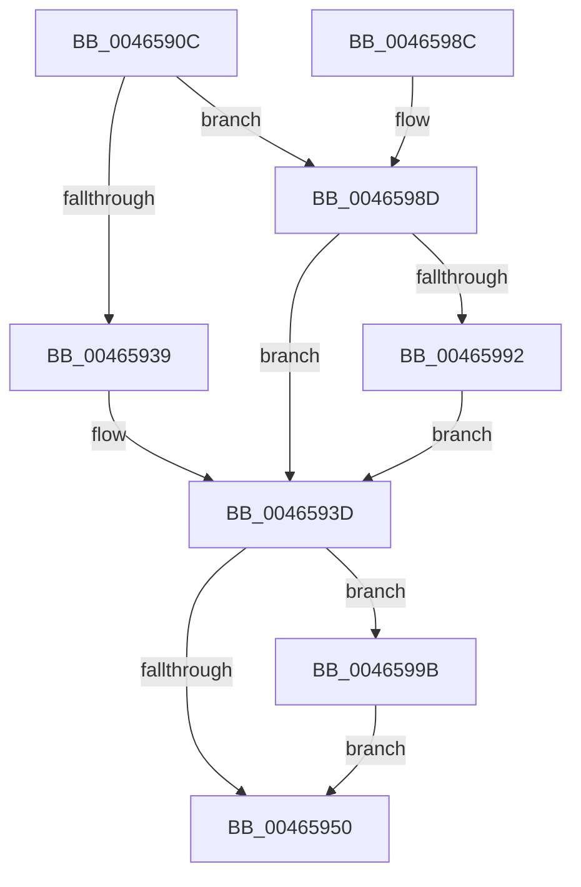

# KeSwapDirectoryTableBase

- RVA: `0x0046590C`–`0x004659A5` (길이 `153` bytes)
- VA: `0x000000014046590C`
- 실행 섹션: `.text`
- PDB 이름 있음: `예`; PDB Function 태그: `아니요`
- unwind 정보 RVA: `0x000AABC8`
- 디코드: `41`개 명령, `153/153` bytes 표시
- 미해석 바이트: `0` (있으면 어셈블리에 `.byte`로 보존)

> 이 문서는 커널 이미지의 기계어와 PDB 기호를 분석해 생성했습니다. 4번과 5번은 함수 원형과 자료형을 바이너리 사용 방식에서 추정한 C 해석이며 원본 소스 복구 결과는 아닙니다.

## 1. Dependencies

- 직접 호출 지점: **3**; 고유 호출 대상: **3**
- 직접 호출자로 확인된 함수: **1**
- RIP 상대 이미지 참조: **3**

### Outgoing calls
- `0x0046596F` → [KeGenericProcessorCallback](../39/KeGenericProcessorCallback_function_00398C2C.md) (function, `0x00398C2C`)
- `0x00465977` → [KeFlushProcessTb](KeFlushProcessTb_function_00465BC8.md) (function, `0x00465BC8`)
- `0x0046599E` → [KiCpuPartitionCheckGenericDpc](../5C/KiCpuPartitionCheckGenericDpc_function_005C159C.md) (function, `0x005C159C`)

### Direct callers
- [MiStealPage](../2B/MiStealPage_function_002B28D0.md) at `0x002B3D27`

### Static image references
- `0x0046593D` → RVA `0x00FC6B14` (`ALMOSTRO`; read)
- `0x00465947` → RVA `0x00227FF0` (`KiSwapDirectoryTableBaseTarget`; read)
- `0x00465968` → RVA `0x002C9B60` (`KiGenericCallDpcInitiatorWorker`; read)

## 2. Other-region calls and transfers

- 다른 실행 섹션으로 향하는 call: **0**
- 별도 외부 분기/꼬리 이동을 확인하지 못했습니다.

## 3. Assembly (complete function range)

```asm
0046590C  48 89 5C 24 08                  mov qword ptr [rsp + 8], rbx
00465911  48 89 7C 24 10                  mov qword ptr [rsp + 0x10], rdi
00465916  55                              push rbp
00465917  48 8B EC                        mov rbp, rsp
0046591A  48 83 EC 50                     sub rsp, 0x50
0046591E  33 DB                           xor ebx, ebx
00465920  48 89 4D E8                     mov qword ptr [rbp - 0x18], rcx
00465924  66 89 5D E1                     mov word ptr [rbp - 0x1f], bx
00465928  88 5D E3                        mov byte ptr [rbp - 0x1d], bl
0046592B  88 5D E0                        mov byte ptr [rbp - 0x20], bl
0046592E  89 55 E4                        mov dword ptr [rbp - 0x1c], edx
00465931  4C 89 45 F0                     mov qword ptr [rbp - 0x10], r8
00465935  85 D2                           test edx, edx
00465937  75 54                           jne 0x14046598d
00465939  48 8B 59 28                     mov rbx, qword ptr [rcx + 0x28]
0046593D  F7 05 CD 11 B6 00 00 02 00 00   test dword ptr [rip + 0xb611cd], 0x200
00465947  48 8D 3D A2 26 DC FF            lea rdi, [rip - 0x23d95e]
0046594E  75 4B                           jne 0x14046599b
00465950  48 8D 45 E0                     lea rax, [rbp - 0x20]
00465954  48 89 7D D0                     mov qword ptr [rbp - 0x30], rdi
00465958  41 B9 01 00 00 00               mov r9d, 1
0046595E  48 89 45 D8                     mov qword ptr [rbp - 0x28], rax
00465962  4C 8D 45 D0                     lea r8, [rbp - 0x30]
00465966  33 C9                           xor ecx, ecx
00465968  48 8D 15 F1 41 E6 FF            lea rdx, [rip - 0x19be0f]
0046596F  E8 B8 32 F3 FF                  call 0x140398c2c
00465974  48 8B CB                        mov rcx, rbx
00465977  E8 4C 02 00 00                  call 0x140465bc8
0046597C  48 8B 5C 24 60                  mov rbx, qword ptr [rsp + 0x60]
00465981  48 8B 7C 24 68                  mov rdi, qword ptr [rsp + 0x68]
00465986  48 83 C4 50                     add rsp, 0x50
0046598A  5D                              pop rbp
0046598B  C3                              ret
0046598C  CC                              int3
0046598D  83 FA 01                        cmp edx, 1
00465990  75 AB                           jne 0x14046593d
00465992  48 8B 99 58 01 00 00            mov rbx, qword ptr [rcx + 0x158]
00465999  EB A2                           jmp 0x14046593d
0046599B  48 8B CF                        mov rcx, rdi
0046599E  E8 F9 BB 15 00                  call 0x1405c159c
004659A3  EB AB                           jmp 0x140465950
```

## 4. C-style interpretation (structured pseudocode)

```c
__int64 __fastcall KeSwapDirectoryTableBase(__int64 a1, int a2, __int64 a3)
{
    __int64 result;
    __int64 v_rbx;
    __int64 v_rsp;
    unsigned __int64 v_stack_m18;
    unsigned __int64 v_stack_m20;
    unsigned int v_stack_m24;
    unsigned __int8 v_stack_m25;
    unsigned __int16 v_stack_m27;
    unsigned __int8 v_stack_m28;
    unsigned __int64 v_stack_m30;
    unsigned __int64 v_stack_m38;
    unsigned __int64 v_stack_p10;
    unsigned __int64 v_stack_p8;

    v_stack_p8 = v_rbx;
    v_stack_p10 = v_rdi;
    v_rsp = (v_rsp) - (80);
    v_rbx = 0;
    v_stack_m20 = a1;
    v_stack_m27 = 0;
    v_stack_m25 = 0;
    v_stack_m28 = 0;
    v_stack_m24 = a2;
    v_stack_m18 = a3;
    if (a2 != 0) goto loc_0046598D;
loc_0046593D:
    if (((*(unsigned int *)(v_rip + 11932109)) & (512)) != 0) goto loc_0046599B;
loc_00465950:
    v_stack_m38 = v_rip - 2349406;
    v_stack_m30 = v_stack_m28;
    a1 = 0;
    result = KeGenericProcessorCallback(a1, v_rip - 1687055, v_stack_m38, 1);
    result = KeFlushProcessTb(*(unsigned __int64 *)(a1 + 40), v_rip - 1687055, v_stack_m38, 1);
    v_rsp = (v_rsp) + (80);
    return result;
loc_0046598D:
    if (((unsigned int)(v_rip - 1687055)) != 1) goto loc_0046593D;
    goto loc_0046593D;
loc_0046599B:
    result = KiCpuPartitionCheckGenericDpc(v_stack_p10, v_rip - 1687055, v_stack_m38, 1);
    goto loc_00465950;
}
```

## 5. (Beta) C Style

```c
int64_t KeSwapDirectoryTableBase(void *Arg1, int32_t Arg2, int64_t Arg3)
{
    uint8_t *arg1 = (uint8_t *)Arg1;

    int64_t result;
    int64_t local_rbx;
    int64_t local_rsp;
    uint64_t v_stack_m18;
    uint64_t v_stack_m20;
    uint32_t v_stack_m24;
    uint8_t v_stack_m25;
    uint16_t v_stack_m27;
    uint8_t v_stack_m28;
    uint64_t v_stack_m30;
    uint64_t v_stack_m38;
    uint64_t v_stack_p10;
    uint64_t v_stack_p8;

    v_stack_p8 = local_rbx;
    v_stack_p10 = local_rdi;
    local_rsp = (local_rsp) - (80);
    local_rbx = 0;
    v_stack_m20 = Arg1;
    v_stack_m27 = 0;
    v_stack_m25 = 0;
    v_stack_m28 = 0;
    v_stack_m24 = Arg2;
    v_stack_m18 = Arg3;
    if (Arg2 != 0) goto loc_0046598D;
loc_0046593D:
    if (((*(uint32_t *)(v_rip + 0xB611CD)) & (512)) != 0) goto loc_0046599B;
loc_00465950:
    v_stack_m38 = v_rip - 2349406;
    v_stack_m30 = v_stack_m28;
    Arg1 = 0;
    result = KeGenericProcessorCallback(Arg1, v_rip - 1687055, v_stack_m38, 1);
    result = KeFlushProcessTb(*(uint64_t *)(arg1 + 0x28), v_rip - 1687055, v_stack_m38, 1);
    local_rsp = (local_rsp) + (80);
    return result;
loc_0046598D:
    if (((uint32_t)(v_rip - 1687055)) != 1) goto loc_0046593D;
    goto loc_0046593D;
loc_0046599B:
    result = KiCpuPartitionCheckGenericDpc(v_stack_p10, v_rip - 1687055, v_stack_m38, 1);
    goto loc_00465950;
}
```

### 관측된 메모리 오프셋

구조체 형식이 확인되지 않은 접근은 인자 기준의 오프셋으로만 기록했습니다.

| 기준 인자 | 오프셋 표현 | 폭 (bit) | 접근 |
|---|---:|---:|---|
| `Arg1` | `+ 0x28` | `64` | `R` |
| `Arg1` | `+ 0x158` | `64` | `R` |

## 6. Execution-region graph

[열기: 2D/3D 그래프와 함수 탐색 컨트롤 패널](../../../control-panel.html?section=text&rva=0x0046590C&view=graph)

- 2D 그래프는 위에서 아래로 흐르고, 3D 그래프는 빈 공간을 드래그해 회전합니다. Shift+드래그는 이동, 휠은 확대·축소, 함수 노드 선택은 대상 보고서 이동입니다.

### Static fallback


