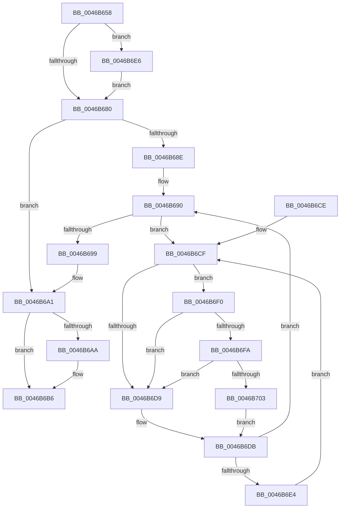

# KiAcquireReleaseThreadLock

- RVA: `0x0046B658`–`0x0046B70C` (길이 `180` bytes)
- VA: `0x000000014046B658`
- 실행 섹션: `.text`
- PDB 이름 있음: `예`; PDB Function 태그: `아니요`
- unwind 정보 RVA: `0x00092E64`
- 디코드: `51`개 명령, `180/180` bytes 표시
- 미해석 바이트: `0` (있으면 어셈블리에 `.byte`로 보존)

> 이 문서는 커널 이미지의 기계어와 PDB 기호를 분석해 생성했습니다. 4번과 5번은 함수 원형과 자료형을 바이너리 사용 방식에서 추정한 C 해석이며 원본 소스 복구 결과는 아닙니다.

## 1. Dependencies

- 직접 호출 지점: **4**; 고유 호출 대상: **4**
- 직접 호출자로 확인된 함수: **1**
- RIP 상대 이미지 참조: **3**

### Outgoing calls
- `0x0046B6B1` → [KiLowerIrqlProcessIrqlFlags](../4F/KiLowerIrqlProcessIrqlFlags_function_004F5698.md) (function, `0x004F5698`)
- `0x0046B6E9` → [KiRaiseIrqlProcessIrqlFlags](../4F/KiRaiseIrqlProcessIrqlFlags_function_004F56FC.md) (function, `0x004F56FC`)
- `0x0046B6FA` → [KiCheckVpBackingLongSpinWaitHypercall](../30/KiCheckVpBackingLongSpinWaitHypercall_function_0030F490.md) (function, `0x0030F490`)
- `0x0046B705` → [HvlNotifyLongSpinWait](../30/HvlNotifyLongSpinWait_function_0030F460.md) (function, `0x0030F460`)

### Direct callers
- [KeRundownApcQueues](../../page/90/KeRundownApcQueues_function_00905C44.md) at `0x00905C63`

### Static image references
- `0x0046B677` → RVA `0x00FC6D20` (`ALMOSTRO`; read)
- `0x0046B6D1` → RVA `0x00FC52AC` (`ALMOSTRO`; reference)
- `0x0046B6F0` → RVA `0x00FC6AB8` (`ALMOSTRO`; read)

## 2. Other-region calls and transfers

- 다른 실행 섹션으로 향하는 call: **0**
- 별도 외부 분기/꼬리 이동을 확인하지 못했습니다.

## 3. Assembly (complete function range)

```asm
0046B658  48 89 5C 24 08                  mov qword ptr [rsp + 8], rbx
0046B65D  48 89 74 24 10                  mov qword ptr [rsp + 0x10], rsi
0046B662  57                              push rdi
0046B663  48 83 EC 20                     sub rsp, 0x20
0046B667  48 8B D9                        mov rbx, rcx
0046B66A  44 0F 20 C6                     mov rsi, cr8
0046B66E  BA 02 00 00 00                  mov edx, 2
0046B673  44 0F 22 C2                     mov cr8, rdx
0046B677  83 3D A2 B6 B5 00 00            cmp dword ptr [rip + 0xb5b6a2], 0
0046B67E  75 66                           jne 0x14046b6e6
0046B680  F0 83 0C 24 00                  lock or dword ptr [rsp], 0
0046B685  48 8B 43 40                     mov rax, qword ptr [rbx + 0x40]
0046B689  48 85 C0                        test rax, rax
0046B68C  74 13                           je 0x14046b6a1
0046B68E  33 FF                           xor edi, edi
0046B690  F0 48 0F BA 6B 40 00            lock bts qword ptr [rbx + 0x40], 0
0046B697  72 36                           jb 0x14046b6cf
0046B699  48 C7 43 40 00 00 00 00         mov qword ptr [rbx + 0x40], 0
0046B6A1  83 3D 78 B6 B5 00 00            cmp dword ptr [rip + 0xb5b678], 0
0046B6A8  74 0C                           je 0x14046b6b6
0046B6AA  44 0F 20 C1                     mov rcx, cr8
0046B6AE  40 8A D6                        mov dl, sil
0046B6B1  E8 E2 9F 08 00                  call 0x1404f5698
0046B6B6  40 0F B6 C6                     movzx eax, sil
0046B6BA  44 0F 22 C0                     mov cr8, rax
0046B6BE  48 8B 5C 24 30                  mov rbx, qword ptr [rsp + 0x30]
0046B6C3  48 8B 74 24 38                  mov rsi, qword ptr [rsp + 0x38]
0046B6C8  48 83 C4 20                     add rsp, 0x20
0046B6CC  5F                              pop rdi
0046B6CD  C3                              ret
0046B6CE  CC                              int3
0046B6CF  FF C7                           inc edi
0046B6D1  85 3D D5 9B B5 00               test dword ptr [rip + 0xb59bd5], edi
0046B6D7  74 17                           je 0x14046b6f0
0046B6D9  F3 90                           pause
0046B6DB  48 8B 43 40                     mov rax, qword ptr [rbx + 0x40]
0046B6DF  48 85 C0                        test rax, rax
0046B6E2  74 AC                           je 0x14046b690
0046B6E4  EB E9                           jmp 0x14046b6cf
0046B6E6  40 8A CE                        mov cl, sil
0046B6E9  E8 0E A0 08 00                  call 0x1404f56fc
0046B6EE  EB 90                           jmp 0x14046b680
0046B6F0  8B 05 C2 B3 B5 00               mov eax, dword ptr [rip + 0xb5b3c2]
0046B6F6  A8 40                           test al, 0x40
0046B6F8  74 DF                           je 0x14046b6d9
0046B6FA  E8 91 3D EA FF                  call 0x14030f490
0046B6FF  84 C0                           test al, al
0046B701  74 D6                           je 0x14046b6d9
0046B703  8B CF                           mov ecx, edi
0046B705  E8 56 3D EA FF                  call 0x14030f460
0046B70A  EB CF                           jmp 0x14046b6db
```

## 4. C-style interpretation (structured pseudocode)

```c
__int64 __fastcall KiAcquireReleaseThreadLock(__int64 a1)
{
    __int64 result;
    __int64 v_rdi;
    __int64 v_rsp;
    unsigned int v_stack_m28;
    unsigned __int64 v_stack_p10;
    unsigned __int64 v_stack_p8;

    v_stack_p8 = v_rbx;
    v_stack_p10 = v_rsi;
    v_rsp = (v_rsp) - (32);
    if ((*(unsigned int *)(v_rip + 11908770)) != 0) goto loc_0046B6E6;
loc_0046B680:
    if (*(unsigned __int64 *)(a1 + 64) == 0) goto loc_0046B6A1;
    v_rdi = 0;
loc_0046B690:
    if (condition_is_below) goto loc_0046B6CF;
    *(unsigned __int64 *)(a1 + 64) = 0;
loc_0046B6A1:
    result = *(unsigned __int64 *)(a1 + 64);
    if ((*(unsigned int *)(v_rip + 11908728)) != 0) {
        a1 = 2;
        a2 = (unsigned __int8)(v_cr8);
        result = KiLowerIrqlProcessIrqlFlags(a1, a2, a3, a4);
    }
    v_rsp = (v_rsp) + (32);
    return (unsigned __int8)(v_cr8);
loc_0046B6CF:
    v_rdi = (unsigned int)((v_rdi) + 1);
    if (((*(unsigned int *)(v_rip + 11901909)) & ((unsigned int)(v_rdi))) == 0) goto loc_0046B6F0;
loc_0046B6D9:
loc_0046B6DB:
    if (*(unsigned __int64 *)(v_stack_p8 + 64) == 0) goto loc_0046B690;
    goto loc_0046B6CF;
loc_0046B6E6:
    result = KiRaiseIrqlProcessIrqlFlags((unsigned __int8)(v_stack_p10), a2, a3, a4);
    goto loc_0046B680;
loc_0046B6F0:
    if ((((unsigned __int8)((unsigned int)(*(unsigned int *)(v_rip + 11908034)))) & (64)) == 0) goto loc_0046B6D9;
    result = KiCheckVpBackingLongSpinWaitHypercall((unsigned __int8)(v_stack_p10), a2, a3, a4);
    if ((unsigned __int8)(result) == 0) goto loc_0046B6D9;
    result = HvlNotifyLongSpinWait((unsigned int)((unsigned int)(v_rdi)), a2, a3, a4);
    goto loc_0046B6DB;
}
```

## 5. (Beta) C Style

```c
int64_t KiAcquireReleaseThreadLock(void *Arg1)
{
    uint8_t *arg1 = (uint8_t *)Arg1;

    int64_t result;
    int64_t local_rdi;
    int64_t local_rsp;
    uint32_t v_stack_m28;
    uint64_t v_stack_p10;
    uint64_t v_stack_p8;

    v_stack_p8 = local_rbx;
    v_stack_p10 = local_rsi;
    local_rsp = (local_rsp) - (32);
    if ((*(uint32_t *)(v_rip + 0xB5B6A2)) != 0) goto loc_0046B6E6;
loc_0046B680:
    if (*(uint64_t *)(arg1 + 0x40) == 0) goto loc_0046B6A1;
    local_rdi = 0;
loc_0046B690:
    if (condition_is_below) goto loc_0046B6CF;
    *(uint64_t *)(arg1 + 0x40) = 0;
loc_0046B6A1:
    result = *(uint64_t *)(arg1 + 0x40);
    if ((*(uint32_t *)(v_rip + 0xB5B678)) != 0) {
        Arg1 = 2;
        a2 = (uint8_t)(v_cr8);
        result = KiLowerIrqlProcessIrqlFlags(Arg1, a2, a3, a4);
    }
    local_rsp = (local_rsp) + (32);
    return (uint8_t)(v_cr8);
loc_0046B6CF:
    local_rdi = (uint32_t)((local_rdi) + 1);
    if (((*(uint32_t *)(v_rip + 0xB59BD5)) & ((uint32_t)(local_rdi))) == 0) goto loc_0046B6F0;
loc_0046B6D9:
loc_0046B6DB:
    if (*(uint64_t *)(v_stack_p8 + 0x40) == 0) goto loc_0046B690;
    goto loc_0046B6CF;
loc_0046B6E6:
    result = KiRaiseIrqlProcessIrqlFlags((uint8_t)(v_stack_p10), a2, a3, a4);
    goto loc_0046B680;
loc_0046B6F0:
    if ((((uint8_t)((uint32_t)(*(uint32_t *)(v_rip + 0xB5B3C2)))) & (64)) == 0) goto loc_0046B6D9;
    result = KiCheckVpBackingLongSpinWaitHypercall((uint8_t)(v_stack_p10), a2, a3, a4);
    if ((uint8_t)(result) == 0) goto loc_0046B6D9;
    result = HvlNotifyLongSpinWait((uint32_t)((uint32_t)(local_rdi)), a2, a3, a4);
    goto loc_0046B6DB;
}
```

### 관측된 메모리 오프셋

구조체 형식이 확인되지 않은 접근은 인자 기준의 오프셋으로만 기록했습니다.

| 기준 인자 | 오프셋 표현 | 폭 (bit) | 접근 |
|---|---:|---:|---|
| `Arg1` | `+ 0x40` | `64` | `R` |
| `Arg1` | `+ 0x40` | `64` | `R/W` |
| `Arg1` | `+ 0x40` | `64` | `W` |

## 6. Execution-region graph

[열기: 2D/3D 그래프와 함수 탐색 컨트롤 패널](../../../control-panel.html?section=text&rva=0x0046B658&view=graph)

- 2D 그래프는 위에서 아래로 흐르고, 3D 그래프는 빈 공간을 드래그해 회전합니다. Shift+드래그는 이동, 휠은 확대·축소, 함수 노드 선택은 대상 보고서 이동입니다.

### Static fallback


