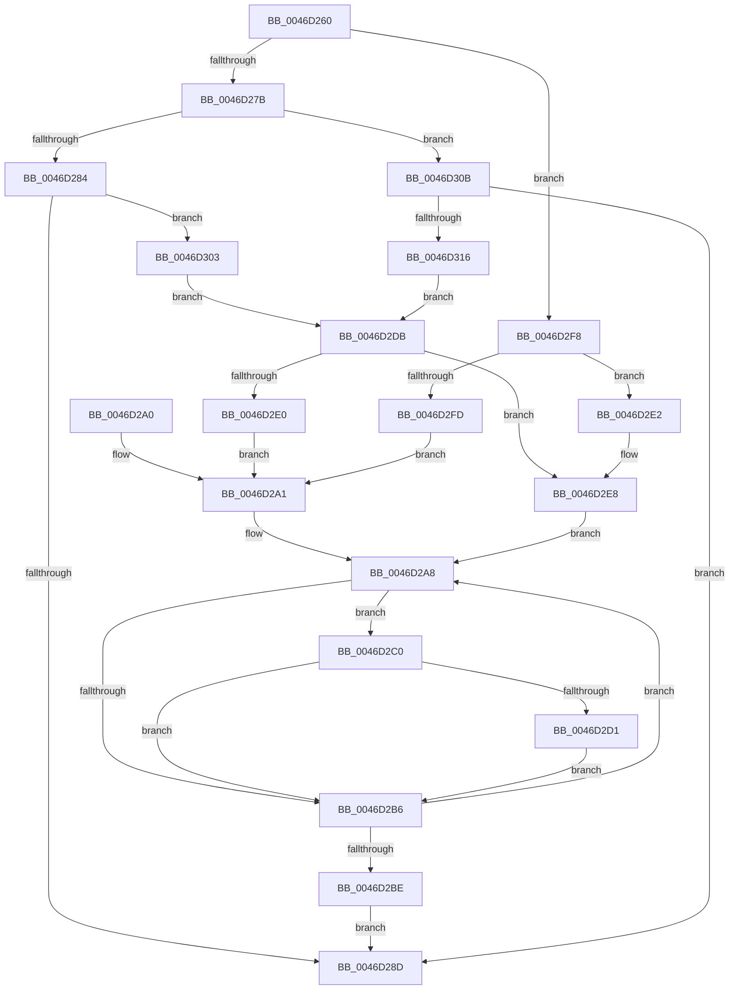

# KiAssignSchedulingGroupWeights

- RVA: `0x0046D260`–`0x0046D31C` (길이 `188` bytes)
- VA: `0x000000014046D260`
- 실행 섹션: `.text`
- PDB 이름 있음: `예`; PDB Function 태그: `아니요`
- unwind 정보 RVA: `0x000ABA30`
- 디코드: `60`개 명령, `188/188` bytes 표시
- 미해석 바이트: `0` (있으면 어셈블리에 `.byte`로 보존)

> 이 문서는 커널 이미지의 기계어와 PDB 기호를 분석해 생성했습니다. 4번과 5번은 함수 원형과 자료형을 바이너리 사용 방식에서 추정한 C 해석이며 원본 소스 복구 결과는 아닙니다.

## 1. Dependencies

- 직접 호출 지점: **1**; 고유 호출 대상: **1**
- 직접 호출자로 확인된 함수: **4**
- RIP 상대 이미지 참조: **4**

### Outgoing calls
- `0x0046D2D4` → [KiUpdateCpuTargetByWeight](KiUpdateCpuTargetByWeight_function_0046E0E0.md) (function, `0x0046E0E0`)

### Direct callers
- [KeSetSchedulingGroupWeights](KeSetSchedulingGroupWeights_function_0046D024.md) at `0x0046D112`
- [KeInsertSchedulingGroup](KeInsertSchedulingGroup_function_0046D324.md) at `0x0046D6D8`
- [KeUpdateGroupSchedulingConstants](../5C/KeUpdateGroupSchedulingConstants_function_005C8E14.md) at `0x005C8F03`
- [sub_006FA7F8](../6F/Unknown_function_006FA7F8.md) at `0x006FA80F`

### Static image references
- `0x0046D284` → RVA `0x00F2343C` (`.data`; read)
- `0x0046D2E2` → RVA `0x00F23438` (`.data`; read)
- `0x0046D2E8` → RVA `0x00F23420` (`.data`; read)
- `0x0046D303` → RVA `0x00F23434` (`.data`; read)

## 2. Other-region calls and transfers

- 다른 실행 섹션으로 향하는 call: **0**
- 별도 외부 분기/꼬리 이동을 확인하지 못했습니다.

## 3. Assembly (complete function range)

```asm
0046D260  48 89 5C 24 10                  mov qword ptr [rsp + 0x10], rbx
0046D265  48 89 6C 24 18                  mov qword ptr [rsp + 0x18], rbp
0046D26A  56                              push rsi
0046D26B  57                              push rdi
0046D26C  41 56                           push r14
0046D26E  48 83 EC 20                     sub rsp, 0x20
0046D272  44 8A F2                        mov r14b, dl
0046D275  8B E9                           mov ebp, ecx
0046D277  85 C9                           test ecx, ecx
0046D279  75 7D                           jne 0x14046d2f8
0046D27B  4D 85 C0                        test r8, r8
0046D27E  0F 85 87 00 00 00               jne 0x14046d30b
0046D284  44 39 05 B1 61 AB 00            cmp dword ptr [rip + 0xab61b1], r8d
0046D28B  75 76                           jne 0x14046d303
0046D28D  48 8B 5C 24 48                  mov rbx, qword ptr [rsp + 0x48]
0046D292  48 8B 6C 24 50                  mov rbp, qword ptr [rsp + 0x50]
0046D297  48 83 C4 20                     add rsp, 0x20
0046D29B  41 5E                           pop r14
0046D29D  5F                              pop rdi
0046D29E  5E                              pop rsi
0046D29F  C3                              ret
0046D2A0  CC                              int3
0046D2A1  49 8D 70 50                     lea rsi, [r8 + 0x50]
0046D2A5  48 8B 1E                        mov rbx, qword ptr [rsi]
0046D2A8  48 8D 4B C8                     lea rcx, [rbx - 0x38]
0046D2AC  8B 41 04                        mov eax, dword ptr [rcx + 4]
0046D2AF  83 E0 01                        and eax, 1
0046D2B2  3B C5                           cmp eax, ebp
0046D2B4  74 0A                           je 0x14046d2c0
0046D2B6  48 8B 1B                        mov rbx, qword ptr [rbx]
0046D2B9  48 3B DE                        cmp rbx, rsi
0046D2BC  75 EA                           jne 0x14046d2a8
0046D2BE  EB CD                           jmp 0x14046d28d
0046D2C0  0F B7 01                        movzx eax, word ptr [rcx]
0046D2C3  33 D2                           xor edx, edx
0046D2C5  C1 E0 07                        shl eax, 7
0046D2C8  F7 F7                           div edi
0046D2CA  89 41 08                        mov dword ptr [rcx + 8], eax
0046D2CD  85 ED                           test ebp, ebp
0046D2CF  75 E5                           jne 0x14046d2b6
0046D2D1  41 8A D6                        mov dl, r14b
0046D2D4  E8 07 0E 00 00                  call 0x14046e0e0
0046D2D9  EB DB                           jmp 0x14046d2b6
0046D2DB  4D 85 C0                        test r8, r8
0046D2DE  74 08                           je 0x14046d2e8
0046D2E0  EB BF                           jmp 0x14046d2a1
0046D2E2  8B 3D 50 61 AB 00               mov edi, dword ptr [rip + 0xab6150]
0046D2E8  48 8B 1D 31 61 AB 00            mov rbx, qword ptr [rip + 0xab6131]
0046D2EF  48 8D 35 2A 61 AB 00            lea rsi, [rip + 0xab612a]
0046D2F6  EB B0                           jmp 0x14046d2a8
0046D2F8  4D 85 C0                        test r8, r8
0046D2FB  74 E5                           je 0x14046d2e2
0046D2FD  41 8B 78 0C                     mov edi, dword ptr [r8 + 0xc]
0046D301  EB 9E                           jmp 0x14046d2a1
0046D303  8B 3D 2B 61 AB 00               mov edi, dword ptr [rip + 0xab612b]
0046D309  EB D0                           jmp 0x14046d2db
0046D30B  41 83 78 14 00                  cmp dword ptr [r8 + 0x14], 0
0046D310  0F 84 77 FF FF FF               je 0x14046d28d
0046D316  41 8B 78 10                     mov edi, dword ptr [r8 + 0x10]
0046D31A  EB BF                           jmp 0x14046d2db
```

## 4. C-style interpretation (structured pseudocode)

```c
__int64 __fastcall KiAssignSchedulingGroupWeights(int a1, int a2, __int64 a3)
{
    __int64 result;
    __int64 v_rsp;
    unsigned __int64 v_stack_p10;
    unsigned __int64 v_stack_p18;

    v_stack_p10 = v_rbx;
    v_stack_p18 = v_rbp;
    v_rsp = (v_rsp) - (32);
    if (a1 != 0) goto loc_0046D2F8;
    if (a3 != 0) goto loc_0046D30B;
    if ((*(unsigned int *)(v_rip + 11231665)) != ((unsigned int)(a3))) goto loc_0046D303;
loc_0046D28D:
    v_rsp = (v_rsp) + (32);
    return result;
loc_0046D2A1:
loc_0046D2A8:
    result = (unsigned int)(((unsigned int)(*(unsigned int *)(*(unsigned __int64 *)(a3 + 80) - 56 + 4))) & (1));
    if (((unsigned int)(result)) == ((unsigned int)(v_stack_p18))) goto loc_0046D2C0;
loc_0046D2B6:
    if ((*(unsigned __int64 *)(*(unsigned __int64 *)(a3 + 80))) != (a3 + 80)) goto loc_0046D2A8;
    goto loc_0046D28D;
loc_0046D2C0:
    a2 = 0;
    result = (unsigned int)((*(unsigned __int16 *)(*(unsigned __int64 *)(a3 + 80) - 56)) << (7));
    *(unsigned int *)(*(unsigned __int64 *)(a3 + 80) - 56 + 8) = (unsigned int)(result);
    if ((unsigned int)(v_stack_p18) != 0) goto loc_0046D2B6;
    result = KiUpdateCpuTargetByWeight(*(unsigned __int64 *)(a3 + 80) - 56, (unsigned __int8)((unsigned __int8)(a2)), a3, a4);
    goto loc_0046D2B6;
loc_0046D2DB:
    if (a3 == 0) goto loc_0046D2E8;
    goto loc_0046D2A1;
loc_0046D2E2:
loc_0046D2E8:
    goto loc_0046D2A8;
loc_0046D2F8:
    if (a3 == 0) goto loc_0046D2E2;
    goto loc_0046D2A1;
loc_0046D303:
    goto loc_0046D2DB;
loc_0046D30B:
    if ((*(unsigned int *)(a3 + 20)) == 0) goto loc_0046D28D;
    goto loc_0046D2DB;
}
```

## 5. (Beta) C Style

```c
int64_t KiAssignSchedulingGroupWeights(int32_t Arg1, int32_t Arg2, int64_t Arg3)
{
    int64_t result;
    int64_t local_rsp;
    uint64_t v_stack_p10;
    uint64_t v_stack_p18;

    v_stack_p10 = local_rbx;
    v_stack_p18 = local_rbp;
    local_rsp = (local_rsp) - (32);
    if (Arg1 != 0) goto loc_0046D2F8;
    if (Arg3 != 0) goto loc_0046D30B;
    if ((*(uint32_t *)(v_rip + 0xAB61B1)) != ((uint32_t)(Arg3))) goto loc_0046D303;
loc_0046D28D:
    local_rsp = (local_rsp) + (32);
    return result;
loc_0046D2A1:
loc_0046D2A8:
    result = (uint32_t)(((uint32_t)(*(uint32_t *)(*(uint64_t *)(Arg3 + 0x50) - 0x38 + 0x4))) & (1));
    if (((uint32_t)(result)) == ((uint32_t)(v_stack_p18))) goto loc_0046D2C0;
loc_0046D2B6:
    if ((*(uint64_t *)(*(uint64_t *)(Arg3 + 0x50))) != (Arg3 + 80)) goto loc_0046D2A8;
    goto loc_0046D28D;
loc_0046D2C0:
    Arg2 = 0;
    result = (uint32_t)((*(uint16_t *)(*(uint64_t *)(Arg3 + 0x50) - 0x38)) << (7));
    *(uint32_t *)(*(uint64_t *)(Arg3 + 0x50) - 0x38 + 0x8) = (uint32_t)(result);
    if ((uint32_t)(v_stack_p18) != 0) goto loc_0046D2B6;
    result = KiUpdateCpuTargetByWeight(*(uint64_t *)(Arg3 + 0x50) - 56, (uint8_t)((uint8_t)(Arg2)), Arg3, a4);
    goto loc_0046D2B6;
loc_0046D2DB:
    if (Arg3 == 0) goto loc_0046D2E8;
    goto loc_0046D2A1;
loc_0046D2E2:
loc_0046D2E8:
    goto loc_0046D2A8;
loc_0046D2F8:
    if (Arg3 == 0) goto loc_0046D2E2;
    goto loc_0046D2A1;
loc_0046D303:
    goto loc_0046D2DB;
loc_0046D30B:
    if ((*(uint32_t *)(Arg3 + 0x14)) == 0) goto loc_0046D28D;
    goto loc_0046D2DB;
}
```

## 6. Execution-region graph

[열기: 2D/3D 그래프와 함수 탐색 컨트롤 패널](../../../control-panel.html?section=text&rva=0x0046D260&view=graph)

- 2D 그래프는 위에서 아래로 흐르고, 3D 그래프는 빈 공간을 드래그해 회전합니다. Shift+드래그는 이동, 휠은 확대·축소, 함수 노드 선택은 대상 보고서 이동입니다.

### Static fallback


