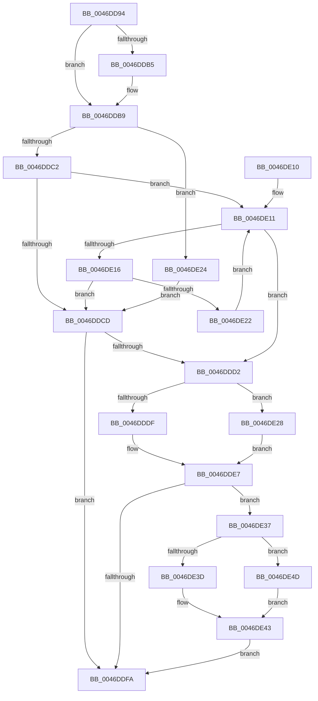

# KiCheckForEffectivePriorityChange

- RVA: `0x0046DD94`–`0x0046DE55` (길이 `193` bytes)
- VA: `0x000000014046DD94`
- 실행 섹션: `.text`
- PDB 이름 있음: `예`; PDB Function 태그: `아니요`
- unwind 정보 RVA: `0x000ABAD8`
- 디코드: `59`개 명령, `193/193` bytes 표시
- 미해석 바이트: `0` (있으면 어셈블리에 `.byte`로 보존)

> 이 문서는 커널 이미지의 기계어와 PDB 기호를 분석해 생성했습니다. 4번과 5번은 함수 원형과 자료형을 바이너리 사용 방식에서 추정한 C 해석이며 원본 소스 복구 결과는 아닙니다.

## 1. Dependencies

- 직접 호출 지점: **2**; 고유 호출 대상: **2**
- 직접 호출자로 확인된 함수: **5**
- RIP 상대 이미지 참조: **1**

### Outgoing calls
- `0x0046DE2E` → [KiQueryEffectivePriorityThread](../25/KiQueryEffectivePriorityThread_function_00257BA0.md) (function, `0x00257BA0`)
- `0x0046DE46` → [KiSetSchedulerAssistPriority](KiSetSchedulerAssistPriority_function_0046E740.md) (function, `0x0046E740`)

### Direct callers
- [KiComputeGroupSchedulingRank](../21/KiComputeGroupSchedulingRank_function_0021EB84.md) at `0x0021ECCE`
- [sub_00356086](../35/Unknown_function_00356086.md) at `0x00356152`
- [KiUpdateCpuTargetByRate](KiUpdateCpuTargetByRate_function_0046D7E4.md) at `0x0046D994`
- [KeSetSchedulingGroupRankBias](KeSetSchedulingGroupRankBias_function_0046DB74.md) at `0x0046DC50`
- [KiUpdateCpuTargetByWeight](KiUpdateCpuTargetByWeight_function_0046E0E0.md) at `0x0046E326`

### Static image references
- `0x0046DE3D` → RVA `0x00FC504C` (`ALMOSTRO`; read)

## 2. Other-region calls and transfers

- 다른 실행 섹션으로 향하는 call: **0**
- 별도 외부 분기/꼬리 이동을 확인하지 못했습니다.

## 3. Assembly (complete function range)

```asm
0046DD94  48 89 5C 24 08                  mov qword ptr [rsp + 8], rbx
0046DD99  48 89 74 24 10                  mov qword ptr [rsp + 0x10], rsi
0046DD9E  48 89 7C 24 18                  mov qword ptr [rsp + 0x18], rdi
0046DDA3  41 56                           push r14
0046DDA5  48 83 EC 20                     sub rsp, 0x20
0046DDA9  48 8B 79 10                     mov rdi, qword ptr [rcx + 0x10]
0046DDAD  48 8B F1                        mov rsi, rcx
0046DDB0  48 85 FF                        test rdi, rdi
0046DDB3  75 04                           jne 0x14046ddb9
0046DDB5  48 8B 79 08                     mov rdi, qword ptr [rcx + 8]
0046DDB9  48 8B 4F 68                     mov rcx, qword ptr [rdi + 0x68]
0046DDBD  48 85 C9                        test rcx, rcx
0046DDC0  74 62                           je 0x14046de24
0046DDC2  8B 86 D8 00 00 00               mov eax, dword ptr [rsi + 0xd8]
0046DDC8  48 03 C1                        add rax, rcx
0046DDCB  75 44                           jne 0x14046de11
0046DDCD  49 3B C0                        cmp rax, r8
0046DDD0  75 28                           jne 0x14046ddfa
0046DDD2  F6 47 02 04                     test byte ptr [rdi + 2], 4
0046DDD6  4C 8B 76 38                     mov r14, qword ptr [rsi + 0x38]
0046DDDA  41 8A 1E                        mov bl, byte ptr [r14]
0046DDDD  75 49                           jne 0x14046de28
0046DDDF  8A C3                           mov al, bl
0046DDE1  32 87 C3 00 00 00               xor al, byte ptr [rdi + 0xc3]
0046DDE7  24 7F                           and al, 0x7f
0046DDE9  32 C3                           xor al, bl
0046DDEB  41 88 06                        mov byte ptr [r14], al
0046DDEE  48 8B 8E B8 8E 00 00            mov rcx, qword ptr [rsi + 0x8eb8]
0046DDF5  48 85 C9                        test rcx, rcx
0046DDF8  75 3D                           jne 0x14046de37
0046DDFA  48 8B 5C 24 30                  mov rbx, qword ptr [rsp + 0x30]
0046DDFF  48 8B 74 24 38                  mov rsi, qword ptr [rsp + 0x38]
0046DE04  48 8B 7C 24 40                  mov rdi, qword ptr [rsp + 0x40]
0046DE09  48 83 C4 20                     add rsp, 0x20
0046DE0D  41 5E                           pop r14
0046DE0F  C3                              ret
0046DE10  CC                              int3
0046DE11  49 3B C0                        cmp rax, r8
0046DE14  74 BC                           je 0x14046ddd2
0046DE16  48 8B 80 A0 01 00 00            mov rax, qword ptr [rax + 0x1a0]
0046DE1D  48 85 C0                        test rax, rax
0046DE20  74 AB                           je 0x14046ddcd
0046DE22  EB ED                           jmp 0x14046de11
0046DE24  33 C0                           xor eax, eax
0046DE26  EB A5                           jmp 0x14046ddcd
0046DE28  48 8B D6                        mov rdx, rsi
0046DE2B  48 8B CF                        mov rcx, rdi
0046DE2E  E8 6D 9D DE FF                  call 0x140257ba0
0046DE33  32 C3                           xor al, bl
0046DE35  EB B0                           jmp 0x14046dde7
0046DE37  48 3B 7E 18                     cmp rdi, qword ptr [rsi + 0x18]
0046DE3B  75 10                           jne 0x14046de4d
0046DE3D  8B 15 09 72 B5 00               mov edx, dword ptr [rip + 0xb57209]
0046DE43  45 33 C0                        xor r8d, r8d
0046DE46  E8 F5 08 00 00                  call 0x14046e740
0046DE4B  EB AD                           jmp 0x14046ddfa
0046DE4D  0F B6 D0                        movzx edx, al
0046DE50  83 E2 7F                        and edx, 0x7f
0046DE53  EB EE                           jmp 0x14046de43
```

## 4. C-style interpretation (structured pseudocode)

```c
__int64 __fastcall KiCheckForEffectivePriorityChange(__int64 a1, __int64 a2, __int64 a3)
{
    __int64 result;
    __int64 v_rdi;
    __int64 v_rsp;
    unsigned __int64 v_stack_p10;
    unsigned __int64 v_stack_p18;
    unsigned __int64 v_stack_p8;

    v_stack_p8 = v_rbx;
    v_stack_p10 = v_rsi;
    v_stack_p18 = v_rdi;
    v_rsp = (v_rsp) - (32);
    v_rdi = *(unsigned __int64 *)(a1 + 16);
    if (*(unsigned __int64 *)(a1 + 16) == 0) {
        v_rdi = *(unsigned __int64 *)(a1 + 8);
    }
    if (*(unsigned __int64 *)(v_rdi + 104) == 0) goto loc_0046DE24;
    result = ((unsigned int)(*(unsigned int *)(a1 + 216))) + (*(unsigned __int64 *)(v_rdi + 104));
    if (condition_is_not_equal) goto loc_0046DE11;
loc_0046DDCD:
    if (result != a3) goto loc_0046DDFA;
loc_0046DDD2:
    if (((*(unsigned __int8 *)(v_rdi + 2)) & (4)) != 0) goto loc_0046DE28;
    result = (unsigned __int8)(((unsigned __int8)(*(unsigned __int8 *)(*(unsigned __int64 *)(a1 + 56)))) ^ (*(unsigned __int8 *)(v_rdi + 195)));
loc_0046DDE7:
    result = (unsigned __int8)((result) & (127));
    result = (unsigned __int8)((result) ^ ((unsigned __int8)(*(unsigned __int8 *)(*(unsigned __int64 *)(a1 + 56)))));
    *(unsigned __int8 *)(*(unsigned __int64 *)(a1 + 56)) = (unsigned __int8)(result);
    if (*(unsigned __int64 *)(a1 + 36536) != 0) goto loc_0046DE37;
loc_0046DDFA:
    v_rsp = (v_rsp) + (32);
    return result;
loc_0046DE11:
    if (result == a3) goto loc_0046DDD2;
    if (*(unsigned __int64 *)(result + 416) == 0) goto loc_0046DDCD;
    goto loc_0046DE11;
loc_0046DE24:
    result = 0;
    goto loc_0046DDCD;
loc_0046DE28:
    result = KiQueryEffectivePriorityThread(v_stack_p18, v_stack_p10, a3, a4);
    result = (unsigned __int8)((result) ^ ((unsigned __int8)(v_stack_p8)));
    goto loc_0046DDE7;
loc_0046DE37:
    if (v_stack_p18 != (*(unsigned __int64 *)(v_stack_p10 + 24))) goto loc_0046DE4D;
loc_0046DE43:
    a3 = 0;
    result = KiSetSchedulerAssistPriority(v_stack_p18, (unsigned int)(*(unsigned int *)(v_rip + 11891209)), a3, a4);
    goto loc_0046DDFA;
loc_0046DE4D:
    a2 = (unsigned int)(((unsigned __int8)(result)) & (127));
    goto loc_0046DE43;
}
```

## 5. (Beta) C Style

```c
int64_t KiCheckForEffectivePriorityChange(void *Arg1, int64_t Arg2, int64_t Arg3)
{
    uint8_t *arg1 = (uint8_t *)Arg1;

    int64_t result;
    int64_t local_rdi;
    int64_t local_rsp;
    uint64_t v_stack_p10;
    uint64_t v_stack_p18;
    uint64_t v_stack_p8;

    v_stack_p8 = local_rbx;
    v_stack_p10 = local_rsi;
    v_stack_p18 = local_rdi;
    local_rsp = (local_rsp) - (32);
    local_rdi = *(uint64_t *)(arg1 + 0x10);
    if (*(uint64_t *)(arg1 + 0x10) == 0) {
        local_rdi = *(uint64_t *)(arg1 + 0x8);
    }
    if (*(uint64_t *)(local_rdi + 0x68) == 0) goto loc_0046DE24;
    result = ((uint32_t)(*(uint32_t *)(arg1 + 0xD8))) + (*(uint64_t *)(local_rdi + 0x68));
    if (condition_is_not_equal) goto loc_0046DE11;
loc_0046DDCD:
    if (result != Arg3) goto loc_0046DDFA;
loc_0046DDD2:
    if (((*(uint8_t *)(local_rdi + 0x2)) & (4)) != 0) goto loc_0046DE28;
    result = (uint8_t)(((uint8_t)(*(uint8_t *)(*(uint64_t *)(arg1 + 0x38)))) ^ (*(uint8_t *)(local_rdi + 0xC3)));
loc_0046DDE7:
    result = (uint8_t)((result) & (127));
    result = (uint8_t)((result) ^ ((uint8_t)(*(uint8_t *)(*(uint64_t *)(arg1 + 0x38)))));
    *(uint8_t *)(*(uint64_t *)(arg1 + 0x38)) = (uint8_t)(result);
    if (*(uint64_t *)(arg1 + 0x8EB8) != 0) goto loc_0046DE37;
loc_0046DDFA:
    local_rsp = (local_rsp) + (32);
    return result;
loc_0046DE11:
    if (result == Arg3) goto loc_0046DDD2;
    if (*(uint64_t *)(result + 0x1A0) == 0) goto loc_0046DDCD;
    goto loc_0046DE11;
loc_0046DE24:
    result = 0;
    goto loc_0046DDCD;
loc_0046DE28:
    result = KiQueryEffectivePriorityThread(v_stack_p18, v_stack_p10, Arg3, a4);
    result = (uint8_t)((result) ^ ((uint8_t)(v_stack_p8)));
    goto loc_0046DDE7;
loc_0046DE37:
    if (v_stack_p18 != (*(uint64_t *)(v_stack_p10 + 0x18))) goto loc_0046DE4D;
loc_0046DE43:
    Arg3 = 0;
    result = KiSetSchedulerAssistPriority(v_stack_p18, (uint32_t)(*(uint32_t *)(v_rip + 0xB57209)), Arg3, a4);
    goto loc_0046DDFA;
loc_0046DE4D:
    Arg2 = (uint32_t)(((uint8_t)(result)) & (127));
    goto loc_0046DE43;
}
```

### 관측된 메모리 오프셋

구조체 형식이 확인되지 않은 접근은 인자 기준의 오프셋으로만 기록했습니다.

| 기준 인자 | 오프셋 표현 | 폭 (bit) | 접근 |
|---|---:|---:|---|
| `Arg1` | `+ 0x8` | `64` | `R` |
| `Arg1` | `+ 0x10` | `64` | `R` |
| `Arg1` | `+ 0x18` | `64` | `R` |
| `Arg1` | `+ 0x38` | `64` | `R` |
| `Arg1` | `+ 0xD8` | `32` | `R` |
| `Arg1` | `+ 0x8EB8` | `64` | `R` |

## 6. Execution-region graph

[열기: 2D/3D 그래프와 함수 탐색 컨트롤 패널](../../../control-panel.html?section=text&rva=0x0046DD94&view=graph)

- 2D 그래프는 위에서 아래로 흐르고, 3D 그래프는 빈 공간을 드래그해 회전합니다. Shift+드래그는 이동, 휠은 확대·축소, 함수 노드 선택은 대상 보고서 이동입니다.

### Static fallback


