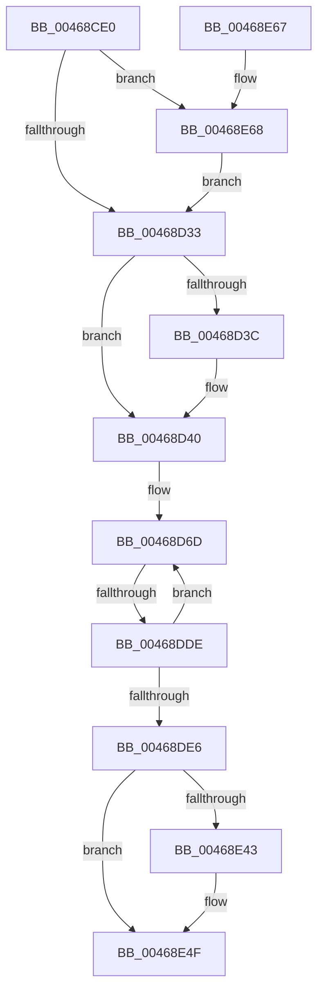

# KiDispatchCallout

- RVA: `0x00468CE0`–`0x00468E75` (길이 `405` bytes)
- VA: `0x0000000140468CE0`
- 실행 섹션: `.text`
- PDB 이름 있음: `예`; PDB Function 태그: `예`
- unwind 정보 RVA: `0x000AB104`
- 디코드: `103`개 명령, `405/405` bytes 표시
- 미해석 바이트: `0` (있으면 어셈블리에 `.byte`로 보존)

> 이 문서는 커널 이미지의 기계어와 PDB 기호를 분석해 생성했습니다. 4번과 5번은 함수 원형과 자료형을 바이너리 사용 방식에서 추정한 C 해석이며 원본 소스 복구 결과는 아닙니다.

## 1. Dependencies

- 직접 호출 지점: **4**; 고유 호출 대상: **4**
- 직접 호출자로 확인된 함수: **0**
- RIP 상대 이미지 참조: **4**

### Outgoing calls
- `0x00468CF5` → [KeExitRetpoline](KeExitRetpoline_function_00468E7C.md) (function, `0x00468E7C`)
- `0x00468E35` → [guard_dispatch_icall](../6B/guard_dispatch_icall_function_006BAAD0.md) (function, `0x006BAAD0`)
- `0x00468E4A` → [KiLowerIrqlProcessIrqlFlags](../4F/KiLowerIrqlProcessIrqlFlags_function_004F5698.md) (function, `0x004F5698`)
- `0x00468E6B` → [KiRaiseIrqlProcessIrqlFlags](../4F/KiRaiseIrqlProcessIrqlFlags_function_004F56FC.md) (function, `0x004F56FC`)

### Direct callers
- 이 함수 시작 RVA로 연결되는 직접 call은 확인되지 않았습니다. 간접 호출은 완전히 역산할 수 없습니다.

### Static image references
- `0x00468D26` → RVA `0x00FC6D20` (`ALMOSTRO`; read)
- `0x00468D33` → RVA `0x01201841` (`CFGRO`; read)
- `0x00468D6D` → RVA `0x00FC6F78` (`ALMOSTRO`; read)
- `0x00468D98` → RVA `0x00FC7250` (`ALMOSTRO`; read)

## 2. Other-region calls and transfers

- 다른 실행 섹션으로 향하는 call: **0**
- call이 아닌 외부 분기/꼬리 이동: **1**
  - `0x00468DD8` → [sub_006F2E8E](../6F/Unknown_function_006F2E8E.md) (`tail-transfer`)

## 3. Assembly (complete function range)

```asm
00468CE0  48 89 5C 24 10                  mov qword ptr [rsp + 0x10], rbx
00468CE5  48 89 74 24 18                  mov qword ptr [rsp + 0x18], rsi
00468CEA  57                              push rdi
00468CEB  48 83 EC 30                     sub rsp, 0x30
00468CEF  49 8B D9                        mov rbx, r9
00468CF2  48 8B F9                        mov rdi, rcx
00468CF5  E8 82 01 00 00                  call 0x140468e7c
00468CFA  48 8B 1B                        mov rbx, qword ptr [rbx]
00468CFD  48 8D 74 24 38                  lea rsi, [rsp + 0x38]
00468D02  48 8B C3                        mov rax, rbx
00468D05  48 33 06                        xor rax, qword ptr [rsi]
00468D08  48 33 C7                        xor rax, rdi
00468D0B  48 89 47 48                     mov qword ptr [rdi + 0x48], rax
00468D0F  48 8B C6                        mov rax, rsi
00468D12  48 33 C3                        xor rax, rbx
00468D15  48 89 47 38                     mov qword ptr [rdi + 0x38], rax
00468D19  44 0F 20 C7                     mov rdi, cr8
00468D1D  BA 02 00 00 00                  mov edx, 2
00468D22  44 0F 22 C2                     mov cr8, rdx
00468D26  83 3D F3 DF B5 00 00            cmp dword ptr [rip + 0xb5dff3], 0
00468D2D  0F 85 35 01 00 00               jne 0x140468e68
00468D33  80 3D 07 8B D9 00 00            cmp byte ptr [rip + 0xd98b07], 0
00468D3A  75 04                           jne 0x140468d40
00468D3C  48 83 26 00                     and qword ptr [rsi], 0
00468D40  4C 8B 53 40                     mov r10, qword ptr [rbx + 0x40]
00468D44  48 B8 00 00 00 00 00 80 FF FF   movabs rax, 0xffff800000000000
00468D4E  4C 33 53 20                     xor r10, qword ptr [rbx + 0x20]
00468D52  BB 19 00 00 00                  mov ebx, 0x19
00468D57  4C 0B D0                        or r10, rax
00468D5A  41 8A CA                        mov cl, r10b
00468D5D  49 8B F2                        mov rsi, r10
00468D60  80 E1 3F                        and cl, 0x3f
00468D63  48 D3 CE                        ror rsi, cl
00468D66  45 33 DB                        xor r11d, r11d
00468D69  4D 8D 4A F8                     lea r9, [r10 - 8]
00468D6D  48 8B 0D 04 E2 B5 00            mov rcx, qword ptr [rip + 0xb5e204]
00468D74  49 8D 41 08                     lea rax, [r9 + 8]
00468D78  4C 8B 00                        mov r8, qword ptr [rax]
00468D7B  4C 8D 08                        lea r9, [rax]
00468D7E  49 8B C0                        mov rax, r8
00468D81  BA C8 00 00 00                  mov edx, 0xc8
00468D86  48 33 C1                        xor rax, rcx
00468D89  41 2B D3                        sub edx, r11d
00468D8C  48 D3 C0                        rol rax, cl
00468D8F  48 33 C6                        xor rax, rsi
00468D92  41 8B CB                        mov ecx, r11d
00468D95  48 0F C8                        bswap rax
00468D98  48 33 05 B1 E4 B5 00            xor rax, qword ptr [rip + 0xb5e4b1]
00468D9F  49 03 C2                        add rax, r10
00468DA2  48 03 C8                        add rcx, rax
00468DA5  41 8B C3                        mov eax, r11d
00468DA8  49 89 09                        mov qword ptr [r9], rcx
00468DAB  48 33 D0                        xor rdx, rax
00468DAE  41 8B C8                        mov ecx, r8d
00468DB1  41 80 F0 FA                     xor r8b, 0xfa
00468DB5  F7 D1                           not ecx
00468DB7  41 80 E0 3F                     and r8b, 0x3f
00468DBB  83 E1 3F                        and ecx, 0x3f
00468DBE  48 D3 CA                        ror rdx, cl
00468DC1  41 8A C8                        mov cl, r8b
00468DC4  48 33 F2                        xor rsi, rdx
00468DC7  48 D3 C6                        rol rsi, cl
00468DCA  49 03 F2                        add rsi, r10
00468DCD  48 81 F6 EC 68 00 77            xor rsi, 0x770068ec
00468DD4  41 83 FB 18                     cmp r11d, 0x18
00468DD8  0F 84 B0 A0 28 00               je 0x1406f2e8e
00468DDE  41 FF C3                        inc r11d
00468DE1  44 3B DB                        cmp r11d, ebx
00468DE4  72 87                           jb 0x140468d6d
00468DE6  49 8B 02                        mov rax, qword ptr [r10]
00468DE9  48 B9 F5 6F 1B AD 5F 93 44 62   movabs rcx, 0x6244935fad1b6ff5
00468DF3  48 33 C1                        xor rax, rcx
00468DF6  45 33 C9                        xor r9d, r9d
00468DF9  48 89 44 24 58                  mov qword ptr [rsp + 0x58], rax
00468DFE  48 B9 DB 27 2A BC 17 A2 15 6A   movabs rcx, 0x6a15a217bc2a27db
00468E08  48 8B 44 24 58                  mov rax, qword ptr [rsp + 0x58]
00468E0D  45 33 C0                        xor r8d, r8d
00468E10  48 33 C1                        xor rax, rcx
00468E13  49 8B CA                        mov rcx, r10
00468E16  48 89 44 24 58                  mov qword ptr [rsp + 0x58], rax
00468E1B  48 8B 54 24 58                  mov rdx, qword ptr [rsp + 0x58]
00468E20  41 C7 02 F5 6F 1B AD            mov dword ptr [r10], 0xad1b6ff5
00468E27  41 8B 02                        mov eax, dword ptr [r10]
00468E2A  35 DB 27 2A BC                  xor eax, 0xbc2a27db
00468E2F  41 89 02                        mov dword ptr [r10], eax
00468E32  49 8B C2                        mov rax, r10
00468E35  E8 96 1C 25 00                  call 0x1406baad0
00468E3A  83 3D DF DE B5 00 00            cmp dword ptr [rip + 0xb5dedf], 0
00468E41  74 0C                           je 0x140468e4f
00468E43  44 0F 20 C1                     mov rcx, cr8
00468E47  40 8A D7                        mov dl, dil
00468E4A  E8 49 C8 08 00                  call 0x1404f5698
00468E4F  40 0F B6 C7                     movzx eax, dil
00468E53  44 0F 22 C0                     mov cr8, rax
00468E57  48 8B 5C 24 48                  mov rbx, qword ptr [rsp + 0x48]
00468E5C  48 8B 74 24 50                  mov rsi, qword ptr [rsp + 0x50]
00468E61  48 83 C4 30                     add rsp, 0x30
00468E65  5F                              pop rdi
00468E66  C3                              ret
00468E67  CC                              int3
00468E68  40 8A CF                        mov cl, dil
00468E6B  E8 8C C8 08 00                  call 0x1404f56fc
00468E70  E9 BE FE FF FF                  jmp 0x140468d33
```

## 4. C-style interpretation (structured pseudocode)

```c
__int64 __fastcall KiDispatchCallout(__int64 a1, __int64 a2, __int64 a3, __int64 a4)
{
    __int64 result;
    __int64 v_r10;
    __int64 v_r11;
    __int64 v_rsi;
    __int64 v_rsp;
    unsigned __int64 v_stack_p0;
    unsigned __int64 v_stack_p10;
    unsigned __int64 v_stack_p18;
    unsigned __int64 v_stack_p20;

    v_stack_p10 = v_rbx;
    v_stack_p18 = v_rsi;
    v_rsp = (v_rsp) - (48);
    result = KeExitRetpoline(a1, a2, a3, a4);
    result = (*(unsigned __int64 *)(a4)) ^ (*(unsigned __int64 *)(v_stack_p0));
    result = (result) ^ (a1);
    *(unsigned __int64 *)(a1 + 72) = result;
    result = (v_stack_p0) ^ (*(unsigned __int64 *)(a4));
    *(unsigned __int64 *)(a1 + 56) = result;
    if ((*(unsigned int *)(v_rip + 11919347)) != 0) goto loc_00468E68;
loc_00468D33:
    if ((*(unsigned __int8 *)(v_rip + 14256903)) == 0) {
    }
    v_r10 = (*(unsigned __int64 *)(*(unsigned __int64 *)(a4) + 64)) ^ (*(unsigned __int64 *)(*(unsigned __int64 *)(a4) + 32));
    v_r10 = (v_r10) | (result);
    a1 = (unsigned __int8)(((unsigned __int8)(v_r10)) & (63));
    v_r11 = 0;
loc_00468D6D:
    result = (*(unsigned __int64 *)(v_r10 - 8 + 8)) ^ (*(unsigned __int64 *)(v_rip + 11919876));
    a2 = (unsigned int)((200) - (0));
    result = (result) ^ (v_r10);
    result = (result) ^ (*(unsigned __int64 *)(v_rip + 11920561));
    result = (result) + (v_r10);
    a1 = (0) + (result);
    *(unsigned __int64 *)(v_r10 - 8 + 8) = a1;
    a2 = (a2) ^ (0);
    a3 = (unsigned __int8)((*(unsigned __int64 *)(v_r10 - 8 + 8)) ^ (250));
    a1 = (unsigned int)(~((unsigned int)((unsigned int)(*(unsigned __int64 *)(v_r10 - 8 + 8)))));
    a3 = (unsigned __int8)((a3) & (63));
    a1 = (unsigned int)((a1) & (63));
    v_rsi = (v_r10) ^ (a2);
    v_rsi = (v_rsi) + (v_r10);
    v_rsi = (v_rsi) ^ (0x770068ECULL);
    v_r11 = (unsigned int)((v_r11) + 1);
    if (((unsigned int)(v_r11)) < 25) goto loc_00468D6D;
    result = (*(unsigned __int64 *)(v_r10)) ^ ((unsigned __int8)(a3));
    a4 = 0;
    v_stack_p20 = result;
    a3 = 0;
    result = (v_stack_p20) ^ ((unsigned __int8)(a3));
    v_stack_p20 = result;
    *(unsigned int *)(v_r10) = 0xAD1B6FF5ULL;
    result = (unsigned int)(((unsigned int)(*(unsigned int *)(v_r10))) ^ (0xBC2A27DBULL));
    *(unsigned int *)(v_r10) = (unsigned int)(result);
    result = guard_dispatch_icall(v_r10, v_stack_p20, a3, a4);
    if ((*(unsigned int *)(v_rip + 11919071)) != 0) {
        a1 = 2;
        a2 = (unsigned __int8)(v_cr8);
        result = KiLowerIrqlProcessIrqlFlags(a1, a2, a3, a4);
    }
    v_rsp = (v_rsp) + (48);
    return (unsigned __int8)(v_cr8);
loc_00468E68:
    result = KiRaiseIrqlProcessIrqlFlags((unsigned __int8)(v_cr8), a2, a3, a4);
    goto loc_00468D33;
}
```

## 5. (Beta) C Style

```c
int64_t KiDispatchCallout(void *Arg1, int64_t Arg2, int64_t Arg3, void *Arg4)
{
    uint8_t *arg1 = (uint8_t *)Arg1;
    uint8_t *arg4 = (uint8_t *)Arg4;

    int64_t result;
    int64_t local_r10;
    int64_t local_r11;
    int64_t local_rsi;
    int64_t local_rsp;
    uint64_t v_stack_p0;
    uint64_t v_stack_p10;
    uint64_t v_stack_p18;
    uint64_t v_stack_p20;

    v_stack_p10 = local_rbx;
    v_stack_p18 = local_rsi;
    local_rsp = (local_rsp) - (48);
    result = KeExitRetpoline(Arg1, Arg2, Arg3, Arg4);
    result = (*(uint64_t *)(arg4)) ^ (*(uint64_t *)(v_stack_p0));
    result = (result) ^ (Arg1);
    *(uint64_t *)(arg1 + 0x48) = result;
    result = (v_stack_p0) ^ (*(uint64_t *)(arg4));
    *(uint64_t *)(arg1 + 0x38) = result;
    if ((*(uint32_t *)(v_rip + 0xB5DFF3)) != 0) goto loc_00468E68;
loc_00468D33:
    if ((*(uint8_t *)(v_rip + 0xD98B07)) == 0) {
    }
    local_r10 = (*(uint64_t *)(*(uint64_t *)(arg4) + 0x40)) ^ (*(uint64_t *)(*(uint64_t *)(arg4) + 0x20));
    local_r10 = (local_r10) | (result);
    Arg1 = (uint8_t)(((uint8_t)(local_r10)) & (63));
    local_r11 = 0;
loc_00468D6D:
    result = (*(uint64_t *)(local_r10 - 0x8 + 0x8)) ^ (*(uint64_t *)(v_rip + 0xB5E204));
    Arg2 = (uint32_t)((200) - (0));
    result = (result) ^ (local_r10);
    result = (result) ^ (*(uint64_t *)(v_rip + 0xB5E4B1));
    result = (result) + (local_r10);
    Arg1 = (0) + (result);
    *(void **)(local_r10 - 0x8 + 0x8) = Arg1;
    Arg2 = (Arg2) ^ (0);
    Arg3 = (uint8_t)((*(uint64_t *)(local_r10 - 0x8 + 0x8)) ^ (250));
    Arg1 = (uint32_t)(~((uint32_t)((uint32_t)(*(uint64_t *)(local_r10 - 0x8 + 0x8)))));
    Arg3 = (uint8_t)((Arg3) & (63));
    Arg1 = (uint32_t)((Arg1) & (63));
    local_rsi = (local_r10) ^ (Arg2);
    local_rsi = (local_rsi) + (local_r10);
    local_rsi = (local_rsi) ^ (0x770068ECULL);
    local_r11 = (uint32_t)((local_r11) + 1);
    if (((uint32_t)(local_r11)) < 25) goto loc_00468D6D;
    result = (*(uint64_t *)(local_r10)) ^ ((uint8_t)(Arg3));
    Arg4 = 0;
    v_stack_p20 = result;
    Arg3 = 0;
    result = (v_stack_p20) ^ ((uint8_t)(Arg3));
    v_stack_p20 = result;
    *(uint32_t *)(local_r10) = 0xAD1B6FF5ULL;
    result = (uint32_t)(((uint32_t)(*(uint32_t *)(local_r10))) ^ (0xBC2A27DBULL));
    *(uint32_t *)(local_r10) = (uint32_t)(result);
    result = guard_dispatch_icall(local_r10, v_stack_p20, Arg3, Arg4);
    if ((*(uint32_t *)(v_rip + 0xB5DEDF)) != 0) {
        Arg1 = 2;
        Arg2 = (uint8_t)(v_cr8);
        result = KiLowerIrqlProcessIrqlFlags(Arg1, Arg2, Arg3, Arg4);
    }
    local_rsp = (local_rsp) + (48);
    return (uint8_t)(v_cr8);
loc_00468E68:
    result = KiRaiseIrqlProcessIrqlFlags((uint8_t)(v_cr8), Arg2, Arg3, Arg4);
    goto loc_00468D33;
}
```

### 관측된 메모리 오프셋

구조체 형식이 확인되지 않은 접근은 인자 기준의 오프셋으로만 기록했습니다.

| 기준 인자 | 오프셋 표현 | 폭 (bit) | 접근 |
|---|---:|---:|---|
| `Arg1` | `+ 0x38` | `64` | `W` |
| `Arg1` | `+ 0x48` | `64` | `W` |
| `Arg4` | `+ 0x0` | `64` | `R` |

## 6. Execution-region graph

[열기: 2D/3D 그래프와 함수 탐색 컨트롤 패널](../../../control-panel.html?section=text&rva=0x00468CE0&view=graph)

- 2D 그래프는 위에서 아래로 흐르고, 3D 그래프는 빈 공간을 드래그해 회전합니다. Shift+드래그는 이동, 휠은 확대·축소, 함수 노드 선택은 대상 보고서 이동입니다.

### Static fallback


