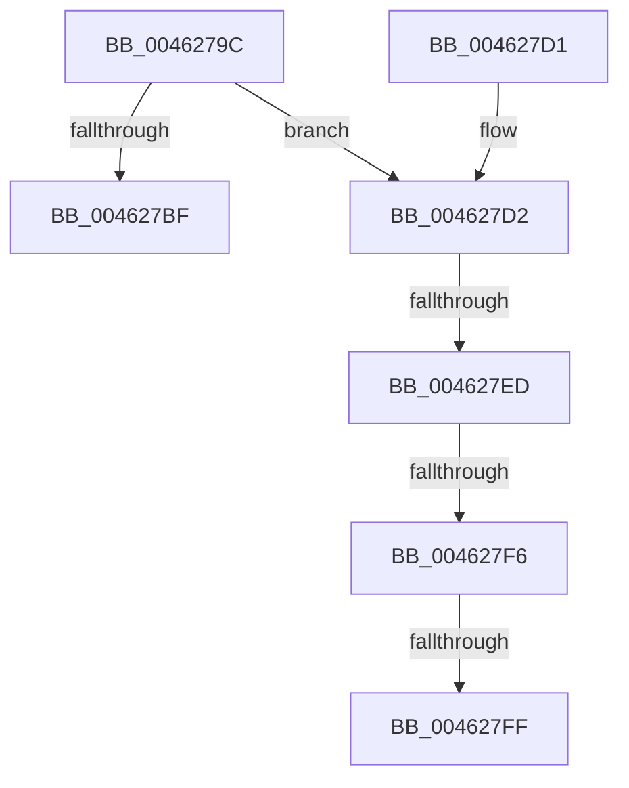

# KiEventClockStateChange

- RVA: `0x0046279C`–`0x0046280F` (길이 `115` bytes)
- VA: `0x000000014046279C`
- 실행 섹션: `.text`
- PDB 이름 있음: `예`; PDB Function 태그: `예`
- unwind 정보 RVA: `0x000AA2BC`
- 디코드: `30`개 명령, `115/115` bytes 표시
- 미해석 바이트: `0` (있으면 어셈블리에 `.byte`로 보존)

> 이 문서는 커널 이미지의 기계어와 PDB 기호를 분석해 생성했습니다. 4번과 5번은 함수 원형과 자료형을 바이너리 사용 방식에서 추정한 C 해석이며 원본 소스 복구 결과는 아닙니다.

## 1. Dependencies

- 직접 호출 지점: **1**; 고유 호출 대상: **1**
- 직접 호출자로 확인된 함수: **4**
- RIP 상대 이미지 참조: **3**

### Outgoing calls
- `0x004627C6` → [_security_check_cookie](../6A/_security_check_cookie_function_006AC640.md) (function, `0x006AC640`)

### Direct callers
- [KeClockInterruptNotify](../39/KeClockInterruptNotify_function_0039A970.md) at `0x0039B2E9`
- [KiResumeClockTimer](../4F/KiResumeClockTimer_function_004F6420.md) at `0x004F657A`
- [KePrepareClockTimerForPlatformIdle](../5B/KePrepareClockTimerForPlatformIdle_function_005BA820.md) at `0x005BAB76`
- [KeResumeClockTimerFromIdle](../5B/KeResumeClockTimerFromIdle_function_005BACC4.md) at `0x005BAF3F`
- [KeResumeClockTimerFromIdle](../5B/KeResumeClockTimerFromIdle_function_005BACC4.md) at `0x005BB11C`
- [KeResumeClockTimerFromIdle](../5B/KeResumeClockTimerFromIdle_function_005BACC4.md) at `0x005BB2C9`

### Static image references
- `0x004627A5` → RVA `0x00E0A740` (`.data`; read)
- `0x004627B3` → RVA `0x00FC6B08` (`ALMOSTRO`; read)
- `0x004627FF` → RVA `0x00F21F88` (`.data`; read)

## 2. Other-region calls and transfers

- 다른 실행 섹션으로 향하는 call: **0**
- call이 아닌 외부 분기/꼬리 이동: **4**
  - `0x004627E7` → [sub_006F27C2](../6F/Unknown_function_006F27C2.md) (`tail-transfer`)
  - `0x004627F0` → [sub_006F27C2](../6F/Unknown_function_006F27C2.md) (`tail-transfer`)
  - `0x004627F9` → [sub_006F27C2 + 0xE](../6F/Unknown_function_006F27C2.md) (`tail-transfer`)
  - `0x0046280A` → [sub_006F27C2 + 0xE](../6F/Unknown_function_006F27C2.md) (`tail-transfer`)

## 3. Assembly (complete function range)

```asm
0046279C  40 55                           push rbp
0046279E  48 8B EC                        mov rbp, rsp
004627A1  48 83 EC 60                     sub rsp, 0x60
004627A5  48 8B 05 94 7F 9A 00            mov rax, qword ptr [rip + 0x9a7f94]
004627AC  48 33 C4                        xor rax, rsp
004627AF  48 89 45 F8                     mov qword ptr [rbp - 8], rax
004627B3  F7 05 4B 43 B6 00 00 00 10 00   test dword ptr [rip + 0xb6434b], 0x100000
004627BD  75 13                           jne 0x1404627d2
004627BF  48 8B 4D F8                     mov rcx, qword ptr [rbp - 8]
004627C3  48 33 CC                        xor rcx, rsp
004627C6  E8 75 9E 24 00                  call 0x1406ac640
004627CB  48 83 C4 60                     add rsp, 0x60
004627CF  5D                              pop rbp
004627D0  C3                              ret
004627D1  CC                              int3
004627D2  33 C0                           xor eax, eax
004627D4  0F 57 C0                        xorps xmm0, xmm0
004627D7  48 89 45 E0                     mov qword ptr [rbp - 0x20], rax
004627DB  0F 11 45 D0                     movups xmmword ptr [rbp - 0x30], xmm0
004627DF  88 4D D0                        mov byte ptr [rbp - 0x30], cl
004627E2  88 55 D1                        mov byte ptr [rbp - 0x2f], dl
004627E5  85 C9                           test ecx, ecx
004627E7  0F 84 D5 FF 28 00               je 0x1406f27c2
004627ED  83 E9 01                        sub ecx, 1
004627F0  0F 84 CC FF 28 00               je 0x1406f27c2
004627F6  83 F9 01                        cmp ecx, 1
004627F9  0F 85 D1 FF 28 00               jne 0x1406f27d0
004627FF  48 8B 05 82 F7 AB 00            mov rax, qword ptr [rip + 0xabf782]
00462806  48 89 45 D8                     mov qword ptr [rbp - 0x28], rax
0046280A  E9 C1 FF 28 00                  jmp 0x1406f27d0
```

## 4. C-style interpretation (structured pseudocode)

```c
__int64 __fastcall KiEventClockStateChange(__int64 a1, unsigned __int8 a2)
{
    __int64 result;
    __int64 v_rsp;
    unsigned __int64 v_stack_m10;
    unsigned __int64 v_stack_m28;
    unsigned __int64 v_stack_m30;
    unsigned __int8 v_stack_m37;
    unsigned __int64 v_stack_m38;

    v_rsp = (v_rsp) - (96);
    result = (*(unsigned __int64 *)(v_rip + 10125204)) ^ (v_rsp);
    v_stack_m10 = result;
    if (((*(unsigned int *)(v_rip + 11944779)) & (0x100000ULL)) != 0) goto loc_004627D2;
    a1 = (v_stack_m10) ^ (v_rsp);
    result = _security_check_cookie(a1, a2, a3, a4);
    v_rsp = (v_rsp) + (96);
    return result;
loc_004627D2:
    result = 0;
    v_stack_m28 = 0;
    v_stack_m38 = v_xmm0;
    v_stack_m38 = (unsigned __int8)(a1);
    v_stack_m37 = a2;
    a1 = (unsigned int)((a1) - (1));
    v_stack_m30 = *(unsigned __int64 *)(v_rip + 11270018);
}
```

## 5. (Beta) C Style

```c
int64_t KiEventClockStateChange(int64_t Arg1, uint8_t Arg2)
{
    int64_t result;
    int64_t local_rsp;
    uint64_t v_stack_m10;
    uint64_t v_stack_m28;
    uint64_t v_stack_m30;
    uint8_t v_stack_m37;
    uint64_t v_stack_m38;

    local_rsp = (local_rsp) - (96);
    result = (*(uint64_t *)(v_rip + 0x9A7F94)) ^ (local_rsp);
    v_stack_m10 = result;
    if (((*(uint32_t *)(v_rip + 0xB6434B)) & (0x100000ULL)) != 0) goto loc_004627D2;
    Arg1 = (v_stack_m10) ^ (local_rsp);
    result = _security_check_cookie(Arg1, Arg2, a3, a4);
    local_rsp = (local_rsp) + (96);
    return result;
loc_004627D2:
    result = 0;
    v_stack_m28 = 0;
    v_stack_m38 = v_xmm0;
    v_stack_m38 = (uint8_t)(Arg1);
    v_stack_m37 = Arg2;
    Arg1 = (uint32_t)((Arg1) - (1));
    v_stack_m30 = *(uint64_t *)(v_rip + 0xABF782);
}
```

## 6. Execution-region graph

[열기: 2D/3D 그래프와 함수 탐색 컨트롤 패널](../../../control-panel.html?section=text&rva=0x0046279C&view=graph)

- 2D 그래프는 위에서 아래로 흐르고, 3D 그래프는 빈 공간을 드래그해 회전합니다. Shift+드래그는 이동, 휠은 확대·축소, 함수 노드 선택은 대상 보고서 이동입니다.

### Static fallback


