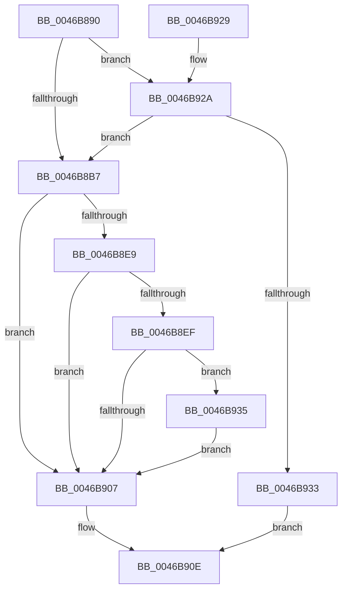

# KiFreezeSingleThread

- RVA: `0x0046B890`–`0x0046B95D` (길이 `205` bytes)
- VA: `0x000000014046B890`
- 실행 섹션: `.text`
- PDB 이름 있음: `예`; PDB Function 태그: `아니요`
- unwind 정보 RVA: `0x000AB520`
- 디코드: `57`개 명령, `205/205` bytes 표시
- 미해석 바이트: `0` (있으면 어셈블리에 `.byte`로 보존)

> 이 문서는 커널 이미지의 기계어와 PDB 기호를 분석해 생성했습니다. 4번과 5번은 함수 원형과 자료형을 바이너리 사용 방식에서 추정한 C 해석이며 원본 소스 복구 결과는 아닙니다.

## 1. Dependencies

- 직접 호출 지점: **2**; 고유 호출 대상: **2**
- 직접 호출자로 확인된 함수: **2**
- RIP 상대 이미지 참조: **0**

### Outgoing calls
- `0x0046B8C1` → [KiAcquireKobjectLockSafe](../25/KiAcquireKobjectLockSafe_function_00251C90.md) (function, `0x00251C90`)
- `0x0046B8FE` → [KiSuspendThread](KiSuspendThread_function_0046B964.md) (function, `0x0046B964`)

### Direct callers
- [KeStartThread](../3C/KeStartThread_function_003C21B8.md) at `0x003C25F9`
- [KeStartThread](../3C/KeStartThread_function_003C21B8.md) at `0x003C2622`
- [KeFreezeProcess](KeFreezeProcess_function_0046B774.md) at `0x0046B82E`

### Static image references
- 디코드된 RIP-relative 메모리 참조가 없습니다.

## 2. Other-region calls and transfers

- 다른 실행 섹션으로 향하는 call: **0**
- 별도 외부 분기/꼬리 이동을 확인하지 못했습니다.

## 3. Assembly (complete function range)

```asm
0046B890  48 8B C4                        mov rax, rsp
0046B893  48 89 58 08                     mov qword ptr [rax + 8], rbx
0046B897  48 89 68 10                     mov qword ptr [rax + 0x10], rbp
0046B89B  48 89 70 18                     mov qword ptr [rax + 0x18], rsi
0046B89F  48 89 78 20                     mov qword ptr [rax + 0x20], rdi
0046B8A3  41 56                           push r14
0046B8A5  48 83 EC 20                     sub rsp, 0x20
0046B8A9  41 8A E8                        mov bpl, r8b
0046B8AC  48 8B DA                        mov rbx, rdx
0046B8AF  4C 8B F1                        mov r14, rcx
0046B8B2  45 84 C0                        test r8b, r8b
0046B8B5  74 73                           je 0x14046b92a
0046B8B7  48 8D B2 E0 02 00 00            lea rsi, [rdx + 0x2e0]
0046B8BE  48 8B CE                        mov rcx, rsi
0046B8C1  E8 CA 63 DE FF                  call 0x140251c90
0046B8C6  40 8A BB 1A 03 00 00            mov dil, byte ptr [rbx + 0x31a]
0046B8CD  40 F6 DD                        neg bpl
0046B8D0  40 B5 02                        mov bpl, 2
0046B8D3  1A C0                           sbb al, al
0046B8D5  40 22 C5                        and al, bpl
0046B8D8  40 02 C5                        add al, bpl
0046B8DB  40 0A C7                        or al, dil
0046B8DE  88 83 1A 03 00 00               mov byte ptr [rbx + 0x31a], al
0046B8E4  40 84 FD                        test bpl, dil
0046B8E7  75 1E                           jne 0x14046b907
0046B8E9  40 F6 C7 04                     test dil, 4
0046B8ED  75 18                           jne 0x14046b907
0046B8EF  F0 0F BA 6B 78 0E               lock bts dword ptr [rbx + 0x78], 0xe
0046B8F5  45 33 C0                        xor r8d, r8d
0046B8F8  49 8B D6                        mov rdx, r14
0046B8FB  48 8B CB                        mov rcx, rbx
0046B8FE  E8 61 00 00 00                  call 0x14046b964
0046B903  84 C0                           test al, al
0046B905  74 2E                           je 0x14046b935
0046B907  F0 81 26 7F FF FF FF            lock and dword ptr [rsi], 0xffffff7f
0046B90E  48 8B 5C 24 30                  mov rbx, qword ptr [rsp + 0x30]
0046B913  48 8B 6C 24 38                  mov rbp, qword ptr [rsp + 0x38]
0046B918  48 8B 74 24 40                  mov rsi, qword ptr [rsp + 0x40]
0046B91D  48 8B 7C 24 48                  mov rdi, qword ptr [rsp + 0x48]
0046B922  48 83 C4 20                     add rsp, 0x20
0046B926  41 5E                           pop r14
0046B928  C3                              ret
0046B929  CC                              int3
0046B92A  F7 42 74 00 00 20 00            test dword ptr [rdx + 0x74], 0x200000
0046B931  74 84                           je 0x14046b8b7
0046B933  EB D9                           jmp 0x14046b90e
0046B935  F0 0F BA 73 78 0E               lock btr dword ptr [rbx + 0x78], 0xe
0046B93B  8A 83 1A 03 00 00               mov al, byte ptr [rbx + 0x31a]
0046B941  8A C8                           mov cl, al
0046B943  40 32 CF                        xor cl, dil
0046B946  80 E1 04                        and cl, 4
0046B949  32 C8                           xor cl, al
0046B94B  40 32 F9                        xor dil, cl
0046B94E  40 22 FD                        and dil, bpl
0046B951  40 32 F9                        xor dil, cl
0046B954  40 88 BB 1A 03 00 00            mov byte ptr [rbx + 0x31a], dil
0046B95B  EB AA                           jmp 0x14046b907
```

## 4. C-style interpretation (structured pseudocode)

```c
__int64 __fastcall KiFreezeSingleThread(__int64 a1, __int64 a2, int a3)
{
    __int64 result;
    __int64 v_rbp;
    __int64 v_rdi;
    __int64 v_rsp;
    unsigned __int64 v_stack_p10;
    unsigned __int64 v_stack_p18;
    unsigned __int64 v_stack_p20;
    unsigned __int64 v_stack_p8;

    *(unsigned __int64 *)(v_rsp + 8) = v_rbx;
    *(unsigned __int64 *)(v_rsp + 16) = v_rbp;
    *(unsigned __int64 *)(v_rsp + 24) = v_rsi;
    *(unsigned __int64 *)(v_rsp + 32) = v_rdi;
    v_rsp = (v_rsp) - (32);
    if ((unsigned __int8)(a3) == 0) goto loc_0046B92A;
loc_0046B8B7:
    result = KiAcquireKobjectLockSafe(a2 + 736, a2, a3, a4);
    v_rbp = (unsigned __int8)(-((unsigned __int8)(a3)));
    result = (unsigned __int8)((result) & (2));
    result = (unsigned __int8)((result) + (2));
    result = (unsigned __int8)((result) | ((unsigned __int8)(*(unsigned __int8 *)(a2 + 794))));
    *(unsigned __int8 *)(a2 + 794) = (unsigned __int8)(result);
    if (((2) & ((unsigned __int8)(*(unsigned __int8 *)(a2 + 794)))) != 0) goto loc_0046B907;
    if ((((unsigned __int8)(*(unsigned __int8 *)(a2 + 794))) & (4)) != 0) goto loc_0046B907;
    a3 = 0;
    result = KiSuspendThread(a2, a1, a3, a4);
    if ((unsigned __int8)(result) == 0) goto loc_0046B935;
loc_0046B907:
loc_0046B90E:
    v_rsp = (v_rsp) + (32);
    return result;
loc_0046B92A:
    if (((*(unsigned int *)(a1 + 116)) & (0x200000ULL)) == 0) goto loc_0046B8B7;
    goto loc_0046B90E;
loc_0046B935:
    a1 = (unsigned __int8)(((unsigned __int8)(*(unsigned __int8 *)(v_stack_p8 + 794))) ^ ((unsigned __int8)(v_stack_p20)));
    a1 = (unsigned __int8)((a1) & (4));
    a1 = (unsigned __int8)((a1) ^ ((unsigned __int8)(*(unsigned __int8 *)(v_stack_p8 + 794))));
    v_rdi = (unsigned __int8)((v_stack_p20) ^ ((unsigned __int8)(a1)));
    v_rdi = (unsigned __int8)((v_rdi) & ((unsigned __int8)(v_stack_p10)));
    v_rdi = (unsigned __int8)((v_rdi) ^ ((unsigned __int8)(a1)));
    *(unsigned __int8 *)(v_stack_p8 + 794) = (unsigned __int8)(v_rdi);
    goto loc_0046B907;
}
```

## 5. (Beta) C Style

```c
int64_t KiFreezeSingleThread(int64_t Arg1, void *Arg2, int32_t Arg3)
{
    uint8_t *arg2 = (uint8_t *)Arg2;

    int64_t result;
    int64_t local_rbp;
    int64_t local_rdi;
    int64_t local_rsp;
    uint64_t v_stack_p10;
    uint64_t v_stack_p18;
    uint64_t v_stack_p20;
    uint64_t v_stack_p8;

    *(uint64_t *)(local_rsp + 0x8) = local_rbx;
    *(uint64_t *)(local_rsp + 0x10) = local_rbp;
    *(uint64_t *)(local_rsp + 0x18) = local_rsi;
    *(uint64_t *)(local_rsp + 0x20) = local_rdi;
    local_rsp = (local_rsp) - (32);
    if ((uint8_t)(Arg3) == 0) goto loc_0046B92A;
loc_0046B8B7:
    result = KiAcquireKobjectLockSafe(Arg2 + 736, Arg2, Arg3, a4);
    local_rbp = (uint8_t)(-((uint8_t)(Arg3)));
    result = (uint8_t)((result) & (2));
    result = (uint8_t)((result) + (2));
    result = (uint8_t)((result) | ((uint8_t)(*(uint8_t *)(arg2 + 0x31A))));
    *(uint8_t *)(arg2 + 0x31A) = (uint8_t)(result);
    if (((2) & ((uint8_t)(*(uint8_t *)(arg2 + 0x31A)))) != 0) goto loc_0046B907;
    if ((((uint8_t)(*(uint8_t *)(arg2 + 0x31A))) & (4)) != 0) goto loc_0046B907;
    Arg3 = 0;
    result = KiSuspendThread(Arg2, Arg1, Arg3, a4);
    if ((uint8_t)(result) == 0) goto loc_0046B935;
loc_0046B907:
loc_0046B90E:
    local_rsp = (local_rsp) + (32);
    return result;
loc_0046B92A:
    if (((*(uint32_t *)(Arg1 + 0x74)) & (0x200000ULL)) == 0) goto loc_0046B8B7;
    goto loc_0046B90E;
loc_0046B935:
    Arg1 = (uint8_t)(((uint8_t)(*(uint8_t *)(v_stack_p8 + 0x31A))) ^ ((uint8_t)(v_stack_p20)));
    Arg1 = (uint8_t)((Arg1) & (4));
    Arg1 = (uint8_t)((Arg1) ^ ((uint8_t)(*(uint8_t *)(v_stack_p8 + 0x31A))));
    local_rdi = (uint8_t)((v_stack_p20) ^ ((uint8_t)(Arg1)));
    local_rdi = (uint8_t)((local_rdi) & ((uint8_t)(v_stack_p10)));
    local_rdi = (uint8_t)((local_rdi) ^ ((uint8_t)(Arg1)));
    *(uint8_t *)(v_stack_p8 + 0x31A) = (uint8_t)(local_rdi);
    goto loc_0046B907;
}
```

### 관측된 메모리 오프셋

구조체 형식이 확인되지 않은 접근은 인자 기준의 오프셋으로만 기록했습니다.

| 기준 인자 | 오프셋 표현 | 폭 (bit) | 접근 |
|---|---:|---:|---|
| `Arg2` | `+ 0x0` | `32` | `R/W` |
| `Arg2` | `+ 0x74` | `32` | `R` |
| `Arg2` | `+ 0x78` | `32` | `R/W` |
| `Arg2` | `+ 0x2E0` | `64` | `R` |
| `Arg2` | `+ 0x31A` | `8` | `R` |
| `Arg2` | `+ 0x31A` | `8` | `W` |

## 6. Execution-region graph

[열기: 2D/3D 그래프와 함수 탐색 컨트롤 패널](../../../control-panel.html?section=text&rva=0x0046B890&view=graph)

- 2D 그래프는 위에서 아래로 흐르고, 3D 그래프는 빈 공간을 드래그해 회전합니다. Shift+드래그는 이동, 휠은 확대·축소, 함수 노드 선택은 대상 보고서 이동입니다.

### Static fallback


