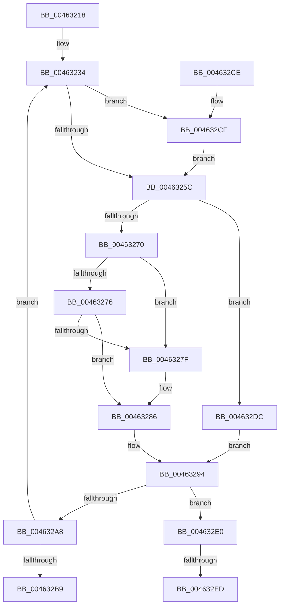

# KiInSwapProcesses

- RVA: `0x00463218`–`0x004632FF` (길이 `231` bytes)
- VA: `0x0000000140463218`
- 실행 섹션: `.text`
- PDB 이름 있음: `예`; PDB Function 태그: `예`
- unwind 정보 RVA: `0x0007BA6C`
- 디코드: `61`개 명령, `231/231` bytes 표시
- 미해석 바이트: `0` (있으면 어셈블리에 `.byte`로 보존)

> 이 문서는 커널 이미지의 기계어와 PDB 기호를 분석해 생성했습니다. 4번과 5번은 함수 원형과 자료형을 바이너리 사용 방식에서 추정한 C 해석이며 원본 소스 복구 결과는 아닙니다.

## 1. Dependencies

- 직접 호출 지점: **5**; 고유 호출 대상: **5**
- 직접 호출자로 확인된 함수: **1**
- RIP 상대 이미지 참조: **1**

### Outgoing calls
- `0x00463246` → [MmInSwapProcess](MmInSwapProcess_function_00463308.md) (function, `0x00463308`)
- `0x0046325F` → [KiAcquireKobjectLockSafe](../25/KiAcquireKobjectLockSafe_function_00251C90.md) (function, `0x00251C90`)
- `0x004632AB` → [KiReadyOutSwappedThreads](../39/KiReadyOutSwappedThreads_function_00396E30.md) (function, `0x00396E30`)
- `0x004632D5` → [KiRaiseIrqlProcessIrqlFlags](../4F/KiRaiseIrqlProcessIrqlFlags_function_004F56FC.md) (function, `0x004F56FC`)
- `0x004632F4` → [KiLowerIrqlProcessIrqlFlags](../4F/KiLowerIrqlProcessIrqlFlags_function_004F5698.md) (function, `0x004F5698`)

### Direct callers
- [KeSwapProcessOrStack](../5C/KeSwapProcessOrStack_function_005C5E00.md) at `0x005C5E84`

### Static image references
- `0x00463253` → RVA `0x00FC6D20` (`ALMOSTRO`; read)

## 2. Other-region calls and transfers

- 다른 실행 섹션으로 향하는 call: **0**
- call이 아닌 외부 분기/꼬리 이동: **2**
  - `0x004632E7` → [sub_006F28B0](../6F/Unknown_function_006F28B0.md) (`tail-transfer`)
  - `0x004632FA` → [sub_006F28B0](../6F/Unknown_function_006F28B0.md) (`tail-transfer`)

## 3. Assembly (complete function range)

```asm
00463218  48 89 5C 24 08                  mov qword ptr [rsp + 8], rbx
0046321D  48 89 6C 24 10                  mov qword ptr [rsp + 0x10], rbp
00463222  48 89 74 24 18                  mov qword ptr [rsp + 0x18], rsi
00463227  57                              push rdi
00463228  48 83 EC 20                     sub rsp, 0x20
0046322C  48 8B F1                        mov rsi, rcx
0046322F  BD 02 00 00 00                  mov ebp, 2
00463234  48 8D 5E 88                     lea rbx, [rsi - 0x78]
00463238  48 8B 36                        mov rsi, qword ptr [rsi]
0046323B  F0 83 B3 08 01 00 00 06         lock xor dword ptr [rbx + 0x108], 6
00463243  48 8B CB                        mov rcx, rbx
00463246  E8 BD 00 00 00                  call 0x140463308
0046324B  44 0F 20 C7                     mov rdi, cr8
0046324F  44 0F 22 C5                     mov cr8, rbp
00463253  83 3D C6 3A B6 00 00            cmp dword ptr [rip + 0xb63ac6], 0
0046325A  75 73                           jne 0x1404632cf
0046325C  48 8B CB                        mov rcx, rbx
0046325F  E8 2C EA DE FF                  call 0x140251c90
00463264  48 8D 43 68                     lea rax, [rbx + 0x68]
00463268  48 8B 08                        mov rcx, qword ptr [rax]
0046326B  48 3B C8                        cmp rcx, rax
0046326E  74 6C                           je 0x1404632dc
00463270  48 39 41 08                     cmp qword ptr [rcx + 8], rax
00463274  75 09                           jne 0x14046327f
00463276  48 8B 50 08                     mov rdx, qword ptr [rax + 8]
0046327A  48 39 02                        cmp qword ptr [rdx], rax
0046327D  74 07                           je 0x140463286
0046327F  B9 03 00 00 00                  mov ecx, 3
00463284  CD 29                           int 0x29
00463286  48 89 0A                        mov qword ptr [rdx], rcx
00463289  48 89 51 08                     mov qword ptr [rcx + 8], rdx
0046328D  48 89 40 08                     mov qword ptr [rax + 8], rax
00463291  48 89 00                        mov qword ptr [rax], rax
00463294  F0 83 B3 08 01 00 00 04         lock xor dword ptr [rbx + 0x108], 4
0046329C  F0 81 23 7F FF FF FF            lock and dword ptr [rbx], 0xffffff7f
004632A3  48 85 C9                        test rcx, rcx
004632A6  74 38                           je 0x1404632e0
004632A8  40 8A D7                        mov dl, dil
004632AB  E8 80 3B F3 FF                  call 0x140396e30
004632B0  48 85 F6                        test rsi, rsi
004632B3  0F 85 7B FF FF FF               jne 0x140463234
004632B9  48 8B 5C 24 30                  mov rbx, qword ptr [rsp + 0x30]
004632BE  48 8B 6C 24 38                  mov rbp, qword ptr [rsp + 0x38]
004632C3  48 8B 74 24 40                  mov rsi, qword ptr [rsp + 0x40]
004632C8  48 83 C4 20                     add rsp, 0x20
004632CC  5F                              pop rdi
004632CD  C3                              ret
004632CE  CC                              int3
004632CF  40 8A D5                        mov dl, bpl
004632D2  40 8A CF                        mov cl, dil
004632D5  E8 22 24 09 00                  call 0x1404f56fc
004632DA  EB 80                           jmp 0x14046325c
004632DC  33 C9                           xor ecx, ecx
004632DE  EB B4                           jmp 0x140463294
004632E0  83 3D 39 3A B6 00 00            cmp dword ptr [rip + 0xb63a39], 0
004632E7  0F 84 C3 F5 28 00               je 0x1406f28b0
004632ED  44 0F 20 C1                     mov rcx, cr8
004632F1  40 8A D7                        mov dl, dil
004632F4  E8 9F 23 09 00                  call 0x1404f5698
004632F9  90                              nop
004632FA  E9 B1 F5 28 00                  jmp 0x1406f28b0
```

## 4. C-style interpretation (structured pseudocode)

```c
__int64 __fastcall KiInSwapProcesses(__int64 a1)
{
    __int64 result;
    __int64 v_rsp;
    unsigned __int64 v_stack_p10;
    unsigned __int64 v_stack_p18;
    unsigned __int64 v_stack_p8;

    v_stack_p8 = v_rbx;
    v_stack_p10 = v_rbp;
    v_stack_p18 = v_rsi;
    v_rsp = (v_rsp) - (32);
loc_00463234:
    result = MmInSwapProcess(a1 - 120, a2, a3, a4);
    if ((*(unsigned int *)(v_rip + 11942598)) != 0) goto loc_004632CF;
loc_0046325C:
    result = KiAcquireKobjectLockSafe(a1 - 120, a2, a3, a4);
    if ((*(unsigned __int64 *)(a1 - 120 + 104)) == (a1 - 120 + 104)) goto loc_004632DC;
    if ((*(unsigned __int64 *)(*(unsigned __int64 *)(a1 - 120 + 104) + 8)) != (a1 - 120 + 104)) goto loc_0046327F;
    if ((*(unsigned __int64 *)(*(unsigned __int64 *)(a1 - 120 + 104 + 8))) != (a1 - 120 + 104)) {
        a1 = 3;
    }
    *(unsigned __int64 *)(*(unsigned __int64 *)(a1 - 120 + 104 + 8)) = a1;
    *(unsigned __int64 *)(a1 + 8) = *(unsigned __int64 *)(a1 - 120 + 104 + 8);
    *(unsigned __int64 *)(a1 - 120 + 104 + 8) = a1 - 120 + 104;
    *(unsigned __int64 *)(a1 - 120 + 104) = a1 - 120 + 104;
loc_00463294:
    if (a1 == 0) goto loc_004632E0;
    result = KiReadyOutSwappedThreads(a1, (unsigned __int8)(v_cr8), a3, a4);
    if (*(unsigned __int64 *)(a1) != 0) goto loc_00463234;
    v_rsp = (v_rsp) + (32);
    return result;
loc_004632CF:
    result = KiRaiseIrqlProcessIrqlFlags((unsigned __int8)(v_cr8), (unsigned __int8)(v_stack_p10), a3, a4);
    goto loc_0046325C;
loc_004632DC:
    a1 = 0;
    goto loc_00463294;
loc_004632E0:
    result = KiLowerIrqlProcessIrqlFlags(2, (unsigned __int8)(v_cr8), a3, a4);
}
```

## 5. (Beta) C Style

```c
int64_t KiInSwapProcesses(int64_t Arg1)
{
    int64_t result;
    int64_t local_rsp;
    uint64_t v_stack_p10;
    uint64_t v_stack_p18;
    uint64_t v_stack_p8;

    v_stack_p8 = local_rbx;
    v_stack_p10 = local_rbp;
    v_stack_p18 = local_rsi;
    local_rsp = (local_rsp) - (32);
loc_00463234:
    result = MmInSwapProcess(Arg1 - 120, a2, a3, a4);
    if ((*(uint32_t *)(v_rip + 0xB63AC6)) != 0) goto loc_004632CF;
loc_0046325C:
    result = KiAcquireKobjectLockSafe(Arg1 - 120, a2, a3, a4);
    if ((*(uint64_t *)(Arg1 - 0x78 + 0x68)) == (Arg1 - 120 + 104)) goto loc_004632DC;
    if ((*(uint64_t *)(*(uint64_t *)(Arg1 - 0x78 + 0x68) + 0x8)) != (Arg1 - 120 + 104)) goto loc_0046327F;
    if ((*(uint64_t *)(*(uint64_t *)(Arg1 - 0x78 + 0x68 + 0x8))) != (Arg1 - 120 + 104)) {
        Arg1 = 3;
    }
    *(uint64_t *)(*(uint64_t *)(Arg1 - 0x78 + 0x68 + 0x8)) = Arg1;
    *(uint64_t *)(Arg1 + 0x8) = *(uint64_t *)(Arg1 - 0x78 + 0x68 + 0x8);
    *(uint64_t *)(Arg1 - 0x78 + 0x68 + 0x8) = Arg1 - 120 + 104;
    *(uint64_t *)(Arg1 - 0x78 + 0x68) = Arg1 - 120 + 104;
loc_00463294:
    if (Arg1 == 0) goto loc_004632E0;
    result = KiReadyOutSwappedThreads(Arg1, (uint8_t)(v_cr8), a3, a4);
    if (*(uint64_t *)(Arg1) != 0) goto loc_00463234;
    local_rsp = (local_rsp) + (32);
    return result;
loc_004632CF:
    result = KiRaiseIrqlProcessIrqlFlags((uint8_t)(v_cr8), (uint8_t)(v_stack_p10), a3, a4);
    goto loc_0046325C;
loc_004632DC:
    Arg1 = 0;
    goto loc_00463294;
loc_004632E0:
    result = KiLowerIrqlProcessIrqlFlags(2, (uint8_t)(v_cr8), a3, a4);
}
```

## 6. Execution-region graph

[열기: 2D/3D 그래프와 함수 탐색 컨트롤 패널](../../../control-panel.html?section=text&rva=0x00463218&view=graph)

- 2D 그래프는 위에서 아래로 흐르고, 3D 그래프는 빈 공간을 드래그해 회전합니다. Shift+드래그는 이동, 휠은 확대·축소, 함수 노드 선택은 대상 보고서 이동입니다.

### Static fallback


