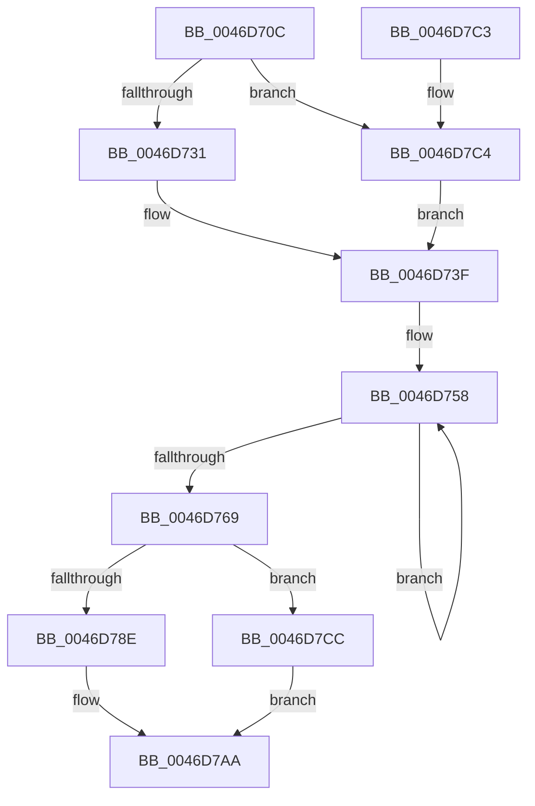

# KiInitializeScb

- RVA: `0x0046D70C`–`0x0046D7DC` (길이 `208` bytes)
- VA: `0x000000014046D70C`
- 실행 섹션: `.text`
- PDB 이름 있음: `예`; PDB Function 태그: `아니요`
- unwind 정보 RVA: `0x000ABA64`
- 디코드: `49`개 명령, `208/208` bytes 표시
- 미해석 바이트: `0` (있으면 어셈블리에 `.byte`로 보존)

> 이 문서는 커널 이미지의 기계어와 PDB 기호를 분석해 생성했습니다. 4번과 5번은 함수 원형과 자료형을 바이너리 사용 방식에서 추정한 C 해석이며 원본 소스 복구 결과는 아닙니다.

## 1. Dependencies

- 직접 호출 지점: **1**; 고유 호출 대상: **1**
- 직접 호출자로 확인된 함수: **1**
- RIP 상대 이미지 참조: **1**

### Outgoing calls
- `0x0046D747` → [memset](../6C/memset_function_006C6C40.md) (function, `0x006C6C40`)

### Direct callers
- [KeInsertSchedulingGroup](KeInsertSchedulingGroup_function_0046D324.md) at `0x0046D3C3`

### Static image references
- `0x0046D769` → RVA `0x00FC52D0` (`ALMOSTRO`; read)

## 2. Other-region calls and transfers

- 다른 실행 섹션으로 향하는 call: **0**
- 별도 외부 분기/꼬리 이동을 확인하지 못했습니다.

## 3. Assembly (complete function range)

```asm
0046D70C  48 89 5C 24 08                  mov qword ptr [rsp + 8], rbx
0046D711  48 89 6C 24 10                  mov qword ptr [rsp + 0x10], rbp
0046D716  48 89 74 24 18                  mov qword ptr [rsp + 0x18], rsi
0046D71B  57                              push rdi
0046D71C  48 83 EC 20                     sub rsp, 0x20
0046D720  33 FF                           xor edi, edi
0046D722  41 8B E9                        mov ebp, r9d
0046D725  48 8B D9                        mov rbx, rcx
0046D728  4D 85 C0                        test r8, r8
0046D72B  0F 84 93 00 00 00               je 0x14046d7c4
0046D731  48 69 F5 B8 01 00 00            imul rsi, rbp, 0x1b8
0046D738  48 83 EE 80                     sub rsi, -0x80
0046D73C  49 03 F0                        add rsi, r8
0046D73F  33 D2                           xor edx, edx
0046D741  41 B8 B8 01 00 00               mov r8d, 0x1b8
0046D747  E8 F4 94 25 00                  call 0x1406c6c40
0046D74C  48 8D 83 90 00 00 00            lea rax, [rbx + 0x90]
0046D753  B9 10 00 00 00                  mov ecx, 0x10
0046D758  48 89 40 08                     mov qword ptr [rax + 8], rax
0046D75C  48 89 00                        mov qword ptr [rax], rax
0046D75F  48 83 C0 10                     add rax, 0x10
0046D763  48 83 E9 01                     sub rcx, 1
0046D767  75 EF                           jne 0x14046d758
0046D769  48 8B 05 60 7B B5 00            mov rax, qword ptr [rip + 0xb57b60]
0046D770  48 89 43 08                     mov qword ptr [rbx + 8], rax
0046D774  48 89 43 10                     mov qword ptr [rbx + 0x10], rax
0046D778  48 89 BB 90 01 00 00            mov qword ptr [rbx + 0x190], rdi
0046D77F  48 89 BB 98 01 00 00            mov qword ptr [rbx + 0x198], rdi
0046D786  89 6B 74                        mov dword ptr [rbx + 0x74], ebp
0046D789  48 85 F6                        test rsi, rsi
0046D78C  74 3E                           je 0x14046d7cc
0046D78E  48 89 B3 A0 01 00 00            mov qword ptr [rbx + 0x1a0], rsi
0046D795  48 8B 86 A8 01 00 00            mov rax, qword ptr [rsi + 0x1a8]
0046D79C  48 89 83 A8 01 00 00            mov qword ptr [rbx + 0x1a8], rax
0046D7A3  40 8A 7E 72                     mov dil, byte ptr [rsi + 0x72]
0046D7A7  40 FE C7                        inc dil
0046D7AA  40 88 7B 72                     mov byte ptr [rbx + 0x72], dil
0046D7AE  48 8B 5C 24 30                  mov rbx, qword ptr [rsp + 0x30]
0046D7B3  48 8B 6C 24 38                  mov rbp, qword ptr [rsp + 0x38]
0046D7B8  48 8B 74 24 40                  mov rsi, qword ptr [rsp + 0x40]
0046D7BD  48 83 C4 20                     add rsp, 0x20
0046D7C1  5F                              pop rdi
0046D7C2  C3                              ret
0046D7C3  CC                              int3
0046D7C4  48 8B F7                        mov rsi, rdi
0046D7C7  E9 73 FF FF FF                  jmp 0x14046d73f
0046D7CC  48 89 BB A0 01 00 00            mov qword ptr [rbx + 0x1a0], rdi
0046D7D3  48 89 9B A8 01 00 00            mov qword ptr [rbx + 0x1a8], rbx
0046D7DA  EB CE                           jmp 0x14046d7aa
```

## 4. C-style interpretation (structured pseudocode)

```c
__int64 __fastcall KiInitializeScb(__int64 a1, int a2, __int64 a3, int a4)
{
    __int64 result;
    __int64 v_rdi;
    __int64 v_rsi;
    __int64 v_rsp;
    unsigned __int64 v_stack_p10;
    unsigned __int64 v_stack_p18;
    unsigned __int64 v_stack_p8;

    v_stack_p8 = v_rbx;
    v_stack_p10 = v_rbp;
    v_stack_p18 = v_rsi;
    v_rsp = (v_rsp) - (32);
    v_rdi = 0;
    if (a3 == 0) goto loc_0046D7C4;
    v_rsi = (v_rsi) * ((unsigned int)(a4));
    v_rsi = (v_rsi) - (-128);
    v_rsi = (v_rsi) + (a3);
loc_0046D73F:
    a2 = 0;
    result = memset(a1, a2, 440, a4);
loc_0046D758:
    *(unsigned __int64 *)(a1 + 144 + 8) = a1 + 144;
    *(unsigned __int64 *)(a1 + 144) = a1 + 144;
    result = (a1 + 144) + (16);
    a1 = (16) - (1);
    if (condition_is_not_equal) goto loc_0046D758;
    *(unsigned __int64 *)(a1 + 8) = *(unsigned __int64 *)(v_rip + 11893600);
    *(unsigned __int64 *)(a1 + 16) = *(unsigned __int64 *)(v_rip + 11893600);
    *(unsigned __int64 *)(a1 + 400) = 0;
    *(unsigned __int64 *)(a1 + 408) = 0;
    *(unsigned int *)(a1 + 116) = (unsigned int)((unsigned int)(a4));
    if (v_rsi == 0) goto loc_0046D7CC;
    *(unsigned __int64 *)(a1 + 416) = v_rsi;
    *(unsigned __int64 *)(a1 + 424) = *(unsigned __int64 *)(v_rsi + 424);
    v_rdi = (unsigned __int8)((*(unsigned __int8 *)(v_rsi + 114)) + 1);
loc_0046D7AA:
    *(unsigned __int8 *)(a1 + 114) = (unsigned __int8)(v_rdi);
    v_rsp = (v_rsp) + (32);
    return *(unsigned __int64 *)(v_rsi + 424);
loc_0046D7C4:
    goto loc_0046D73F;
loc_0046D7CC:
    *(unsigned __int64 *)(v_stack_p8 + 416) = v_rdi;
    *(unsigned __int64 *)(v_stack_p8 + 424) = v_stack_p8;
    goto loc_0046D7AA;
}
```

## 5. (Beta) C Style

```c
int64_t KiInitializeScb(void *Arg1, int32_t Arg2, int64_t Arg3, int32_t Arg4)
{
    uint8_t *arg1 = (uint8_t *)Arg1;

    int64_t result;
    int64_t local_rdi;
    int64_t local_rsi;
    int64_t local_rsp;
    uint64_t v_stack_p10;
    uint64_t v_stack_p18;
    uint64_t v_stack_p8;

    v_stack_p8 = local_rbx;
    v_stack_p10 = local_rbp;
    v_stack_p18 = local_rsi;
    local_rsp = (local_rsp) - (32);
    local_rdi = 0;
    if (Arg3 == 0) goto loc_0046D7C4;
    local_rsi = (local_rsi) * ((uint32_t)(Arg4));
    local_rsi = (local_rsi) - (-128);
    local_rsi = (local_rsi) + (Arg3);
loc_0046D73F:
    Arg2 = 0;
    result = memset(Arg1, Arg2, 440, Arg4);
loc_0046D758:
    *(void **)(arg1 + 0x90 + 0x8) = Arg1 + 144;
    *(void **)(arg1 + 0x90) = Arg1 + 144;
    result = (Arg1 + 144) + (16);
    Arg1 = (16) - (1);
    if (condition_is_not_equal) goto loc_0046D758;
    *(uint64_t *)(arg1 + 0x8) = *(uint64_t *)(v_rip + 0xB57B60);
    *(uint64_t *)(arg1 + 0x10) = *(uint64_t *)(v_rip + 0xB57B60);
    *(uint64_t *)(arg1 + 0x190) = 0;
    *(uint64_t *)(arg1 + 0x198) = 0;
    *(uint32_t *)(arg1 + 0x74) = (uint32_t)((uint32_t)(Arg4));
    if (local_rsi == 0) goto loc_0046D7CC;
    *(uint64_t *)(arg1 + 0x1A0) = local_rsi;
    *(uint64_t *)(arg1 + 0x1A8) = *(uint64_t *)(local_rsi + 0x1A8);
    local_rdi = (uint8_t)((*(uint8_t *)(local_rsi + 0x72)) + 1);
loc_0046D7AA:
    *(uint8_t *)(arg1 + 0x72) = (uint8_t)(local_rdi);
    local_rsp = (local_rsp) + (32);
    return *(uint64_t *)(local_rsi + 0x1A8);
loc_0046D7C4:
    goto loc_0046D73F;
loc_0046D7CC:
    *(uint64_t *)(v_stack_p8 + 0x1A0) = local_rdi;
    *(uint64_t *)(v_stack_p8 + 0x1A8) = v_stack_p8;
    goto loc_0046D7AA;
}
```

### 관측된 메모리 오프셋

구조체 형식이 확인되지 않은 접근은 인자 기준의 오프셋으로만 기록했습니다.

| 기준 인자 | 오프셋 표현 | 폭 (bit) | 접근 |
|---|---:|---:|---|
| `Arg1` | `+ 0x0` | `64` | `W` |
| `Arg1` | `+ 0x8` | `64` | `W` |
| `Arg1` | `+ 0x10` | `64` | `W` |
| `Arg1` | `+ 0x72` | `8` | `W` |
| `Arg1` | `+ 0x74` | `32` | `W` |
| `Arg1` | `+ 0x90` | `64` | `R` |
| `Arg1` | `+ 0x190` | `64` | `W` |
| `Arg1` | `+ 0x198` | `64` | `W` |
| `Arg1` | `+ 0x1A0` | `64` | `W` |
| `Arg1` | `+ 0x1A8` | `64` | `W` |

## 6. Execution-region graph

[열기: 2D/3D 그래프와 함수 탐색 컨트롤 패널](../../../control-panel.html?section=text&rva=0x0046D70C&view=graph)

- 2D 그래프는 위에서 아래로 흐르고, 3D 그래프는 빈 공간을 드래그해 회전합니다. Shift+드래그는 이동, 휠은 확대·축소, 함수 노드 선택은 대상 보고서 이동입니다.

### Static fallback


