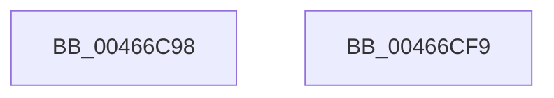

# KiLogClockIncrementUpdate

- RVA: `0x00466C98`–`0x00466CFA` (길이 `98` bytes)
- VA: `0x0000000140466C98`
- 실행 섹션: `.text`
- PDB 이름 있음: `예`; PDB Function 태그: `아니요`
- unwind 정보 RVA: `0x0005CAAC`
- 디코드: `23`개 명령, `98/98` bytes 표시
- 미해석 바이트: `0` (있으면 어셈블리에 `.byte`로 보존)

> 이 문서는 커널 이미지의 기계어와 PDB 기호를 분석해 생성했습니다. 4번과 5번은 함수 원형과 자료형을 바이너리 사용 방식에서 추정한 C 해석이며 원본 소스 복구 결과는 아닙니다.

## 1. Dependencies

- 직접 호출 지점: **1**; 고유 호출 대상: **1**
- 직접 호출자로 확인된 함수: **2**
- RIP 상대 이미지 참조: **0**

### Outgoing calls
- `0x00466CD6` → [KeQueryPerformanceCounter](../37/KeQueryPerformanceCounter_function_0037E7E0.md) (function, `0x0037E7E0`)

### Direct callers
- [KiRestoreClockTickRate](../4D/KiRestoreClockTickRate_function_004D2780.md) at `0x004D28ED`
- [KePrepareClockTimerForPlatformIdle](../5B/KePrepareClockTimerForPlatformIdle_function_005BA820.md) at `0x005BAB51`

### Static image references
- 디코드된 RIP-relative 메모리 참조가 없습니다.

## 2. Other-region calls and transfers

- 다른 실행 섹션으로 향하는 call: **0**
- 별도 외부 분기/꼬리 이동을 확인하지 못했습니다.

## 3. Assembly (complete function range)

```asm
00466C98  48 89 5C 24 08                  mov qword ptr [rsp + 8], rbx
00466C9D  57                              push rdi
00466C9E  48 83 EC 20                     sub rsp, 0x20
00466CA2  8B 81 10 96 00 00               mov eax, dword ptr [rcx + 0x9610]
00466CA8  48 8B F9                        mov rdi, rcx
00466CAB  8B D8                           mov ebx, eax
00466CAD  48 C1 E3 05                     shl rbx, 5
00466CB1  FF C0                           inc eax
00466CB3  83 E0 0F                        and eax, 0xf
00466CB6  89 81 10 96 00 00               mov dword ptr [rcx + 0x9610], eax
00466CBC  44 89 8C 0B 98 98 00 00         mov dword ptr [rbx + rcx + 0x9898], r9d
00466CC4  44 89 84 0B 9C 98 00 00         mov dword ptr [rbx + rcx + 0x989c], r8d
00466CCC  48 89 94 0B A0 98 00 00         mov qword ptr [rbx + rcx + 0x98a0], rdx
00466CD4  33 C9                           xor ecx, ecx
00466CD6  E8 05 7B F1 FF                  call 0x14037e7e0
00466CDB  48 89 84 3B A8 98 00 00         mov qword ptr [rbx + rdi + 0x98a8], rax
00466CE3  8A 44 24 50                     mov al, byte ptr [rsp + 0x50]
00466CE7  88 84 3B B0 98 00 00            mov byte ptr [rbx + rdi + 0x98b0], al
00466CEE  48 8B 5C 24 30                  mov rbx, qword ptr [rsp + 0x30]
00466CF3  48 83 C4 20                     add rsp, 0x20
00466CF7  5F                              pop rdi
00466CF8  C3                              ret
00466CF9  CC                              int3
```

## 4. C-style interpretation (structured pseudocode)

```c
__int64 __fastcall KiLogClockIncrementUpdate(__int64 a1, __int64 a2, int a3, int a4, unsigned __int8 a5)
{
    __int64 result;
    __int64 v_rbx;
    __int64 v_rsp;
    unsigned __int64 v_stack_p8;

    v_stack_p8 = v_rbx;
    v_rsp = (v_rsp) - (32);
    v_rbx = ((unsigned int)((unsigned int)((unsigned int)(*(unsigned int *)(a1 + 38416))))) << (5);
    result = (unsigned int)(((unsigned int)(*(unsigned int *)(a1 + 38416))) + 1);
    result = (unsigned int)((result) & (15));
    *(unsigned int *)(a1 + 38416) = (unsigned int)(result);
    *(unsigned int *)(v_rbx + a1 * 1 + 39064) = a4;
    *(unsigned int *)(v_rbx + a1 * 1 + 39068) = a3;
    *(unsigned __int64 *)(v_rbx + a1 * 1 + 39072) = a2;
    a1 = 0;
    result = KeQueryPerformanceCounter(a1, a2, a3, a4);
    *(unsigned __int64 *)(v_rbx + a1 * 1 + 39080) = result;
    *(unsigned __int8 *)(v_rbx + a1 * 1 + 39088) = a5;
    v_rsp = (v_rsp) + (32);
    return a5;
}
```

## 5. (Beta) C Style

```c
int64_t KiLogClockIncrementUpdate(void *Arg1, int64_t Arg2, int32_t Arg3, int32_t Arg4, uint8_t Arg5)
{
    uint8_t *arg1 = (uint8_t *)Arg1;

    int64_t result;
    int64_t local_rbx;
    int64_t local_rsp;
    uint64_t v_stack_p8;

    v_stack_p8 = local_rbx;
    local_rsp = (local_rsp) - (32);
    local_rbx = ((uint32_t)((uint32_t)((uint32_t)(*(uint32_t *)(arg1 + 0x9610))))) << (5);
    result = (uint32_t)(((uint32_t)(*(uint32_t *)(arg1 + 0x9610))) + 1);
    result = (uint32_t)((result) & (15));
    *(uint32_t *)(arg1 + 0x9610) = (uint32_t)(result);
    *(uint32_t *)(local_rbx + arg1 * 1 + 0x9898) = Arg4;
    *(uint32_t *)(local_rbx + arg1 * 1 + 0x989C) = Arg3;
    *(uint64_t *)(local_rbx + arg1 * 1 + 0x98A0) = Arg2;
    Arg1 = 0;
    result = KeQueryPerformanceCounter(Arg1, Arg2, Arg3, Arg4);
    *(uint64_t *)(local_rbx + arg1 * 1 + 0x98A8) = result;
    *(uint8_t *)(local_rbx + arg1 * 1 + 0x98B0) = Arg5;
    local_rsp = (local_rsp) + (32);
    return Arg5;
}
```

### 관측된 메모리 오프셋

구조체 형식이 확인되지 않은 접근은 인자 기준의 오프셋으로만 기록했습니다.

| 기준 인자 | 오프셋 표현 | 폭 (bit) | 접근 |
|---|---:|---:|---|
| `Arg1` | `+ 0x9610` | `32` | `R` |
| `Arg1` | `+ 0x9610` | `32` | `W` |

## 6. Execution-region graph

[열기: 2D/3D 그래프와 함수 탐색 컨트롤 패널](../../../control-panel.html?section=text&rva=0x00466C98&view=graph)

- 2D 그래프는 위에서 아래로 흐르고, 3D 그래프는 빈 공간을 드래그해 회전합니다. Shift+드래그는 이동, 휠은 확대·축소, 함수 노드 선택은 대상 보고서 이동입니다.

### Static fallback


