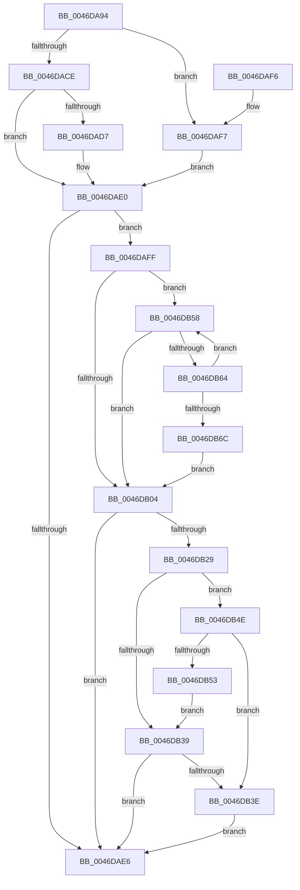

# KiResetScb

- RVA: `0x0046DA94`–`0x0046DB6E` (길이 `218` bytes)
- VA: `0x000000014046DA94`
- 실행 섹션: `.text`
- PDB 이름 있음: `예`; PDB Function 태그: `아니요`
- unwind 정보 RVA: `0x000ABA98`
- 디코드: `67`개 명령, `218/218` bytes 표시
- 미해석 바이트: `0` (있으면 어셈블리에 `.byte`로 보존)

> 이 문서는 커널 이미지의 기계어와 PDB 기호를 분석해 생성했습니다. 4번과 5번은 함수 원형과 자료형을 바이너리 사용 방식에서 추정한 C 해석이며 원본 소스 복구 결과는 아닙니다.

## 1. Dependencies

- 직접 호출 지점: **2**; 고유 호출 대상: **2**
- 직접 호출자로 확인된 함수: **2**
- RIP 상대 이미지 참조: **0**

### Outgoing calls
- `0x0046DB1E` → [KiMoveScbThreadsToNewReadylist](../30/KiMoveScbThreadsToNewReadylist_function_003099AC.md) (function, `0x003099AC`)
- `0x0046DB47` → [KiRemoveSchedulingGroupQueue](../20/KiRemoveSchedulingGroupQueue_function_00202638.md) (function, `0x00202638`)

### Direct callers
- [KiUpdateCpuTargetByRate](KiUpdateCpuTargetByRate_function_0046D7E4.md) at `0x0046D981`
- [KiUpdateCpuTargetByWeight](KiUpdateCpuTargetByWeight_function_0046E0E0.md) at `0x0046E313`

### Static image references
- 디코드된 RIP-relative 메모리 참조가 없습니다.

## 2. Other-region calls and transfers

- 다른 실행 섹션으로 향하는 call: **0**
- 별도 외부 분기/꼬리 이동을 확인하지 못했습니다.

## 3. Assembly (complete function range)

```asm
0046DA94  48 89 5C 24 08                  mov qword ptr [rsp + 8], rbx
0046DA99  48 89 74 24 10                  mov qword ptr [rsp + 0x10], rsi
0046DA9E  57                              push rdi
0046DA9F  48 83 EC 20                     sub rsp, 0x20
0046DAA3  33 F6                           xor esi, esi
0046DAA5  B8 F1 FF 00 00                  mov eax, 0xfff1
0046DAAA  66 23 41 70                     and ax, word ptr [rcx + 0x70]
0046DAAE  48 8B FA                        mov rdi, rdx
0046DAB1  48 89 31                        mov qword ptr [rcx], rsi
0046DAB4  48 8B D9                        mov rbx, rcx
0046DAB7  48 89 71 18                     mov qword ptr [rcx + 0x18], rsi
0046DABB  48 89 71 28                     mov qword ptr [rcx + 0x28], rsi
0046DABF  48 89 71 38                     mov qword ptr [rcx + 0x38], rsi
0046DAC3  89 71 7C                        mov dword ptr [rcx + 0x7c], esi
0046DAC6  66 89 41 70                     mov word ptr [rcx + 0x70], ax
0046DACA  A8 40                           test al, 0x40
0046DACC  75 29                           jne 0x14046daf7
0046DACE  48 39 B1 80 00 00 00            cmp qword ptr [rcx + 0x80], rsi
0046DAD5  74 09                           je 0x14046dae0
0046DAD7  48 8B 81 80 00 00 00            mov rax, qword ptr [rcx + 0x80]
0046DADE  89 30                           mov dword ptr [rax], esi
0046DAE0  66 39 71 78                     cmp word ptr [rcx + 0x78], si
0046DAE4  75 19                           jne 0x14046daff
0046DAE6  48 8B 5C 24 30                  mov rbx, qword ptr [rsp + 0x30]
0046DAEB  48 8B 74 24 38                  mov rsi, qword ptr [rsp + 0x38]
0046DAF0  48 83 C4 20                     add rsp, 0x20
0046DAF4  5F                              pop rdi
0046DAF5  C3                              ret
0046DAF6  CC                              int3
0046DAF7  89 B1 88 00 00 00               mov dword ptr [rcx + 0x88], esi
0046DAFD  EB E1                           jmp 0x14046dae0
0046DAFF  39 71 7C                        cmp dword ptr [rcx + 0x7c], esi
0046DB02  74 54                           je 0x14046db58
0046DB04  8B 41 7C                        mov eax, dword ptr [rcx + 0x7c]
0046DB07  4C 8B C6                        mov r8, rsi
0046DB0A  85 C0                           test eax, eax
0046DB0C  4C 0F 44 C7                     cmove r8, rdi
0046DB10  F7 D8                           neg eax
0046DB12  48 1B D2                        sbb rdx, rdx
0046DB15  45 33 C9                        xor r9d, r9d
0046DB18  48 23 D1                        and rdx, rcx
0046DB1B  48 8B CB                        mov rcx, rbx
0046DB1E  E8 89 BE E9 FF                  call 0x1403099ac
0046DB23  F6 43 70 01                     test byte ptr [rbx + 0x70], 1
0046DB27  74 BD                           je 0x14046dae6
0046DB29  48 8D 8B 90 01 00 00            lea rcx, [rbx + 0x190]
0046DB30  F6 41 08 01                     test byte ptr [rcx + 8], 1
0046DB34  48 8B 01                        mov rax, qword ptr [rcx]
0046DB37  75 15                           jne 0x14046db4e
0046DB39  48 85 C0                        test rax, rax
0046DB3C  75 A8                           jne 0x14046dae6
0046DB3E  45 33 C0                        xor r8d, r8d
0046DB41  48 8B D3                        mov rdx, rbx
0046DB44  48 8B CF                        mov rcx, rdi
0046DB47  E8 EC 4A D9 FF                  call 0x140202638
0046DB4C  EB 98                           jmp 0x14046dae6
0046DB4E  48 85 C0                        test rax, rax
0046DB51  74 EB                           je 0x14046db3e
0046DB53  48 33 C1                        xor rax, rcx
0046DB56  EB E1                           jmp 0x14046db39
0046DB58  48 8B 81 A0 01 00 00            mov rax, qword ptr [rcx + 0x1a0]
0046DB5F  48 85 C0                        test rax, rax
0046DB62  74 A0                           je 0x14046db04
0046DB64  48 8B C8                        mov rcx, rax
0046DB67  39 70 7C                        cmp dword ptr [rax + 0x7c], esi
0046DB6A  74 EC                           je 0x14046db58
0046DB6C  EB 96                           jmp 0x14046db04
```

## 4. C-style interpretation (structured pseudocode)

```c
__int64 __fastcall KiResetScb(__int64 a1, __int64 a2, __int64 a3, int a4)
{
    __int64 result;
    __int64 v_rsi;
    __int64 v_rsp;
    unsigned __int64 v_stack_p10;
    unsigned __int64 v_stack_p8;

    v_stack_p8 = v_rbx;
    v_stack_p10 = v_rsi;
    v_rsp = (v_rsp) - (32);
    v_rsi = 0;
    result = (unsigned __int16)(((unsigned int)(0xFFF1ULL)) & (*(unsigned __int16 *)(a1 + 112)));
    *(unsigned __int64 *)(a1) = 0;
    *(unsigned __int64 *)(a1 + 24) = 0;
    *(unsigned __int64 *)(a1 + 40) = 0;
    *(unsigned __int64 *)(a1 + 56) = 0;
    *(unsigned int *)(a1 + 124) = 0;
    *(unsigned __int16 *)(a1 + 112) = (unsigned __int16)(result);
    if ((((unsigned __int8)(result)) & (64)) != 0) goto loc_0046DAF7;
    if ((*(unsigned __int64 *)(a1 + 128)) != 0) {
        result = *(unsigned __int64 *)(a1 + 128);
        *(unsigned int *)(result) = 0;
    }
    if ((*(unsigned __int16 *)(a1 + 120)) != 0) goto loc_0046DAFF;
loc_0046DAE6:
    v_rsp = (v_rsp) + (32);
    return result;
loc_0046DAF7:
    *(unsigned int *)(a1 + 136) = (unsigned int)(v_stack_p10);
    goto loc_0046DAE0;
loc_0046DAFF:
    if ((*(unsigned int *)(a1 + 124)) == ((unsigned int)(v_stack_p10))) goto loc_0046DB58;
loc_0046DB04:
    a3 = v_stack_p10;
    if ((unsigned int)((unsigned int)(*(unsigned int *)(a1 + 124))) == 0) { a3 = a2; }
    result = (unsigned int)(-((unsigned int)(*(unsigned int *)(a1 + 124))));
    a4 = 0;
    a2 = (a2) & (a1);
    result = KiMoveScbThreadsToNewReadylist(v_stack_p8, a2, a3, a4);
    if (((*(unsigned __int8 *)(v_stack_p8 + 112)) & (1)) == 0) goto loc_0046DAE6;
    if (((*(unsigned __int8 *)(v_stack_p8 + 400 + 8)) & (1)) != 0) goto loc_0046DB4E;
loc_0046DB39:
    if (*(unsigned __int64 *)(v_stack_p8 + 400) != 0) goto loc_0046DAE6;
loc_0046DB3E:
    a3 = 0;
    result = KiRemoveSchedulingGroupQueue(a2, v_stack_p8, a3, a4);
    goto loc_0046DAE6;
loc_0046DB4E:
    if (result == 0) goto loc_0046DB3E;
    result = (result) ^ (a2);
    goto loc_0046DB39;
loc_0046DB58:
    if (*(unsigned __int64 *)(a2 + 416) == 0) goto loc_0046DB04;
    if ((*(unsigned int *)(*(unsigned __int64 *)(a2 + 416) + 124)) == ((unsigned int)(v_stack_p10))) goto loc_0046DB58;
    goto loc_0046DB04;
}
```

## 5. (Beta) C Style

```c
int64_t KiResetScb(void *Arg1, int64_t Arg2, int64_t Arg3, int32_t Arg4)
{
    uint8_t *arg1 = (uint8_t *)Arg1;

    int64_t result;
    int64_t local_rsi;
    int64_t local_rsp;
    uint64_t v_stack_p10;
    uint64_t v_stack_p8;

    v_stack_p8 = local_rbx;
    v_stack_p10 = local_rsi;
    local_rsp = (local_rsp) - (32);
    local_rsi = 0;
    result = (uint16_t)(((uint32_t)(0xFFF1ULL)) & (*(uint16_t *)(arg1 + 0x70)));
    *(uint64_t *)(arg1) = 0;
    *(uint64_t *)(arg1 + 0x18) = 0;
    *(uint64_t *)(arg1 + 0x28) = 0;
    *(uint64_t *)(arg1 + 0x38) = 0;
    *(uint32_t *)(arg1 + 0x7C) = 0;
    *(uint16_t *)(arg1 + 0x70) = (uint16_t)(result);
    if ((((uint8_t)(result)) & (64)) != 0) goto loc_0046DAF7;
    if ((*(uint64_t *)(arg1 + 0x80)) != 0) {
        result = *(uint64_t *)(arg1 + 0x80);
        *(uint32_t *)(result) = 0;
    }
    if ((*(uint16_t *)(arg1 + 0x78)) != 0) goto loc_0046DAFF;
loc_0046DAE6:
    local_rsp = (local_rsp) + (32);
    return result;
loc_0046DAF7:
    *(uint32_t *)(arg1 + 0x88) = (uint32_t)(v_stack_p10);
    goto loc_0046DAE0;
loc_0046DAFF:
    if ((*(uint32_t *)(arg1 + 0x7C)) == ((uint32_t)(v_stack_p10))) goto loc_0046DB58;
loc_0046DB04:
    Arg3 = v_stack_p10;
    if ((uint32_t)((uint32_t)(*(uint32_t *)(arg1 + 0x7C))) == 0) { Arg3 = Arg2; }
    result = (uint32_t)(-((uint32_t)(*(uint32_t *)(arg1 + 0x7C))));
    Arg4 = 0;
    Arg2 = (Arg2) & (Arg1);
    result = KiMoveScbThreadsToNewReadylist(v_stack_p8, Arg2, Arg3, Arg4);
    if (((*(uint8_t *)(v_stack_p8 + 0x70)) & (1)) == 0) goto loc_0046DAE6;
    if (((*(uint8_t *)(v_stack_p8 + 0x190 + 0x8)) & (1)) != 0) goto loc_0046DB4E;
loc_0046DB39:
    if (*(uint64_t *)(v_stack_p8 + 0x190) != 0) goto loc_0046DAE6;
loc_0046DB3E:
    Arg3 = 0;
    result = KiRemoveSchedulingGroupQueue(Arg2, v_stack_p8, Arg3, Arg4);
    goto loc_0046DAE6;
loc_0046DB4E:
    if (result == 0) goto loc_0046DB3E;
    result = (result) ^ (Arg2);
    goto loc_0046DB39;
loc_0046DB58:
    if (*(uint64_t *)(Arg2 + 0x1A0) == 0) goto loc_0046DB04;
    if ((*(uint32_t *)(*(uint64_t *)(Arg2 + 0x1A0) + 0x7C)) == ((uint32_t)(v_stack_p10))) goto loc_0046DB58;
    goto loc_0046DB04;
}
```

### 관측된 메모리 오프셋

구조체 형식이 확인되지 않은 접근은 인자 기준의 오프셋으로만 기록했습니다.

| 기준 인자 | 오프셋 표현 | 폭 (bit) | 접근 |
|---|---:|---:|---|
| `Arg1` | `+ 0x0` | `64` | `R` |
| `Arg1` | `+ 0x0` | `64` | `W` |
| `Arg1` | `+ 0x8` | `8` | `R` |
| `Arg1` | `+ 0x18` | `64` | `W` |
| `Arg1` | `+ 0x28` | `64` | `W` |
| `Arg1` | `+ 0x38` | `64` | `W` |
| `Arg1` | `+ 0x70` | `8` | `R` |
| `Arg1` | `+ 0x70` | `16` | `R` |
| `Arg1` | `+ 0x70` | `16` | `W` |
| `Arg1` | `+ 0x78` | `16` | `R` |
| `Arg1` | `+ 0x7C` | `32` | `R` |
| `Arg1` | `+ 0x7C` | `32` | `W` |
| `Arg1` | `+ 0x80` | `64` | `R` |
| `Arg1` | `+ 0x88` | `32` | `W` |
| `Arg1` | `+ 0x190` | `64` | `R` |

## 6. Execution-region graph

[열기: 2D/3D 그래프와 함수 탐색 컨트롤 패널](../../../control-panel.html?section=text&rva=0x0046DA94&view=graph)

- 2D 그래프는 위에서 아래로 흐르고, 3D 그래프는 빈 공간을 드래그해 회전합니다. Shift+드래그는 이동, 휠은 확대·축소, 함수 노드 선택은 대상 보고서 이동입니다.

### Static fallback


