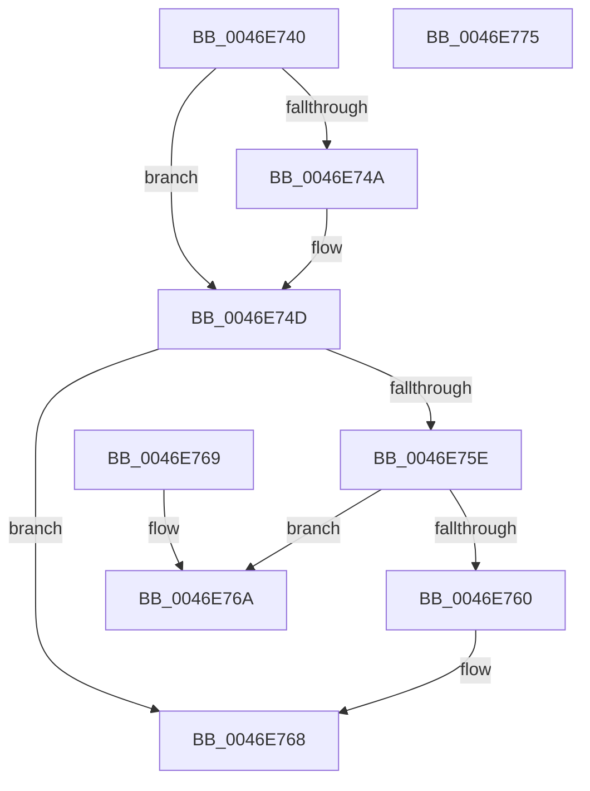

# KiSetSchedulerAssistPriority

- RVA: `0x0046E740`–`0x0046E776` (길이 `54` bytes)
- VA: `0x000000014046E740`
- 실행 섹션: `.text`
- PDB 이름 있음: `예`; PDB Function 태그: `아니요`
- unwind 정보 RVA: `0x000DB714`
- 디코드: `24`개 명령, `54/54` bytes 표시
- 미해석 바이트: `0` (있으면 어셈블리에 `.byte`로 보존)

> 이 문서는 커널 이미지의 기계어와 PDB 기호를 분석해 생성했습니다. 4번과 5번은 함수 원형과 자료형을 바이너리 사용 방식에서 추정한 C 해석이며 원본 소스 복구 결과는 아닙니다.

## 1. Dependencies

- 직접 호출 지점: **0**; 고유 호출 대상: **0**
- 직접 호출자로 확인된 함수: **4**
- RIP 상대 이미지 참조: **0**

### Outgoing calls
- 직접 디코드된 call 명령이 없습니다.

### Direct callers
- [KiTransitionSchedulingGroupGeneration](../30/KiTransitionSchedulingGroupGeneration_function_003094C8.md) at `0x00309921`
- [KiCheckForEffectivePriorityChange](KiCheckForEffectivePriorityChange_function_0046DD94.md) at `0x0046DE46`
- [KiUpdateThreadSchedulingProperties](KiUpdateThreadSchedulingProperties_function_0046E5DC.md) at `0x0046E679`
- [sub_006E0CEA](../6E/Unknown_function_006E0CEA.md) at `0x006E0D29`
- [sub_006E0CEA](../6E/Unknown_function_006E0CEA.md) at `0x006E0DD5`

### Static image references
- 디코드된 RIP-relative 메모리 참조가 없습니다.

## 2. Other-region calls and transfers

- 다른 실행 섹션으로 향하는 call: **0**
- 별도 외부 분기/꼬리 이동을 확인하지 못했습니다.

## 3. Assembly (complete function range)

```asm
0046E740  8B 01                           mov eax, dword ptr [rcx]
0046E742  4C 8B C9                        mov r9, rcx
0046E745  45 84 C0                        test r8b, r8b
0046E748  75 03                           jne 0x14046e74d
0046E74A  C1 E8 08                        shr eax, 8
0046E74D  41 F6 D8                        neg r8b
0046E750  0F B6 C0                        movzx eax, al
0046E753  1B C9                           sbb ecx, ecx
0046E755  F7 D1                           not ecx
0046E757  83 E1 08                        and ecx, 8
0046E75A  3B D0                           cmp edx, eax
0046E75C  74 0A                           je 0x14046e768
0046E75E  7E 0A                           jle 0x14046e76a
0046E760  2B D0                           sub edx, eax
0046E762  D3 E2                           shl edx, cl
0046E764  F0 41 01 11                     lock add dword ptr [r9], edx
0046E768  C3                              ret
0046E769  CC                              int3
0046E76A  2B C2                           sub eax, edx
0046E76C  D3 E0                           shl eax, cl
0046E76E  F7 D8                           neg eax
0046E770  F0 41 01 01                     lock add dword ptr [r9], eax
0046E774  C3                              ret
0046E775  CC                              int3
```

## 4. C-style interpretation (structured pseudocode)

```c
__int64 __fastcall KiSetSchedulerAssistPriority(__int64 a1, int a2, unsigned __int8 a3)
{
    __int64 result;

    result = (unsigned int)(*(unsigned int *)(a1));
    if (a3 == 0) {
        result = (unsigned int)(((unsigned int)(*(unsigned int *)(a1))) >> (8));
    }
    a3 = (unsigned __int8)(-(a3));
    a1 = (unsigned int)(~(a1));
    a1 = (unsigned int)((a1) & (8));
    if (a2 == ((unsigned int)((unsigned __int8)(result)))) goto loc_0046E768;
    if (a2 <= ((unsigned int)((unsigned __int8)(result)))) goto loc_0046E76A;
    a2 = (unsigned int)((a2) - ((unsigned int)((unsigned __int8)(result))));
    a2 = (unsigned int)((a2) << ((unsigned __int8)(a1)));
loc_0046E768:
    return (unsigned __int8)(result);
loc_0046E76A:
    result = (unsigned int)(((unsigned __int8)(result)) - (a2));
    result = (unsigned int)((result) << ((unsigned __int8)(a1)));
    result = (unsigned int)(-(result));
    return result;
}
```

## 5. (Beta) C Style

```c
int64_t KiSetSchedulerAssistPriority(void *Arg1, int32_t Arg2, uint8_t Arg3)
{
    uint8_t *arg1 = (uint8_t *)Arg1;

    int64_t result;

    result = (uint32_t)(*(uint32_t *)(arg1));
    if (Arg3 == 0) {
        result = (uint32_t)(((uint32_t)(*(uint32_t *)(arg1))) >> (8));
    }
    Arg3 = (uint8_t)(-(Arg3));
    Arg1 = (uint32_t)(~(Arg1));
    Arg1 = (uint32_t)((Arg1) & (8));
    if (Arg2 == ((uint32_t)((uint8_t)(result)))) goto loc_0046E768;
    if (Arg2 <= ((uint32_t)((uint8_t)(result)))) goto loc_0046E76A;
    Arg2 = (uint32_t)((Arg2) - ((uint32_t)((uint8_t)(result))));
    Arg2 = (uint32_t)((Arg2) << ((uint8_t)(Arg1)));
loc_0046E768:
    return (uint8_t)(result);
loc_0046E76A:
    result = (uint32_t)(((uint8_t)(result)) - (Arg2));
    result = (uint32_t)((result) << ((uint8_t)(Arg1)));
    result = (uint32_t)(-(result));
    return result;
}
```

### 관측된 메모리 오프셋

구조체 형식이 확인되지 않은 접근은 인자 기준의 오프셋으로만 기록했습니다.

| 기준 인자 | 오프셋 표현 | 폭 (bit) | 접근 |
|---|---:|---:|---|
| `Arg1` | `+ 0x0` | `32` | `R` |
| `Arg1` | `+ 0x0` | `32` | `R/W` |

## 6. Execution-region graph

[열기: 2D/3D 그래프와 함수 탐색 컨트롤 패널](../../../control-panel.html?section=text&rva=0x0046E740&view=graph)

- 2D 그래프는 위에서 아래로 흐르고, 3D 그래프는 빈 공간을 드래그해 회전합니다. Shift+드래그는 이동, 휠은 확대·축소, 함수 노드 선택은 대상 보고서 이동입니다.

### Static fallback


