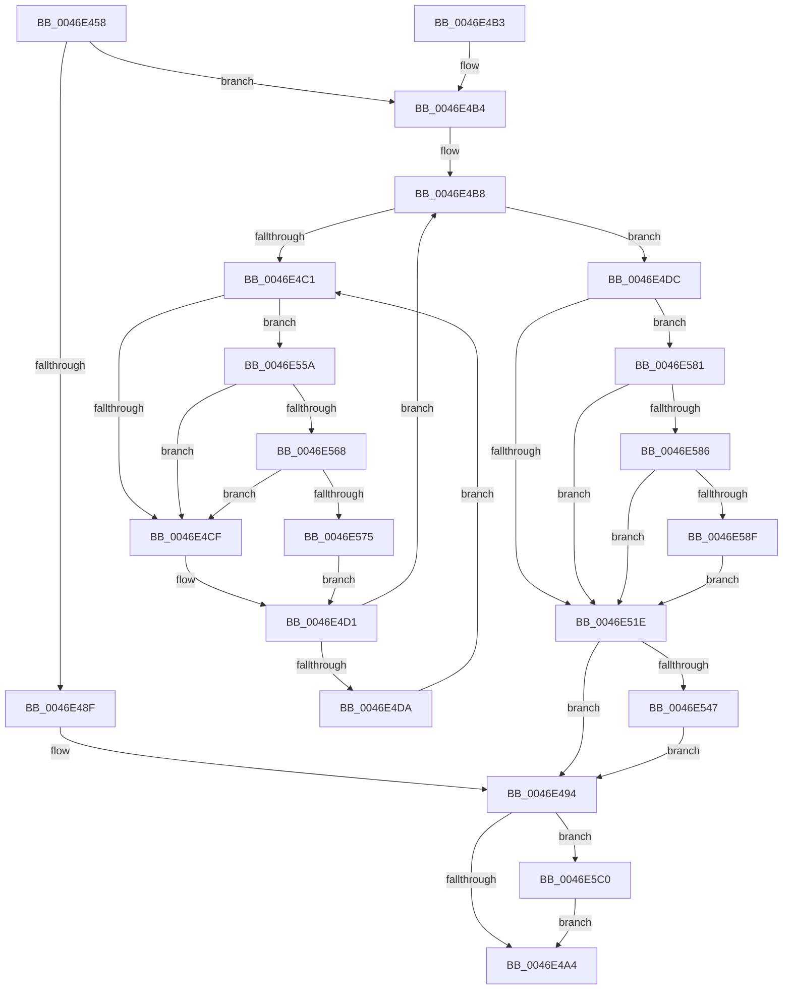

# KiSetThreadSchedulingGroup

- RVA: `0x0046E458`–`0x0046E5D3` (길이 `379` bytes)
- VA: `0x000000014046E458`
- 실행 섹션: `.text`
- PDB 이름 있음: `예`; PDB Function 태그: `아니요`
- unwind 정보 RVA: `0x000ABB38`
- 디코드: `104`개 명령, `379/379` bytes 표시
- 미해석 바이트: `0` (있으면 어셈블리에 `.byte`로 보존)

> 이 문서는 커널 이미지의 기계어와 PDB 기호를 분석해 생성했습니다. 4번과 5번은 함수 원형과 자료형을 바이너리 사용 방식에서 추정한 C 해석이며 원본 소스 복구 결과는 아닙니다.

## 1. Dependencies

- 직접 호출 지점: **10**; 고유 호출 대상: **10**
- 직접 호출자로 확인된 함수: **1**
- RIP 상대 이미지 참조: **3**

### Outgoing calls
- `0x0046E48F` → [KiRemoveThreadFromSchedulingGroup](../35/KiRemoveThreadFromSchedulingGroup_function_00356514.md) (function, `0x00356514`)
- `0x0046E4F4` → [KiAcquireThreadStateLockForWrite](../30/KiAcquireThreadStateLockForWrite_function_0030E8C0.md) (function, `0x0030E8C0`)
- `0x0046E510` → [KiUpdateThreadSchedulingProperties](KiUpdateThreadSchedulingProperties_function_0046E5DC.md) (function, `0x0046E5DC`)
- `0x0046E531` → [KiReleaseThreadStateLock](../21/KiReleaseThreadStateLock_function_00217910.md) (function, `0x00217910`)
- `0x0046E550` → [KiDeferredReadyThread](../39/KiDeferredReadyThread_function_00398640.md) (function, `0x00398640`)
- `0x0046E568` → [KiCheckVpBackingLongSpinWaitHypercall](../30/KiCheckVpBackingLongSpinWaitHypercall_function_0030F490.md) (function, `0x0030F490`)
- `0x0046E577` → [HvlNotifyLongSpinWait](../30/HvlNotifyLongSpinWait_function_0030F460.md) (function, `0x0030F460`)
- `0x0046E5AA` → [KiRemoveThreadFromSharedReadyQueue](../20/KiRemoveThreadFromSharedReadyQueue_function_002019B0.md) (function, `0x002019B0`)
- `0x0046E5B2` → [KiEnterDeferredReadyState](../39/KiEnterDeferredReadyState_function_00397420.md) (function, `0x00397420`)
- `0x0046E5C9` → [EtwTraceThreadSchedulingGroup](../65/EtwTraceThreadSchedulingGroup_function_006503AC.md) (function, `0x006503AC`)

### Direct callers
- [KeSetProcessSchedulingGroup](KeSetProcessSchedulingGroup_function_0046E378.md) at `0x0046E3EE`

### Static image references
- `0x0046E494` → RVA `0x00FC6B14` (`ALMOSTRO`; read)
- `0x0046E4C3` → RVA `0x00FC52AC` (`ALMOSTRO`; reference)
- `0x0046E55A` → RVA `0x00FC6AB8` (`ALMOSTRO`; read)

## 2. Other-region calls and transfers

- 다른 실행 섹션으로 향하는 call: **0**
- 별도 외부 분기/꼬리 이동을 확인하지 못했습니다.

## 3. Assembly (complete function range)

```asm
0046E458  40 55                           push rbp
0046E45A  53                              push rbx
0046E45B  56                              push rsi
0046E45C  57                              push rdi
0046E45D  41 54                           push r12
0046E45F  41 56                           push r14
0046E461  41 57                           push r15
0046E463  48 8B EC                        mov rbp, rsp
0046E466  48 83 EC 40                     sub rsp, 0x40
0046E46A  48 83 65 48 00                  and qword ptr [rbp + 0x48], 0
0046E46F  0F 57 C0                        xorps xmm0, xmm0
0046E472  48 83 65 40 00                  and qword ptr [rbp + 0x40], 0
0046E477  4C 8B FA                        mov r15, rdx
0046E47A  48 83 65 50 00                  and qword ptr [rbp + 0x50], 0
0046E47F  48 8B F9                        mov rdi, rcx
0046E482  4C 8B 61 68                     mov r12, qword ptr [rcx + 0x68]
0046E486  0F 11 45 F0                     movups xmmword ptr [rbp - 0x10], xmm0
0046E48A  48 85 D2                        test rdx, rdx
0046E48D  75 25                           jne 0x14046e4b4
0046E48F  E8 80 80 EE FF                  call 0x140356514
0046E494  F7 05 76 86 B5 00 00 40 00 00   test dword ptr [rip + 0xb58676], 0x4000
0046E49E  0F 85 1C 01 00 00               jne 0x14046e5c0
0046E4A4  48 83 C4 40                     add rsp, 0x40
0046E4A8  41 5F                           pop r15
0046E4AA  41 5E                           pop r14
0046E4AC  41 5C                           pop r12
0046E4AE  5F                              pop rdi
0046E4AF  5E                              pop rsi
0046E4B0  5B                              pop rbx
0046E4B1  5D                              pop rbp
0046E4B2  C3                              ret
0046E4B3  CC                              int3
0046E4B4  33 F6                           xor esi, esi
0046E4B6  33 DB                           xor ebx, ebx
0046E4B8  F0 48 0F BA 6F 40 00            lock bts qword ptr [rdi + 0x40], 0
0046E4BF  73 1B                           jae 0x14046e4dc
0046E4C1  FF C3                           inc ebx
0046E4C3  85 1D E3 6D B5 00               test dword ptr [rip + 0xb56de3], ebx
0046E4C9  0F 84 8B 00 00 00               je 0x14046e55a
0046E4CF  F3 90                           pause
0046E4D1  48 8B 47 40                     mov rax, qword ptr [rdi + 0x40]
0046E4D5  48 85 C0                        test rax, rax
0046E4D8  74 DE                           je 0x14046e4b8
0046E4DA  EB E5                           jmp 0x14046e4c1
0046E4DC  48 8D 45 F0                     lea rax, [rbp - 0x10]
0046E4E0  48 8B CF                        mov rcx, rdi
0046E4E3  4C 8D 4D 40                     lea r9, [rbp + 0x40]
0046E4E7  48 89 44 24 20                  mov qword ptr [rsp + 0x20], rax
0046E4EC  4C 8D 45 50                     lea r8, [rbp + 0x50]
0046E4F0  48 8D 55 48                     lea rdx, [rbp + 0x48]
0046E4F4  E8 C7 03 EA FF                  call 0x14030e8c0
0046E4F9  4C 89 7F 68                     mov qword ptr [rdi + 0x68], r15
0046E4FD  8A D0                           mov dl, al
0046E4FF  F0 0F BA 2F 12                  lock bts dword ptr [rdi], 0x12
0046E504  4C 8B 75 48                     mov r14, qword ptr [rbp + 0x48]
0046E508  48 8B CF                        mov rcx, rdi
0046E50B  4D 8B C6                        mov r8, r14
0046E50E  8A D8                           mov bl, al
0046E510  E8 C7 00 00 00                  call 0x14046e5dc
0046E515  80 FB 01                        cmp bl, 1
0046E518  48 8B 5D 40                     mov rbx, qword ptr [rbp + 0x40]
0046E51C  74 63                           je 0x14046e581
0046E51E  48 8D 45 F0                     lea rax, [rbp - 0x10]
0046E522  4C 8B CB                        mov r9, rbx
0046E525  4C 8D 45 50                     lea r8, [rbp + 0x50]
0046E529  48 89 44 24 20                  mov qword ptr [rsp + 0x20], rax
0046E52E  49 8B D6                        mov rdx, r14
0046E531  E8 DA 93 DA FF                  call 0x140217910
0046E536  48 C7 47 40 00 00 00 00         mov qword ptr [rdi + 0x40], 0
0046E53E  48 85 F6                        test rsi, rsi
0046E541  0F 84 4D FF FF FF               je 0x14046e494
0046E547  45 33 C0                        xor r8d, r8d
0046E54A  48 8B D7                        mov rdx, rdi
0046E54D  48 8B CE                        mov rcx, rsi
0046E550  E8 EB A0 F2 FF                  call 0x140398640
0046E555  E9 3A FF FF FF                  jmp 0x14046e494
0046E55A  8B 05 58 85 B5 00               mov eax, dword ptr [rip + 0xb58558]
0046E560  A8 40                           test al, 0x40
0046E562  0F 84 67 FF FF FF               je 0x14046e4cf
0046E568  E8 23 0F EA FF                  call 0x14030f490
0046E56D  84 C0                           test al, al
0046E56F  0F 84 5A FF FF FF               je 0x14046e4cf
0046E575  8B CB                           mov ecx, ebx
0046E577  E8 E4 0E EA FF                  call 0x14030f460
0046E57C  E9 50 FF FF FF                  jmp 0x14046e4d1
0046E581  48 85 DB                        test rbx, rbx
0046E584  74 98                           je 0x14046e51e
0046E586  F7 47 78 00 20 00 00            test dword ptr [rdi + 0x78], 0x2000
0046E58D  75 8F                           jne 0x14046e51e
0046E58F  65 48 8B 34 25 20 00 00 00      mov rsi, qword ptr gs:[0x20]
0046E598  48 8B D7                        mov rdx, rdi
0046E59B  48 8B 5D 40                     mov rbx, qword ptr [rbp + 0x40]
0046E59F  44 0F BE 87 C3 00 00 00         movsx r8d, byte ptr [rdi + 0xc3]
0046E5A7  48 8B CB                        mov rcx, rbx
0046E5AA  E8 01 34 D9 FF                  call 0x1402019b0
0046E5AF  48 8B CF                        mov rcx, rdi
0046E5B2  E8 69 8E F2 FF                  call 0x140397420
0046E5B7  4C 8B 75 48                     mov r14, qword ptr [rbp + 0x48]
0046E5BB  E9 5E FF FF FF                  jmp 0x14046e51e
0046E5C0  4D 8B C7                        mov r8, r15
0046E5C3  49 8B D4                        mov rdx, r12
0046E5C6  48 8B CF                        mov rcx, rdi
0046E5C9  E8 DE 1D 1E 00                  call 0x1406503ac
0046E5CE  E9 D1 FE FF FF                  jmp 0x14046e4a4
```

## 4. C-style interpretation (structured pseudocode)

```c
__int64 __fastcall KiSetThreadSchedulingGroup(__int64 a1, __int64 a2)
{
    __int64 result;
    __int64 v_rbx;
    __int64 v_rsi;
    __int64 v_rsp;
    unsigned __int64 v_stack_m48;
    unsigned __int64 v_stack_p10;
    unsigned __int64 v_stack_p18;
    unsigned __int64 v_stack_p20;
    unsigned __int64 v_stack_p8;

    v_rsp = (v_rsp) - (64);
    v_stack_m48 = v_xmm0;
    if (a2 != 0) goto loc_0046E4B4;
    result = KiRemoveThreadFromSchedulingGroup(a1, a2, a3, a4);
loc_0046E494:
    if (((*(unsigned int *)(v_rip + 11896438)) & (0x4000ULL)) != 0) goto loc_0046E5C0;
loc_0046E4A4:
    v_rsp = (v_rsp) + (64);
    return result;
loc_0046E4B4:
    v_rsi = 0;
    v_rbx = 0;
loc_0046E4B8:
    if (condition_is_above_or_equal) goto loc_0046E4DC;
loc_0046E4C1:
    v_rbx = (unsigned int)((v_rbx) + 1);
    if (((*(unsigned int *)(v_rip + 11890147)) & ((unsigned int)(v_rbx))) == 0) goto loc_0046E55A;
loc_0046E4CF:
loc_0046E4D1:
    if (*(unsigned __int64 *)(a1 + 64) == 0) goto loc_0046E4B8;
    goto loc_0046E4C1;
loc_0046E4DC:
    v_stack_p20 = v_stack_m48;
    result = KiAcquireThreadStateLockForWrite(a1, v_stack_p10, v_stack_p18, v_stack_p8);
    *(unsigned __int64 *)(a1 + 104) = a2;
    result = KiUpdateThreadSchedulingProperties(a1, (unsigned __int8)(result), v_stack_p10, v_stack_p8);
    if (((unsigned __int8)((unsigned __int8)(result))) == 1) goto loc_0046E581;
loc_0046E51E:
    v_stack_p20 = v_stack_m48;
    result = KiReleaseThreadStateLock(a1, v_stack_p10, v_stack_p18, v_stack_p8);
    *(unsigned __int64 *)(a1 + 64) = 0;
    if (0 == 0) goto loc_0046E494;
    a3 = 0;
    result = KiDeferredReadyThread(0, a1, a3, v_stack_p8);
    goto loc_0046E494;
loc_0046E55A:
    if ((((unsigned __int8)((unsigned int)(*(unsigned int *)(v_rip + 11896152)))) & (64)) == 0) goto loc_0046E4CF;
    result = KiCheckVpBackingLongSpinWaitHypercall(0, a1, a3, v_stack_p8);
    if ((unsigned __int8)(result) == 0) goto loc_0046E4CF;
    result = HvlNotifyLongSpinWait((unsigned int)((unsigned int)(v_stack_p8)), a1, a3, v_stack_p8);
    goto loc_0046E4D1;
loc_0046E581:
    if (v_stack_p8 == 0) goto loc_0046E51E;
    if (((*(unsigned int *)(a1 + 120)) & (0x2000ULL)) != 0) goto loc_0046E51E;
    result = KiRemoveThreadFromSharedReadyQueue(v_stack_p8, a1, (__int8)(*(unsigned __int8 *)(a1 + 195)), v_stack_p8);
    result = KiEnterDeferredReadyState(a1, a1, (__int8)(*(unsigned __int8 *)(a1 + 195)), v_stack_p8);
    goto loc_0046E51E;
loc_0046E5C0:
    result = EtwTraceThreadSchedulingGroup(a1, *(unsigned __int64 *)(a1 + 104), a2, v_stack_p8);
    goto loc_0046E4A4;
}
```

## 5. (Beta) C Style

```c
int64_t KiSetThreadSchedulingGroup(void *Arg1, int64_t Arg2)
{
    uint8_t *arg1 = (uint8_t *)Arg1;

    int64_t result;
    int64_t local_rbx;
    int64_t local_rsi;
    int64_t local_rsp;
    uint64_t v_stack_m48;
    uint64_t v_stack_p10;
    uint64_t v_stack_p18;
    uint64_t v_stack_p20;
    uint64_t v_stack_p8;

    local_rsp = (local_rsp) - (64);
    v_stack_m48 = v_xmm0;
    if (Arg2 != 0) goto loc_0046E4B4;
    result = KiRemoveThreadFromSchedulingGroup(Arg1, Arg2, a3, a4);
loc_0046E494:
    if (((*(uint32_t *)(v_rip + 0xB58676)) & (0x4000ULL)) != 0) goto loc_0046E5C0;
loc_0046E4A4:
    local_rsp = (local_rsp) + (64);
    return result;
loc_0046E4B4:
    local_rsi = 0;
    local_rbx = 0;
loc_0046E4B8:
    if (condition_is_above_or_equal) goto loc_0046E4DC;
loc_0046E4C1:
    local_rbx = (uint32_t)((local_rbx) + 1);
    if (((*(uint32_t *)(v_rip + 0xB56DE3)) & ((uint32_t)(local_rbx))) == 0) goto loc_0046E55A;
loc_0046E4CF:
loc_0046E4D1:
    if (*(uint64_t *)(arg1 + 0x40) == 0) goto loc_0046E4B8;
    goto loc_0046E4C1;
loc_0046E4DC:
    v_stack_p20 = v_stack_m48;
    result = KiAcquireThreadStateLockForWrite(Arg1, v_stack_p10, v_stack_p18, v_stack_p8);
    *(uint64_t *)(arg1 + 0x68) = Arg2;
    result = KiUpdateThreadSchedulingProperties(Arg1, (uint8_t)(result), v_stack_p10, v_stack_p8);
    if (((uint8_t)((uint8_t)(result))) == 1) goto loc_0046E581;
loc_0046E51E:
    v_stack_p20 = v_stack_m48;
    result = KiReleaseThreadStateLock(Arg1, v_stack_p10, v_stack_p18, v_stack_p8);
    *(uint64_t *)(arg1 + 0x40) = 0;
    if (0 == 0) goto loc_0046E494;
    a3 = 0;
    result = KiDeferredReadyThread(0, Arg1, a3, v_stack_p8);
    goto loc_0046E494;
loc_0046E55A:
    if ((((uint8_t)((uint32_t)(*(uint32_t *)(v_rip + 0xB58558)))) & (64)) == 0) goto loc_0046E4CF;
    result = KiCheckVpBackingLongSpinWaitHypercall(0, Arg1, a3, v_stack_p8);
    if ((uint8_t)(result) == 0) goto loc_0046E4CF;
    result = HvlNotifyLongSpinWait((uint32_t)((uint32_t)(v_stack_p8)), Arg1, a3, v_stack_p8);
    goto loc_0046E4D1;
loc_0046E581:
    if (v_stack_p8 == 0) goto loc_0046E51E;
    if (((*(uint32_t *)(arg1 + 0x78)) & (0x2000ULL)) != 0) goto loc_0046E51E;
    result = KiRemoveThreadFromSharedReadyQueue(v_stack_p8, Arg1, (int8_t)(*(uint8_t *)(arg1 + 0xC3)), v_stack_p8);
    result = KiEnterDeferredReadyState(Arg1, Arg1, (int8_t)(*(uint8_t *)(arg1 + 0xC3)), v_stack_p8);
    goto loc_0046E51E;
loc_0046E5C0:
    result = EtwTraceThreadSchedulingGroup(Arg1, *(uint64_t *)(arg1 + 0x68), Arg2, v_stack_p8);
    goto loc_0046E4A4;
}
```

### 관측된 메모리 오프셋

구조체 형식이 확인되지 않은 접근은 인자 기준의 오프셋으로만 기록했습니다.

| 기준 인자 | 오프셋 표현 | 폭 (bit) | 접근 |
|---|---:|---:|---|
| `Arg1` | `+ 0x0` | `32` | `R/W` |
| `Arg1` | `+ 0x40` | `64` | `R` |
| `Arg1` | `+ 0x40` | `64` | `R/W` |
| `Arg1` | `+ 0x40` | `64` | `W` |
| `Arg1` | `+ 0x68` | `64` | `R` |
| `Arg1` | `+ 0x68` | `64` | `W` |
| `Arg1` | `+ 0x78` | `32` | `R` |
| `Arg1` | `+ 0xC3` | `8` | `R` |

## 6. Execution-region graph

[열기: 2D/3D 그래프와 함수 탐색 컨트롤 패널](../../../control-panel.html?section=text&rva=0x0046E458&view=graph)

- 2D 그래프는 위에서 아래로 흐르고, 3D 그래프는 빈 공간을 드래그해 회전합니다. Shift+드래그는 이동, 휠은 확대·축소, 함수 노드 선택은 대상 보고서 이동입니다.

### Static fallback


