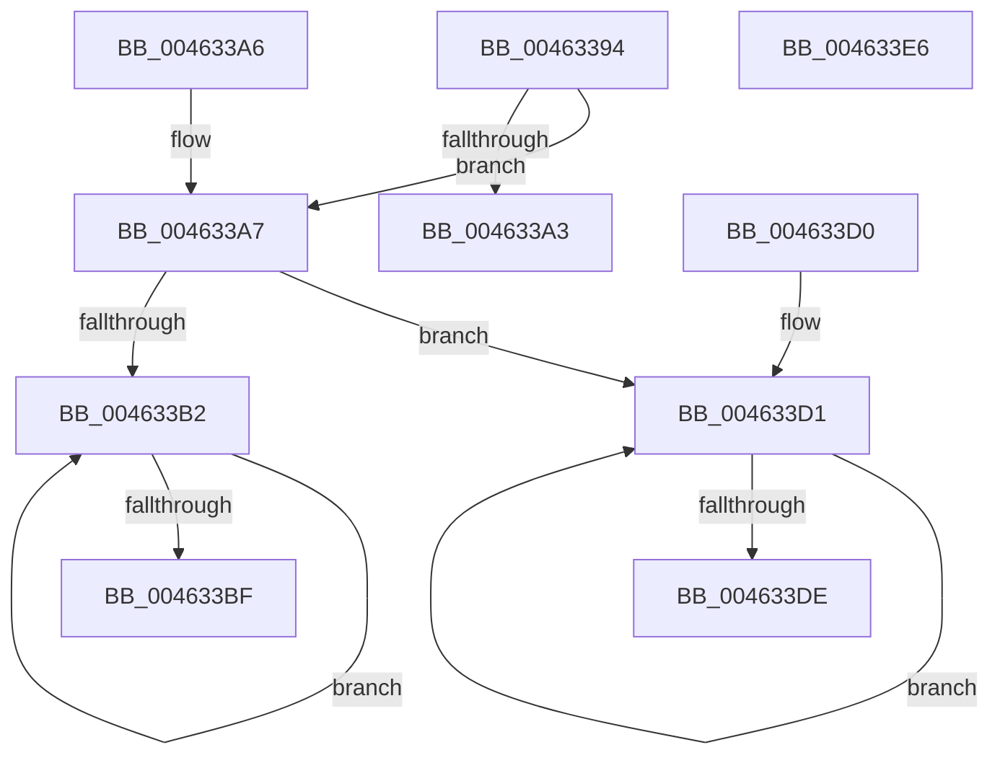

# KiSetVpThreadHrTimerActive

- RVA: `0x00463394`–`0x004633E7` (길이 `83` bytes)
- VA: `0x0000000140463394`
- 실행 섹션: `.text`
- PDB 이름 있음: `예`; PDB Function 태그: `아니요`
- unwind 정보 RVA: `0x000DB714`
- 디코드: `30`개 명령, `83/83` bytes 표시
- 미해석 바이트: `0` (있으면 어셈블리에 `.byte`로 보존)

> 이 문서는 커널 이미지의 기계어와 PDB 기호를 분석해 생성했습니다. 4번과 5번은 함수 원형과 자료형을 바이너리 사용 방식에서 추정한 C 해석이며 원본 소스 복구 결과는 아닙니다.

## 1. Dependencies

- 직접 호출 지점: **0**; 고유 호출 대상: **0**
- 직접 호출자로 확인된 함수: **2**
- RIP 상대 이미지 참조: **0**

### Outgoing calls
- 직접 디코드된 call 명령이 없습니다.

### Direct callers
- [KePrepareClockTimerForPlatformIdle](../5B/KePrepareClockTimerForPlatformIdle_function_005BA820.md) at `0x005BAC8C`
- [KeResumeClockTimerFromIdle](../5B/KeResumeClockTimerFromIdle_function_005BACC4.md) at `0x005BB143`

### Static image references
- 디코드된 RIP-relative 메모리 참조가 없습니다.

## 2. Other-region calls and transfers

- 다른 실행 섹션으로 향하는 call: **0**
- 별도 외부 분기/꼬리 이동을 확인하지 못했습니다.

## 3. Assembly (complete function range)

```asm
00463394  4C 8B 81 B8 8E 00 00            mov r8, qword ptr [rcx + 0x8eb8]
0046339B  45 33 C9                        xor r9d, r9d
0046339E  4D 85 C0                        test r8, r8
004633A1  75 04                           jne 0x1404633a7
004633A3  32 C0                           xor al, al
004633A5  C3                              ret
004633A6  CC                              int3
004633A7  41 0F 0D 08                     prefetchw byte ptr [r8]
004633AB  41 8B 00                        mov eax, dword ptr [r8]
004633AE  84 D2                           test dl, dl
004633B0  75 1F                           jne 0x1404633d1
004633B2  8B C8                           mov ecx, eax
004633B4  0F BA F1 13                     btr ecx, 0x13
004633B8  F0 41 0F B1 08                  lock cmpxchg dword ptr [r8], ecx
004633BD  75 F3                           jne 0x1404633b2
004633BF  0F BA E0 13                     bt eax, 0x13
004633C3  B9 01 00 00 00                  mov ecx, 1
004633C8  41 0F B6 C1                     movzx eax, r9b
004633CC  0F 42 C1                        cmovb eax, ecx
004633CF  C3                              ret
004633D0  CC                              int3
004633D1  8B C8                           mov ecx, eax
004633D3  0F BA E9 13                     bts ecx, 0x13
004633D7  F0 41 0F B1 08                  lock cmpxchg dword ptr [r8], ecx
004633DC  75 F3                           jne 0x1404633d1
004633DE  C1 E8 13                        shr eax, 0x13
004633E1  F6 D0                           not al
004633E3  24 01                           and al, 1
004633E5  C3                              ret
004633E6  CC                              int3
```

## 4. C-style interpretation (structured pseudocode)

```c
__int64 __fastcall KiSetVpThreadHrTimerActive(__int64 a1, unsigned __int8 a2, __int64 a3, int a4)
{
    __int64 result;

    a4 = 0;
    if (*(unsigned __int64 *)(a1 + 36536) != 0) goto loc_004633A7;
    result = 0;
    return result;
loc_004633A7:
    if (a2 != 0) goto loc_004633D1;
loc_004633B2:
    if (a2 != 0) goto loc_004633B2;
    result = 0;
    if (condition_is_below) { result = 1; }
    return result;
loc_004633D1:
    if (a2 != 0) goto loc_004633D1;
    result = (unsigned int)((result) >> (19));
    result = (unsigned __int8)(~(result));
    result = (unsigned __int8)((result) & (1));
    return result;
}
```

## 5. (Beta) C Style

```c
int64_t KiSetVpThreadHrTimerActive(void *Arg1, uint8_t Arg2, int64_t Arg3, int32_t Arg4)
{
    uint8_t *arg1 = (uint8_t *)Arg1;

    int64_t result;

    Arg4 = 0;
    if (*(uint64_t *)(arg1 + 0x8EB8) != 0) goto loc_004633A7;
    result = 0;
    return result;
loc_004633A7:
    if (Arg2 != 0) goto loc_004633D1;
loc_004633B2:
    if (Arg2 != 0) goto loc_004633B2;
    result = 0;
    if (condition_is_below) { result = 1; }
    return result;
loc_004633D1:
    if (Arg2 != 0) goto loc_004633D1;
    result = (uint32_t)((result) >> (19));
    result = (uint8_t)(~(result));
    result = (uint8_t)((result) & (1));
    return result;
}
```

### 관측된 메모리 오프셋

구조체 형식이 확인되지 않은 접근은 인자 기준의 오프셋으로만 기록했습니다.

| 기준 인자 | 오프셋 표현 | 폭 (bit) | 접근 |
|---|---:|---:|---|
| `Arg1` | `+ 0x8EB8` | `64` | `R` |

## 6. Execution-region graph

[열기: 2D/3D 그래프와 함수 탐색 컨트롤 패널](../../../control-panel.html?section=text&rva=0x00463394&view=graph)

- 2D 그래프는 위에서 아래로 흐르고, 3D 그래프는 빈 공간을 드래그해 회전합니다. Shift+드래그는 이동, 휠은 확대·축소, 함수 노드 선택은 대상 보고서 이동입니다.

### Static fallback


