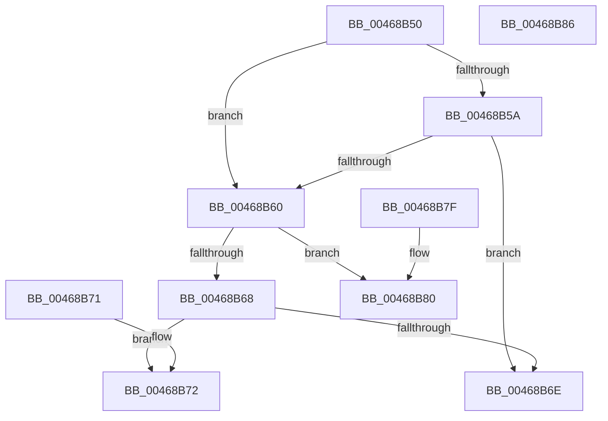

# KiShouldScanSharedReadyQueue

- RVA: `0x00468B50`–`0x00468B87` (길이 `55` bytes)
- VA: `0x0000000140468B50`
- 실행 섹션: `.text`
- PDB 이름 있음: `예`; PDB Function 태그: `아니요`
- unwind 정보 RVA: `0x000DB714`
- 디코드: `20`개 명령, `55/55` bytes 표시
- 미해석 바이트: `0` (있으면 어셈블리에 `.byte`로 보존)

> 이 문서는 커널 이미지의 기계어와 PDB 기호를 분석해 생성했습니다. 4번과 5번은 함수 원형과 자료형을 바이너리 사용 방식에서 추정한 C 해석이며 원본 소스 복구 결과는 아닙니다.

## 1. Dependencies

- 직접 호출 지점: **0**; 고유 호출 대상: **0**
- 직접 호출자로 확인된 함수: **3**
- RIP 상대 이미지 참조: **1**

### Outgoing calls
- 직접 디코드된 call 명령이 없습니다.

### Direct callers
- [KiNormalPriorityReadyScan](../21/KiNormalPriorityReadyScan_function_0021B400.md) at `0x0021B41D`
- [sub_0021C284](../21/Unknown_function_0021C284.md) at `0x0021C47D`
- [KiUpdateRunTime](../39/KiUpdateRunTime_function_0039BB70.md) at `0x0039C067`
- [KiUpdateRunTime](../39/KiUpdateRunTime_function_0039BB70.md) at `0x0039C0DE`

### Static image references
- `0x00468B52` → RVA `0x00FC52E0` (`ALMOSTRO`; read)

## 2. Other-region calls and transfers

- 다른 실행 섹션으로 향하는 call: **0**
- 별도 외부 분기/꼬리 이동을 확인하지 못했습니다.

## 3. Assembly (complete function range)

```asm
00468B50  33 D2                           xor edx, edx
00468B52  39 15 88 C7 B5 00               cmp dword ptr [rip + 0xb5c788], edx
00468B58  74 06                           je 0x140468b60
00468B5A  F6 41 23 20                     test byte ptr [rcx + 0x23], 0x20
00468B5E  75 0E                           jne 0x140468b6e
00468B60  39 91 50 8E 00 00               cmp dword ptr [rcx + 0x8e50], edx
00468B66  75 18                           jne 0x140468b80
00468B68  F6 41 23 10                     test byte ptr [rcx + 0x23], 0x10
00468B6C  75 04                           jne 0x140468b72
00468B6E  33 C0                           xor eax, eax
00468B70  C3                              ret
00468B71  CC                              int3
00468B72  48 39 91 40 8E 00 00            cmp qword ptr [rcx + 0x8e40], rdx
00468B79  0F 95 C2                        setne dl
00468B7C  8B C2                           mov eax, edx
00468B7E  C3                              ret
00468B7F  CC                              int3
00468B80  B8 01 00 00 00                  mov eax, 1
00468B85  C3                              ret
00468B86  CC                              int3
```

## 4. C-style interpretation (structured pseudocode)

```c
__int64 __fastcall KiShouldScanSharedReadyQueue(__int64 a1, int a2)
{
    __int64 result;

    a2 = 0;
    if ((*(unsigned int *)(v_rip + 11913096)) == 0) goto loc_00468B60;
    if (((*(unsigned __int8 *)(a1 + 35)) & (32)) != 0) goto loc_00468B6E;
loc_00468B60:
    if ((*(unsigned int *)(a1 + 36432)) != 0) goto loc_00468B80;
    if (((*(unsigned __int8 *)(a1 + 35)) & (16)) != 0) goto loc_00468B72;
loc_00468B6E:
    result = 0;
    return result;
loc_00468B72:
    a2 = ((*(unsigned __int64 *)(a1 + 36416)) != 0) ? 1 : 0;
    return (unsigned int)(a2);
loc_00468B80:
    return 1;
}
```

## 5. (Beta) C Style

```c
int64_t KiShouldScanSharedReadyQueue(void *Arg1, int32_t Arg2)
{
    uint8_t *arg1 = (uint8_t *)Arg1;

    int64_t result;

    Arg2 = 0;
    if ((*(uint32_t *)(v_rip + 0xB5C788)) == 0) goto loc_00468B60;
    if (((*(uint8_t *)(arg1 + 0x23)) & (32)) != 0) goto loc_00468B6E;
loc_00468B60:
    if ((*(uint32_t *)(arg1 + 0x8E50)) != 0) goto loc_00468B80;
    if (((*(uint8_t *)(arg1 + 0x23)) & (16)) != 0) goto loc_00468B72;
loc_00468B6E:
    result = 0;
    return result;
loc_00468B72:
    Arg2 = ((*(uint64_t *)(arg1 + 0x8E40)) != 0) ? 1 : 0;
    return (uint32_t)(Arg2);
loc_00468B80:
    return 1;
}
```

### 관측된 메모리 오프셋

구조체 형식이 확인되지 않은 접근은 인자 기준의 오프셋으로만 기록했습니다.

| 기준 인자 | 오프셋 표현 | 폭 (bit) | 접근 |
|---|---:|---:|---|
| `Arg1` | `+ 0x23` | `8` | `R` |
| `Arg1` | `+ 0x8E40` | `64` | `R` |
| `Arg1` | `+ 0x8E50` | `32` | `R` |

## 6. Execution-region graph

[열기: 2D/3D 그래프와 함수 탐색 컨트롤 패널](../../../control-panel.html?section=text&rva=0x00468B50&view=graph)

- 2D 그래프는 위에서 아래로 흐르고, 3D 그래프는 빈 공간을 드래그해 회전합니다. Shift+드래그는 이동, 휠은 확대·축소, 함수 노드 선택은 대상 보고서 이동입니다.

### Static fallback


