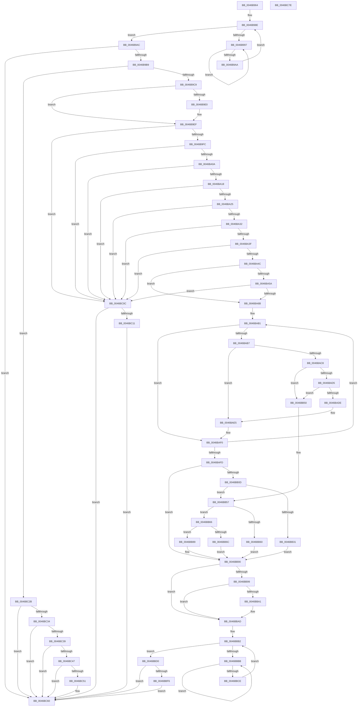

# KiSuspendThread

- RVA: `0x0046B964`–`0x0046BC7F` (길이 `795` bytes)
- VA: `0x000000014046B964`
- 실행 섹션: `.text`
- PDB 이름 있음: `예`; PDB Function 태그: `아니요`
- unwind 정보 RVA: `0x00083688`
- 디코드: `205`개 명령, `795/795` bytes 표시
- 미해석 바이트: `0` (있으면 어셈블리에 `.byte`로 보존)

> 이 문서는 커널 이미지의 기계어와 PDB 기호를 분석해 생성했습니다. 4번과 5번은 함수 원형과 자료형을 바이너리 사용 방식에서 추정한 C 해석이며 원본 소스 복구 결과는 아닙니다.

## 1. Dependencies

- 직접 호출 지점: **10**; 고유 호출 대상: **9**
- 직접 호출자로 확인된 함수: **4**
- RIP 상대 이미지 참조: **1**

### Outgoing calls
- `0x0046B99C` → [KeYieldProcessorEx](../3F/KeYieldProcessorEx_function_003FBD00.md) (function, `0x003FBD00`)
- `0x0046B9EA` → [KiInsertQueueApc](../20/KiInsertQueueApc_function_002041F0.md) (function, `0x002041F0`)
- `0x0046BABE` → [KiAcquireKobjectLockSafe](../25/KiAcquireKobjectLockSafe_function_00251C90.md) (function, `0x00251C90`)
- `0x0046BB28` → [KiCancelTimer](../3D/KiCancelTimer_function_003D3A80.md) (function, `0x003D3A80`)
- `0x0046BBA8` → [KiDecrementProcessStackCount](../2A/KiDecrementProcessStackCount_function_002A1620.md) (function, `0x002A1620`)
- `0x0046BBC0` → [KeYieldProcessorEx](../3F/KeYieldProcessorEx_function_003FBD00.md) (function, `0x003FBD00`)
- `0x0046BC05` → [KiSignalThread](../21/KiSignalThread_function_0021F9E0.md) (function, `0x0021F9E0`)
- `0x0046BC24` → [KiSignalThreadForApc](../20/KiSignalThreadForApc_function_00204360.md) (function, `0x00204360`)
- `0x0046BC2B` → [Feature_SuspendThread2__private_IsEnabledNoReportingNoInline](../5C/Feature_SuspendThread2__private_IsEnabledNoReportingNoInline_function_005C357C.md) (function, `0x005C357C`)
- `0x0046BC5B` → [KiRequestApcInterruptSynchronously](../5C/KiRequestApcInterruptSynchronously_function_005C47CC.md) (function, `0x005C47CC`)

### Direct callers
- [KiFreezeSingleThread](KiFreezeSingleThread_function_0046B890.md) at `0x0046B8FE`
- [KeSuspendThread](../4E/KeSuspendThread_function_004E8B9C.md) at `0x004E8C6B`
- [KeSuspendThreadOld](../5B/KeSuspendThreadOld_function_005B9000.md) at `0x005B9071`
- [KiAdjustThreadTimer](../5C/KiAdjustThreadTimer_function_005C3A3C.md) at `0x005C3A8D`

### Static image references
- `0x0046B9EF` → RVA `0x00FC6FEC` (`ALMOSTRO`; read)

## 2. Other-region calls and transfers

- 다른 실행 섹션으로 향하는 call: **0**
- 별도 외부 분기/꼬리 이동을 확인하지 못했습니다.

## 3. Assembly (complete function range)

```asm
0046B964  48 89 5C 24 10                  mov qword ptr [rsp + 0x10], rbx
0046B969  48 89 6C 24 18                  mov qword ptr [rsp + 0x18], rbp
0046B96E  56                              push rsi
0046B96F  57                              push rdi
0046B970  41 54                           push r12
0046B972  41 56                           push r14
0046B974  41 57                           push r15
0046B976  48 83 EC 20                     sub rsp, 0x20
0046B97A  45 33 E4                        xor r12d, r12d
0046B97D  41 8A E8                        mov bpl, r8b
0046B980  41 8A FC                        mov dil, r12b
0046B983  44 89 64 24 50                  mov dword ptr [rsp + 0x50], r12d
0046B988  4C 8B FA                        mov r15, rdx
0046B98B  48 8B D9                        mov rbx, rcx
0046B98E  F0 48 0F BA 6B 40 00            lock bts qword ptr [rbx + 0x40], 0
0046B995  73 15                           jae 0x14046b9ac
0046B997  48 8D 4C 24 50                  lea rcx, [rsp + 0x50]
0046B99C  E8 5F 03 F9 FF                  call 0x1403fbd00
0046B9A1  48 8B 43 40                     mov rax, qword ptr [rbx + 0x40]
0046B9A5  48 85 C0                        test rax, rax
0046B9A8  75 ED                           jne 0x14046b997
0046B9AA  EB E2                           jmp 0x14046b98e
0046B9AC  F7 43 74 00 40 00 00            test dword ptr [rbx + 0x74], 0x4000
0046B9B3  0F 84 A7 02 00 00               je 0x14046bc60
0046B9B9  40 B7 01                        mov dil, 1
0046B9BC  44 39 A3 E4 02 00 00            cmp dword ptr [rbx + 0x2e4], r12d
0046B9C3  0F 84 62 02 00 00               je 0x14046bc2b
0046B9C9  48 8D B3 88 02 00 00            lea rsi, [rbx + 0x288]
0046B9D0  44 89 A3 E4 02 00 00            mov dword ptr [rbx + 0x2e4], r12d
0046B9D7  45 8A F4                        mov r14b, r12b
0046B9DA  44 38 66 52                     cmp byte ptr [rsi + 0x52], r12b
0046B9DE  75 0F                           jne 0x14046b9ef
0046B9E0  48 8B CE                        mov rcx, rsi
0046B9E3  40 88 7E 52                     mov byte ptr [rsi + 0x52], dil
0046B9E7  44 8A F7                        mov r14b, dil
0046B9EA  E8 01 88 D9 FF                  call 0x1402041f0
0046B9EF  44 39 25 F6 B5 B5 00            cmp dword ptr [rip + 0xb5b5f6], r12d
0046B9F6  0F 85 10 02 00 00               jne 0x14046bc0c
0046B9FC  8A 83 84 01 00 00               mov al, byte ptr [rbx + 0x184]
0046BA02  3C 05                           cmp al, 5
0046BA04  0F 85 02 02 00 00               jne 0x14046bc0c
0046BA0A  8A 43 70                        mov al, byte ptr [rbx + 0x70]
0046BA0D  24 07                           and al, 7
0046BA0F  40 3A C7                        cmp al, dil
0046BA12  0F 85 F4 01 00 00               jne 0x14046bc0c
0046BA18  44 39 A3 E4 01 00 00            cmp dword ptr [rbx + 0x1e4], r12d
0046BA1F  0F 85 E7 01 00 00               jne 0x14046bc0c
0046BA25  44 38 A3 86 01 00 00            cmp byte ptr [rbx + 0x186], r12b
0046BA2C  0F 85 DA 01 00 00               jne 0x14046bc0c
0046BA32  44 38 A3 C0 00 00 00            cmp byte ptr [rbx + 0xc0], r12b
0046BA39  0F 85 CD 01 00 00               jne 0x14046bc0c
0046BA3F  44 38 A3 4A 02 00 00            cmp byte ptr [rbx + 0x24a], r12b
0046BA46  0F 85 C0 01 00 00               jne 0x14046bc0c
0046BA4C  48 8B 83 D0 00 00 00            mov rax, qword ptr [rbx + 0xd0]
0046BA53  8A 40 11                        mov al, byte ptr [rax + 0x11]
0046BA56  3C 05                           cmp al, 5
0046BA58  74 11                           je 0x14046ba6b
0046BA5A  48 8B 83 D0 00 00 00            mov rax, qword ptr [rbx + 0xd0]
0046BA61  40 38 78 10                     cmp byte ptr [rax + 0x10], dil
0046BA65  0F 85 A1 01 00 00               jne 0x14046bc0c
0046BA6B  8B 43 74                        mov eax, dword ptr [rbx + 0x74]
0046BA6E  0F BE 8B 87 01 00 00            movsx ecx, byte ptr [rbx + 0x187]
0046BA75  C1 E1 12                        shl ecx, 0x12
0046BA78  33 C8                           xor ecx, eax
0046BA7A  C6 43 70 03                     mov byte ptr [rbx + 0x70], 3
0046BA7E  81 E1 00 00 04 00               and ecx, 0x40000
0046BA84  40 88 BB C1 00 00 00            mov byte ptr [rbx + 0xc1], dil
0046BA8B  33 C8                           xor ecx, eax
0046BA8D  0F B6 83 4B 02 00 00            movzx eax, byte ptr [rbx + 0x24b]
0046BA94  89 4B 74                        mov dword ptr [rbx + 0x74], ecx
0046BA97  48 8B 8B D0 00 00 00            mov rcx, qword ptr [rbx + 0xd0]
0046BA9E  4C 89 63 40                     mov qword ptr [rbx + 0x40], r12
0046BAA2  4C 8D 34 40                     lea r14, [rax + rax*2]
0046BAA6  49 C1 E6 04                     shl r14, 4
0046BAAA  4C 03 F1                        add r14, rcx
0046BAAD  48 8D 71 11                     lea rsi, [rcx + 0x11]
0046BAB1  8A 06                           mov al, byte ptr [rsi]
0046BAB3  3C 05                           cmp al, 5
0046BAB5  73 39                           jae 0x14046baf0
0046BAB7  48 8B 6E 0F                     mov rbp, qword ptr [rsi + 0xf]
0046BABB  48 8B CD                        mov rcx, rbp
0046BABE  E8 CD 61 DE FF                  call 0x140251c90
0046BAC3  80 3E 04                        cmp byte ptr [rsi], 4
0046BAC6  75 1D                           jne 0x14046bae5
0046BAC8  48 8D 56 EF                     lea rdx, [rsi - 0x11]
0046BACC  48 8B 0A                        mov rcx, qword ptr [rdx]
0046BACF  48 39 51 08                     cmp qword ptr [rcx + 8], rdx
0046BAD3  75 7B                           jne 0x14046bb50
0046BAD5  48 8B 46 F7                     mov rax, qword ptr [rsi - 9]
0046BAD9  48 39 10                        cmp qword ptr [rax], rdx
0046BADC  75 72                           jne 0x14046bb50
0046BADE  48 89 08                        mov qword ptr [rax], rcx
0046BAE1  48 89 41 08                     mov qword ptr [rcx + 8], rax
0046BAE5  F0 81 65 00 7F FF FF FF         lock and dword ptr [rbp], 0xffffff7f
0046BAED  C6 06 06                        mov byte ptr [rsi], 6
0046BAF0  48 83 C6 30                     add rsi, 0x30
0046BAF4  48 8D 46 EF                     lea rax, [rsi - 0x11]
0046BAF8  49 3B C6                        cmp rax, r14
0046BAFB  75 B4                           jne 0x14046bab1
0046BAFD  41 BE 00 02 00 00               mov r14d, 0x200
0046BB03  44 85 73 74                     test dword ptr [rbx + 0x74], r14d
0046BB07  0F 84 83 00 00 00               je 0x14046bb90
0046BB0D  48 BD 08 00 00 00 80 F7 FF FF   movabs rbp, 0xfffff78000000008
0046BB17  48 8D B3 00 01 00 00            lea rsi, [rbx + 0x100]
0046BB1E  40 8A D7                        mov dl, dil
0046BB21  48 8B CE                        mov rcx, rsi
0046BB24  48 8B 6D 00                     mov rbp, qword ptr [rbp]
0046BB28  E8 53 7F F6 FF                  call 0x1403d3a80
0046BB2D  84 C0                           test al, al
0046BB2F  75 26                           jne 0x14046bb57
0046BB31  48 8D 83 D0 01 00 00            lea rax, [rbx + 0x1d0]
0046BB38  4C 89 66 18                     mov qword ptr [rsi + 0x18], r12
0046BB3C  C6 40 11 04                     mov byte ptr [rax + 0x11], 4
0046BB40  48 89 83 08 01 00 00            mov qword ptr [rbx + 0x108], rax
0046BB47  48 89 83 10 01 00 00            mov qword ptr [rbx + 0x110], rax
0046BB4E  EB 40                           jmp 0x14046bb90
0046BB50  B9 03 00 00 00                  mov ecx, 3
0046BB55  CD 29                           int 0x29
0046BB57  48 8B 4E 18                     mov rcx, qword ptr [rsi + 0x18]
0046BB5B  48 3B CD                        cmp rcx, rbp
0046BB5E  77 06                           ja 0x14046bb66
0046BB60  4C 89 66 18                     mov qword ptr [rsi + 0x18], r12
0046BB64  EB 2A                           jmp 0x14046bb90
0046BB66  40 84 7E 01                     test byte ptr [rsi + 1], dil
0046BB6A  74 1D                           je 0x14046bb89
0046BB6C  48 B8 14 00 00 00 80 F7 FF FF   movabs rax, 0xfffff78000000014
0046BB76  48 8B 00                        mov rax, qword ptr [rax]
0046BB79  48 8B 4E 18                     mov rcx, qword ptr [rsi + 0x18]
0046BB7D  48 2B CD                        sub rcx, rbp
0046BB80  48 03 C8                        add rcx, rax
0046BB83  48 89 4E 18                     mov qword ptr [rsi + 0x18], rcx
0046BB87  EB 07                           jmp 0x14046bb90
0046BB89  48 2B E9                        sub rbp, rcx
0046BB8C  48 89 6E 18                     mov qword ptr [rsi + 0x18], rbp
0046BB90  F7 43 78 00 40 00 00            test dword ptr [rbx + 0x78], 0x4000
0046BB97  74 14                           je 0x14046bbad
0046BB99  F0 0F BA 6B 78 14               lock bts dword ptr [rbx + 0x78], 0x14
0046BB9F  72 0C                           jb 0x14046bbad
0046BBA1  48 8B 8B B8 00 00 00            mov rcx, qword ptr [rbx + 0xb8]
0046BBA8  E8 73 5A E3 FF                  call 0x1402a1620
0046BBAD  44 89 64 24 68                  mov dword ptr [rsp + 0x68], r12d
0046BBB2  F0 48 0F BA 6B 40 00            lock bts qword ptr [rbx + 0x40], 0
0046BBB9  73 15                           jae 0x14046bbd0
0046BBBB  48 8D 4C 24 68                  lea rcx, [rsp + 0x68]
0046BBC0  E8 3B 01 F9 FF                  call 0x1403fbd00
0046BBC5  48 8B 43 40                     mov rax, qword ptr [rbx + 0x40]
0046BBC9  48 85 C0                        test rax, rax
0046BBCC  75 ED                           jne 0x14046bbbb
0046BBCE  EB E2                           jmp 0x14046bbb2
0046BBD0  8B 43 74                        mov eax, dword ptr [rbx + 0x74]
0046BBD3  8B C8                           mov ecx, eax
0046BBD5  0F BA F0 11                     btr eax, 0x11
0046BBD9  41 23 CE                        and ecx, r14d
0046BBDC  C1 E1 08                        shl ecx, 8
0046BBDF  33 C8                           xor ecx, eax
0046BBE1  8A 43 70                        mov al, byte ptr [rbx + 0x70]
0046BBE4  24 FC                           and al, 0xfc
0046BBE6  0F BA F1 09                     btr ecx, 9
0046BBEA  0C 04                           or al, 4
0046BBEC  89 4B 74                        mov dword ptr [rbx + 0x74], ecx
0046BBEF  88 43 70                        mov byte ptr [rbx + 0x70], al
0046BBF2  A8 20                           test al, 0x20
0046BBF4  74 6A                           je 0x14046bc60
0046BBF6  45 33 C9                        xor r9d, r9d
0046BBF9  41 B8 00 01 00 00               mov r8d, 0x100
0046BBFF  48 8B D3                        mov rdx, rbx
0046BC02  49 8B CF                        mov rcx, r15
0046BC05  E8 D6 3D DB FF                  call 0x14021f9e0
0046BC0A  EB 54                           jmp 0x14046bc60
0046BC0C  45 84 F6                        test r14b, r14b
0046BC0F  74 4F                           je 0x14046bc60
0046BC11  40 F6 DD                        neg bpl
0046BC14  41 B0 02                        mov r8b, 2
0046BC17  48 8B D6                        mov rdx, rsi
0046BC1A  49 8B CF                        mov rcx, r15
0046BC1D  45 1B C9                        sbb r9d, r9d
0046BC20  41 83 E1 02                     and r9d, 2
0046BC24  E8 37 87 D9 FF                  call 0x140204360
0046BC29  EB 35                           jmp 0x14046bc60
0046BC2B  E8 4C 79 15 00                  call 0x1405c357c
0046BC30  85 C0                           test eax, eax
0046BC32  74 2C                           je 0x14046bc60
0046BC34  40 84 ED                        test bpl, bpl
0046BC37  74 27                           je 0x14046bc60
0046BC39  65 48 8B 04 25 88 01 00 00      mov rax, qword ptr gs:[0x188]
0046BC42  48 3B C3                        cmp rax, rbx
0046BC45  74 19                           je 0x14046bc60
0046BC47  8A 83 84 01 00 00               mov al, byte ptr [rbx + 0x184]
0046BC4D  3C 02                           cmp al, 2
0046BC4F  75 0F                           jne 0x14046bc60
0046BC51  8B 8B 18 02 00 00               mov ecx, dword ptr [rbx + 0x218]
0046BC57  0F BA F1 1F                     btr ecx, 0x1f
0046BC5B  E8 6C 8B 15 00                  call 0x1405c47cc
0046BC60  48 8B 6C 24 60                  mov rbp, qword ptr [rsp + 0x60]
0046BC65  40 8A C7                        mov al, dil
0046BC68  4C 89 63 40                     mov qword ptr [rbx + 0x40], r12
0046BC6C  48 8B 5C 24 58                  mov rbx, qword ptr [rsp + 0x58]
0046BC71  48 83 C4 20                     add rsp, 0x20
0046BC75  41 5F                           pop r15
0046BC77  41 5E                           pop r14
0046BC79  41 5C                           pop r12
0046BC7B  5F                              pop rdi
0046BC7C  5E                              pop rsi
0046BC7D  C3                              ret
0046BC7E  CC                              int3
```

## 4. C-style interpretation (structured pseudocode)

```c
__int64 __fastcall KiSuspendThread(__int64 a1, __int64 a2, unsigned __int8 a3, int a4)
{
    __int64 result;
    __int64 v_r12;
    __int64 v_r14;
    __int64 v_rbp;
    __int64 v_rsi;
    __int64 v_rsp;
    unsigned __int64 v_stack_p10;
    unsigned __int64 v_stack_p18;
    unsigned int v_stack_p20;
    unsigned int v_stack_p8;

    v_stack_p10 = v_rbx;
    v_stack_p18 = v_rbp;
    v_rsp = (v_rsp) - (32);
    v_r12 = 0;
    v_stack_p8 = 0;
loc_0046B98E:
    if (condition_is_above_or_equal) goto loc_0046B9AC;
loc_0046B997:
    result = KeYieldProcessorEx(v_stack_p8, a2, a3, a4);
    if (*(unsigned __int64 *)(a1 + 64) != 0) goto loc_0046B997;
    goto loc_0046B98E;
loc_0046B9AC:
    if (((*(unsigned int *)(a1 + 116)) & (0x4000ULL)) == 0) goto loc_0046BC60;
    if ((*(unsigned int *)(a1 + 740)) == 0) goto loc_0046BC2B;
    *(unsigned int *)(a1 + 740) = 0;
    result = *(unsigned __int64 *)(a1 + 64);
    v_r14 = 0;
    if ((*(unsigned __int8 *)(a1 + 648 + 82)) == 0) {
        a1 = a1 + 648;
        *(unsigned __int8 *)(a1 + 648 + 82) = 1;
        v_r14 = 1;
        result = KiInsertQueueApc(a1, a2, a3, a4);
    }
    if ((*(unsigned int *)(v_rip + 11908598)) != 0) goto loc_0046BC0C;
    if (((unsigned __int8)(*(unsigned __int8 *)(a1 + 388))) != 5) goto loc_0046BC0C;
    result = (unsigned __int8)((*(unsigned __int8 *)(a1 + 112)) & (7));
    if (((unsigned __int8)(result)) != 1) goto loc_0046BC0C;
    if ((*(unsigned int *)(a1 + 484)) != 0) goto loc_0046BC0C;
    if ((*(unsigned __int8 *)(a1 + 390)) != 0) goto loc_0046BC0C;
    if ((*(unsigned __int8 *)(a1 + 192)) != 0) goto loc_0046BC0C;
    if ((*(unsigned __int8 *)(a1 + 586)) != 0) goto loc_0046BC0C;
    if (((unsigned __int8)(*(unsigned __int8 *)(*(unsigned __int64 *)(a1 + 208) + 17))) == 5) goto loc_0046BA6B;
    if ((*(unsigned __int8 *)(*(unsigned __int64 *)(a1 + 208) + 16)) != 1) goto loc_0046BC0C;
loc_0046BA6B:
    a1 = (unsigned int)(((__int8)(*(unsigned __int8 *)(a1 + 391))) << (18));
    a1 = (unsigned int)((a1) ^ ((unsigned int)((unsigned int)(*(unsigned int *)(a1 + 116)))));
    *(unsigned __int8 *)(a1 + 112) = 3;
    a1 = (unsigned int)((a1) & (0x40000ULL));
    *(unsigned __int8 *)(a1 + 193) = 1;
    a1 = (unsigned int)((a1) ^ ((unsigned int)((unsigned int)(*(unsigned int *)(a1 + 116)))));
    *(unsigned int *)(a1 + 116) = (unsigned int)(a1);
    *(unsigned __int64 *)(a1 + 64) = 0;
    v_r14 = (*(unsigned __int8 *)(a1 + 587) + *(unsigned __int8 *)(a1 + 587) * 2) << (4);
    v_r14 = (v_r14) + (*(unsigned __int64 *)(a1 + 208));
loc_0046BAB1:
    if (((unsigned __int8)(*(unsigned __int8 *)(*(unsigned __int64 *)(a1 + 208) + 17))) >= 5) goto loc_0046BAF0;
    result = KiAcquireKobjectLockSafe(*(unsigned __int64 *)(*(unsigned __int64 *)(a1 + 208) + 17 + 15), a2, a3, a4);
    if ((*(unsigned __int8 *)(*(unsigned __int64 *)(a1 + 208) + 17)) != 4) goto loc_0046BAE5;
    if ((*(unsigned __int64 *)(*(unsigned __int64 *)(*(unsigned __int64 *)(a1 + 208) + 17 - 17) + 8)) != (*(unsigned __int64 *)(a1 + 208) + 17 - 17)) goto loc_0046BB50;
    if ((*(unsigned __int64 *)(*(unsigned __int64 *)(*(unsigned __int64 *)(a1 + 208) + 17 - 9))) != (*(unsigned __int64 *)(a1 + 208) + 17 - 17)) goto loc_0046BB50;
    *(unsigned __int64 *)(*(unsigned __int64 *)(*(unsigned __int64 *)(a1 + 208) + 17 - 9)) = *(unsigned __int64 *)(*(unsigned __int64 *)(a1 + 208) + 17 - 17);
    *(unsigned __int64 *)(*(unsigned __int64 *)(*(unsigned __int64 *)(a1 + 208) + 17 - 17) + 8) = *(unsigned __int64 *)(*(unsigned __int64 *)(a1 + 208) + 17 - 9);
loc_0046BAE5:
    *(unsigned __int8 *)(*(unsigned __int64 *)(a1 + 208) + 17) = 6;
loc_0046BAF0:
    v_rsi = (*(unsigned __int64 *)(a1 + 208) + 17) + (48);
    if ((v_rsi - 17) != v_r14) goto loc_0046BAB1;
    if (((*(unsigned int *)(a1 + 116)) & (512)) == 0) goto loc_0046BB90;
    result = KiCancelTimer(a1 + 256, 1, a3, a4);
    if ((unsigned __int8)(result) != 0) goto loc_0046BB57;
    *(unsigned __int64 *)(a1 + 256 + 24) = 0;
    *(unsigned __int8 *)(a1 + 464 + 17) = 4;
    *(unsigned __int64 *)(a1 + 264) = a1 + 464;
    *(unsigned __int64 *)(a1 + 272) = a1 + 464;
    goto loc_0046BB90;
loc_0046BB50:
loc_0046BB57:
    if ((*(unsigned __int64 *)(a1 + 256 + 24)) > (*(unsigned __int64 *)(*(unsigned __int64 *)(*(unsigned __int64 *)(a1 + 208) + 17 + 15)))) goto loc_0046BB66;
    *(unsigned __int64 *)(a1 + 256 + 24) = 0;
    goto loc_0046BB90;
loc_0046BB66:
    if (((*(unsigned __int8 *)(a1 + 256 + 1)) & (1)) == 0) goto loc_0046BB89;
    a1 = (*(unsigned __int64 *)(a1 + 256 + 24)) - (*(unsigned __int64 *)(*(unsigned __int64 *)(*(unsigned __int64 *)(a1 + 208) + 17 + 15)));
    a1 = (a1) + (*(unsigned __int64 *)(a1 + 464));
    *(unsigned __int64 *)(a1 + 256 + 24) = a1;
    goto loc_0046BB90;
loc_0046BB89:
    v_rbp = (*(unsigned __int64 *)(*(unsigned __int64 *)(*(unsigned __int64 *)(a1 + 208) + 17 + 15))) - (a1);
    *(unsigned __int64 *)(a1 + 256 + 24) = v_rbp;
loc_0046BB90:
    if (((*(unsigned int *)(a1 + 120)) & (0x4000ULL)) == 0) goto loc_0046BBAD;
    result = *(unsigned __int64 *)(a1 + 464);
    if (!(condition_is_below)) {
        a1 = *(unsigned __int64 *)(a1 + 184);
        result = KiDecrementProcessStackCount(a1, 1, a3, a4);
    }
    v_stack_p20 = 0;
loc_0046BBB2:
    if (condition_is_above_or_equal) goto loc_0046BBD0;
loc_0046BBBB:
    result = KeYieldProcessorEx(v_stack_p20, 1, a3, a4);
    if (*(unsigned __int64 *)(a1 + 64) != 0) goto loc_0046BBBB;
    goto loc_0046BBB2;
loc_0046BBD0:
    a1 = (unsigned int)(((unsigned int)((unsigned int)((unsigned int)(*(unsigned int *)(a1 + 116))))) & (512));
    a1 = (unsigned int)((a1) << (8));
    a1 = (unsigned int)((a1) ^ ((unsigned int)((unsigned int)(*(unsigned int *)(a1 + 116)))));
    result = (unsigned __int8)((*(unsigned __int8 *)(a1 + 112)) & (252));
    result = (unsigned __int8)((result) | (4));
    *(unsigned int *)(a1 + 116) = (unsigned int)(a1);
    *(unsigned __int8 *)(a1 + 112) = (unsigned __int8)(result);
    if ((((unsigned __int8)(result)) & (32)) == 0) goto loc_0046BC60;
    a4 = 0;
    result = KiSignalThread(a2, a1, 256, a4);
    goto loc_0046BC60;
loc_0046BC0C:
    if (512 == 0) goto loc_0046BC60;
    v_rbp = (unsigned __int8)(-(v_rbp));
    a4 = (unsigned int)((a4) & (2));
    result = KiSignalThreadForApc(a2, a1 + 256, 2, a4);
    goto loc_0046BC60;
loc_0046BC2B:
    result = Feature_SuspendThread2__private_IsEnabledNoReportingNoInline(a2, a1 + 256, 2, a4);
    if ((unsigned int)(result) == 0) goto loc_0046BC60;
    if ((unsigned __int8)(v_rbp) == 0) goto loc_0046BC60;
    if ((*(unsigned __int64 *)(gs_base + (0 + 392))) == a1) goto loc_0046BC60;
    result = *(unsigned __int8 *)(a1 + 388);
    if (((unsigned __int8)(*(unsigned __int8 *)(a1 + 388))) == 2) {
        a1 = *(unsigned int *)(a1 + 536);
        result = KiRequestApcInterruptSynchronously(a1, a1 + 256, 2, a4);
    }
    *(unsigned __int64 *)(a1 + 64) = 0;
    v_rsp = (v_rsp) + (32);
    return 1;
}
```

## 5. (Beta) C Style

```c
int64_t KiSuspendThread(void *Arg1, int64_t Arg2, uint8_t Arg3, int32_t Arg4)
{
    uint8_t *arg1 = (uint8_t *)Arg1;

    int64_t result;
    int64_t local_r12;
    int64_t local_r14;
    int64_t local_rbp;
    int64_t local_rsi;
    int64_t local_rsp;
    uint64_t v_stack_p10;
    uint64_t v_stack_p18;
    uint32_t v_stack_p20;
    uint32_t v_stack_p8;

    v_stack_p10 = local_rbx;
    v_stack_p18 = local_rbp;
    local_rsp = (local_rsp) - (32);
    local_r12 = 0;
    v_stack_p8 = 0;
loc_0046B98E:
    if (condition_is_above_or_equal) goto loc_0046B9AC;
loc_0046B997:
    result = KeYieldProcessorEx(v_stack_p8, Arg2, Arg3, Arg4);
    if (*(uint64_t *)(arg1 + 0x40) != 0) goto loc_0046B997;
    goto loc_0046B98E;
loc_0046B9AC:
    if (((*(uint32_t *)(arg1 + 0x74)) & (0x4000ULL)) == 0) goto loc_0046BC60;
    if ((*(uint32_t *)(arg1 + 0x2E4)) == 0) goto loc_0046BC2B;
    *(uint32_t *)(arg1 + 0x2E4) = 0;
    result = *(uint64_t *)(arg1 + 0x40);
    local_r14 = 0;
    if ((*(uint8_t *)(arg1 + 0x288 + 0x52)) == 0) {
        Arg1 = Arg1 + 648;
        *(uint8_t *)(arg1 + 0x288 + 0x52) = 1;
        local_r14 = 1;
        result = KiInsertQueueApc(Arg1, Arg2, Arg3, Arg4);
    }
    if ((*(uint32_t *)(v_rip + 0xB5B5F6)) != 0) goto loc_0046BC0C;
    if (((uint8_t)(*(uint8_t *)(arg1 + 0x184))) != 5) goto loc_0046BC0C;
    result = (uint8_t)((*(uint8_t *)(arg1 + 0x70)) & (7));
    if (((uint8_t)(result)) != 1) goto loc_0046BC0C;
    if ((*(uint32_t *)(arg1 + 0x1E4)) != 0) goto loc_0046BC0C;
    if ((*(uint8_t *)(arg1 + 0x186)) != 0) goto loc_0046BC0C;
    if ((*(uint8_t *)(arg1 + 0xC0)) != 0) goto loc_0046BC0C;
    if ((*(uint8_t *)(arg1 + 0x24A)) != 0) goto loc_0046BC0C;
    if (((uint8_t)(*(uint8_t *)(*(uint64_t *)(arg1 + 0xD0) + 0x11))) == 5) goto loc_0046BA6B;
    if ((*(uint8_t *)(*(uint64_t *)(arg1 + 0xD0) + 0x10)) != 1) goto loc_0046BC0C;
loc_0046BA6B:
    Arg1 = (uint32_t)(((int8_t)(*(uint8_t *)(arg1 + 0x187))) << (18));
    Arg1 = (uint32_t)((Arg1) ^ ((uint32_t)((uint32_t)(*(uint32_t *)(arg1 + 0x74)))));
    *(uint8_t *)(arg1 + 0x70) = 3;
    Arg1 = (uint32_t)((Arg1) & (0x40000ULL));
    *(uint8_t *)(arg1 + 0xC1) = 1;
    Arg1 = (uint32_t)((Arg1) ^ ((uint32_t)((uint32_t)(*(uint32_t *)(arg1 + 0x74)))));
    *(uint32_t *)(arg1 + 0x74) = (uint32_t)(Arg1);
    *(uint64_t *)(arg1 + 0x40) = 0;
    local_r14 = (*(uint8_t *)(arg1 + 0x24B) + *(uint8_t *)(arg1 + 0x24B) * 2) << (4);
    local_r14 = (local_r14) + (*(uint64_t *)(arg1 + 0xD0));
loc_0046BAB1:
    if (((uint8_t)(*(uint8_t *)(*(uint64_t *)(arg1 + 0xD0) + 0x11))) >= 5) goto loc_0046BAF0;
    result = KiAcquireKobjectLockSafe(*(uint64_t *)(*(uint64_t *)(arg1 + 0xD0) + 0x11 + 0xF), Arg2, Arg3, Arg4);
    if ((*(uint8_t *)(*(uint64_t *)(arg1 + 0xD0) + 0x11)) != 4) goto loc_0046BAE5;
    if ((*(uint64_t *)(*(uint64_t *)(*(uint64_t *)(arg1 + 0xD0) + 0x11 - 0x11) + 0x8)) != (*(uint64_t *)(arg1 + 0xD0) + 17 - 17)) goto loc_0046BB50;
    if ((*(uint64_t *)(*(uint64_t *)(*(uint64_t *)(arg1 + 0xD0) + 0x11 - 0x9))) != (*(uint64_t *)(arg1 + 0xD0) + 17 - 17)) goto loc_0046BB50;
    *(uint64_t *)(*(uint64_t *)(*(uint64_t *)(arg1 + 0xD0) + 0x11 - 0x9)) = *(uint64_t *)(*(uint64_t *)(arg1 + 0xD0) + 0x11 - 0x11);
    *(uint64_t *)(*(uint64_t *)(*(uint64_t *)(arg1 + 0xD0) + 0x11 - 0x11) + 0x8) = *(uint64_t *)(*(uint64_t *)(arg1 + 0xD0) + 0x11 - 0x9);
loc_0046BAE5:
    *(uint8_t *)(*(uint64_t *)(arg1 + 0xD0) + 0x11) = 6;
loc_0046BAF0:
    local_rsi = (*(uint64_t *)(arg1 + 0xD0) + 17) + (48);
    if ((local_rsi - 17) != local_r14) goto loc_0046BAB1;
    if (((*(uint32_t *)(arg1 + 0x74)) & (512)) == 0) goto loc_0046BB90;
    result = KiCancelTimer(Arg1 + 256, 1, Arg3, Arg4);
    if ((uint8_t)(result) != 0) goto loc_0046BB57;
    *(uint64_t *)(arg1 + 0x100 + 0x18) = 0;
    *(uint8_t *)(arg1 + 0x1D0 + 0x11) = 4;
    *(void **)(arg1 + 0x108) = Arg1 + 464;
    *(void **)(arg1 + 0x110) = Arg1 + 464;
    goto loc_0046BB90;
loc_0046BB50:
loc_0046BB57:
    if ((*(uint64_t *)(arg1 + 0x100 + 0x18)) > (*(uint64_t *)(*(uint64_t *)(*(uint64_t *)(arg1 + 0xD0) + 0x11 + 0xF)))) goto loc_0046BB66;
    *(uint64_t *)(arg1 + 0x100 + 0x18) = 0;
    goto loc_0046BB90;
loc_0046BB66:
    if (((*(uint8_t *)(arg1 + 0x100 + 0x1)) & (1)) == 0) goto loc_0046BB89;
    Arg1 = (*(uint64_t *)(arg1 + 0x100 + 0x18)) - (*(uint64_t *)(*(uint64_t *)(*(uint64_t *)(arg1 + 0xD0) + 0x11 + 0xF)));
    Arg1 = (Arg1) + (*(uint64_t *)(arg1 + 0x1D0));
    *(void **)(arg1 + 0x100 + 0x18) = Arg1;
    goto loc_0046BB90;
loc_0046BB89:
    local_rbp = (*(uint64_t *)(*(uint64_t *)(*(uint64_t *)(arg1 + 0xD0) + 0x11 + 0xF))) - (Arg1);
    *(uint64_t *)(arg1 + 0x100 + 0x18) = local_rbp;
loc_0046BB90:
    if (((*(uint32_t *)(arg1 + 0x78)) & (0x4000ULL)) == 0) goto loc_0046BBAD;
    result = *(uint64_t *)(arg1 + 0x1D0);
    if (!(condition_is_below)) {
        Arg1 = *(uint64_t *)(arg1 + 0xB8);
        result = KiDecrementProcessStackCount(Arg1, 1, Arg3, Arg4);
    }
    v_stack_p20 = 0;
loc_0046BBB2:
    if (condition_is_above_or_equal) goto loc_0046BBD0;
loc_0046BBBB:
    result = KeYieldProcessorEx(v_stack_p20, 1, Arg3, Arg4);
    if (*(uint64_t *)(arg1 + 0x40) != 0) goto loc_0046BBBB;
    goto loc_0046BBB2;
loc_0046BBD0:
    Arg1 = (uint32_t)(((uint32_t)((uint32_t)((uint32_t)(*(uint32_t *)(arg1 + 0x74))))) & (512));
    Arg1 = (uint32_t)((Arg1) << (8));
    Arg1 = (uint32_t)((Arg1) ^ ((uint32_t)((uint32_t)(*(uint32_t *)(arg1 + 0x74)))));
    result = (uint8_t)((*(uint8_t *)(arg1 + 0x70)) & (252));
    result = (uint8_t)((result) | (4));
    *(uint32_t *)(arg1 + 0x74) = (uint32_t)(Arg1);
    *(uint8_t *)(arg1 + 0x70) = (uint8_t)(result);
    if ((((uint8_t)(result)) & (32)) == 0) goto loc_0046BC60;
    Arg4 = 0;
    result = KiSignalThread(Arg2, Arg1, 256, Arg4);
    goto loc_0046BC60;
loc_0046BC0C:
    if (512 == 0) goto loc_0046BC60;
    local_rbp = (uint8_t)(-(local_rbp));
    Arg4 = (uint32_t)((Arg4) & (2));
    result = KiSignalThreadForApc(Arg2, Arg1 + 256, 2, Arg4);
    goto loc_0046BC60;
loc_0046BC2B:
    result = Feature_SuspendThread2__private_IsEnabledNoReportingNoInline(Arg2, Arg1 + 256, 2, Arg4);
    if ((uint32_t)(result) == 0) goto loc_0046BC60;
    if ((uint8_t)(local_rbp) == 0) goto loc_0046BC60;
    if ((*(uint64_t *)(gs_base + (0 + 0x188))) == Arg1) goto loc_0046BC60;
    result = *(uint8_t *)(arg1 + 0x184);
    if (((uint8_t)(*(uint8_t *)(arg1 + 0x184))) == 2) {
        Arg1 = *(uint32_t *)(arg1 + 0x218);
        result = KiRequestApcInterruptSynchronously(Arg1, Arg1 + 256, 2, Arg4);
    }
    *(uint64_t *)(arg1 + 0x40) = 0;
    local_rsp = (local_rsp) + (32);
    return 1;
}
```

### 관측된 메모리 오프셋

구조체 형식이 확인되지 않은 접근은 인자 기준의 오프셋으로만 기록했습니다.

| 기준 인자 | 오프셋 표현 | 폭 (bit) | 접근 |
|---|---:|---:|---|
| `Arg1` | `+ 0x11` | `8` | `W` |
| `Arg1` | `+ 0x18` | `64` | `W` |
| `Arg1` | `+ 0x40` | `64` | `R` |
| `Arg1` | `+ 0x40` | `64` | `R/W` |
| `Arg1` | `+ 0x40` | `64` | `W` |
| `Arg1` | `+ 0x52` | `8` | `R` |
| `Arg1` | `+ 0x52` | `8` | `W` |
| `Arg1` | `+ 0x70` | `8` | `R` |
| `Arg1` | `+ 0x70` | `8` | `W` |
| `Arg1` | `+ 0x74` | `32` | `R` |
| `Arg1` | `+ 0x74` | `32` | `W` |
| `Arg1` | `+ 0x78` | `32` | `R` |
| `Arg1` | `+ 0x78` | `32` | `R/W` |
| `Arg1` | `+ 0xB8` | `64` | `R` |
| `Arg1` | `+ 0xC0` | `8` | `R` |
| `Arg1` | `+ 0xC1` | `8` | `W` |
| `Arg1` | `+ 0xD0` | `64` | `R` |
| `Arg1` | `+ 0x100` | `64` | `R` |
| `Arg1` | `+ 0x108` | `64` | `W` |
| `Arg1` | `+ 0x110` | `64` | `W` |
| `Arg1` | `+ 0x184` | `8` | `R` |
| `Arg1` | `+ 0x186` | `8` | `R` |
| `Arg1` | `+ 0x187` | `8` | `R` |
| `Arg1` | `+ 0x1D0` | `64` | `R` |
| `Arg1` | `+ 0x1E4` | `32` | `R` |
| `Arg1` | `+ 0x218` | `32` | `R` |
| `Arg1` | `+ 0x24A` | `8` | `R` |
| `Arg1` | `+ 0x24B` | `8` | `R` |
| `Arg1` | `+ 0x288` | `64` | `R` |
| `Arg1` | `+ 0x2E4` | `32` | `R` |
| `Arg1` | `+ 0x2E4` | `32` | `W` |

## 6. Execution-region graph

[열기: 2D/3D 그래프와 함수 탐색 컨트롤 패널](../../../control-panel.html?section=text&rva=0x0046B964&view=graph)

- 2D 그래프는 위에서 아래로 흐르고, 3D 그래프는 빈 공간을 드래그해 회전합니다. Shift+드래그는 이동, 휠은 확대·축소, 함수 노드 선택은 대상 보고서 이동입니다.

### Static fallback


