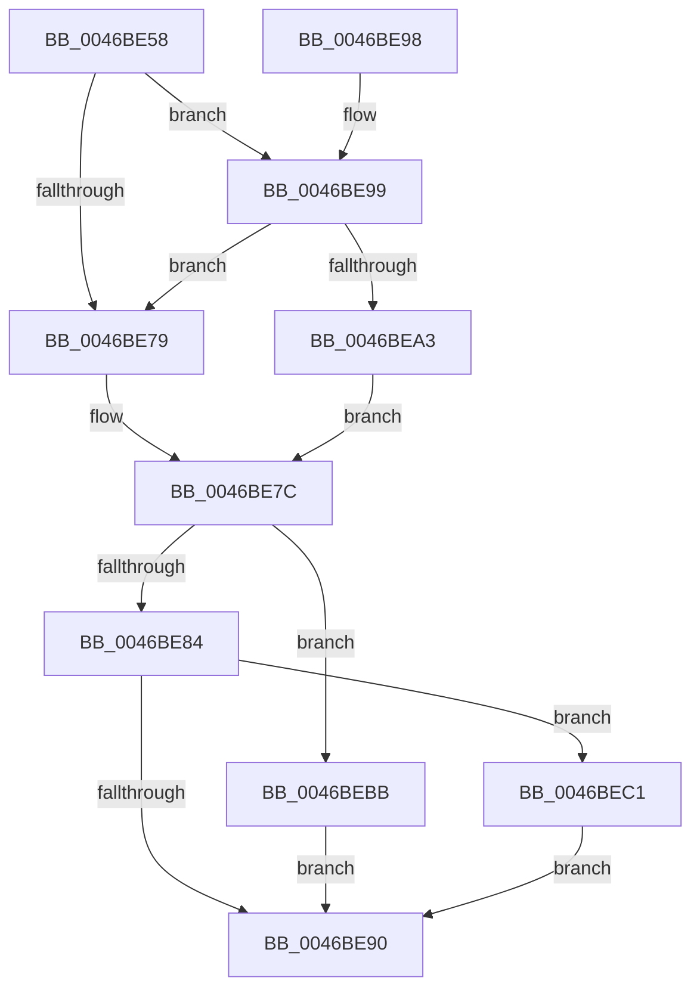

# KiTryToAcquireSpinLockInstrumented

- RVA: `0x0046BE58`–`0x0046BEE7` (길이 `143` bytes)
- VA: `0x000000014046BE58`
- 실행 섹션: `.text`
- PDB 이름 있음: `예`; PDB Function 태그: `아니요`
- unwind 정보 RVA: `0x000AB568`
- 디코드: `43`개 명령, `143/143` bytes 표시
- 미해석 바이트: `0` (있으면 어셈블리에 `.byte`로 보존)

> 이 문서는 커널 이미지의 기계어와 PDB 기호를 분석해 생성했습니다. 4번과 5번은 함수 원형과 자료형을 바이너리 사용 방식에서 추정한 C 해석이며 원본 소스 복구 결과는 아닙니다.

## 1. Dependencies

- 직접 호출 지점: **1**; 고유 호출 대상: **1**
- 직접 호출자로 확인된 함수: **1**
- RIP 상대 이미지 참조: **2**

### Outgoing calls
- `0x0046BEE0` → [PerfLogSpinLockAcquire](../41/PerfLogSpinLockAcquire_function_00414FC4.md) (function, `0x00414FC4`)

### Direct callers
- [KxTryToAcquireSpinLock](KxTryToAcquireSpinLock_function_0046BE18.md) at `0x0046BE47`

### Static image references
- `0x0046BE71` → RVA `0x00FC6B06` (`ALMOSTRO`; reference)
- `0x0046BE99` → RVA `0x00F0DE58` (`.data`; read)

## 2. Other-region calls and transfers

- 다른 실행 섹션으로 향하는 call: **0**
- 별도 외부 분기/꼬리 이동을 확인하지 못했습니다.

## 3. Assembly (complete function range)

```asm
0046BE58  40 53                           push rbx
0046BE5A  48 83 EC 30                     sub rsp, 0x30
0046BE5E  65 4C 8B 04 25 20 00 00 00      mov r8, qword ptr gs:[0x20]
0046BE67  45 33 D2                        xor r10d, r10d
0046BE6A  45 33 DB                        xor r11d, r11d
0046BE6D  41 8D 5A 01                     lea ebx, [r10 + 1]
0046BE71  84 1D 8F AC B5 00               test byte ptr [rip + 0xb5ac8f], bl
0046BE77  75 20                           jne 0x14046be99
0046BE79  45 32 C9                        xor r9b, r9b
0046BE7C  F0 48 0F BA 29 00               lock bts qword ptr [rcx], 0
0046BE82  72 37                           jb 0x14046bebb
0046BE84  41 01 98 C0 8E 00 00            add dword ptr [r8 + 0x8ec0], ebx
0046BE8B  45 84 C9                        test r9b, r9b
0046BE8E  75 31                           jne 0x14046bec1
0046BE90  8A C3                           mov al, bl
0046BE92  48 83 C4 30                     add rsp, 0x30
0046BE96  5B                              pop rbx
0046BE97  C3                              ret
0046BE98  CC                              int3
0046BE99  8B 05 B9 1F AA 00               mov eax, dword ptr [rip + 0xaa1fb9]
0046BE9F  85 C0                           test eax, eax
0046BEA1  75 D6                           jne 0x14046be79
0046BEA3  44 8A CB                        mov r9b, bl
0046BEA6  0F 31                           rdtsc
0046BEA8  45 8B 90 40 86 00 00            mov r10d, dword ptr [r8 + 0x8640]
0046BEAF  48 C1 E2 20                     shl rdx, 0x20
0046BEB3  48 0B C2                        or rax, rdx
0046BEB6  4C 8B D8                        mov r11, rax
0046BEB9  EB C1                           jmp 0x14046be7c
0046BEBB  32 DB                           xor bl, bl
0046BEBD  F3 90                           pause
0046BEBF  EB CF                           jmp 0x14046be90
0046BEC1  0F 31                           rdtsc
0046BEC3  48 C1 E2 20                     shl rdx, 0x20
0046BEC7  45 33 C9                        xor r9d, r9d
0046BECA  48 0B C2                        or rax, rdx
0046BECD  C6 44 24 28 00                  mov byte ptr [rsp + 0x28], 0
0046BED2  44 8B C0                        mov r8d, eax
0046BED5  44 89 54 24 20                  mov dword ptr [rsp + 0x20], r10d
0046BEDA  45 2B C3                        sub r8d, r11d
0046BEDD  48 8B D0                        mov rdx, rax
0046BEE0  E8 DF 90 FA FF                  call 0x140414fc4
0046BEE5  EB A9                           jmp 0x14046be90
```

## 4. C-style interpretation (structured pseudocode)

```c
__int64 __fastcall KiTryToAcquireSpinLockInstrumented(__int64 a1, __int64 a2, __int64 a3, unsigned __int8 a4)
{
    __int64 result;
    __int64 v_r10;
    __int64 v_r11;
    __int64 v_rbx;
    __int64 v_rsp;
    unsigned int v_stack_p20;
    unsigned __int8 v_stack_p28;

    v_rsp = (v_rsp) - (48);
    v_r10 = 0;
    v_r11 = 0;
    if (((*(unsigned __int8 *)(v_rip + 11906191)) & ((unsigned __int8)(v_r10 + 1))) != 0) goto loc_0046BE99;
loc_0046BE79:
    a4 = 0;
loc_0046BE7C:
    if (condition_is_below) goto loc_0046BEBB;
    if (0 != 0) goto loc_0046BEC1;
loc_0046BE90:
    v_rsp = (v_rsp) + (48);
    return (unsigned __int8)(v_r10 + 1);
loc_0046BE99:
    if ((unsigned int)((unsigned int)(*(unsigned int *)(v_rip + 11149241))) != 0) goto loc_0046BE79;
    a2 = (a2) << (32);
    result = ((unsigned int)(*(unsigned int *)(v_rip + 11149241))) | (a2);
    goto loc_0046BE7C;
loc_0046BEBB:
    v_rbx = 0;
    goto loc_0046BE90;
loc_0046BEC1:
    a2 = (a2) << (32);
    a4 = 0;
    result = (result) | (a2);
    v_stack_p28 = 0;
    v_stack_p20 = (unsigned int)((unsigned int)(*(unsigned int *)(*(unsigned __int64 *)(gs_base + (0 + 32)) + 34368)));
    a3 = (unsigned int)(((unsigned int)((unsigned int)(result))) - ((unsigned int)(result)));
    result = PerfLogSpinLockAcquire(a1, result, a3, a4);
    goto loc_0046BE90;
}
```

## 5. (Beta) C Style

```c
int64_t KiTryToAcquireSpinLockInstrumented(void *Arg1, int64_t Arg2, int64_t Arg3, uint8_t Arg4)
{
    uint8_t *arg1 = (uint8_t *)Arg1;

    int64_t result;
    int64_t local_r10;
    int64_t local_r11;
    int64_t local_rbx;
    int64_t local_rsp;
    uint32_t v_stack_p20;
    uint8_t v_stack_p28;

    local_rsp = (local_rsp) - (48);
    local_r10 = 0;
    local_r11 = 0;
    if (((*(uint8_t *)(v_rip + 0xB5AC8F)) & ((uint8_t)(local_r10 + 1))) != 0) goto loc_0046BE99;
loc_0046BE79:
    Arg4 = 0;
loc_0046BE7C:
    if (condition_is_below) goto loc_0046BEBB;
    if (0 != 0) goto loc_0046BEC1;
loc_0046BE90:
    local_rsp = (local_rsp) + (48);
    return (uint8_t)(local_r10 + 1);
loc_0046BE99:
    if ((uint32_t)((uint32_t)(*(uint32_t *)(v_rip + 0xAA1FB9))) != 0) goto loc_0046BE79;
    Arg2 = (Arg2) << (32);
    result = ((uint32_t)(*(uint32_t *)(v_rip + 0xAA1FB9))) | (Arg2);
    goto loc_0046BE7C;
loc_0046BEBB:
    local_rbx = 0;
    goto loc_0046BE90;
loc_0046BEC1:
    Arg2 = (Arg2) << (32);
    Arg4 = 0;
    result = (result) | (Arg2);
    v_stack_p28 = 0;
    v_stack_p20 = (uint32_t)((uint32_t)(*(uint32_t *)(*(uint64_t *)(gs_base + (0 + 0x20)) + 0x8640)));
    Arg3 = (uint32_t)(((uint32_t)((uint32_t)(result))) - ((uint32_t)(result)));
    result = PerfLogSpinLockAcquire(Arg1, result, Arg3, Arg4);
    goto loc_0046BE90;
}
```

### 관측된 메모리 오프셋

구조체 형식이 확인되지 않은 접근은 인자 기준의 오프셋으로만 기록했습니다.

| 기준 인자 | 오프셋 표현 | 폭 (bit) | 접근 |
|---|---:|---:|---|
| `Arg1` | `+ 0x0` | `64` | `R/W` |

## 6. Execution-region graph

[열기: 2D/3D 그래프와 함수 탐색 컨트롤 패널](../../../control-panel.html?section=text&rva=0x0046BE58&view=graph)

- 2D 그래프는 위에서 아래로 흐르고, 3D 그래프는 빈 공간을 드래그해 회전합니다. Shift+드래그는 이동, 휠은 확대·축소, 함수 노드 선택은 대상 보고서 이동입니다.

### Static fallback


