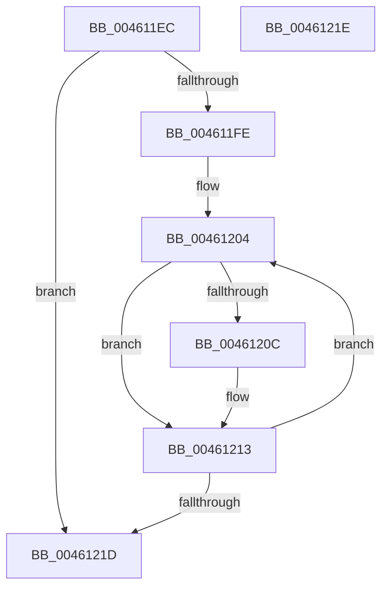

# KiUnlockKobjectArray

- RVA: `0x004611EC`–`0x0046121F` (길이 `51` bytes)
- VA: `0x00000001404611EC`
- 실행 섹션: `.text`
- PDB 이름 있음: `예`; PDB Function 태그: `아니요`
- unwind 정보 RVA: `0x000DB714`
- 디코드: `17`개 명령, `51/51` bytes 표시
- 미해석 바이트: `0` (있으면 어셈블리에 `.byte`로 보존)

> 이 문서는 커널 이미지의 기계어와 PDB 기호를 분석해 생성했습니다. 4번과 5번은 함수 원형과 자료형을 바이너리 사용 방식에서 추정한 C 해석이며 원본 소스 복구 결과는 아닙니다.

## 1. Dependencies

- 직접 호출 지점: **0**; 고유 호출 대상: **0**
- 직접 호출자로 확인된 함수: **1**
- RIP 상대 이미지 참조: **0**

### Outgoing calls
- 직접 디코드된 call 명령이 없습니다.

### Direct callers
- [KiWaitForAllObjects](../3C/KiWaitForAllObjects_function_003C5800.md) at `0x003C5F62`

### Static image references
- 디코드된 RIP-relative 메모리 참조가 없습니다.

## 2. Other-region calls and transfers

- 다른 실행 섹션으로 향하는 call: **0**
- 별도 외부 분기/꼬리 이동을 확인하지 못했습니다.

## 3. Assembly (complete function range)

```asm
004611EC  4C 8B 01                        mov r8, qword ptr [rcx]
004611EF  41 B9 7F FF FF FF               mov r9d, 0xffffff7f
004611F5  F0 45 21 08                     lock and dword ptr [r8], r9d
004611F9  83 FA 01                        cmp edx, 1
004611FC  76 1F                           jbe 0x14046121d
004611FE  48 83 C1 08                     add rcx, 8
00461202  FF CA                           dec edx
00461204  48 8B 01                        mov rax, qword ptr [rcx]
00461207  49 3B C0                        cmp rax, r8
0046120A  74 07                           je 0x140461213
0046120C  4C 8B C0                        mov r8, rax
0046120F  F0 44 21 08                     lock and dword ptr [rax], r9d
00461213  48 83 C1 08                     add rcx, 8
00461217  48 83 EA 01                     sub rdx, 1
0046121B  75 E7                           jne 0x140461204
0046121D  C3                              ret
0046121E  CC                              int3
```

## 4. C-style interpretation (structured pseudocode)

```c
__int64 __fastcall KiUnlockKobjectArray(__int64 a1, int a2)
{
    if (a2 <= 1) goto loc_0046121D;
    a1 = (a1) + (8);
    a2 = (unsigned int)((a2) - 1);
loc_00461204:
    if ((*(unsigned __int64 *)(a1)) != (*(unsigned __int64 *)(a1))) {
        a3 = *(unsigned __int64 *)(a1);
    }
    a1 = (a1) + (8);
    a2 = (a2) - (1);
    if (condition_is_not_equal) goto loc_00461204;
loc_0046121D:
    return *(unsigned __int64 *)(a1);
}
```

## 5. (Beta) C Style

```c
int64_t KiUnlockKobjectArray(void *Arg1, int32_t Arg2)
{
    uint8_t *arg1 = (uint8_t *)Arg1;

    if (Arg2 <= 1) goto loc_0046121D;
    Arg1 = (Arg1) + (8);
    Arg2 = (uint32_t)((Arg2) - 1);
loc_00461204:
    if ((*(uint64_t *)(arg1)) != (*(uint64_t *)(arg1))) {
        a3 = *(uint64_t *)(arg1);
    }
    Arg1 = (Arg1) + (8);
    Arg2 = (Arg2) - (1);
    if (condition_is_not_equal) goto loc_00461204;
loc_0046121D:
    return *(uint64_t *)(arg1);
}
```

### 관측된 메모리 오프셋

구조체 형식이 확인되지 않은 접근은 인자 기준의 오프셋으로만 기록했습니다.

| 기준 인자 | 오프셋 표현 | 폭 (bit) | 접근 |
|---|---:|---:|---|
| `Arg1` | `+ 0x0` | `64` | `R` |

## 6. Execution-region graph

[열기: 2D/3D 그래프와 함수 탐색 컨트롤 패널](../../../control-panel.html?section=text&rva=0x004611EC&view=graph)

- 2D 그래프는 위에서 아래로 흐르고, 3D 그래프는 빈 공간을 드래그해 회전합니다. Shift+드래그는 이동, 휠은 확대·축소, 함수 노드 선택은 대상 보고서 이동입니다.

### Static fallback


