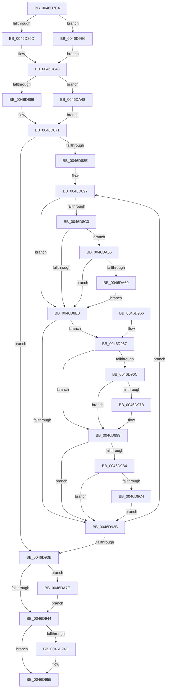

# KiUpdateCpuTargetByRate

- RVA: `0x0046D7E4`–`0x0046DA8E` (길이 `682` bytes)
- VA: `0x000000014046D7E4`
- 실행 섹션: `.text`
- PDB 이름 있음: `예`; PDB Function 태그: `아니요`
- unwind 정보 RVA: `0x000ABA7C`
- 디코드: `164`개 명령, `682/682` bytes 표시
- 미해석 바이트: `0` (있으면 어셈블리에 `.byte`로 보존)

> 이 문서는 커널 이미지의 기계어와 PDB 기호를 분석해 생성했습니다. 4번과 5번은 함수 원형과 자료형을 바이너리 사용 방식에서 추정한 C 해석이며 원본 소스 복구 결과는 아닙니다.

## 1. Dependencies

- 직접 호출 지점: **9**; 고유 호출 대상: **7**
- 직접 호출자로 확인된 함수: **4**
- RIP 상대 이미지 참조: **5**

### Outgoing calls
- `0x0046D8CA` → [KiAcquirePrcbLocksForIsolationUnit](../30/KiAcquirePrcbLocksForIsolationUnit_function_0030ED60.md) (function, `0x0030ED60`)
- `0x0046D950` → [KiUpdateChildrenCpuTarget](../5C/KiUpdateChildrenCpuTarget_function_005C8BD0.md) (function, `0x005C8BD0`)
- `0x0046D981` → [KiResetScb](KiResetScb_function_0046DA94.md) (function, `0x0046DA94`)
- `0x0046D994` → [KiCheckForEffectivePriorityChange](KiCheckForEffectivePriorityChange_function_0046DD94.md) (function, `0x0046DD94`)
- `0x0046D99E` → [KiReleasePrcbLocksForIsolationUnit](../39/KiReleasePrcbLocksForIsolationUnit_function_00399C50.md) (function, `0x00399C50`)
- `0x0046D9D9` → [EtwTraceScbRankChange](../4F/EtwTraceScbRankChange_function_004F899C.md) (function, `0x004F899C`)
- `0x0046D9F4` → [KiAcquirePrcbLocksForIsolationUnit](../30/KiAcquirePrcbLocksForIsolationUnit_function_0030ED60.md) (function, `0x0030ED60`)
- `0x0046DA3B` → [KiReleasePrcbLocksForIsolationUnit](../39/KiReleasePrcbLocksForIsolationUnit_function_00399C50.md) (function, `0x00399C50`)
- `0x0046DA80` → [KeQueryPerformanceCounter](../37/KeQueryPerformanceCounter_function_0037E7E0.md) (function, `0x0037E7E0`)

### Direct callers
- [KeInsertSchedulingGroup](KeInsertSchedulingGroup_function_0046D324.md) at `0x0046D5AB`
- [KeSetSchedulingGroupCpuRates](KeSetSchedulingGroupCpuRates_function_0046DE5C.md) at `0x0046DF2E`
- [KiUpdateChildrenCpuTarget](../5C/KiUpdateChildrenCpuTarget_function_005C8BD0.md) at `0x005C8BFD`
- [KeUpdateGroupSchedulingConstants](../5C/KeUpdateGroupSchedulingConstants_function_005C8E14.md) at `0x005C8EEF`

### Static image references
- `0x0046D81A` → RVA `0x00FC5138` (`ALMOSTRO`; read)
- `0x0046D871` → RVA `0x00FC6A80` (`ALMOSTRO`; read)
- `0x0046D87A` → RVA `0x00FC6AE8` (`ALMOSTRO`; read)
- `0x0046D89A` → RVA `0x00FC8C40` (`ALMOSTRO`; read)
- `0x0046D9B4` → RVA `0x00FC6B14` (`ALMOSTRO`; read)

## 2. Other-region calls and transfers

- 다른 실행 섹션으로 향하는 call: **0**
- 별도 외부 분기/꼬리 이동을 확인하지 못했습니다.

## 3. Assembly (complete function range)

```asm
0046D7E4  40 53                           push rbx
0046D7E6  55                              push rbp
0046D7E7  56                              push rsi
0046D7E8  57                              push rdi
0046D7E9  41 54                           push r12
0046D7EB  41 55                           push r13
0046D7ED  41 56                           push r14
0046D7EF  41 57                           push r15
0046D7F1  48 83 EC 38                     sub rsp, 0x38
0046D7F5  45 33 C9                        xor r9d, r9d
0046D7F8  44 8A E2                        mov r12b, dl
0046D7FB  48 8B D9                        mov rbx, rcx
0046D7FE  4C 89 4C 24 20                  mov qword ptr [rsp + 0x20], r9
0046D803  4C 39 49 60                     cmp qword ptr [rcx + 0x60], r9
0046D807  0F 85 D9 01 00 00               jne 0x14046d9e6
0046D80D  0F B7 09                        movzx ecx, word ptr [rcx]
0046D810  49 BA 4B 59 86 38 D6 C5 6D 34   movabs r10, 0x346dc5d63886594b
0046D81A  48 0F AF 0D 16 79 B5 00         imul rcx, qword ptr [rip + 0xb57916]
0046D822  49 8B C2                        mov rax, r10
0046D825  48 F7 E1                        mul rcx
0046D828  0F B7 4B 02                     movzx ecx, word ptr [rbx + 2]
0046D82C  49 8B C2                        mov rax, r10
0046D82F  48 0F AF 0D 01 79 B5 00         imul rcx, qword ptr [rip + 0xb57901]
0046D837  48 8B EA                        mov rbp, rdx
0046D83A  48 F7 E1                        mul rcx
0046D83D  48 C1 ED 0B                     shr rbp, 0xb
0046D841  48 8B FA                        mov rdi, rdx
0046D844  48 C1 EF 0B                     shr rdi, 0xb
0046D848  48 3B 3D E9 78 B5 00            cmp rdi, qword ptr [rip + 0xb578e9]
0046D84F  0F 94 C1                        sete cl
0046D852  48 3B 2D DF 78 B5 00            cmp rbp, qword ptr [rip + 0xb578df]
0046D859  88 8C 24 80 00 00 00            mov byte ptr [rsp + 0x80], cl
0046D860  0F 85 E2 01 00 00               jne 0x14046da48
0046D866  C7 84 24 90 00 00 00 20 00 00 00  mov dword ptr [rsp + 0x90], 0x20
0046D871  8B 05 09 92 B5 00               mov eax, dword ptr [rip + 0xb59209]
0046D877  45 8B F1                        mov r14d, r9d
0046D87A  44 39 0D 67 92 B5 00            cmp dword ptr [rip + 0xb59267], r9d
0046D881  89 84 24 98 00 00 00            mov dword ptr [rsp + 0x98], eax
0046D888  0F 86 AD 00 00 00               jbe 0x14046d93b
0046D88E  44 0F B6 E9                     movzx r13d, cl
0046D892  66 41 C1 E5 04                  shl r13w, 4
0046D897  41 8B CE                        mov ecx, r14d
0046D89A  4C 8D 3D 9F B3 B5 00            lea r15, [rip + 0xb5b39f]
0046D8A1  48 69 F1 B8 01 00 00            imul rsi, rcx, 0x1b8
0046D8A8  4D 8B 3C CF                     mov r15, qword ptr [r15 + rcx*8]
0046D8AC  48 83 EE 80                     sub rsi, -0x80
0046D8B0  44 88 8C 24 88 00 00 00         mov byte ptr [rsp + 0x88], r9b
0046D8B8  48 03 F3                        add rsi, rbx
0046D8BB  4D 85 FF                        test r15, r15
0046D8BE  74 20                           je 0x14046d8e0
0046D8C0  4C 8D 44 24 20                  lea r8, [rsp + 0x20]
0046D8C5  33 D2                           xor edx, edx
0046D8C7  49 8B CF                        mov rcx, r15
0046D8CA  E8 91 14 EA FF                  call 0x14030ed60
0046D8CF  45 33 C9                        xor r9d, r9d
0046D8D2  44 38 8C 24 80 00 00 00         cmp byte ptr [rsp + 0x80], r9b
0046D8DA  0F 84 76 01 00 00               je 0x14046da56
0046D8E0  0F B7 4E 70                     movzx ecx, word ptr [rsi + 0x70]
0046D8E4  B8 EF FF 00 00                  mov eax, 0xffef
0046D8E9  66 23 C8                        and cx, ax
0046D8EC  48 89 6E 08                     mov qword ptr [rsi + 8], rbp
0046D8F0  66 41 0B CD                     or cx, r13w
0046D8F4  48 89 7E 10                     mov qword ptr [rsi + 0x10], rdi
0046D8F8  B8 DF FF 00 00                  mov eax, 0xffdf
0046D8FD  BA 80 00 00 00                  mov edx, 0x80
0046D902  66 23 C8                        and cx, ax
0046D905  66 0B 8C 24 90 00 00 00         or cx, word ptr [rsp + 0x90]
0046D90D  66 89 4E 70                     mov word ptr [rsi + 0x70], cx
0046D911  0F B7 43 04                     movzx eax, word ptr [rbx + 4]
0046D915  66 C1 E0 04                     shl ax, 4
0046D919  66 33 C1                        xor ax, cx
0046D91C  66 23 C2                        and ax, dx
0046D91F  66 33 C1                        xor ax, cx
0046D922  66 89 46 70                     mov word ptr [rsi + 0x70], ax
0046D926  4D 85 FF                        test r15, r15
0046D929  75 3C                           jne 0x14046d967
0046D92B  41 FF C6                        inc r14d
0046D92E  44 3B 35 B3 91 B5 00            cmp r14d, dword ptr [rip + 0xb591b3]
0046D935  0F 82 5C FF FF FF               jb 0x14046d897
0046D93B  45 84 E4                        test r12b, r12b
0046D93E  0F 85 3A 01 00 00               jne 0x14046da7e
0046D944  48 8D 4B 50                     lea rcx, [rbx + 0x50]
0046D948  48 39 09                        cmp qword ptr [rcx], rcx
0046D94B  74 08                           je 0x14046d955
0046D94D  41 8A D4                        mov dl, r12b
0046D950  E8 7B B2 15 00                  call 0x1405c8bd0
0046D955  48 83 C4 38                     add rsp, 0x38
0046D959  41 5F                           pop r15
0046D95B  41 5E                           pop r14
0046D95D  41 5D                           pop r13
0046D95F  41 5C                           pop r12
0046D961  5F                              pop rdi
0046D962  5E                              pop rsi
0046D963  5D                              pop rbp
0046D964  5B                              pop rbx
0046D965  C3                              ret
0046D966  CC                              int3
0046D967  45 84 E4                        test r12b, r12b
0046D96A  74 2D                           je 0x14046d999
0046D96C  4C 89 4E 20                     mov qword ptr [rsi + 0x20], r9
0046D970  4C 89 4E 30                     mov qword ptr [rsi + 0x30], r9
0046D974  8B 43 04                        mov eax, dword ptr [rbx + 4]
0046D977  A8 02                           test al, 2
0046D979  74 1E                           je 0x14046d999
0046D97B  49 8B D7                        mov rdx, r15
0046D97E  48 8B CE                        mov rcx, rsi
0046D981  E8 0E 01 00 00                  call 0x14046da94
0046D986  4C 8B C6                        mov r8, rsi
0046D989  C6 84 24 88 00 00 00 01         mov byte ptr [rsp + 0x88], 1
0046D991  49 8B CF                        mov rcx, r15
0046D994  E8 FB 03 00 00                  call 0x14046dd94
0046D999  48 8D 4C 24 20                  lea rcx, [rsp + 0x20]
0046D99E  E8 AD C2 F2 FF                  call 0x140399c50
0046D9A3  45 33 C9                        xor r9d, r9d
0046D9A6  44 38 8C 24 88 00 00 00         cmp byte ptr [rsp + 0x88], r9b
0046D9AE  0F 84 77 FF FF FF               je 0x14046d92b
0046D9B4  F7 05 56 91 B5 00 00 40 00 00   test dword ptr [rip + 0xb59156], 0x4000
0046D9BE  0F 84 67 FF FF FF               je 0x14046d92b
0046D9C4  44 8A 4E 70                     mov r9b, byte ptr [rsi + 0x70]
0046D9C8  41 8B D6                        mov edx, r14d
0046D9CB  44 8B 46 7C                     mov r8d, dword ptr [rsi + 0x7c]
0046D9CF  48 8B CB                        mov rcx, rbx
0046D9D2  41 D0 E9                        shr r9b, 1
0046D9D5  41 80 E1 01                     and r9b, 1
0046D9D9  E8 BE AF 08 00                  call 0x1404f899c
0046D9DE  45 33 C9                        xor r9d, r9d
0046D9E1  E9 45 FF FF FF                  jmp 0x14046d92b
0046D9E6  48 8B 0D 53 B2 B5 00            mov rcx, qword ptr [rip + 0xb5b253]
0046D9ED  4C 8D 44 24 20                  lea r8, [rsp + 0x20]
0046D9F2  33 D2                           xor edx, edx
0046D9F4  E8 67 13 EA FF                  call 0x14030ed60
0046D9F9  4C 8B 8B 20 02 00 00            mov r9, qword ptr [rbx + 0x220]
0046DA00  49 BA 4B 59 86 38 D6 C5 6D 34   movabs r10, 0x346dc5d63886594b
0046DA0A  44 0F B7 03                     movzx r8d, word ptr [rbx]
0046DA0E  49 8B C2                        mov rax, r10
0046DA11  0F B7 4B 02                     movzx ecx, word ptr [rbx + 2]
0046DA15  49 0F AF 49 10                  imul rcx, qword ptr [r9 + 0x10]
0046DA1A  4D 0F AF 41 08                  imul r8, qword ptr [r9 + 8]
0046DA1F  49 F7 E0                        mul r8
0046DA22  49 8B C2                        mov rax, r10
0046DA25  48 8B EA                        mov rbp, rdx
0046DA28  48 F7 E1                        mul rcx
0046DA2B  48 8D 4C 24 20                  lea rcx, [rsp + 0x20]
0046DA30  48 C1 ED 0B                     shr rbp, 0xb
0046DA34  48 8B FA                        mov rdi, rdx
0046DA37  48 C1 EF 0B                     shr rdi, 0xb
0046DA3B  E8 10 C2 F2 FF                  call 0x140399c50
0046DA40  45 33 C9                        xor r9d, r9d
0046DA43  E9 00 FE FF FF                  jmp 0x14046d848
0046DA48  66 44 89 8C 24 90 00 00 00      mov word ptr [rsp + 0x90], r9w
0046DA51  E9 1B FE FF FF                  jmp 0x14046d871
0046DA56  45 38 4F 21                     cmp byte ptr [r15 + 0x21], r9b
0046DA5A  0F 84 80 FE FF FF               je 0x14046d8e0
0046DA60  8B 8C 24 98 00 00 00            mov ecx, dword ptr [rsp + 0x98]
0046DA67  8B C1                           mov eax, ecx
0046DA69  48 0F AF C7                     imul rax, rdi
0046DA6D  48 0F AF CF                     imul rcx, rdi
0046DA71  48 89 43 28                     mov qword ptr [rbx + 0x28], rax
0046DA75  48 89 4B 30                     mov qword ptr [rbx + 0x30], rcx
0046DA79  E9 62 FE FF FF                  jmp 0x14046d8e0
0046DA7E  33 C9                           xor ecx, ecx
0046DA80  E8 5B 0D F1 FF                  call 0x14037e7e0
0046DA85  48 89 43 18                     mov qword ptr [rbx + 0x18], rax
0046DA89  E9 B6 FE FF FF                  jmp 0x14046d944
```

## 4. C-style interpretation (structured pseudocode)

```c
__int64 __fastcall KiUpdateCpuTargetByRate(__int64 a1, __int64 a2, __int64 a3, int a4)
{
    __int64 result;
    __int64 v_r13;
    __int64 v_r14;
    __int64 v_rbp;
    __int64 v_rdi;
    __int64 v_rsi;
    __int64 v_rsp;
    unsigned __int64 v_stack_m58;
    unsigned __int8 v_stack_p10;
    unsigned int v_stack_p18;
    unsigned int v_stack_p20;
    unsigned __int8 v_stack_p8;
    unsigned __int8 v_stack_p88;
    unsigned __int16 v_stack_p90;
    unsigned int v_stack_p98;

    v_rsp = (v_rsp) - (56);
    a4 = 0;
    v_stack_m58 = 0;
    if ((*(unsigned __int64 *)(a1 + 96)) != 0) goto loc_0046D9E6;
    a1 = (*(unsigned __int16 *)(a1)) * (*(unsigned __int64 *)(v_rip + 11893014));
    a1 = (*(unsigned __int16 *)(a1 + 2)) * (*(unsigned __int64 *)(v_rip + 11892993));
    v_rbp = (a2) >> (11);
    v_rdi = (a2) >> (11);
loc_0046D848:
    a1 = (v_rdi == (*(unsigned __int64 *)(v_rip + 11892969))) ? 1 : 0;
    v_stack_p8 = (unsigned __int8)(a1);
    if (v_rbp != (*(unsigned __int64 *)(v_rip + 11892959))) goto loc_0046DA48;
    v_stack_p18 = 32;
loc_0046D871:
    v_stack_p20 = (unsigned int)((unsigned int)(*(unsigned int *)(v_rip + 11899401)));
    if ((*(unsigned int *)(v_rip + 11899495)) <= 0) goto loc_0046D93B;
    v_r13 = (unsigned __int16)(((unsigned __int8)(a1)) << (4));
loc_0046D897:
    v_rsi = (v_rsi) * (0);
    v_rsi = (v_rsi) - (-128);
    v_stack_p10 = 0;
    v_rsi = (v_rsi) + (a1);
    if (*(unsigned __int64 *)(v_rip + 11907999 + 0 * 8) == 0) goto loc_0046D8E0;
    a2 = 0;
    result = KiAcquirePrcbLocksForIsolationUnit(*(unsigned __int64 *)(v_rip + 11907999 + 0 * 8), a2, v_stack_m58, a4);
    a4 = 0;
    if (v_stack_p8 == 0) goto loc_0046DA56;
loc_0046D8E0:
    a1 = (unsigned __int16)((*(unsigned __int16 *)(v_rsi + 112)) & ((unsigned __int16)((unsigned int)(0xFFEFULL))));
    *(unsigned __int64 *)(v_rsi + 8) = v_rbp;
    a1 = (unsigned __int16)((a1) | ((unsigned __int16)(v_r13)));
    *(unsigned __int64 *)(v_rsi + 16) = v_rdi;
    a1 = (unsigned __int16)((a1) & ((unsigned __int16)((unsigned int)(0xFFDFULL))));
    a1 = (unsigned __int16)((a1) | (v_stack_p18));
    *(unsigned __int16 *)(v_rsi + 112) = (unsigned __int16)(a1);
    result = (unsigned __int16)((*(unsigned __int16 *)(a1 + 4)) << (4));
    result = (unsigned __int16)((result) ^ ((unsigned __int16)(a1)));
    result = (unsigned __int16)((result) & (128));
    result = (unsigned __int16)((result) ^ ((unsigned __int16)(a1)));
    *(unsigned __int16 *)(v_rsi + 112) = (unsigned __int16)(result);
    if (*(unsigned __int64 *)(v_rip + 11907999 + 0 * 8) != 0) goto loc_0046D967;
loc_0046D92B:
    v_r14 = (unsigned int)((0) + 1);
    if (((unsigned int)(v_r14)) < (*(unsigned int *)(v_rip + 11899315))) goto loc_0046D897;
loc_0046D93B:
    if ((unsigned __int8)((unsigned __int8)(a2)) != 0) goto loc_0046DA7E;
loc_0046D944:
    if ((*(unsigned __int64 *)(a1 + 80)) != (a1 + 80)) {
        a2 = (unsigned __int8)((unsigned __int8)(a2));
        result = KiUpdateChildrenCpuTarget(a1 + 80, a2, v_stack_m58, a4);
    }
    v_rsp = (v_rsp) + (56);
    return result;
loc_0046D967:
    if ((unsigned __int8)((unsigned __int8)(a2)) == 0) goto loc_0046D999;
    *(unsigned __int64 *)(v_rsi + 32) = 0;
    *(unsigned __int64 *)(v_rsi + 48) = 0;
    result = (unsigned int)(*(unsigned int *)(a1 + 4));
    if ((((unsigned __int8)((unsigned int)(*(unsigned int *)(a1 + 4)))) & (2)) != 0) {
        a2 = *(unsigned __int64 *)(v_rip + 11907999 + 0 * 8);
        a1 = v_rsi;
        result = KiResetScb(a1, a2, v_stack_m58, a4);
        a3 = v_rsi;
        v_stack_p88 = 1;
        a1 = *(unsigned __int64 *)(v_rip + 11907999 + 0 * 8);
        result = KiCheckForEffectivePriorityChange(a1, a2, a3, a4);
    }
    result = KiReleasePrcbLocksForIsolationUnit(v_stack_p20, a2, a3, a4);
    a4 = 0;
    if (v_stack_p88 == 0) goto loc_0046D92B;
    if (((*(unsigned int *)(v_rip + 11899222)) & (0x4000ULL)) == 0) goto loc_0046D92B;
    a4 = (unsigned __int8)((*(unsigned __int8 *)(v_rsi + 112)) >> (1));
    a4 = (unsigned __int8)((a4) & (1));
    result = EtwTraceScbRankChange(a1, (unsigned int)((unsigned int)(v_r14)), (unsigned int)(*(unsigned int *)(v_rsi + 124)), a4);
    a4 = 0;
    goto loc_0046D92B;
loc_0046D9E6:
    a2 = 0;
    result = KiAcquirePrcbLocksForIsolationUnit(*(unsigned __int64 *)(v_rip + 11907667), a2, v_stack_p20, a4);
    a1 = (*(unsigned __int16 *)(a1 + 2)) * (*(unsigned __int64 *)(*(unsigned __int64 *)(a1 + 544) + 16));
    a3 = (*(unsigned __int16 *)(a1)) * (*(unsigned __int64 *)(*(unsigned __int64 *)(a1 + 544) + 8));
    v_rbp = (0) >> (11);
    v_rdi = (0) >> (11);
    result = KiReleasePrcbLocksForIsolationUnit(v_stack_p20, a2, a3, *(unsigned __int64 *)(a1 + 544));
    a4 = 0;
    goto loc_0046D848;
loc_0046DA48:
    v_stack_p90 = 0;
    goto loc_0046D871;
loc_0046DA56:
    if ((*(unsigned __int8 *)(*(unsigned __int64 *)(v_rip + 11907999 + 0 * 8) + 33)) == 0) goto loc_0046D8E0;
    result = ((unsigned int)((unsigned int)((unsigned int)(v_stack_p98)))) * (v_rdi);
    a1 = ((unsigned int)(v_stack_p98)) * (v_rdi);
    *(unsigned __int64 *)(a1 + 40) = result;
    *(unsigned __int64 *)(a1 + 48) = a1;
    goto loc_0046D8E0;
loc_0046DA7E:
    a1 = 0;
    result = KeQueryPerformanceCounter(a1, a2, a3, a4);
    *(unsigned __int64 *)(a1 + 24) = result;
    goto loc_0046D944;
}
```

## 5. (Beta) C Style

```c
int64_t KiUpdateCpuTargetByRate(void *Arg1, int64_t Arg2, int64_t Arg3, int32_t Arg4)
{
    uint8_t *arg1 = (uint8_t *)Arg1;

    int64_t result;
    int64_t local_r13;
    int64_t local_r14;
    int64_t local_rbp;
    int64_t local_rdi;
    int64_t local_rsi;
    int64_t local_rsp;
    uint64_t v_stack_m58;
    uint8_t v_stack_p10;
    uint32_t v_stack_p18;
    uint32_t v_stack_p20;
    uint8_t v_stack_p8;
    uint8_t v_stack_p88;
    uint16_t v_stack_p90;
    uint32_t v_stack_p98;

    local_rsp = (local_rsp) - (56);
    Arg4 = 0;
    v_stack_m58 = 0;
    if ((*(uint64_t *)(arg1 + 0x60)) != 0) goto loc_0046D9E6;
    Arg1 = (*(uint16_t *)(arg1)) * (*(uint64_t *)(v_rip + 0xB57916));
    Arg1 = (*(uint16_t *)(arg1 + 0x2)) * (*(uint64_t *)(v_rip + 0xB57901));
    local_rbp = (Arg2) >> (11);
    local_rdi = (Arg2) >> (11);
loc_0046D848:
    Arg1 = (local_rdi == (*(uint64_t *)(v_rip + 0xB578E9))) ? 1 : 0;
    v_stack_p8 = (uint8_t)(Arg1);
    if (local_rbp != (*(uint64_t *)(v_rip + 0xB578DF))) goto loc_0046DA48;
    v_stack_p18 = 32;
loc_0046D871:
    v_stack_p20 = (uint32_t)((uint32_t)(*(uint32_t *)(v_rip + 0xB59209)));
    if ((*(uint32_t *)(v_rip + 0xB59267)) <= 0) goto loc_0046D93B;
    local_r13 = (uint16_t)(((uint8_t)(Arg1)) << (4));
loc_0046D897:
    local_rsi = (local_rsi) * (0);
    local_rsi = (local_rsi) - (-128);
    v_stack_p10 = 0;
    local_rsi = (local_rsi) + (Arg1);
    if (*(uint64_t *)(v_rip + 0xB5B39F + 0x0 * 8) == 0) goto loc_0046D8E0;
    Arg2 = 0;
    result = KiAcquirePrcbLocksForIsolationUnit(*(uint64_t *)(v_rip + 0xB5B39F + 0x0 * 8), Arg2, v_stack_m58, Arg4);
    Arg4 = 0;
    if (v_stack_p8 == 0) goto loc_0046DA56;
loc_0046D8E0:
    Arg1 = (uint16_t)((*(uint16_t *)(local_rsi + 0x70)) & ((uint16_t)((uint32_t)(0xFFEFULL))));
    *(uint64_t *)(local_rsi + 0x8) = local_rbp;
    Arg1 = (uint16_t)((Arg1) | ((uint16_t)(local_r13)));
    *(uint64_t *)(local_rsi + 0x10) = local_rdi;
    Arg1 = (uint16_t)((Arg1) & ((uint16_t)((uint32_t)(0xFFDFULL))));
    Arg1 = (uint16_t)((Arg1) | (v_stack_p18));
    *(uint16_t *)(local_rsi + 0x70) = (uint16_t)(Arg1);
    result = (uint16_t)((*(uint16_t *)(arg1 + 0x4)) << (4));
    result = (uint16_t)((result) ^ ((uint16_t)(Arg1)));
    result = (uint16_t)((result) & (128));
    result = (uint16_t)((result) ^ ((uint16_t)(Arg1)));
    *(uint16_t *)(local_rsi + 0x70) = (uint16_t)(result);
    if (*(uint64_t *)(v_rip + 0xB5B39F + 0x0 * 8) != 0) goto loc_0046D967;
loc_0046D92B:
    local_r14 = (uint32_t)((0) + 1);
    if (((uint32_t)(local_r14)) < (*(uint32_t *)(v_rip + 0xB591B3))) goto loc_0046D897;
loc_0046D93B:
    if ((uint8_t)((uint8_t)(Arg2)) != 0) goto loc_0046DA7E;
loc_0046D944:
    if ((*(uint64_t *)(arg1 + 0x50)) != (Arg1 + 80)) {
        Arg2 = (uint8_t)((uint8_t)(Arg2));
        result = KiUpdateChildrenCpuTarget(Arg1 + 80, Arg2, v_stack_m58, Arg4);
    }
    local_rsp = (local_rsp) + (56);
    return result;
loc_0046D967:
    if ((uint8_t)((uint8_t)(Arg2)) == 0) goto loc_0046D999;
    *(uint64_t *)(local_rsi + 0x20) = 0;
    *(uint64_t *)(local_rsi + 0x30) = 0;
    result = (uint32_t)(*(uint32_t *)(arg1 + 0x4));
    if ((((uint8_t)((uint32_t)(*(uint32_t *)(arg1 + 0x4)))) & (2)) != 0) {
        Arg2 = *(uint64_t *)(v_rip + 0xB5B39F + 0x0 * 8);
        Arg1 = local_rsi;
        result = KiResetScb(Arg1, Arg2, v_stack_m58, Arg4);
        Arg3 = local_rsi;
        v_stack_p88 = 1;
        Arg1 = *(uint64_t *)(v_rip + 0xB5B39F + 0x0 * 8);
        result = KiCheckForEffectivePriorityChange(Arg1, Arg2, Arg3, Arg4);
    }
    result = KiReleasePrcbLocksForIsolationUnit(v_stack_p20, Arg2, Arg3, Arg4);
    Arg4 = 0;
    if (v_stack_p88 == 0) goto loc_0046D92B;
    if (((*(uint32_t *)(v_rip + 0xB59156)) & (0x4000ULL)) == 0) goto loc_0046D92B;
    Arg4 = (uint8_t)((*(uint8_t *)(local_rsi + 0x70)) >> (1));
    Arg4 = (uint8_t)((Arg4) & (1));
    result = EtwTraceScbRankChange(Arg1, (uint32_t)((uint32_t)(local_r14)), (uint32_t)(*(uint32_t *)(local_rsi + 0x7C)), Arg4);
    Arg4 = 0;
    goto loc_0046D92B;
loc_0046D9E6:
    Arg2 = 0;
    result = KiAcquirePrcbLocksForIsolationUnit(*(uint64_t *)(v_rip + 0xB5B253), Arg2, v_stack_p20, Arg4);
    Arg1 = (*(uint16_t *)(arg1 + 0x2)) * (*(uint64_t *)(*(uint64_t *)(arg1 + 0x220) + 0x10));
    Arg3 = (*(uint16_t *)(arg1)) * (*(uint64_t *)(*(uint64_t *)(arg1 + 0x220) + 0x8));
    local_rbp = (0) >> (11);
    local_rdi = (0) >> (11);
    result = KiReleasePrcbLocksForIsolationUnit(v_stack_p20, Arg2, Arg3, *(uint64_t *)(arg1 + 0x220));
    Arg4 = 0;
    goto loc_0046D848;
loc_0046DA48:
    v_stack_p90 = 0;
    goto loc_0046D871;
loc_0046DA56:
    if ((*(uint8_t *)(*(uint64_t *)(v_rip + 0xB5B39F + 0x0 * 8) + 0x21)) == 0) goto loc_0046D8E0;
    result = ((uint32_t)((uint32_t)((uint32_t)(v_stack_p98)))) * (local_rdi);
    Arg1 = ((uint32_t)(v_stack_p98)) * (local_rdi);
    *(uint64_t *)(arg1 + 0x28) = result;
    *(void **)(arg1 + 0x30) = Arg1;
    goto loc_0046D8E0;
loc_0046DA7E:
    Arg1 = 0;
    result = KeQueryPerformanceCounter(Arg1, Arg2, Arg3, Arg4);
    *(uint64_t *)(arg1 + 0x18) = result;
    goto loc_0046D944;
}
```

### 관측된 메모리 오프셋

구조체 형식이 확인되지 않은 접근은 인자 기준의 오프셋으로만 기록했습니다.

| 기준 인자 | 오프셋 표현 | 폭 (bit) | 접근 |
|---|---:|---:|---|
| `Arg1` | `+ 0x0` | `16` | `R` |
| `Arg1` | `+ 0x0` | `64` | `R` |
| `Arg1` | `+ 0x2` | `16` | `R` |
| `Arg1` | `+ 0x4` | `16` | `R` |
| `Arg1` | `+ 0x4` | `32` | `R` |
| `Arg1` | `+ 0x18` | `64` | `W` |
| `Arg1` | `+ 0x28` | `64` | `W` |
| `Arg1` | `+ 0x30` | `64` | `W` |
| `Arg1` | `+ 0x50` | `64` | `R` |
| `Arg1` | `+ 0x60` | `64` | `R` |
| `Arg1` | `+ 0x220` | `64` | `R` |

## 6. Execution-region graph

[열기: 2D/3D 그래프와 함수 탐색 컨트롤 패널](../../../control-panel.html?section=text&rva=0x0046D7E4&view=graph)

- 2D 그래프는 위에서 아래로 흐르고, 3D 그래프는 빈 공간을 드래그해 회전합니다. Shift+드래그는 이동, 휠은 확대·축소, 함수 노드 선택은 대상 보고서 이동입니다.

### Static fallback


