# KiUpdateCpuTargetByWeight

- RVA: `0x0046E0E0`–`0x0046E371` (길이 `657` bytes)
- VA: `0x000000014046E0E0`
- 실행 섹션: `.text`
- PDB 이름 있음: `예`; PDB Function 태그: `아니요`
- unwind 정보 RVA: `0x000ABB1C`
- 디코드: `162`개 명령, `657/657` bytes 표시
- 미해석 바이트: `0` (있으면 어셈블리에 `.byte`로 보존)

> 이 문서는 커널 이미지의 기계어와 PDB 기호를 분석해 생성했습니다. 4번과 5번은 함수 원형과 자료형을 바이너리 사용 방식에서 추정한 C 해석이며 원본 소스 복구 결과는 아닙니다.

## 1. Dependencies

- 직접 호출 지점: **9**; 고유 호출 대상: **7**
- 직접 호출자로 확인된 함수: **5**
- RIP 상대 이미지 참조: **6**

### Outgoing calls
- `0x0046E1B1` → [KiAcquirePrcbLocksForIsolationUnit](../30/KiAcquirePrcbLocksForIsolationUnit_function_0030ED60.md) (function, `0x0030ED60`)
- `0x0046E220` → [KiReleasePrcbLocksForIsolationUnit](../39/KiReleasePrcbLocksForIsolationUnit_function_00399C50.md) (function, `0x00399C50`)
- `0x0046E259` → [KiUpdateChildrenCpuTarget](../5C/KiUpdateChildrenCpuTarget_function_005C8BD0.md) (function, `0x005C8BD0`)
- `0x0046E28E` → [KiAcquirePrcbLocksForIsolationUnit](../30/KiAcquirePrcbLocksForIsolationUnit_function_0030ED60.md) (function, `0x0030ED60`)
- `0x0046E2BF` → [KiReleasePrcbLocksForIsolationUnit](../39/KiReleasePrcbLocksForIsolationUnit_function_00399C50.md) (function, `0x00399C50`)
- `0x0046E313` → [KiResetScb](KiResetScb_function_0046DA94.md) (function, `0x0046DA94`)
- `0x0046E326` → [KiCheckForEffectivePriorityChange](KiCheckForEffectivePriorityChange_function_0046DD94.md) (function, `0x0046DD94`)
- `0x0046E354` → [EtwTraceScbRankChange](../4F/EtwTraceScbRankChange_function_004F899C.md) (function, `0x004F899C`)
- `0x0046E363` → [KeQueryPerformanceCounter](../37/KeQueryPerformanceCounter_function_0037E7E0.md) (function, `0x0037E7E0`)

### Direct callers
- [KeSetSchedulingGroupWeights](KeSetSchedulingGroupWeights_function_0046D024.md) at `0x0046D1FE`
- [KiAssignSchedulingGroupWeights](KiAssignSchedulingGroupWeights_function_0046D260.md) at `0x0046D2D4`
- [KeInsertSchedulingGroup](KeInsertSchedulingGroup_function_0046D324.md) at `0x0046D697`
- [KeSetSchedulingGroupCpuRates](KeSetSchedulingGroupCpuRates_function_0046DE5C.md) at `0x0046E02E`
- [KiUpdateChildrenCpuTarget](../5C/KiUpdateChildrenCpuTarget_function_005C8BD0.md) at `0x005C8BF6`

### Static image references
- `0x0046E110` → RVA `0x00FC5138` (`ALMOSTRO`; read)
- `0x0046E119` → RVA `0x00F2343C` (`.data`; read)
- `0x0046E159` → RVA `0x00FC6A80` (`ALMOSTRO`; read)
- `0x0046E162` → RVA `0x00FC6AE8` (`ALMOSTRO`; read)
- `0x0046E181` → RVA `0x00FC8C40` (`ALMOSTRO`; read)
- `0x0046E330` → RVA `0x00FC6B14` (`ALMOSTRO`; read)

## 2. Other-region calls and transfers

- 다른 실행 섹션으로 향하는 call: **0**
- 별도 외부 분기/꼬리 이동을 확인하지 못했습니다.

## 3. Assembly (complete function range)

```asm
0046E0E0  40 53                           push rbx
0046E0E2  55                              push rbp
0046E0E3  56                              push rsi
0046E0E4  57                              push rdi
0046E0E5  41 54                           push r12
0046E0E7  41 55                           push r13
0046E0E9  41 56                           push r14
0046E0EB  41 57                           push r15
0046E0ED  48 83 EC 38                     sub rsp, 0x38
0046E0F1  0F B7 31                        movzx esi, word ptr [rcx]
0046E0F4  45 33 C0                        xor r8d, r8d
0046E0F7  44 8A E2                        mov r12b, dl
0046E0FA  0F B7 69 02                     movzx ebp, word ptr [rcx + 2]
0046E0FE  48 8B D9                        mov rbx, rcx
0046E101  4C 89 44 24 20                  mov qword ptr [rsp + 0x20], r8
0046E106  4C 39 41 60                     cmp qword ptr [rcx + 0x60], r8
0046E10A  0F 85 70 01 00 00               jne 0x14046e280
0046E110  48 8B 3D 21 70 B5 00            mov rdi, qword ptr [rip + 0xb57021]
0046E117  33 D2                           xor edx, edx
0046E119  8B 0D 1D 53 AB 00               mov ecx, dword ptr [rip + 0xab531d]
0046E11F  8B C6                           mov eax, esi
0046E121  48 0F AF C7                     imul rax, rdi
0046E125  48 F7 F1                        div rcx
0046E128  66 3B F5                        cmp si, bp
0046E12B  4C 8B F8                        mov r15, rax
0046E12E  48 0F 44 F8                     cmove rdi, rax
0046E132  48 3B 3D FF 6F B5 00            cmp rdi, qword ptr [rip + 0xb56fff]
0046E139  0F 94 C1                        sete cl
0046E13C  4C 3B 3D F5 6F B5 00            cmp r15, qword ptr [rip + 0xb56ff5]
0046E143  88 8C 24 80 00 00 00            mov byte ptr [rsp + 0x80], cl
0046E14A  0F 84 20 01 00 00               je 0x14046e270
0046E150  66 44 89 84 24 90 00 00 00      mov word ptr [rsp + 0x90], r8w
0046E159  8B 05 21 89 B5 00               mov eax, dword ptr [rip + 0xb58921]
0046E15F  41 8B E8                        mov ebp, r8d
0046E162  44 39 05 7F 89 B5 00            cmp dword ptr [rip + 0xb5897f], r8d
0046E169  89 84 24 98 00 00 00            mov dword ptr [rsp + 0x98], eax
0046E170  0F 86 CE 00 00 00               jbe 0x14046e244
0046E176  44 0F B6 E9                     movzx r13d, cl
0046E17A  66 41 C1 E5 04                  shl r13w, 4
0046E17F  8B CD                           mov ecx, ebp
0046E181  4C 8D 35 B8 AA B5 00            lea r14, [rip + 0xb5aab8]
0046E188  48 69 F1 B8 01 00 00            imul rsi, rcx, 0x1b8
0046E18F  4D 8B 34 CE                     mov r14, qword ptr [r14 + rcx*8]
0046E193  48 83 EE 80                     sub rsi, -0x80
0046E197  44 88 84 24 88 00 00 00         mov byte ptr [rsp + 0x88], r8b
0046E19F  48 03 F3                        add rsi, rbx
0046E1A2  4D 85 F6                        test r14, r14
0046E1A5  74 20                           je 0x14046e1c7
0046E1A7  4C 8D 44 24 20                  lea r8, [rsp + 0x20]
0046E1AC  33 D2                           xor edx, edx
0046E1AE  49 8B CE                        mov rcx, r14
0046E1B1  E8 AA 0B EA FF                  call 0x14030ed60
0046E1B6  45 33 C0                        xor r8d, r8d
0046E1B9  44 38 84 24 80 00 00 00         cmp byte ptr [rsp + 0x80], r8b
0046E1C1  0F 84 0B 01 00 00               je 0x14046e2d2
0046E1C7  0F B7 4E 70                     movzx ecx, word ptr [rsi + 0x70]
0046E1CB  B8 EF FF 00 00                  mov eax, 0xffef
0046E1D0  66 23 C8                        and cx, ax
0046E1D3  4C 89 7E 08                     mov qword ptr [rsi + 8], r15
0046E1D7  66 41 0B CD                     or cx, r13w
0046E1DB  48 89 7E 10                     mov qword ptr [rsi + 0x10], rdi
0046E1DF  B8 DF FF 00 00                  mov eax, 0xffdf
0046E1E4  BA 80 00 00 00                  mov edx, 0x80
0046E1E9  66 23 C8                        and cx, ax
0046E1EC  66 0B 8C 24 90 00 00 00         or cx, word ptr [rsp + 0x90]
0046E1F4  66 89 4E 70                     mov word ptr [rsi + 0x70], cx
0046E1F8  0F B7 43 04                     movzx eax, word ptr [rbx + 4]
0046E1FC  66 C1 E0 04                     shl ax, 4
0046E200  66 33 C1                        xor ax, cx
0046E203  66 23 C2                        and ax, dx
0046E206  66 33 C1                        xor ax, cx
0046E209  66 89 46 70                     mov word ptr [rsi + 0x70], ax
0046E20D  4D 85 F6                        test r14, r14
0046E210  74 24                           je 0x14046e236
0046E212  45 84 E4                        test r12b, r12b
0046E215  0F 85 DF 00 00 00               jne 0x14046e2fa
0046E21B  48 8D 4C 24 20                  lea rcx, [rsp + 0x20]
0046E220  E8 2B BA F2 FF                  call 0x140399c50
0046E225  45 33 C0                        xor r8d, r8d
0046E228  44 38 84 24 88 00 00 00         cmp byte ptr [rsp + 0x88], r8b
0046E230  0F 85 FA 00 00 00               jne 0x14046e330
0046E236  FF C5                           inc ebp
0046E238  3B 2D AA 88 B5 00               cmp ebp, dword ptr [rip + 0xb588aa]
0046E23E  0F 82 3B FF FF FF               jb 0x14046e17f
0046E244  45 84 E4                        test r12b, r12b
0046E247  0F 85 14 01 00 00               jne 0x14046e361
0046E24D  48 8D 4B 50                     lea rcx, [rbx + 0x50]
0046E251  48 39 09                        cmp qword ptr [rcx], rcx
0046E254  74 08                           je 0x14046e25e
0046E256  41 8A D4                        mov dl, r12b
0046E259  E8 72 A9 15 00                  call 0x1405c8bd0
0046E25E  48 83 C4 38                     add rsp, 0x38
0046E262  41 5F                           pop r15
0046E264  41 5E                           pop r14
0046E266  41 5D                           pop r13
0046E268  41 5C                           pop r12
0046E26A  5F                              pop rdi
0046E26B  5E                              pop rsi
0046E26C  5D                              pop rbp
0046E26D  5B                              pop rbx
0046E26E  C3                              ret
0046E26F  CC                              int3
0046E270  C7 84 24 90 00 00 00 20 00 00 00  mov dword ptr [rsp + 0x90], 0x20
0046E27B  E9 D9 FE FF FF                  jmp 0x14046e159
0046E280  48 8B 0D B9 A9 B5 00            mov rcx, qword ptr [rip + 0xb5a9b9]
0046E287  4C 8D 44 24 20                  lea r8, [rsp + 0x20]
0046E28C  33 D2                           xor edx, edx
0046E28E  E8 CD 0A EA FF                  call 0x14030ed60
0046E293  48 8B BB 20 02 00 00            mov rdi, qword ptr [rbx + 0x220]
0046E29A  33 D2                           xor edx, edx
0046E29C  0F B7 03                        movzx eax, word ptr [rbx]
0046E29F  48 8B 4B 60                     mov rcx, qword ptr [rbx + 0x60]
0046E2A3  48 0F AF 47 08                  imul rax, qword ptr [rdi + 8]
0046E2A8  44 8B 41 14                     mov r8d, dword ptr [rcx + 0x14]
0046E2AC  49 F7 F0                        div r8
0046E2AF  4C 8B F8                        mov r15, rax
0046E2B2  66 3B F5                        cmp si, bp
0046E2B5  75 15                           jne 0x14046e2cc
0046E2B7  48 8B F8                        mov rdi, rax
0046E2BA  48 8D 4C 24 20                  lea rcx, [rsp + 0x20]
0046E2BF  E8 8C B9 F2 FF                  call 0x140399c50
0046E2C4  45 33 C0                        xor r8d, r8d
0046E2C7  E9 66 FE FF FF                  jmp 0x14046e132
0046E2CC  48 8B 7F 10                     mov rdi, qword ptr [rdi + 0x10]
0046E2D0  EB E8                           jmp 0x14046e2ba
0046E2D2  45 38 46 21                     cmp byte ptr [r14 + 0x21], r8b
0046E2D6  0F 84 EB FE FF FF               je 0x14046e1c7
0046E2DC  8B 8C 24 98 00 00 00            mov ecx, dword ptr [rsp + 0x98]
0046E2E3  8B C1                           mov eax, ecx
0046E2E5  48 0F AF C7                     imul rax, rdi
0046E2E9  48 0F AF CF                     imul rcx, rdi
0046E2ED  48 89 43 28                     mov qword ptr [rbx + 0x28], rax
0046E2F1  48 89 4B 30                     mov qword ptr [rbx + 0x30], rcx
0046E2F5  E9 CD FE FF FF                  jmp 0x14046e1c7
0046E2FA  4C 89 46 20                     mov qword ptr [rsi + 0x20], r8
0046E2FE  4C 89 46 30                     mov qword ptr [rsi + 0x30], r8
0046E302  8B 43 04                        mov eax, dword ptr [rbx + 4]
0046E305  A8 02                           test al, 2
0046E307  0F 84 0E FF FF FF               je 0x14046e21b
0046E30D  49 8B D6                        mov rdx, r14
0046E310  48 8B CE                        mov rcx, rsi
0046E313  E8 7C F7 FF FF                  call 0x14046da94
0046E318  4C 8B C6                        mov r8, rsi
0046E31B  C6 84 24 88 00 00 00 01         mov byte ptr [rsp + 0x88], 1
0046E323  49 8B CE                        mov rcx, r14
0046E326  E8 69 FA FF FF                  call 0x14046dd94
0046E32B  E9 EB FE FF FF                  jmp 0x14046e21b
0046E330  F7 05 DA 87 B5 00 00 40 00 00   test dword ptr [rip + 0xb587da], 0x4000
0046E33A  0F 84 F6 FE FF FF               je 0x14046e236
0046E340  44 8A 4E 70                     mov r9b, byte ptr [rsi + 0x70]
0046E344  8B D5                           mov edx, ebp
0046E346  44 8B 46 7C                     mov r8d, dword ptr [rsi + 0x7c]
0046E34A  48 8B CB                        mov rcx, rbx
0046E34D  41 D0 E9                        shr r9b, 1
0046E350  41 80 E1 01                     and r9b, 1
0046E354  E8 43 A6 08 00                  call 0x1404f899c
0046E359  45 33 C0                        xor r8d, r8d
0046E35C  E9 D5 FE FF FF                  jmp 0x14046e236
0046E361  33 C9                           xor ecx, ecx
0046E363  E8 78 04 F1 FF                  call 0x14037e7e0
0046E368  48 89 43 18                     mov qword ptr [rbx + 0x18], rax
0046E36C  E9 DC FE FF FF                  jmp 0x14046e24d
```

## 4. C-style interpretation (structured pseudocode)

```c
__int64 __fastcall KiUpdateCpuTargetByWeight(__int64 a1, int a2, int a3)
{
    __int64 result;
    __int64 v_r13;
    __int64 v_rbp;
    __int64 v_rdi;
    __int64 v_rsi;
    __int64 v_rsp;
    unsigned __int64 v_stack_m58;
    unsigned __int8 v_stack_p10;
    unsigned __int16 v_stack_p18;
    unsigned int v_stack_p20;
    unsigned __int8 v_stack_p8;
    unsigned __int8 v_stack_p88;
    unsigned int v_stack_p90;
    unsigned int v_stack_p98;

    v_rsp = (v_rsp) - (56);
    a3 = 0;
    v_stack_m58 = 0;
    if ((*(unsigned __int64 *)(a1 + 96)) != 0) goto loc_0046E280;
    a2 = 0;
    result = ((unsigned int)((unsigned int)(*(unsigned __int16 *)(a1)))) * (*(unsigned __int64 *)(v_rip + 11890721));
    v_rdi = *(unsigned __int64 *)(v_rip + 11890721);
    if (((unsigned __int16)(*(unsigned __int16 *)(a1))) == ((unsigned __int16)(*(unsigned __int16 *)(a1 + 2)))) { v_rdi = result; }
loc_0046E132:
    a1 = (v_rdi == (*(unsigned __int64 *)(v_rip + 11890687))) ? 1 : 0;
    v_stack_p8 = (unsigned __int8)(a1);
    if (result == (*(unsigned __int64 *)(v_rip + 11890677))) goto loc_0046E270;
    v_stack_p18 = 0;
loc_0046E159:
    v_stack_p20 = (unsigned int)((unsigned int)(*(unsigned int *)(v_rip + 11897121)));
    if ((*(unsigned int *)(v_rip + 11897215)) <= 0) goto loc_0046E244;
    v_r13 = (unsigned __int16)(((unsigned __int8)(a1)) << (4));
loc_0046E17F:
    v_rsi = (*(unsigned __int16 *)(a1)) * (0);
    v_rsi = (v_rsi) - (-128);
    v_stack_p10 = 0;
    v_rsi = (v_rsi) + (a1);
    if (*(unsigned __int64 *)(v_rip + 11905720 + 0 * 8) == 0) goto loc_0046E1C7;
    a2 = 0;
    result = KiAcquirePrcbLocksForIsolationUnit(*(unsigned __int64 *)(v_rip + 11905720 + 0 * 8), a2, v_stack_m58, a4);
    a3 = 0;
    if (v_stack_p8 == 0) goto loc_0046E2D2;
loc_0046E1C7:
    a1 = (unsigned __int16)((*(unsigned __int16 *)(v_rsi + 112)) & ((unsigned __int16)((unsigned int)(0xFFEFULL))));
    *(unsigned __int64 *)(v_rsi + 8) = result;
    a1 = (unsigned __int16)((a1) | ((unsigned __int16)(v_r13)));
    *(unsigned __int64 *)(v_rsi + 16) = v_rdi;
    a1 = (unsigned __int16)((a1) & ((unsigned __int16)((unsigned int)(0xFFDFULL))));
    a1 = (unsigned __int16)((a1) | (v_stack_p18));
    *(unsigned __int16 *)(v_rsi + 112) = (unsigned __int16)(a1);
    result = (unsigned __int16)((*(unsigned __int16 *)(a1 + 4)) << (4));
    result = (unsigned __int16)((result) ^ ((unsigned __int16)(a1)));
    result = (unsigned __int16)((result) & (128));
    result = (unsigned __int16)((result) ^ ((unsigned __int16)(a1)));
    *(unsigned __int16 *)(v_rsi + 112) = (unsigned __int16)(result);
    if (*(unsigned __int64 *)(v_rip + 11905720 + 0 * 8) == 0) goto loc_0046E236;
    if ((unsigned __int8)((unsigned __int8)(a2)) != 0) goto loc_0046E2FA;
loc_0046E21B:
    result = KiReleasePrcbLocksForIsolationUnit(v_stack_m58, 128, a3, a4);
    a3 = 0;
    if (v_stack_p10 != 0) goto loc_0046E330;
loc_0046E236:
    v_rbp = (unsigned int)((0) + 1);
    if (((unsigned int)(v_rbp)) < (*(unsigned int *)(v_rip + 11897002))) goto loc_0046E17F;
loc_0046E244:
    if ((unsigned __int8)((unsigned __int8)(a2)) != 0) goto loc_0046E361;
loc_0046E24D:
    if ((*(unsigned __int64 *)(a1 + 80)) != (a1 + 80)) {
        a2 = (unsigned __int8)((unsigned __int8)(a2));
        result = KiUpdateChildrenCpuTarget(a1 + 80, a2, a3, a4);
    }
    v_rsp = (v_rsp) + (56);
    return result;
loc_0046E270:
    v_stack_p90 = 32;
    goto loc_0046E159;
loc_0046E280:
    a2 = 0;
    result = KiAcquirePrcbLocksForIsolationUnit(*(unsigned __int64 *)(v_rip + 11905465), a2, v_stack_p20, a4);
    a2 = 0;
    result = (*(unsigned __int16 *)(a1)) * (*(unsigned __int64 *)(*(unsigned __int64 *)(a1 + 544) + 8));
    if (((unsigned __int16)(v_rsi)) != ((unsigned __int16)(v_rbp))) goto loc_0046E2CC;
loc_0046E2BA:
    result = KiReleasePrcbLocksForIsolationUnit(v_stack_p20, a2, (unsigned int)(*(unsigned int *)(*(unsigned __int64 *)(a1 + 96) + 20)), a4);
    a3 = 0;
    goto loc_0046E132;
loc_0046E2CC:
    goto loc_0046E2BA;
loc_0046E2D2:
    if ((*(unsigned __int8 *)(*(unsigned __int64 *)(v_rip + 11905720 + 0 * 8) + 33)) == 0) goto loc_0046E1C7;
    result = ((unsigned int)((unsigned int)((unsigned int)(v_stack_p98)))) * (*(unsigned __int64 *)(result + 16));
    a1 = ((unsigned int)(v_stack_p98)) * (*(unsigned __int64 *)(result + 16));
    *(unsigned __int64 *)(a1 + 40) = result;
    *(unsigned __int64 *)(a1 + 48) = a1;
    goto loc_0046E1C7;
loc_0046E2FA:
    *(unsigned __int64 *)(v_rsi + 32) = 0;
    *(unsigned __int64 *)(v_rsi + 48) = 0;
    if ((((unsigned __int8)((unsigned int)(*(unsigned int *)(a1 + 4)))) & (2)) == 0) goto loc_0046E21B;
    result = KiResetScb(v_rsi, *(unsigned __int64 *)(v_rip + 11905720 + 0 * 8), a3, a4);
    v_stack_p88 = 1;
    result = KiCheckForEffectivePriorityChange(*(unsigned __int64 *)(v_rip + 11905720 + 0 * 8), *(unsigned __int64 *)(v_rip + 11905720 + 0 * 8), v_rsi, a4);
    goto loc_0046E21B;
loc_0046E330:
    if (((*(unsigned int *)(v_rip + 11896794)) & (0x4000ULL)) == 0) goto loc_0046E236;
    a4 = (unsigned __int8)((*(unsigned __int8 *)(v_rsi + 112)) >> (1));
    a4 = (unsigned __int8)((a4) & (1));
    result = EtwTraceScbRankChange(a1, (unsigned int)((unsigned int)(v_rbp)), (unsigned int)(*(unsigned int *)(v_rsi + 124)), a4);
    a3 = 0;
    goto loc_0046E236;
loc_0046E361:
    a1 = 0;
    result = KeQueryPerformanceCounter(a1, (unsigned int)((unsigned int)(v_rbp)), a3, a4);
    *(unsigned __int64 *)(a1 + 24) = result;
    goto loc_0046E24D;
}
```

## 5. (Beta) C Style

```c
int64_t KiUpdateCpuTargetByWeight(void *Arg1, int32_t Arg2, int32_t Arg3)
{
    uint8_t *arg1 = (uint8_t *)Arg1;

    int64_t result;
    int64_t local_r13;
    int64_t local_rbp;
    int64_t local_rdi;
    int64_t local_rsi;
    int64_t local_rsp;
    uint64_t v_stack_m58;
    uint8_t v_stack_p10;
    uint16_t v_stack_p18;
    uint32_t v_stack_p20;
    uint8_t v_stack_p8;
    uint8_t v_stack_p88;
    uint32_t v_stack_p90;
    uint32_t v_stack_p98;

    local_rsp = (local_rsp) - (56);
    Arg3 = 0;
    v_stack_m58 = 0;
    if ((*(uint64_t *)(arg1 + 0x60)) != 0) goto loc_0046E280;
    Arg2 = 0;
    result = ((uint32_t)((uint32_t)(*(uint16_t *)(arg1)))) * (*(uint64_t *)(v_rip + 0xB57021));
    local_rdi = *(uint64_t *)(v_rip + 0xB57021);
    if (((uint16_t)(*(uint16_t *)(arg1))) == ((uint16_t)(*(uint16_t *)(arg1 + 0x2)))) { local_rdi = result; }
loc_0046E132:
    Arg1 = (local_rdi == (*(uint64_t *)(v_rip + 0xB56FFF))) ? 1 : 0;
    v_stack_p8 = (uint8_t)(Arg1);
    if (result == (*(uint64_t *)(v_rip + 0xB56FF5))) goto loc_0046E270;
    v_stack_p18 = 0;
loc_0046E159:
    v_stack_p20 = (uint32_t)((uint32_t)(*(uint32_t *)(v_rip + 0xB58921)));
    if ((*(uint32_t *)(v_rip + 0xB5897F)) <= 0) goto loc_0046E244;
    local_r13 = (uint16_t)(((uint8_t)(Arg1)) << (4));
loc_0046E17F:
    local_rsi = (*(uint16_t *)(arg1)) * (0);
    local_rsi = (local_rsi) - (-128);
    v_stack_p10 = 0;
    local_rsi = (local_rsi) + (Arg1);
    if (*(uint64_t *)(v_rip + 0xB5AAB8 + 0x0 * 8) == 0) goto loc_0046E1C7;
    Arg2 = 0;
    result = KiAcquirePrcbLocksForIsolationUnit(*(uint64_t *)(v_rip + 0xB5AAB8 + 0x0 * 8), Arg2, v_stack_m58, a4);
    Arg3 = 0;
    if (v_stack_p8 == 0) goto loc_0046E2D2;
loc_0046E1C7:
    Arg1 = (uint16_t)((*(uint16_t *)(local_rsi + 0x70)) & ((uint16_t)((uint32_t)(0xFFEFULL))));
    *(uint64_t *)(local_rsi + 0x8) = result;
    Arg1 = (uint16_t)((Arg1) | ((uint16_t)(local_r13)));
    *(uint64_t *)(local_rsi + 0x10) = local_rdi;
    Arg1 = (uint16_t)((Arg1) & ((uint16_t)((uint32_t)(0xFFDFULL))));
    Arg1 = (uint16_t)((Arg1) | (v_stack_p18));
    *(uint16_t *)(local_rsi + 0x70) = (uint16_t)(Arg1);
    result = (uint16_t)((*(uint16_t *)(arg1 + 0x4)) << (4));
    result = (uint16_t)((result) ^ ((uint16_t)(Arg1)));
    result = (uint16_t)((result) & (128));
    result = (uint16_t)((result) ^ ((uint16_t)(Arg1)));
    *(uint16_t *)(local_rsi + 0x70) = (uint16_t)(result);
    if (*(uint64_t *)(v_rip + 0xB5AAB8 + 0x0 * 8) == 0) goto loc_0046E236;
    if ((uint8_t)((uint8_t)(Arg2)) != 0) goto loc_0046E2FA;
loc_0046E21B:
    result = KiReleasePrcbLocksForIsolationUnit(v_stack_m58, 128, Arg3, a4);
    Arg3 = 0;
    if (v_stack_p10 != 0) goto loc_0046E330;
loc_0046E236:
    local_rbp = (uint32_t)((0) + 1);
    if (((uint32_t)(local_rbp)) < (*(uint32_t *)(v_rip + 0xB588AA))) goto loc_0046E17F;
loc_0046E244:
    if ((uint8_t)((uint8_t)(Arg2)) != 0) goto loc_0046E361;
loc_0046E24D:
    if ((*(uint64_t *)(arg1 + 0x50)) != (Arg1 + 80)) {
        Arg2 = (uint8_t)((uint8_t)(Arg2));
        result = KiUpdateChildrenCpuTarget(Arg1 + 80, Arg2, Arg3, a4);
    }
    local_rsp = (local_rsp) + (56);
    return result;
loc_0046E270:
    v_stack_p90 = 32;
    goto loc_0046E159;
loc_0046E280:
    Arg2 = 0;
    result = KiAcquirePrcbLocksForIsolationUnit(*(uint64_t *)(v_rip + 0xB5A9B9), Arg2, v_stack_p20, a4);
    Arg2 = 0;
    result = (*(uint16_t *)(arg1)) * (*(uint64_t *)(*(uint64_t *)(arg1 + 0x220) + 0x8));
    if (((uint16_t)(local_rsi)) != ((uint16_t)(local_rbp))) goto loc_0046E2CC;
loc_0046E2BA:
    result = KiReleasePrcbLocksForIsolationUnit(v_stack_p20, Arg2, (uint32_t)(*(uint32_t *)(*(uint64_t *)(arg1 + 0x60) + 0x14)), a4);
    Arg3 = 0;
    goto loc_0046E132;
loc_0046E2CC:
    goto loc_0046E2BA;
loc_0046E2D2:
    if ((*(uint8_t *)(*(uint64_t *)(v_rip + 0xB5AAB8 + 0x0 * 8) + 0x21)) == 0) goto loc_0046E1C7;
    result = ((uint32_t)((uint32_t)((uint32_t)(v_stack_p98)))) * (*(uint64_t *)(result + 0x10));
    Arg1 = ((uint32_t)(v_stack_p98)) * (*(uint64_t *)(result + 0x10));
    *(uint64_t *)(arg1 + 0x28) = result;
    *(void **)(arg1 + 0x30) = Arg1;
    goto loc_0046E1C7;
loc_0046E2FA:
    *(uint64_t *)(local_rsi + 0x20) = 0;
    *(uint64_t *)(local_rsi + 0x30) = 0;
    if ((((uint8_t)((uint32_t)(*(uint32_t *)(arg1 + 0x4)))) & (2)) == 0) goto loc_0046E21B;
    result = KiResetScb(local_rsi, *(uint64_t *)(v_rip + 0xB5AAB8 + 0x0 * 8), Arg3, a4);
    v_stack_p88 = 1;
    result = KiCheckForEffectivePriorityChange(*(uint64_t *)(v_rip + 0xB5AAB8 + 0x0 * 8), *(uint64_t *)(v_rip + 0xB5AAB8 + 0x0 * 8), local_rsi, a4);
    goto loc_0046E21B;
loc_0046E330:
    if (((*(uint32_t *)(v_rip + 0xB587DA)) & (0x4000ULL)) == 0) goto loc_0046E236;
    a4 = (uint8_t)((*(uint8_t *)(local_rsi + 0x70)) >> (1));
    a4 = (uint8_t)((a4) & (1));
    result = EtwTraceScbRankChange(Arg1, (uint32_t)((uint32_t)(local_rbp)), (uint32_t)(*(uint32_t *)(local_rsi + 0x7C)), a4);
    Arg3 = 0;
    goto loc_0046E236;
loc_0046E361:
    Arg1 = 0;
    result = KeQueryPerformanceCounter(Arg1, (uint32_t)((uint32_t)(local_rbp)), Arg3, a4);
    *(uint64_t *)(arg1 + 0x18) = result;
    goto loc_0046E24D;
}
```

### 관측된 메모리 오프셋

구조체 형식이 확인되지 않은 접근은 인자 기준의 오프셋으로만 기록했습니다.

| 기준 인자 | 오프셋 표현 | 폭 (bit) | 접근 |
|---|---:|---:|---|
| `Arg1` | `+ 0x0` | `16` | `R` |
| `Arg1` | `+ 0x0` | `64` | `R` |
| `Arg1` | `+ 0x2` | `16` | `R` |
| `Arg1` | `+ 0x4` | `16` | `R` |
| `Arg1` | `+ 0x4` | `32` | `R` |
| `Arg1` | `+ 0x18` | `64` | `W` |
| `Arg1` | `+ 0x28` | `64` | `W` |
| `Arg1` | `+ 0x30` | `64` | `W` |
| `Arg1` | `+ 0x50` | `64` | `R` |
| `Arg1` | `+ 0x60` | `64` | `R` |
| `Arg1` | `+ 0x220` | `64` | `R` |

## 6. Execution-region graph

[열기: 2D/3D 그래프와 함수 탐색 컨트롤 패널](../../../control-panel.html?section=text&rva=0x0046E0E0&view=graph)

- 2D 그래프는 위에서 아래로 흐르고, 3D 그래프는 빈 공간을 드래그해 회전합니다. Shift+드래그는 이동, 휠은 확대·축소, 함수 노드 선택은 대상 보고서 이동입니다.

### Static fallback

```mermaid
flowchart TD
  bb_0046E0E0[BB_0046E0E0]
  bb_0046E110[BB_0046E110]
  bb_0046E132[BB_0046E132]
  bb_0046E150[BB_0046E150]
  bb_0046E159[BB_0046E159]
  bb_0046E176[BB_0046E176]
  bb_0046E17F[BB_0046E17F]
  bb_0046E1A7[BB_0046E1A7]
  bb_0046E1C7[BB_0046E1C7]
  bb_0046E212[BB_0046E212]
  bb_0046E21B[BB_0046E21B]
  bb_0046E236[BB_0046E236]
  bb_0046E244[BB_0046E244]
  bb_0046E24D[BB_0046E24D]
  bb_0046E256[BB_0046E256]
  bb_0046E25E[BB_0046E25E]
  bb_0046E26F[BB_0046E26F]
  bb_0046E270[BB_0046E270]
  bb_0046E280[BB_0046E280]
  bb_0046E2B7[BB_0046E2B7]
  bb_0046E2BA[BB_0046E2BA]
  bb_0046E2CC[BB_0046E2CC]
  bb_0046E2D2[BB_0046E2D2]
  bb_0046E2DC[BB_0046E2DC]
  bb_0046E2FA[BB_0046E2FA]
  bb_0046E30D[BB_0046E30D]
  bb_0046E330[BB_0046E330]
  bb_0046E340[BB_0046E340]
  bb_0046E361[BB_0046E361]
  bb_0046E0E0 -->|branch| bb_0046E280
  bb_0046E0E0 -->|fallthrough| bb_0046E110
  bb_0046E110 -->|flow| bb_0046E132
  bb_0046E132 -->|branch| bb_0046E270
  bb_0046E132 -->|fallthrough| bb_0046E150
  bb_0046E150 -->|flow| bb_0046E159
  bb_0046E159 -->|branch| bb_0046E244
  bb_0046E159 -->|fallthrough| bb_0046E176
  bb_0046E176 -->|flow| bb_0046E17F
  bb_0046E17F -->|branch| bb_0046E1C7
  bb_0046E17F -->|fallthrough| bb_0046E1A7
  bb_0046E1A7 -->|branch| bb_0046E2D2
  bb_0046E1A7 -->|fallthrough| bb_0046E1C7
  bb_0046E1C7 -->|branch| bb_0046E236
  bb_0046E1C7 -->|fallthrough| bb_0046E212
  bb_0046E212 -->|branch| bb_0046E2FA
  bb_0046E212 -->|fallthrough| bb_0046E21B
  bb_0046E21B -->|branch| bb_0046E330
  bb_0046E21B -->|fallthrough| bb_0046E236
  bb_0046E236 -->|branch| bb_0046E17F
  bb_0046E236 -->|fallthrough| bb_0046E244
  bb_0046E244 -->|branch| bb_0046E361
  bb_0046E244 -->|fallthrough| bb_0046E24D
  bb_0046E24D -->|branch| bb_0046E25E
  bb_0046E24D -->|fallthrough| bb_0046E256
  bb_0046E256 -->|flow| bb_0046E25E
  bb_0046E26F -->|flow| bb_0046E270
  bb_0046E270 -->|branch| bb_0046E159
  bb_0046E280 -->|branch| bb_0046E2CC
  bb_0046E280 -->|fallthrough| bb_0046E2B7
  bb_0046E2B7 -->|flow| bb_0046E2BA
  bb_0046E2BA -->|branch| bb_0046E132
  bb_0046E2CC -->|branch| bb_0046E2BA
  bb_0046E2D2 -->|branch| bb_0046E1C7
  bb_0046E2D2 -->|fallthrough| bb_0046E2DC
  bb_0046E2DC -->|branch| bb_0046E1C7
  bb_0046E2FA -->|branch| bb_0046E21B
  bb_0046E2FA -->|fallthrough| bb_0046E30D
  bb_0046E30D -->|branch| bb_0046E21B
  bb_0046E330 -->|branch| bb_0046E236
  bb_0046E330 -->|fallthrough| bb_0046E340
  bb_0046E340 -->|branch| bb_0046E236
  bb_0046E361 -->|branch| bb_0046E24D
```


