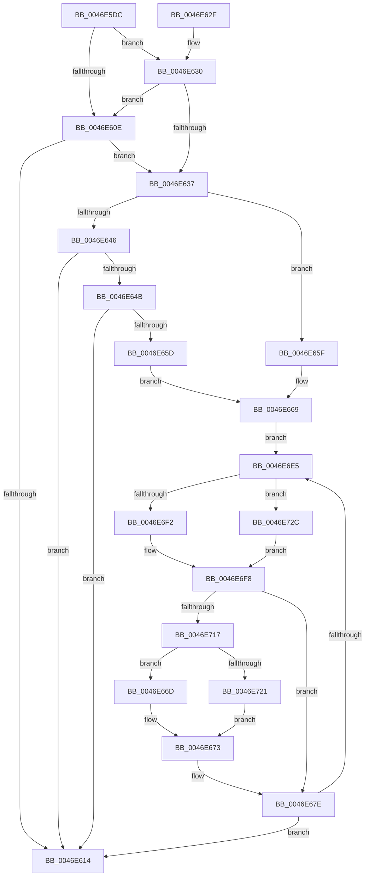

# KiUpdateThreadSchedulingProperties

- RVA: `0x0046E5DC`–`0x0046E739` (길이 `349` bytes)
- VA: `0x000000014046E5DC`
- 실행 섹션: `.text`
- PDB 이름 있음: `예`; PDB Function 태그: `아니요`
- unwind 정보 RVA: `0x000ABB50`
- 디코드: `100`개 명령, `349/349` bytes 표시
- 미해석 바이트: `0` (있으면 어셈블리에 `.byte`로 보존)

> 이 문서는 커널 이미지의 기계어와 PDB 기호를 분석해 생성했습니다. 4번과 5번은 함수 원형과 자료형을 바이너리 사용 방식에서 추정한 C 해석이며 원본 소스 복구 결과는 아닙니다.

## 1. Dependencies

- 직접 호출 지점: **5**; 고유 호출 대상: **5**
- 직접 호출자로 확인된 함수: **2**
- RIP 상대 이미지 참조: **2**

### Outgoing calls
- `0x0046E603` → [KiUpdateSharedReadyQueueAffinityThread](../2C/KiUpdateSharedReadyQueueAffinityThread_function_002CE470.md) (function, `0x002CE470`)
- `0x0046E679` → [KiSetSchedulerAssistPriority](KiSetSchedulerAssistPriority_function_0046E740.md) (function, `0x0046E740`)
- `0x0046E6CA` → [KiUpdateThreadQosGroupingSummaries](../25/KiUpdateThreadQosGroupingSummaries_function_00257AEC.md) (function, `0x00257AEC`)
- `0x0046E6D2` → [KiUpdateStandbyStealSummaryForStandbyChange](../25/KiUpdateStandbyStealSummaryForStandbyChange_function_00257A80.md) (function, `0x00257A80`)
- `0x0046E732` → [KiQueryEffectivePriorityThread](../25/KiQueryEffectivePriorityThread_function_00257BA0.md) (function, `0x00257BA0`)

### Direct callers
- [KiRemoveThreadFromSchedulingGroup](../35/KiRemoveThreadFromSchedulingGroup_function_00356514.md) at `0x003565CE`
- [KiRemoveThreadFromSchedulingGroup](../35/KiRemoveThreadFromSchedulingGroup_function_00356514.md) at `0x00356653`
- [KiSetThreadSchedulingGroup](KiSetThreadSchedulingGroup_function_0046E458.md) at `0x0046E510`

### Static image references
- `0x0046E66D` → RVA `0x00FC504C` (`ALMOSTRO`; read)
- `0x0046E6B4` → RVA `0x00FC537C` (`ALMOSTRO`; read)

## 2. Other-region calls and transfers

- 다른 실행 섹션으로 향하는 call: **0**
- 별도 외부 분기/꼬리 이동을 확인하지 못했습니다.

## 3. Assembly (complete function range)

```asm
0046E5DC  48 8B C4                        mov rax, rsp
0046E5DF  48 89 58 08                     mov qword ptr [rax + 8], rbx
0046E5E3  48 89 68 10                     mov qword ptr [rax + 0x10], rbp
0046E5E7  48 89 70 18                     mov qword ptr [rax + 0x18], rsi
0046E5EB  48 89 78 20                     mov qword ptr [rax + 0x20], rdi
0046E5EF  41 56                           push r14
0046E5F1  48 83 EC 30                     sub rsp, 0x30
0046E5F5  48 8B D9                        mov rbx, rcx
0046E5F8  44 8A DA                        mov r11b, dl
0046E5FB  48 8B D1                        mov rdx, rcx
0046E5FE  4D 8B D0                        mov r10, r8
0046E601  33 C9                           xor ecx, ecx
0046E603  E8 68 FE E5 FF                  call 0x1402ce470
0046E608  41 80 FB 02                     cmp r11b, 2
0046E60C  74 22                           je 0x14046e630
0046E60E  41 80 FB 03                     cmp r11b, 3
0046E612  74 23                           je 0x14046e637
0046E614  48 8B 5C 24 40                  mov rbx, qword ptr [rsp + 0x40]
0046E619  48 8B 6C 24 48                  mov rbp, qword ptr [rsp + 0x48]
0046E61E  48 8B 74 24 50                  mov rsi, qword ptr [rsp + 0x50]
0046E623  48 8B 7C 24 58                  mov rdi, qword ptr [rsp + 0x58]
0046E628  48 83 C4 30                     add rsp, 0x30
0046E62C  41 5E                           pop r14
0046E62E  C3                              ret
0046E62F  CC                              int3
0046E630  49 83 7A 10 00                  cmp qword ptr [r10 + 0x10], 0
0046E635  75 D7                           jne 0x14046e60e
0046E637  8B 4B 78                        mov ecx, dword ptr [rbx + 0x78]
0046E63A  D1 E9                           shr ecx, 1
0046E63C  4C 89 54 24 20                  mov qword ptr [rsp + 0x20], r10
0046E641  83 E1 01                        and ecx, 1
0046E644  74 19                           je 0x14046e65f
0046E646  83 F9 01                        cmp ecx, 1
0046E649  75 C9                           jne 0x14046e614
0046E64B  49 8B 82 58 8E 00 00            mov rax, qword ptr [r10 + 0x8e58]
0046E652  0F B6 08                        movzx ecx, byte ptr [rax]
0046E655  48 8D 70 08                     lea rsi, [rax + 8]
0046E659  85 C9                           test ecx, ecx
0046E65B  74 B7                           je 0x14046e614
0046E65D  EB 0A                           jmp 0x14046e669
0046E65F  48 8D 74 24 20                  lea rsi, [rsp + 0x20]
0046E664  B9 01 00 00 00                  mov ecx, 1
0046E669  8B E9                           mov ebp, ecx
0046E66B  EB 78                           jmp 0x14046e6e5
0046E66D  8B 15 D9 69 B5 00               mov edx, dword ptr [rip + 0xb569d9]
0046E673  45 33 C0                        xor r8d, r8d
0046E676  48 8B C8                        mov rcx, rax
0046E679  E8 C2 00 00 00                  call 0x14046e740
0046E67E  8B 53 54                        mov edx, dword ptr [rbx + 0x54]
0046E681  44 8B 43 50                     mov r8d, dword ptr [rbx + 0x50]
0046E685  4C 8B 4F 38                     mov r9, qword ptr [rdi + 0x38]
0046E689  41 8A 41 40                     mov al, byte ptr [r9 + 0x40]
0046E68D  8A C8                           mov cl, al
0046E68F  32 8B 04 02 00 00               xor cl, byte ptr [rbx + 0x204]
0046E695  80 E1 07                        and cl, 7
0046E698  32 C1                           xor al, cl
0046E69A  8A 8B 05 02 00 00               mov cl, byte ptr [rbx + 0x205]
0046E6A0  C0 E1 03                        shl cl, 3
0046E6A3  32 C8                           xor cl, al
0046E6A5  80 E1 38                        and cl, 0x38
0046E6A8  32 C1                           xor al, cl
0046E6AA  48 8B CF                        mov rcx, rdi
0046E6AD  44 3B C2                        cmp r8d, edx
0046E6B0  44 0F 46 C2                     cmovbe r8d, edx
0046E6B4  44 3B 05 C1 6C B5 00            cmp r8d, dword ptr [rip + 0xb56cc1]
0046E6BB  1A D2                           sbb dl, dl
0046E6BD  24 BF                           and al, 0xbf
0046E6BF  F6 D2                           not dl
0046E6C1  80 E2 40                        and dl, 0x40
0046E6C4  0A C2                           or al, dl
0046E6C6  41 88 41 40                     mov byte ptr [r9 + 0x40], al
0046E6CA  E8 1D 94 DE FF                  call 0x140257aec
0046E6CF  48 8B CF                        mov rcx, rdi
0046E6D2  E8 A9 93 DE FF                  call 0x140257a80
0046E6D7  48 83 C6 08                     add rsi, 8
0046E6DB  48 83 ED 01                     sub rbp, 1
0046E6DF  0F 84 2F FF FF FF               je 0x14046e614
0046E6E5  F6 43 02 04                     test byte ptr [rbx + 2], 4
0046E6E9  48 8B 3E                        mov rdi, qword ptr [rsi]
0046E6EC  4C 8B 77 38                     mov r14, qword ptr [rdi + 0x38]
0046E6F0  75 3A                           jne 0x14046e72c
0046E6F2  8A 83 C3 00 00 00               mov al, byte ptr [rbx + 0xc3]
0046E6F8  8B 4B 78                        mov ecx, dword ptr [rbx + 0x78]
0046E6FB  24 7F                           and al, 0x7f
0046E6FD  D1 E9                           shr ecx, 1
0046E6FF  C0 E1 07                        shl cl, 7
0046E702  0A C8                           or cl, al
0046E704  41 88 0E                        mov byte ptr [r14], cl
0046E707  48 8B 87 B8 8E 00 00            mov rax, qword ptr [rdi + 0x8eb8]
0046E70E  48 85 C0                        test rax, rax
0046E711  0F 84 67 FF FF FF               je 0x14046e67e
0046E717  48 3B 5F 18                     cmp rbx, qword ptr [rdi + 0x18]
0046E71B  0F 84 4C FF FF FF               je 0x14046e66d
0046E721  0F B6 D1                        movzx edx, cl
0046E724  83 E2 7F                        and edx, 0x7f
0046E727  E9 47 FF FF FF                  jmp 0x14046e673
0046E72C  48 8B D7                        mov rdx, rdi
0046E72F  48 8B CB                        mov rcx, rbx
0046E732  E8 69 94 DE FF                  call 0x140257ba0
0046E737  EB BF                           jmp 0x14046e6f8
```

## 4. C-style interpretation (structured pseudocode)

```c
__int64 __fastcall KiUpdateThreadSchedulingProperties(__int64 a1, unsigned __int8 a2, __int64 a3)
{
    __int64 result;
    __int64 v_rbp;
    __int64 v_rsi;
    __int64 v_rsp;
    unsigned __int64 v_stack_p10;
    unsigned __int64 v_stack_p18;
    unsigned __int64 v_stack_p20;
    unsigned __int64 v_stack_p8;

    *(unsigned __int64 *)(v_rsp + 8) = v_rbx;
    *(unsigned __int64 *)(v_rsp + 16) = v_rbp;
    *(unsigned __int64 *)(v_rsp + 24) = v_rsi;
    *(unsigned __int64 *)(v_rsp + 32) = v_rdi;
    v_rsp = (v_rsp) - (48);
    a1 = 0;
    result = KiUpdateSharedReadyQueueAffinityThread(a1, a1, a3, a4);
    if (a2 == 2) goto loc_0046E630;
loc_0046E60E:
    if (a2 == 3) goto loc_0046E637;
loc_0046E614:
    v_rsp = (v_rsp) + (48);
    return result;
loc_0046E630:
    if ((*(unsigned __int64 *)(a3 + 16)) != 0) goto loc_0046E60E;
loc_0046E637:
    a1 = (unsigned int)(((unsigned int)(*(unsigned int *)(v_stack_p8 + 120))) >> (1));
    v_stack_p20 = a3;
    a1 = (unsigned int)((a1) & (1));
    if (condition_is_equal) goto loc_0046E65F;
    if (((unsigned int)(a1)) != 1) goto loc_0046E614;
    if ((unsigned int)(*(unsigned __int8 *)(*(unsigned __int64 *)(a3 + 36440))) == 0) goto loc_0046E614;
    goto loc_0046E669;
loc_0046E65F:
loc_0046E669:
    goto loc_0046E6E5;
loc_0046E66D:
loc_0046E673:
    a3 = 0;
    result = KiSetSchedulerAssistPriority(*(unsigned __int64 *)(a3 + 36440), (unsigned int)(*(unsigned int *)(v_rip + 11889113)), a3, a4);
loc_0046E67E:
    a1 = (unsigned __int8)(((unsigned __int8)(*(unsigned __int8 *)(*(unsigned __int64 *)(v_stack_p20 + 56) + 64))) ^ (*(unsigned __int8 *)(v_stack_p8 + 516)));
    a1 = (unsigned __int8)((a1) & (7));
    result = (unsigned __int8)((*(unsigned __int8 *)(*(unsigned __int64 *)(v_stack_p20 + 56) + 64)) ^ ((unsigned __int8)(a1)));
    a1 = (unsigned __int8)((*(unsigned __int8 *)(v_stack_p8 + 517)) << (3));
    a1 = (unsigned __int8)((a1) ^ ((unsigned __int8)(result)));
    a1 = (unsigned __int8)((a1) & (56));
    result = (unsigned __int8)((result) ^ ((unsigned __int8)(a1)));
    a3 = (unsigned int)(*(unsigned int *)(v_stack_p8 + 80));
    if (((unsigned int)((unsigned int)(*(unsigned int *)(v_stack_p8 + 80)))) <= ((unsigned int)((unsigned int)(*(unsigned int *)(v_stack_p8 + 84))))) { a3 = (unsigned int)((unsigned int)(*(unsigned int *)(v_stack_p8 + 84))); }
    result = (unsigned __int8)((result) & (191));
    a2 = (unsigned __int8)(~((unsigned int)(*(unsigned int *)(v_stack_p8 + 84))));
    a2 = (unsigned __int8)((a2) & (64));
    result = (unsigned __int8)((result) | (a2));
    *(unsigned __int8 *)(*(unsigned __int64 *)(v_stack_p20 + 56) + 64) = (unsigned __int8)(result);
    result = KiUpdateThreadQosGroupingSummaries(v_stack_p20, a2, a3, *(unsigned __int64 *)(v_stack_p20 + 56));
    result = KiUpdateStandbyStealSummaryForStandbyChange(v_stack_p20, a2, a3, *(unsigned __int64 *)(v_stack_p20 + 56));
    v_rsi = (v_stack_p20) + (8);
    v_rbp = (1) - (1);
    if (condition_is_equal) goto loc_0046E614;
loc_0046E6E5:
    if (((*(unsigned __int8 *)(v_stack_p8 + 2)) & (4)) != 0) goto loc_0046E72C;
loc_0046E6F8:
    result = (unsigned __int8)((*(unsigned __int8 *)(v_stack_p8 + 195)) & (127));
    a1 = (unsigned int)(((unsigned int)(*(unsigned int *)(v_stack_p8 + 120))) >> (1));
    a1 = (unsigned __int8)((a1) << (7));
    a1 = (unsigned __int8)((a1) | ((unsigned __int8)(result)));
    *(unsigned __int8 *)(*(unsigned __int64 *)(*(unsigned __int64 *)(v_rsi) + 56)) = (unsigned __int8)(a1);
    if (*(unsigned __int64 *)(*(unsigned __int64 *)(v_rsi) + 36536) == 0) goto loc_0046E67E;
    if (v_stack_p8 == (*(unsigned __int64 *)(*(unsigned __int64 *)(v_rsi) + 24))) goto loc_0046E66D;
    a2 = (unsigned int)(((unsigned __int8)(a1)) & (127));
    goto loc_0046E673;
loc_0046E72C:
    result = KiQueryEffectivePriorityThread(v_stack_p8, *(unsigned __int64 *)(v_rsi), a3, *(unsigned __int64 *)(v_stack_p20 + 56));
    goto loc_0046E6F8;
}
```

## 5. (Beta) C Style

```c
int64_t KiUpdateThreadSchedulingProperties(void *Arg1, uint8_t Arg2, int64_t Arg3)
{
    uint8_t *arg1 = (uint8_t *)Arg1;

    int64_t result;
    int64_t local_rbp;
    int64_t local_rsi;
    int64_t local_rsp;
    uint64_t v_stack_p10;
    uint64_t v_stack_p18;
    uint64_t v_stack_p20;
    uint64_t v_stack_p8;

    *(uint64_t *)(local_rsp + 0x8) = local_rbx;
    *(uint64_t *)(local_rsp + 0x10) = local_rbp;
    *(uint64_t *)(local_rsp + 0x18) = local_rsi;
    *(uint64_t *)(local_rsp + 0x20) = local_rdi;
    local_rsp = (local_rsp) - (48);
    Arg1 = 0;
    result = KiUpdateSharedReadyQueueAffinityThread(Arg1, Arg1, Arg3, a4);
    if (Arg2 == 2) goto loc_0046E630;
loc_0046E60E:
    if (Arg2 == 3) goto loc_0046E637;
loc_0046E614:
    local_rsp = (local_rsp) + (48);
    return result;
loc_0046E630:
    if ((*(uint64_t *)(Arg3 + 0x10)) != 0) goto loc_0046E60E;
loc_0046E637:
    Arg1 = (uint32_t)(((uint32_t)(*(uint32_t *)(v_stack_p8 + 0x78))) >> (1));
    v_stack_p20 = Arg3;
    Arg1 = (uint32_t)((Arg1) & (1));
    if (condition_is_equal) goto loc_0046E65F;
    if (((uint32_t)(Arg1)) != 1) goto loc_0046E614;
    if ((uint32_t)(*(uint8_t *)(*(uint64_t *)(Arg3 + 0x8E58))) == 0) goto loc_0046E614;
    goto loc_0046E669;
loc_0046E65F:
loc_0046E669:
    goto loc_0046E6E5;
loc_0046E66D:
loc_0046E673:
    Arg3 = 0;
    result = KiSetSchedulerAssistPriority(*(uint64_t *)(Arg3 + 0x8E58), (uint32_t)(*(uint32_t *)(v_rip + 0xB569D9)), Arg3, a4);
loc_0046E67E:
    Arg1 = (uint8_t)(((uint8_t)(*(uint8_t *)(*(uint64_t *)(v_stack_p20 + 0x38) + 0x40))) ^ (*(uint8_t *)(v_stack_p8 + 0x204)));
    Arg1 = (uint8_t)((Arg1) & (7));
    result = (uint8_t)((*(uint8_t *)(*(uint64_t *)(v_stack_p20 + 0x38) + 0x40)) ^ ((uint8_t)(Arg1)));
    Arg1 = (uint8_t)((*(uint8_t *)(v_stack_p8 + 0x205)) << (3));
    Arg1 = (uint8_t)((Arg1) ^ ((uint8_t)(result)));
    Arg1 = (uint8_t)((Arg1) & (56));
    result = (uint8_t)((result) ^ ((uint8_t)(Arg1)));
    Arg3 = (uint32_t)(*(uint32_t *)(v_stack_p8 + 0x50));
    if (((uint32_t)((uint32_t)(*(uint32_t *)(v_stack_p8 + 0x50)))) <= ((uint32_t)((uint32_t)(*(uint32_t *)(v_stack_p8 + 0x54))))) { Arg3 = (uint32_t)((uint32_t)(*(uint32_t *)(v_stack_p8 + 0x54))); }
    result = (uint8_t)((result) & (191));
    Arg2 = (uint8_t)(~((uint32_t)(*(uint32_t *)(v_stack_p8 + 0x54))));
    Arg2 = (uint8_t)((Arg2) & (64));
    result = (uint8_t)((result) | (Arg2));
    *(uint8_t *)(*(uint64_t *)(v_stack_p20 + 0x38) + 0x40) = (uint8_t)(result);
    result = KiUpdateThreadQosGroupingSummaries(v_stack_p20, Arg2, Arg3, *(uint64_t *)(v_stack_p20 + 0x38));
    result = KiUpdateStandbyStealSummaryForStandbyChange(v_stack_p20, Arg2, Arg3, *(uint64_t *)(v_stack_p20 + 0x38));
    local_rsi = (v_stack_p20) + (8);
    local_rbp = (1) - (1);
    if (condition_is_equal) goto loc_0046E614;
loc_0046E6E5:
    if (((*(uint8_t *)(v_stack_p8 + 0x2)) & (4)) != 0) goto loc_0046E72C;
loc_0046E6F8:
    result = (uint8_t)((*(uint8_t *)(v_stack_p8 + 0xC3)) & (127));
    Arg1 = (uint32_t)(((uint32_t)(*(uint32_t *)(v_stack_p8 + 0x78))) >> (1));
    Arg1 = (uint8_t)((Arg1) << (7));
    Arg1 = (uint8_t)((Arg1) | ((uint8_t)(result)));
    *(uint8_t *)(*(uint64_t *)(*(uint64_t *)(local_rsi) + 0x38)) = (uint8_t)(Arg1);
    if (*(uint64_t *)(*(uint64_t *)(local_rsi) + 0x8EB8) == 0) goto loc_0046E67E;
    if (v_stack_p8 == (*(uint64_t *)(*(uint64_t *)(local_rsi) + 0x18))) goto loc_0046E66D;
    Arg2 = (uint32_t)(((uint8_t)(Arg1)) & (127));
    goto loc_0046E673;
loc_0046E72C:
    result = KiQueryEffectivePriorityThread(v_stack_p8, *(uint64_t *)(local_rsi), Arg3, *(uint64_t *)(v_stack_p20 + 0x38));
    goto loc_0046E6F8;
}
```

### 관측된 메모리 오프셋

구조체 형식이 확인되지 않은 접근은 인자 기준의 오프셋으로만 기록했습니다.

| 기준 인자 | 오프셋 표현 | 폭 (bit) | 접근 |
|---|---:|---:|---|
| `Arg1` | `+ 0x78` | `32` | `R` |

## 6. Execution-region graph

[열기: 2D/3D 그래프와 함수 탐색 컨트롤 패널](../../../control-panel.html?section=text&rva=0x0046E5DC&view=graph)

- 2D 그래프는 위에서 아래로 흐르고, 3D 그래프는 빈 공간을 드래그해 회전합니다. Shift+드래그는 이동, 휠은 확대·축소, 함수 노드 선택은 대상 보고서 이동입니다.

### Static fallback


