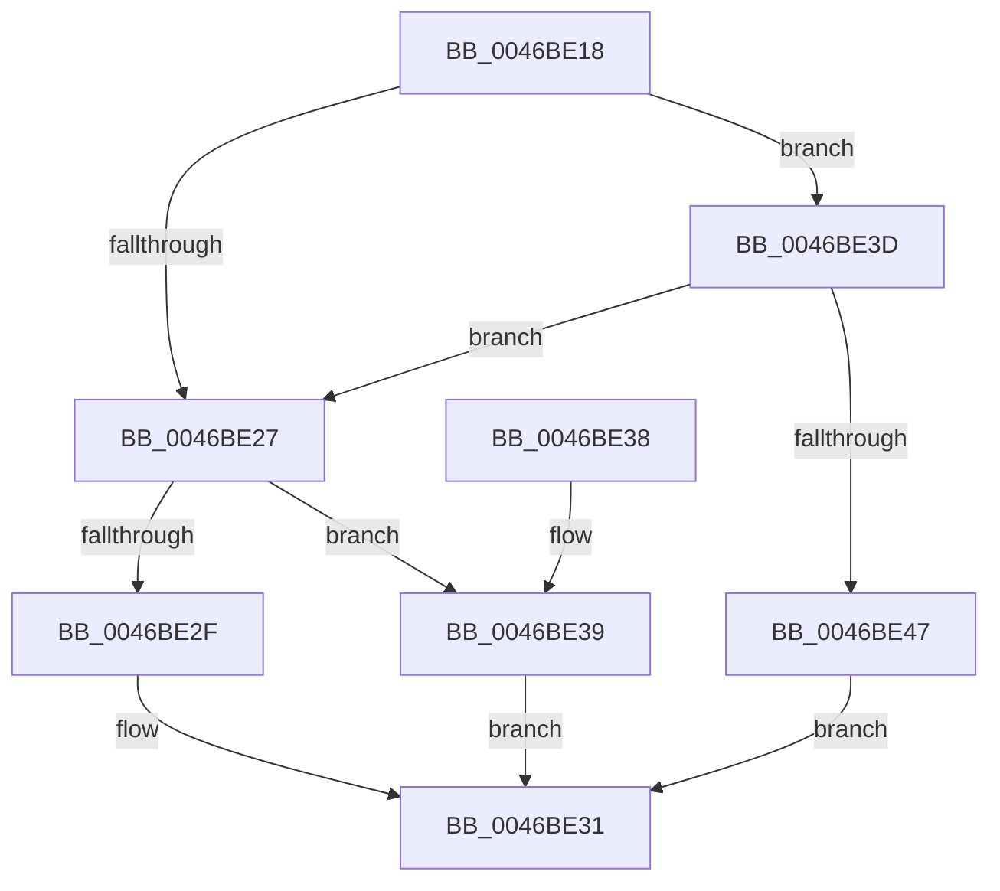

# KxTryToAcquireSpinLock

- RVA: `0x0046BE18`–`0x0046BE50` (길이 `56` bytes)
- VA: `0x000000014046BE18`
- 실행 섹션: `.text`
- PDB 이름 있음: `예`; PDB Function 태그: `아니요`
- unwind 정보 RVA: `0x0006DBD4`
- 디코드: `19`개 명령, `56/56` bytes 표시
- 미해석 바이트: `0` (있으면 어셈블리에 `.byte`로 보존)

> 이 문서는 커널 이미지의 기계어와 PDB 기호를 분석해 생성했습니다. 4번과 5번은 함수 원형과 자료형을 바이너리 사용 방식에서 추정한 C 해석이며 원본 소스 복구 결과는 아닙니다.

## 1. Dependencies

- 직접 호출 지점: **1**; 고유 호출 대상: **1**
- 직접 호출자로 확인된 함수: **17**
- RIP 상대 이미지 참조: **2**

### Outgoing calls
- `0x0046BE47` → [KiTryToAcquireSpinLockInstrumented](KiTryToAcquireSpinLockInstrumented_function_0046BE58.md) (function, `0x0046BE58`)

### Direct callers
- [KiRcuReportQuiescentState](../20/KiRcuReportQuiescentState_function_0020AB8C.md) at `0x0020ABD8`
- [KiRcuFlushCompleted](../20/KiRcuFlushCompleted_function_0020AD38.md) at `0x0020AD9E`
- [EtwpTraceStackKey](../3F/EtwpTraceStackKey_function_003FC290.md) at `0x003FC4F6`
- [EtwpCovSampTryAcquireBufferLock](../43/EtwpCovSampTryAcquireBufferLock_function_0043C5CC.md) at `0x0043C61D`
- [KeTryToAcquireSpinLockAtDpcLevel](KeTryToAcquireSpinLockAtDpcLevel_function_0046BE00.md) at `0x0046BE04`
- [EtwpGetCrimsonStackKey](../4D/EtwpGetCrimsonStackKey_function_004D68CC.md) at `0x004D6998`
- [KeFreezeExecution](../4D/KeFreezeExecution_function_004DFA40.md) at `0x004DFAFA`
- [HalpHandleMachineCheck](../54/HalpHandleMachineCheck_function_005413C8.md) at `0x00541430`
- [HalpMceHandlerCore](../54/HalpMceHandlerCore_function_00542038.md) at `0x005420E8`
- [IvtHandleInterrupt](../56/IvtHandleInterrupt_function_0056FF00.md) at `0x005700D1`
- [KiProcessNMI](../5B/KiProcessNMI_function_005B8950.md) at `0x005B8A34`
- [KiSrcuFlushCompleted](../5C/KiSrcuFlushCompleted_function_005C22B4.md) at `0x005C22FE`
- [KiSrcuReportQuiescent](../5C/KiSrcuReportQuiescent_function_005C2C08.md) at `0x005C2C7D`
- [PopFxComponentRelationsCleanup](../5D/PopFxComponentRelationsCleanup_function_005D221C.md) at `0x005D228F`
- [PopFxComponentRelationsCleanup](../5D/PopFxComponentRelationsCleanup_function_005D221C.md) at `0x005D2389`
- [PopFxDeviceRelationsCleanup](../5D/PopFxDeviceRelationsCleanup_function_005D2660.md) at `0x005D2710`
- [DifKeTryToAcquireSpinLockAtDpcLevelWrapper](../63/DifKeTryToAcquireSpinLockAtDpcLevelWrapper_function_00633390.md) at `0x0063345D`
- [sub_006E5E2E](../6E/Unknown_function_006E5E2E.md) at `0x006E5E93`

### Static image references
- `0x0046BE1E` → RVA `0x00FC6B06` (`ALMOSTRO`; read)
- `0x0046BE3D` → RVA `0x00F0DE58` (`.data`; read)

## 2. Other-region calls and transfers

- 다른 실행 섹션으로 향하는 call: **0**
- 별도 외부 분기/꼬리 이동을 확인하지 못했습니다.

## 3. Assembly (complete function range)

```asm
0046BE18  48 83 EC 28                     sub rsp, 0x28
0046BE1C  33 D2                           xor edx, edx
0046BE1E  F6 05 E1 AC B5 00 21            test byte ptr [rip + 0xb5ace1], 0x21
0046BE25  75 16                           jne 0x14046be3d
0046BE27  F0 48 0F BA 29 00               lock bts qword ptr [rcx], 0
0046BE2D  73 0A                           jae 0x14046be39
0046BE2F  F3 90                           pause
0046BE31  8A C2                           mov al, dl
0046BE33  48 83 C4 28                     add rsp, 0x28
0046BE37  C3                              ret
0046BE38  CC                              int3
0046BE39  B2 01                           mov dl, 1
0046BE3B  EB F4                           jmp 0x14046be31
0046BE3D  8B 05 15 20 AA 00               mov eax, dword ptr [rip + 0xaa2015]
0046BE43  85 C0                           test eax, eax
0046BE45  75 E0                           jne 0x14046be27
0046BE47  E8 0C 00 00 00                  call 0x14046be58
0046BE4C  8A D0                           mov dl, al
0046BE4E  EB E1                           jmp 0x14046be31
```

## 4. C-style interpretation (structured pseudocode)

```c
__int64 __fastcall KxTryToAcquireSpinLock(__int64 a1, int a2)
{
    __int64 result;
    __int64 v_rsp;

    v_rsp = (v_rsp) - (40);
    a2 = 0;
    if (((*(unsigned __int8 *)(v_rip + 11906273)) & (33)) != 0) goto loc_0046BE3D;
loc_0046BE27:
    if (condition_is_above_or_equal) goto loc_0046BE39;
loc_0046BE31:
    v_rsp = (v_rsp) + (40);
    return 0;
loc_0046BE39:
    goto loc_0046BE31;
loc_0046BE3D:
    if ((unsigned int)((unsigned int)(*(unsigned int *)(v_rip + 11149333))) != 0) goto loc_0046BE27;
    result = KiTryToAcquireSpinLockInstrumented(a1, 1, a3, a4);
    goto loc_0046BE31;
}
```

## 5. (Beta) C Style

```c
int64_t KxTryToAcquireSpinLock(void *Arg1, int32_t Arg2)
{
    uint8_t *arg1 = (uint8_t *)Arg1;

    int64_t result;
    int64_t local_rsp;

    local_rsp = (local_rsp) - (40);
    Arg2 = 0;
    if (((*(uint8_t *)(v_rip + 0xB5ACE1)) & (33)) != 0) goto loc_0046BE3D;
loc_0046BE27:
    if (condition_is_above_or_equal) goto loc_0046BE39;
loc_0046BE31:
    local_rsp = (local_rsp) + (40);
    return 0;
loc_0046BE39:
    goto loc_0046BE31;
loc_0046BE3D:
    if ((uint32_t)((uint32_t)(*(uint32_t *)(v_rip + 0xAA2015))) != 0) goto loc_0046BE27;
    result = KiTryToAcquireSpinLockInstrumented(Arg1, 1, a3, a4);
    goto loc_0046BE31;
}
```

### 관측된 메모리 오프셋

구조체 형식이 확인되지 않은 접근은 인자 기준의 오프셋으로만 기록했습니다.

| 기준 인자 | 오프셋 표현 | 폭 (bit) | 접근 |
|---|---:|---:|---|
| `Arg1` | `+ 0x0` | `64` | `R/W` |

## 6. Execution-region graph

[열기: 2D/3D 그래프와 함수 탐색 컨트롤 패널](../../../control-panel.html?section=text&rva=0x0046BE18&view=graph)

- 2D 그래프는 위에서 아래로 흐르고, 3D 그래프는 빈 공간을 드래그해 회전합니다. Shift+드래그는 이동, 휠은 확대·축소, 함수 노드 선택은 대상 보고서 이동입니다.

### Static fallback


