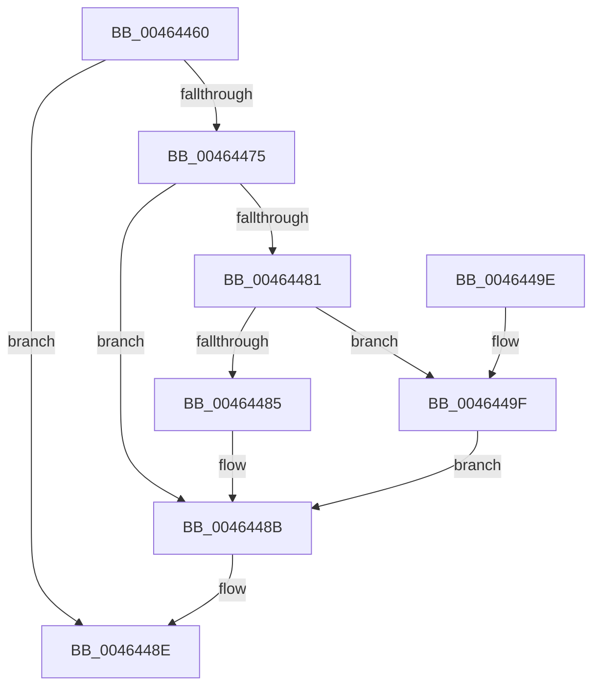

# MI_CLEAR_RESET_PTE

- RVA: `0x00464460`–`0x004644A5` (길이 `69` bytes)
- VA: `0x0000000140464460`
- 실행 섹션: `.text`
- PDB 이름 있음: `예`; PDB Function 태그: `아니요`
- unwind 정보 RVA: `0x0006CC84`
- 디코드: `24`개 명령, `69/69` bytes 표시
- 미해석 바이트: `0` (있으면 어셈블리에 `.byte`로 보존)

> 이 문서는 커널 이미지의 기계어와 PDB 기호를 분석해 생성했습니다. 4번과 5번은 함수 원형과 자료형을 바이너리 사용 방식에서 추정한 C 해석이며 원본 소스 복구 결과는 아닙니다.

## 1. Dependencies

- 직접 호출 지점: **2**; 고유 호출 대상: **2**
- 직접 호출자로 확인된 함수: **1**
- RIP 상대 이미지 참조: **1**

### Outgoing calls
- `0x00464469` → [MI_READ_PTE_LOCK_FREE](../28/MI_READ_PTE_LOCK_FREE_function_002828A0.md) (function, `0x002828A0`)
- `0x00464490` → [MiSwizzleInvalidPte](../28/MiSwizzleInvalidPte_function_0028F5E0.md) (function, `0x0028F5E0`)

### Direct callers
- [MiActOnPte](../24/MiActOnPte_function_00244C90.md) at `0x00245240`

### Static image references
- `0x00464475` → RVA `0x00E2DC80` (`.data`; read)

## 2. Other-region calls and transfers

- 다른 실행 섹션으로 향하는 call: **0**
- 별도 외부 분기/꼬리 이동을 확인하지 못했습니다.

## 3. Assembly (complete function range)

```asm
00464460  40 53                           push rbx
00464462  48 83 EC 20                     sub rsp, 0x20
00464466  48 8B D9                        mov rbx, rcx
00464469  E8 32 E4 E1 FF                  call 0x1402828a0
0046446E  33 D2                           xor edx, edx
00464470  48 85 C0                        test rax, rax
00464473  74 19                           je 0x14046448e
00464475  48 8B 0D 04 98 9C 00            mov rcx, qword ptr [rip + 0x9c9804]
0046447C  48 85 C9                        test rcx, rcx
0046447F  74 0A                           je 0x14046448b
00464481  A8 10                           test al, 0x10
00464483  75 1A                           jne 0x14046449f
00464485  48 F7 D1                        not rcx
00464488  48 23 C1                        and rax, rcx
0046448B  48 8B D0                        mov rdx, rax
0046448E  8B CA                           mov ecx, edx
00464490  E8 4B B1 E2 FF                  call 0x14028f5e0
00464495  48 89 03                        mov qword ptr [rbx], rax
00464498  48 83 C4 20                     add rsp, 0x20
0046449C  5B                              pop rbx
0046449D  C3                              ret
0046449E  CC                              int3
0046449F  48 83 E0 EF                     and rax, 0xffffffffffffffef
004644A3  EB E6                           jmp 0x14046448b
```

## 4. C-style interpretation (structured pseudocode)

```c
__int64 __fastcall MI_CLEAR_RESET_PTE(__int64 a1, int a2)
{
    __int64 result;
    __int64 v_rsp;

    v_rsp = (v_rsp) - (32);
    result = MI_READ_PTE_LOCK_FREE(a1, a2, a3, a4);
    a2 = 0;
    if (result == 0) goto loc_0046448E;
    if (*(unsigned __int64 *)(v_rip + 10262532) == 0) goto loc_0046448B;
    if ((((unsigned __int8)(result)) & (16)) != 0) goto loc_0046449F;
    a1 = ~(*(unsigned __int64 *)(v_rip + 10262532));
    result = (result) & (a1);
loc_0046448B:
loc_0046448E:
    result = MiSwizzleInvalidPte((unsigned int)((unsigned int)(result)), result, a3, a4);
    *(unsigned __int64 *)(a1) = result;
    v_rsp = (v_rsp) + (32);
    return result;
loc_0046449F:
    result = (result) & (-17);
    goto loc_0046448B;
}
```

## 5. (Beta) C Style

```c
int64_t MI_CLEAR_RESET_PTE(void *Arg1, int32_t Arg2)
{
    uint8_t *arg1 = (uint8_t *)Arg1;

    int64_t result;
    int64_t local_rsp;

    local_rsp = (local_rsp) - (32);
    result = MI_READ_PTE_LOCK_FREE(Arg1, Arg2, a3, a4);
    Arg2 = 0;
    if (result == 0) goto loc_0046448E;
    if (*(uint64_t *)(v_rip + 0x9C9804) == 0) goto loc_0046448B;
    if ((((uint8_t)(result)) & (16)) != 0) goto loc_0046449F;
    Arg1 = ~(*(uint64_t *)(v_rip + 0x9C9804));
    result = (result) & (Arg1);
loc_0046448B:
loc_0046448E:
    result = MiSwizzleInvalidPte((uint32_t)((uint32_t)(result)), result, a3, a4);
    *(uint64_t *)(arg1) = result;
    local_rsp = (local_rsp) + (32);
    return result;
loc_0046449F:
    result = (result) & (-17);
    goto loc_0046448B;
}
```

### 관측된 메모리 오프셋

구조체 형식이 확인되지 않은 접근은 인자 기준의 오프셋으로만 기록했습니다.

| 기준 인자 | 오프셋 표현 | 폭 (bit) | 접근 |
|---|---:|---:|---|
| `Arg1` | `+ 0x0` | `64` | `W` |

## 6. Execution-region graph

[열기: 2D/3D 그래프와 함수 탐색 컨트롤 패널](../../../control-panel.html?section=text&rva=0x00464460&view=graph)

- 2D 그래프는 위에서 아래로 흐르고, 3D 그래프는 빈 공간을 드래그해 회전합니다. Shift+드래그는 이동, 휠은 확대·축소, 함수 노드 선택은 대상 보고서 이동입니다.

### Static fallback


